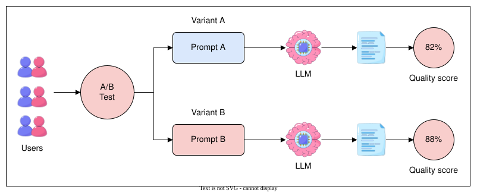

# Online_Evaluation_and_Drift_Detection_in_Generative_AI_Systems

Source: https://www.educative.io/courses/generative-ai-system-design/online-evaluation-experiment-design-and-drift

---

[Home](https://www.educative.io/)

[Courses](https://www.educative.io/search?tab=courses)

[Grokking the Generative AI System Design Interview](https://www.educative.io/courses/generative-ai-system-design)

# Online Evaluation, Experiment Design, and Drift

Explore how to evaluate generative AI systems in production using online metrics and controlled experiments. Understand rollout strategies like A/B testing and canary deployments, and learn to detect semantic drift across inputs, outputs, and models. This lesson equips you to design reliable monitoring and release processes that maintain system quality amid real-world changes and non-deterministic behaviors.

We'll cover the following...

- [Production evaluation as a release system](https://www.educative.io/courses/generative-ai-system-design/online-evaluation-experiment-design-and-drift#Production-evaluation-as-a-release-system)
- [Online metrics and rollout mechanics](https://www.educative.io/courses/generative-ai-system-design/online-evaluation-experiment-design-and-drift#Online-metrics-and-rollout-mechanics)
  - [Comparing rollout mechanisms](https://www.educative.io/courses/generative-ai-system-design/online-evaluation-experiment-design-and-drift#Comparing-rollout-mechanisms)
    - [A/B testing](https://www.educative.io/courses/generative-ai-system-design/online-evaluation-experiment-design-and-drift#AB-testing)
    - [Canary deployments](https://www.educative.io/courses/generative-ai-system-design/online-evaluation-experiment-design-and-drift#Canary-deployments)
    - [Shadow traffic](https://www.educative.io/courses/generative-ai-system-design/online-evaluation-experiment-design-and-drift#Shadow-traffic)
- [Golden sets as release gates](https://www.educative.io/courses/generative-ai-system-design/online-evaluation-experiment-design-and-drift#Golden-sets-as-release-gates)
  - [Deterministic versus model-based evaluation gates](https://www.educative.io/courses/generative-ai-system-design/online-evaluation-experiment-design-and-drift#Deterministic-versus-model-based-evaluation-gates)
- [Drift and silent behavior changes](https://www.educative.io/courses/generative-ai-system-design/online-evaluation-experiment-design-and-drift#Drift-and-silent-behavior-changes)
- [Designing the operating model](https://www.educative.io/courses/generative-ai-system-design/online-evaluation-experiment-design-and-drift#Designing-the-operating-model)
- [Conclusion](https://www.educative.io/courses/generative-ai-system-design/online-evaluation-experiment-design-and-drift#Conclusion)

Passing every test in staging doesn’t guarantee that a generative application will perform well under live user traffic. Production systems encounter changing user behavior, updated knowledge sources, model provider changes, and non-deterministic outputs that static tests may not capture.

Offline evaluation helps catch known regressions before release, but production evaluation answers a different question: how does the system perform for real users over time? This lesson focuses on measuring online outcomes, designing reliable experiments, and detecting changes in system behavior.

## Production evaluation as a release system[#](https://www.educative.io/courses/generative-ai-system-design/online-evaluation-experiment-design-and-drift#Production-evaluation-as-a-release-system)

A production GenAI stack routes a request through retrieval, prompt assembly, model inference, post-processing, and sometimes tool execution. Evaluation has to sit across that whole path, not only at the model layer. The release unit is therefore the entire serving configuration.

A simple rule works well in interviews. If a change can alter the answer, the refusal, the tool call, the latency, or the cost, it must enter the same release pipeline.

The operating life cycle usually contains these control points.

- **Predeploy gate:** The candidate configuration runs against a versioned regression suite before any user sees it.
- **Exposure control:** Traffic is mirrored, sampled, or gradually shifted so the candidate sees realistic load without immediate full blast radius.
- **Online measurement:** The serving layer emits metrics and traces sliced by version and cohort.
- **Rollback ownership:** The on-call or release owner has preapproved thresholds and can revert without waiting for a debate.

**Note:** Senior interview answers get stronger when they mention release criteria and operational ownership, not just “we monitor quality.”

The system behaves like a circuit breaker around model quality. Offline checks filter obvious regressions, rollout mechanics limit blast radius, and online metrics determine whether the change keeps expanding or gets reversed. That leads directly to the mechanics of measurement and rollout.

## Online metrics and rollout mechanics[#](https://www.educative.io/courses/generative-ai-system-design/online-evaluation-experiment-design-and-drift#Online-metrics-and-rollout-mechanics)

The first production question is simple. What signals decide whether traffic should keep flowing to the candidate?

For GenAI, online metrics come from both user outcomes and serving behavior. You usually segment every metric by model version, prompt version, cohort, and traffic slice so that mixed traffic does not hide a regression.

The most common metrics are listed below.

- **Task success:** This measures whether the system completed the intended job using business proxies such as issue resolution, successful workflow completion, or downstream conversion.
- **Explicit and implicit feedback:** This combines ratings with behavioral signals such as abandonment, regenerate frequency, edit rate, or reopening a support case.
- **Escalation rate:** This counts sessions that required human takeover, compliance review, or safety intervention.
- **Cost per request:** This tracks token usage, tool invocations, and any retrieval or judge-model overhead attached to the request path.
- **Latency percentiles:** This uses P50 and P95 because averages hide long-tail stalls caused by retrieval misses, retries, or verbose outputs.

### Comparing rollout mechanisms[#](https://www.educative.io/courses/generative-ai-system-design/online-evaluation-experiment-design-and-drift#Comparing-rollout-mechanisms)

Classical feature tests assume deterministic behavior. GenAI systems do not. The same input can produce different valid outputs, which raises variance and increases sample size requirements.

#### A/B testing[#](https://www.educative.io/courses/generative-ai-system-design/online-evaluation-experiment-design-and-drift#AB-testing)

A/B experimentation splits production traffic across control and candidate cohorts through randomized assignment, measuring downstream business metrics over extended periods. It quantifies real user impact such as conversion rates and ticket resolution times. The primary challenge is prolonged convergence time caused by non-deterministic model variance, requiring large sample sizes. It fits critical revenue workflows and core task optimization services.

A/B testing GenAI variants

#### Canary deployments[#](https://www.educative.io/courses/generative-ai-system-design/online-evaluation-experiment-design-and-drift#Canary-deployments)

Canary deployments route a small fraction of live traffic, typically two to five percent, to the candidate system while the majority stays on the baseline. This provides authentic user validation with a bounded blast radius and automated rollback protection. However, detecting rare edge cases or subtle policy violations requires high query volumes. Canaries are the standard choice for low-risk conversational bots and internal copilots.

Safe traffic testing with canary deployment

#### Shadow traffic[#](https://www.educative.io/courses/generative-ai-system-design/online-evaluation-experiment-design-and-drift#Shadow-traffic)

Shadow traffic clones live user requests to the candidate pipeline in parallel without returning candidate completions to users. This eliminates user-facing risk while validating response quality, schema compliance, and tail latency under realistic concurrency. The main drawback is compute cost inflation from running duplicate model inferences. Shadowing is ideal for high-risk changes such as embedding migrations and vector index refactoring.

Shadow traffic in action

1.

Why is shadow traffic preferred over A/B testing when deploying infrastructure or embedding model upgrades?

Show Answer

Did you find this helpful?

That rollout machinery still needs a hard gate before traffic moves at all, which is where golden sets enter.

## Golden sets as release gates[#](https://www.educative.io/courses/generative-ai-system-design/online-evaluation-experiment-design-and-drift#Golden-sets-as-release-gates)

Offline evaluation complements production monitoring. Golden sets help detect regressions against known examples, while judge calibration checks whether LLM-based evaluations align with human judgments. However, offline evaluations cannot capture every change in real-world traffic or user behavior, so online metrics and drift detection remain necessary.

### Deterministic versus model-based evaluation gates[#](https://www.educative.io/courses/generative-ai-system-design/online-evaluation-experiment-design-and-drift#Deterministic-versus-model-based-evaluation-gates)

Production monitoring complements the evaluation gates used before release. **Deterministic checks** verify requirements with clear, measurable outcomes, such as schema validity, required fields, citation presence, and tool-call argument validity. They are fast, reproducible, and useful for catching known failure conditions.

**Model-based evaluators**, such as LLM judges, assess qualities that are harder to capture with fixed rules, including relevance, answer completeness, and instruction following. However, model-based evaluations can be inconsistent and should be validated against human judgments.

Combining both approaches helps catch different types of failures: deterministic checks enforce explicit requirements, while model-based evaluators assess more subjective qualities.

For details on designing these checks, golden sets, calibrating judges, and combining them into offline evaluation gates, see “*LLM-as-Judge and the Offline Eval Harness*.”

Passing every predeploy gate confirms that known failure modes are handled, but once software meets live production traffic, unexpected shifts in user behavior and model outputs inevitably emerge.

## Drift and silent behavior changes[#](https://www.educative.io/courses/generative-ai-system-design/online-evaluation-experiment-design-and-drift#Drift-and-silent-behavior-changes)

Drift represents the gradual divergence between system behavior and user reality. Unlike traditional software crashes that trigger alert thresholds, semantic drift occurs silently while response status codes report complete success.

Production agent and RAG architectures monitor four discrete drift vectors.

- **Input distribution drift:** Occurs when user terminology, seasonal interests, regional languages, or inquiry complexity shifts over time, causing prompt templates to misinterpret intent. Monitoring query topics, language distributions, and embedding distributions helps identify these shifts.
- **Output behavior drift:** Occurs when completion lengths, refusal rates, or tool-calling distributions change, indicating that model generation has become overly verbose or defensive. Tracking these metrics against established baselines highlights unexpected changes.
- **Retrieval index drift:** Occurs when knowledge base updates, deleted documents, or stale embeddings degrade retrieval relevance, leaving the model with insufficient evidence. Monitoring Recall@k, ranking relevance, and stale document rates helps reveal retrieval degradation.
- **Provider model drift:** Occurs when third-party hosted model providers update underlying model checkpoints, altering instruction following, reasoning depth, or formatting habits without changing the endpoint name. Periodic golden-set evaluations reveal changes in task success, output formats, and latency.

The diagram below illustrates the monitoring loop that detects semantic drift across production traffic.

Production drift monitoring with an automated release circuit breaker

1.

How do provider checkpoint updates trigger silent production regressions?

Show Answer

Did you find this helpful?

## Designing the operating model[#](https://www.educative.io/courses/generative-ai-system-design/online-evaluation-experiment-design-and-drift#Designing-the-operating-model)

A staff-level answer describes a layered release life cycle and names who owns each decision. The system starts with offline regression gates, then runs shadow validation on real traffic, then exposes a low-percentage canary, then uses guarded A/B testing where user-impact estimation is needed, and finally reaches full rollout under continuous drift monitoring.

Maintaining production reliability requires unifying all generative dependencies into a single deployable artifact. Changing a prompt template without tracking the associated embedding model, chunking configuration, tool schemas, and model checkpoint makes post-incident analysis impossible.

A production release bundle binds five immutable elements.

- **Prompt template hash:** The exact parameterized prompt template version used for execution.
- **Model checkpoint tag:** The specific provider checkpoint, parameter scale, and quantization level.
- **Retrieval index identifier:** The vector database namespace, embedding model version, and chunking strategy version.
- **Tool schema manifest:** The registered definitions and parameter schemas for all callable tools.
- **Decoding parameter profile:** The temperature, top-p, stop sequences, and maximum token ceilings.

Every outgoing request trace records this configuration hash. When production telemetry detects degraded task completion or rising escalations, on-call engineers can roll back the entire bundle to a previous stable hash with a single configuration flag.

AI Powered

Saved

15 attempts left

Reset

Online evaluation and drift detection

Test your understanding of online evaluation, golden sets, rollout strategies, and drift detection in GenAI systems. Answer three production-focused questions to assess your knowledge of real-world System Design decisions. Say “Hi” to Ed below to start.

You have 15 attempts to answer.

## Conclusion[#](https://www.educative.io/courses/generative-ai-system-design/online-evaluation-experiment-design-and-drift#Conclusion)

Production evaluation is a continuous operational discipline that protects platforms against non-deterministic failures, silent semantic drift, and unannounced provider changes. Offline benchmarks provide baseline confidence, but only controlled online rollouts reveal real-world impact.

Resilient architectures enforce deterministic release gates via versioned golden sets, mitigate deployment risk through shadow and canary routing, continuously track online outcome metrics across rolling windows, and bind prompts, models, and retrieval configurations into unified immutable bundles.

With online evaluation, golden sets, and drift monitoring established, the next lesson explores production observability and telemetry architecture, examining how to design high-throughput distributed tracing, structured logging, and automated feedback ingestion pipelines across enterprise GenAI platforms.

LLM-as-Judge and the Offline Eval Harness

Observability and Feedback Loops

Ask

[Production evaluation as a release system](https://www.educative.io/courses/generative-ai-system-design/online-evaluation-experiment-design-and-drift#Production-evaluation-as-a-release-system)

[Online metrics and rollout mechanics](https://www.educative.io/courses/generative-ai-system-design/online-evaluation-experiment-design-and-drift#Online-metrics-and-rollout-mechanics)

[Comparing rollout mechanisms](https://www.educative.io/courses/generative-ai-system-design/online-evaluation-experiment-design-and-drift#Comparing-rollout-mechanisms)

[A/B testing](https://www.educative.io/courses/generative-ai-system-design/online-evaluation-experiment-design-and-drift#AB-testing)

[Canary deployments](https://www.educative.io/courses/generative-ai-system-design/online-evaluation-experiment-design-and-drift#Canary-deployments)

[Shadow traffic](https://www.educative.io/courses/generative-ai-system-design/online-evaluation-experiment-design-and-drift#Shadow-traffic)

[Golden sets as release gates](https://www.educative.io/courses/generative-ai-system-design/online-evaluation-experiment-design-and-drift#Golden-sets-as-release-gates)

[Deterministic versus model-based evaluation gates](https://www.educative.io/courses/generative-ai-system-design/online-evaluation-experiment-design-and-drift#Deterministic-versus-model-based-evaluation-gates)

[Drift and silent behavior changes](https://www.educative.io/courses/generative-ai-system-design/online-evaluation-experiment-design-and-drift#Drift-and-silent-behavior-changes)

[Designing the operating model](https://www.educative.io/courses/generative-ai-system-design/online-evaluation-experiment-design-and-drift#Designing-the-operating-model)

[Conclusion](https://www.educative.io/courses/generative-ai-system-design/online-evaluation-experiment-design-and-drift#Conclusion)