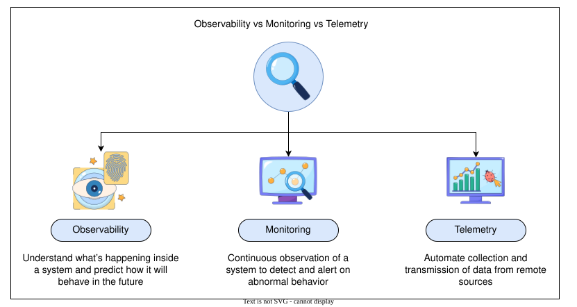

# Observability_and_Feedback_Loops_in_Generative_AI_Systems

Source: https://www.educative.io/courses/generative-ai-system-design/observability-and-feedback-loops

---

[Home](https://www.educative.io/)

[Courses](https://www.educative.io/search?tab=courses)

[Grokking the Generative AI System Design Interview](https://www.educative.io/courses/generative-ai-system-design)

# Observability and Feedback Loops

Understand how to design observability for multistep generative AI systems by tracing prompts, retrievals, tool calls, and outputs. Explore how feedback loops from explicit and implicit signals enable continuous improvement through prompt fixes, retrieval tuning, and policy updates while balancing privacy and operational stability.

We'll cover the following...

- [What to trace in GenAI requests](https://www.educative.io/courses/generative-ai-system-design/observability-and-feedback-loops#What-to-trace-in-GenAI-requests)
- [Tracing multistep chains and agents](https://www.educative.io/courses/generative-ai-system-design/observability-and-feedback-loops#Tracing-multistep-chains-and-agents)
  - [How the hierarchy works](https://www.educative.io/courses/generative-ai-system-design/observability-and-feedback-loops#How-the-hierarchy-works)
  - [Where systems usually break](https://www.educative.io/courses/generative-ai-system-design/observability-and-feedback-loops#Where-systems-usually-break)
- [Dashboards, alerts and operating metrics](https://www.educative.io/courses/generative-ai-system-design/observability-and-feedback-loops#Dashboards-alerts-and-operating-metrics)
- [From user signals to a data flywheel](https://www.educative.io/courses/generative-ai-system-design/observability-and-feedback-loops#From-user-signals-to-a-data-flywheel)
  - [Building the improvement loop](https://www.educative.io/courses/generative-ai-system-design/observability-and-feedback-loops#Building-the-improvement-loop)
- [Using feedback to improve the system](https://www.educative.io/courses/generative-ai-system-design/observability-and-feedback-loops#Using-feedback-to-improve-the-system)
- [Privacy retention and interview trade-offs](https://www.educative.io/courses/generative-ai-system-design/observability-and-feedback-loops#Privacy-retention-and-interview-trade-offs)
- [Conclusion](https://www.educative.io/courses/generative-ai-system-design/observability-and-feedback-loops#Conclusion)

A support agent says the wrong order is refundable, cites an outdated policy excerpt, waits three seconds on a hidden tool retry, and then returns malformed JSON to the UI. The incident review starts, but nobody can answer a basic question. Which step failed first, and which failure actually changed the user-visible result?

That is the observability problem in GenAI System Design. A multistep LLM system does not fail at one point. It accumulates small faults across retrieval, orchestration, generation, and tool execution until the final answer becomes wrong or slow. The fix is not another prompt tweak. The fix starts with tracing the full request path and connecting it to user feedback.

In interview terms, this separates candidates who can assemble components from candidates who can run a production platform. Strong designs include diagnosis, measurement, and iteration paths from day one. We will use three units throughout the lesson. A session groups all turns for one user task. A trace groups all work for one request or turn. A span records one timed operation inside that trace, such as retrieval or a tool call.

Before building a trace schema, it helps to distinguish the three layers of platform visibility:

- **Telemetry:** The raw logs, tokens, spans, and payload data emitted by your system.
- **Monitoring:** Aggregated dashboards and alerts that track known metrics over time.
- **Observability:** The overarching ability to query telemetry to diagnose new or unseen failure modes.

The three pillars of platform health

## What to trace in GenAI requests[#](https://www.educative.io/courses/generative-ai-system-design/observability-and-feedback-loops#What-to-trace-in-GenAI-requests)

Start with a simple rule. If a human reviewer cannot reconstruct what the system saw, did, and returned, the trace is incomplete.

A minimum schema should capture the following structured fields.

- **Prompt inputs:** The trace stores the prompt template identifier, prompt version, and metadata about the instructions and user input. When debugging requires the actual content, store a redacted or access-controlled copy only under an approved retention policy. This preserves traceability without requiring every raw prompt to be persisted.
- **Retrieved context:** The retriever span stores document IDs, chunk IDs, ranking scores, query rewrite version, and freshness markers. By default, it records references and metadata rather than full retrieved text. Redacted excerpts can be retained when needed to diagnose retrieval failure
- **Tool calls:** Each tool span stores the tool name, timeout budget, retry count, status, and fallback path. Arguments and outputs should be redacted or represented by references, hashes, or summaries by default. Retain full payloads only when necessary and permitted by the applicable access and retention policies.
- **Model outputs:** The generation span stores the final response, TTFT, output token count, completion status, structured-output validation results, safety labels, and parser status. Avoid storing every streamed token, since this increases telemetry costs with little added debugging value. Retain streamed content only when needed for specific debugging or evaluation tasks and permitted by the privacy policy.
- **Usage and timing:** Every span stores input tokens, output tokens, cost attribution, queue time, compute time, and wall-clock latency for drill-down analysis.
- **Errors:** The trace records infrastructure faults and semantic faults, including unsupported parameters, empty retrieval, citation mismatch, and schema violations.

**Note:** Without structured metadata, postmortems degrade into screenshot archaeology and guesswork.

Industry tooling increasingly encodes these fields with semantic attributes, often following OpenTelemetry-style conventions. That schema becomes more valuable once the request fans out across services, which is the next step.

This visual anchors the request life cycle before we discuss distributed tracing behavior.

Tracing a multi-step run

## Tracing multistep chains and agents[#](https://www.educative.io/courses/generative-ai-system-design/observability-and-feedback-loops#Tracing-multistep-chains-and-agents)

One user turn should produce one root trace. Everything else hangs off it.

In an agentic system, the orchestrator creates child spans for planning, retrieval, tool selection, tool execution, memory access, and final generation. If a subagent runs independently, it should still inherit the same distributed context. That inheritance usually relies on trace context propagation.

### How the hierarchy works[#](https://www.educative.io/courses/generative-ai-system-design/observability-and-feedback-loops#How-the-hierarchy-works)

A practical hierarchy keeps debugging human-readable.

- **Root request level:** The root span represents the end-user request at the gateway or orchestrator. It records session ID, tenant, model route, user-visible latency, and final status.
- **Child operation level:** Child spans represent retrieval, reranking, LLM calls, tool calls, and formatter stages. Retries should either create linked retry spans or carry retry metadata, but not both, or duplicate accounting appears.

### Where systems usually break[#](https://www.educative.io/courses/generative-ai-system-design/observability-and-feedback-loops#Where-systems-usually-break)

The common failures are operational, not conceptual.

- **Missing propagation:** A tool service drops the trace ID, so the slowest hop becomes invisible.
- **Retry duplication:** Automatic retries emit independent spans with no linkage, inflating call counts and token totals.
- **Complaint disconnect:** Support receives a user complaint, but no stable request identifier links the complaint to a trace.
- **Telemetry overload:** High-cardinality fields such as raw user IDs or arbitrary tool arguments make storage expensive and queries slow.

Agent workflows hide bottlenecks in orchestration overhead, queueing, and fan-out control, not only in the model call itself.

As span volume grows, traces alone are not enough. They must be summarized into operational views.

## Dashboards, alerts and operating metrics[#](https://www.educative.io/courses/generative-ai-system-design/observability-and-feedback-loops#Dashboards-alerts-and-operating-metrics)

Once traces land in storage, the monitoring layer aggregates them into service views. Keep the operating model simple and interview-friendly by organizing metrics into quality, cost, and latency.

The dashboard should track the following measures.

- **Quality:** Track task success rate, citation or faithfulness failure rate, parse success rate, tool success rate, and dissatisfaction proxies such as immediate re-ask or escalation.
- **Cost:** Track tokens per request, cost per session, model mix, retrieval fan-out, and expensive tool invocation frequency.
- **Latency:** Track time to first token, end-to-end latency, and per-step P50, P95, and P99 for retrieval, generation, and tools.

A good dashboard separates healthy aggregates from bad-trace drill-down. Aggregate charts answer whether the system is drifting. Trace drill-down answers which request shape caused the drift.

Service-level objectives should attach thresholds to these views. For example, P95 latency may stay under 4 seconds, parse success may remain above 99 percent, and average cost per session may stay below a budget cap. Canary rollouts and side-by-side evals then compare prompt versions and model routes before broad rollout. For details, see “*Online Evaluation, Experiment Design, and Drift.”*

**Educative byte:** Monitor step-level metrics, not just end-to-end metrics. A regression in one step can be hidden by an improvement in another, leaving overall latency or quality metrics seemingly unchanged.

## From user signals to a data flywheel[#](https://www.educative.io/courses/generative-ai-system-design/observability-and-feedback-loops#From-user-signals-to-a-data-flywheel)

Production feedback enters the system through two channels. Explicit signals are cleaner but sparse. Implicit signals are abundant but noisy.

The capture layer should ingest both forms against the same trace identifiers.

- **Explicit feedback:** The UI can attach thumbs up or down, issue categories, free-text comments, expert annotations, and curated golden traces to a specific request.
- **Implicit feedback:** The product can infer dissatisfaction from re-asking, user correction, abandonment, copy behavior, long edit chains, repeated retries, or escalation to a human agent.

That feedback does not improve the system by itself. The pipeline has to normalize and cluster it. Think of it like airport baggage tags. Without the tag, every bag exists, but none reaches the right destination. Here, the trace ID is the tag.

### Building the improvement loop[#](https://www.educative.io/courses/generative-ai-system-design/observability-and-feedback-loops#Building-the-improvement-loop)

The system usually runs this sequence.

- **Collection and linkage:** Telemetry is captured during execution, then the application writes feedback events keyed by session ID and trace ID. Privacy filters should run before long-term storage.
- **Triage and conversion:** Analysts or automated jobs cluster failure modes, sample representative traces, and convert them into evaluation examples. Those examples then feed prompt fixes, retriever tuning, routing changes, or supervised datasets.

**Note:** Many production issues come from retrieval quality, tool contracts, or response formatting, so model retraining is often the wrong first action.

To make that mapping concrete, the next table connects common production signals to likely system changes.

|  |  |
| --- | --- |
| **Signal** | **Likely action** |
| Low rating with incorrect citation | Add to faithfulness eval set |
| Repeated user rephrasing | Inspect retrieval and improve query rewriting |
| Malformed JSON from model | Tighten schema and add parser retries |
| High token growth across turns | Trim memory and summarize context |
| Frequent tool timeout | Add circuit breaker and fallback path |

## Using feedback to improve the system[#](https://www.educative.io/courses/generative-ai-system-design/observability-and-feedback-loops#Using-feedback-to-improve-the-system)

Once failure clusters are visible, the platform needs a decision rule for remediation. The wrong pattern is to treat every complaint as a model problem.

Use the signal to select the cheapest layer that can fix the defect.

- **Prompt fixes:** If users ask for a different tone, ordering, or answer style, update instructions or prompt templates before changing retrieval or models.
- **Retrieval tuning:** If answers are irrelevant yet citations exist, inspect chunking, ranking, freshness filters, and query rewriting before touching generation.
- **Tool contract changes:** If structured outputs break on unsupported parameters or timeouts, tighten schemas, add validation, and make calls idempotent.
- **Policy updates:** If the answer is correct but noncompliant, adjust response policies and postprocessing rather than retraining the model.
- **Evaluation expansion:** If a new failure mode appears, add representative traces to offline eval suites so the regression becomes measurable.
- **Fine-tuning:** If the same domain correction recurs across many traces and cannot be fixed upstream, convert those examples into supervised data.

Version prompts, datasets, and model endpoints so every release is attributable. Then validate each fix offline, roll it out gradually, and monitor online for regressions.

## Privacy retention and interview trade-offs[#](https://www.educative.io/courses/generative-ai-system-design/observability-and-feedback-loops#Privacy-retention-and-interview-trade-offs)

Observability data often contains the most sensitive material in the system. Prompts may include personal information, retrieved chunks may expose customer records, and tool outputs may contain secrets or regulated fields. The trace pipeline therefore needs controls at ingestion time, not as an afterthought.

A production design usually combines several controls.

- **Redaction and masking:** Remove or transform PII, secrets, and regulated fields before traces are persisted outside the serving path.
- **Selective logging:** Keep full payloads only for approved fields, while storing references, hashes, or summaries for everything else.
- **Access and encryption:** Restrict trace access by role, encrypt at rest and in transit, and enforce regional boundaries for storage.
- **Retention tiers:** Keep routine raw traces for short periods, but retain traces linked to complaints, escalations, or failures longer when policy permits. Use sampled traces or redacted summaries to support investigations after raw traces expire.
- **Sampling policy:** Store all error traces and only a fraction of healthy traces to control cost and query load.

**Practical tip:** Sampling should be label-aware. If you only sample uniformly, rare failure classes disappear from analysis.

There is a direct trade-off between visibility and privacy, trace detail and overhead, and fast iteration and production stability. A strong interview answer states that the platform logs enough to debug, evaluate, and audit, but not so much that telemetry becomes a compliance or reliability risk. That boundary leads naturally into guardrail design, where observability data also supports audits, policy review, and incident response.

## Conclusion[#](https://www.educative.io/courses/generative-ai-system-design/observability-and-feedback-loops#Conclusion)

Observability makes a multistep GenAI system legible under load. The platform traces prompts, retrieved evidence, tool calls, outputs, token usage, latency, and failures across sessions, traces, and spans so one bad answer can be reconstructed precisely.

Feedback loops then turn ratings and user behavior into eval cases, prompt updates, retrieval fixes, tool changes, and sometimes fine-tuning data. Once those loops are in place, guardrails stop being blind filters and become measurable control points.

In the next lesson, we build on that foundation and design input and output guardrails that prevent, catch, or contain failures before they reach the user.

Knowledge Check

1.

In this lesson, what is a span?

A.

A group of all turns for one user task

B.

A timed operation inside a trace such as retrieval or a tool call

C.

A full dashboard view of quality, cost, and latency

D.

A complaint record from a support system

---

1 / 4

Online Evaluation, Experiment Design, and Drift

Input and Output Guardrail Design

Ask

[What to trace in GenAI requests](https://www.educative.io/courses/generative-ai-system-design/observability-and-feedback-loops#What-to-trace-in-GenAI-requests)

[Tracing multistep chains and agents](https://www.educative.io/courses/generative-ai-system-design/observability-and-feedback-loops#Tracing-multistep-chains-and-agents)

[How the hierarchy works](https://www.educative.io/courses/generative-ai-system-design/observability-and-feedback-loops#How-the-hierarchy-works)

[Where systems usually break](https://www.educative.io/courses/generative-ai-system-design/observability-and-feedback-loops#Where-systems-usually-break)

[Dashboards, alerts and operating metrics](https://www.educative.io/courses/generative-ai-system-design/observability-and-feedback-loops#Dashboards-alerts-and-operating-metrics)

[From user signals to a data flywheel](https://www.educative.io/courses/generative-ai-system-design/observability-and-feedback-loops#From-user-signals-to-a-data-flywheel)

[Building the improvement loop](https://www.educative.io/courses/generative-ai-system-design/observability-and-feedback-loops#Building-the-improvement-loop)

[Using feedback to improve the system](https://www.educative.io/courses/generative-ai-system-design/observability-and-feedback-loops#Using-feedback-to-improve-the-system)

[Privacy retention and interview trade-offs](https://www.educative.io/courses/generative-ai-system-design/observability-and-feedback-loops#Privacy-retention-and-interview-trade-offs)

[Conclusion](https://www.educative.io/courses/generative-ai-system-design/observability-and-feedback-loops#Conclusion)