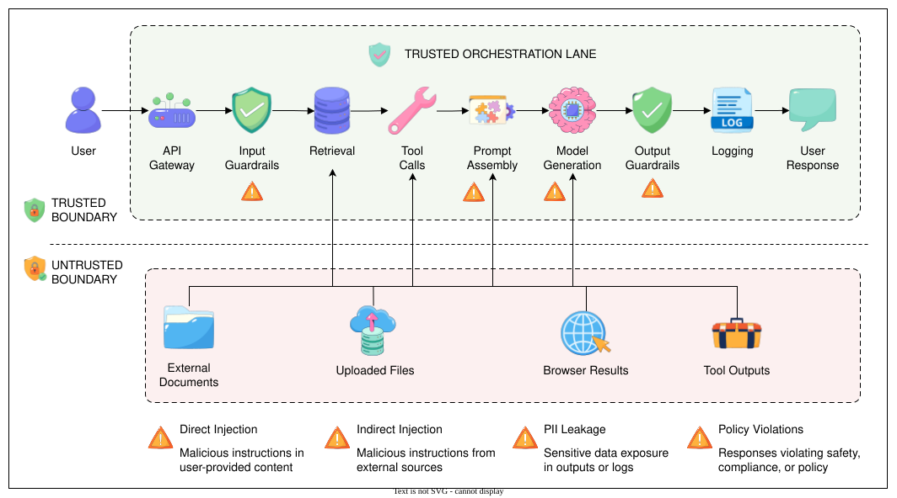

# Designing_Input_and_Output_Guardrails_for_Generative_AI_Safety

Source: https://www.educative.io/courses/generative-ai-system-design/input-and-output-guardrail-design

---

[Home](https://www.educative.io/)

[Courses](https://www.educative.io/search?tab=courses)

[Grokking the Generative AI System Design Interview](https://www.educative.io/courses/generative-ai-system-design)

# Input and Output Guardrail Design

Explore how to design robust input and output guardrails as foundational components in Generative AI system architecture. Understand threat models, trust boundaries, and layered defenses that detect and mitigate prompt injections, PII leaks, and policy violations. Learn methods for input normalization, tiered reviews, and output validation to maintain safety while managing latency and false positives. This lesson equips you to build enforceable trust boundaries across the request lifecycle for secure and reliable AI services.

We'll cover the following...

- [Guardrails as a production boundary](https://www.educative.io/courses/generative-ai-system-design/input-and-output-guardrail-design#Guardrails-as-a-production-boundary)
- [Input guardrails in the request path](https://www.educative.io/courses/generative-ai-system-design/input-and-output-guardrail-design#Input-guardrails-in-the-request-path)
  - [Tiered review for harder cases](https://www.educative.io/courses/generative-ai-system-design/input-and-output-guardrail-design#Tiered-review-for-harder-cases)
    - [Placement beyond the user prompt](https://www.educative.io/courses/generative-ai-system-design/input-and-output-guardrail-design#Placement-beyond-the-user-prompt)
- [Output guardrails and response control](https://www.educative.io/courses/generative-ai-system-design/input-and-output-guardrail-design#Output-guardrails-and-response-control)
  - [Post-generation validation](https://www.educative.io/courses/generative-ai-system-design/input-and-output-guardrail-design#Post-generation-validation)
  - [Grounding and streaming](https://www.educative.io/courses/generative-ai-system-design/input-and-output-guardrail-design#Grounding-and-streaming)
- [Handling false positives and blocked flows](https://www.educative.io/courses/generative-ai-system-design/input-and-output-guardrail-design#Handling-false-positives-and-blocked-flows)
- [Measuring guardrail quality](https://www.educative.io/courses/generative-ai-system-design/input-and-output-guardrail-design#Measuring-guardrail-quality)
- [Conclusion](https://www.educative.io/courses/generative-ai-system-design/input-and-output-guardrail-design#Conclusion)

A support copilot answers a billing question, cites an internal CRM note, and exposes account details the agent should never reveal. The model was not being creative; it executed a hidden instruction embedded inside retrieved text that ordered it to bypass policy. That incident is an engineering failure at the request boundary.

This lesson treats guardrails as foundational architecture rather than a last-minute moderation add-on. Specifically, it walks through how to build enforceable trust boundaries across the entire request life cycle. You will learn how to stop malicious prompts with low-latency input checks, neutralize indirect injection hidden inside retrieved context and tool outputs, and validate generated responses for PII leaks, grounding, and schema compliance, all while balancing strict latency budgets and false-positive risks.

## Guardrails as a production boundary[#](https://www.educative.io/courses/generative-ai-system-design/input-and-output-guardrail-design#Guardrails-as-a-production-boundary)

A guardrail system starts with a simple rule. Every boundary crossing gets checked.

In System Design terms, the **threat model** describes which attackers, failures, and policy violations the architecture must resist. A user can attempt direct prompt injection by typing “ignore prior instructions.” A retrieved document can carry indirect injection through a wiki page, uploaded PDF, browser result, or CRM note. A tool can return poisoned content that looks authoritative because it came from an internal service.

A **jailbreak** is an attempt to bypass policy using role-play, obfuscated text, delimiter tricks, or hidden Unicode. A trust boundary appears at user input, retrieval, orchestration, tools, model hosting, logs, and downstream APIs.

The request path needs chained controls, not one classifier. The system checks before retrieval, before generation, and before delivery. It also treats retrieved and tool-returned content as untrusted even when the source is internal, because relevance does not imply safety.

**Warning:** Internal documents often bypass scrutiny because teams assume corporate origin means trusted content.

High-risk paths usually fail closed. Low-risk degradations may fail open with warnings. With those boundaries defined, placement becomes the next design task.

This architecture becomes clearer when the request path is drawn end to end.

Trust boundaries in flow

## Input guardrails in the request path[#](https://www.educative.io/courses/generative-ai-system-design/input-and-output-guardrail-design#Input-guardrails-in-the-request-path)

Input guardrails run before expensive downstream work. In plain terms, they stop bad requests early so the system does not waste retrieval, tool calls, or generation on traffic that should never proceed.

The first stage performs normalization and deterministic filtering. This stage behaves like airport security for text. It removes obvious tricks quickly before slower review starts.

The pipeline commonly includes the following controls.

- **Normalization:** The gateway cleans whitespace, strips hidden Unicode, canonicalizes encodings, escapes delimiters, and applies size limits so later detectors inspect a stable representation.
- **Topic filtering:** A low-latency rules engine or lightweight classifier flags disallowed categories such as self-harm instructions, prohibited financial advice, or unsafe malware requests.
- **PII detection:** The system scans for account numbers, SSNs, email addresses, and secrets, then either masks them or blocks the request depending on policy and domain risk.
- **Direct injection heuristics:** Regex and phrase rules catch obvious override attempts such as instruction-reset patterns, system-prompt extraction requests, and role-confusion templates.

These checks usually run before retrieval because they are inexpensive and prevent wasted work. The flow then escalates only uncertain cases.

### Tiered review for harder cases[#](https://www.educative.io/courses/generative-ai-system-design/input-and-output-guardrail-design#Tiered-review-for-harder-cases)

Harder attacks need a second layer. A classifier can detect jailbreak patterns that simple rules miss. The system routes traffic through a tiered stack.

- **Low-latency checks:** Regex, rule filters, and length checks usually add microseconds to a few milliseconds.
- **Medium-latency checks:** Lightweight classifiers add more cost but still fit common online budgets.
- **High-latency checks:** Model-based review gives better coverage on obfuscated attacks, but it is the most expensive path and should run selectively.

Parallelization matters here. Independent checks run at the same time so P95 latency does not become the sum of every detector.

#### Placement beyond the user prompt[#](https://www.educative.io/courses/generative-ai-system-design/input-and-output-guardrail-design#Placement-beyond-the-user-prompt)

Input guardrails apply to more than typed text.

- **Retrieved chunk scans:** Each retrieved passage is rescanned before prompt assembly because relevant passages can still contain hidden instructions.
- **Uploaded file scans:** OCR text, extracted metadata, and embedded notes get the same treatment as normal input.
- **Pre-tool-call checks:** Tool arguments are validated before execution so the model cannot turn a prompt injection into unauthorized actions.

**Practical tip:** Treat retrieval quality and retrieval safety as separate concerns. A top-ranked chunk can still be malicious.

## Output guardrails and response control[#](https://www.educative.io/courses/generative-ai-system-design/input-and-output-guardrail-design#Output-guardrails-and-response-control)

Output guardrails inspect what leaves the system. The model may generate fluent text, valid-looking JSON, or tool arguments, but none of it is trusted until validation finishes.

### Post-generation validation[#](https://www.educative.io/courses/generative-ai-system-design/input-and-output-guardrail-design#Post-generation-validation)

The output stage performs policy and leak detection first.

The response pipeline usually applies these controls.

- **Policy checks:** The system scans generated text for harmful content, restricted categories, and disallowed advice before it reaches the user.
- **PII leak detection:** The detector blocks secrets, customer records, internal tokens, and system-prompt fragments that appear in the generated response.
- **No-echo rules:** The orchestrator prevents raw tool output or retrieved text from being copied directly into the answer without formatting and validation.
- **Schema validation:** Structured output is checked against a schema so downstream services do not consume malformed payloads.

If a violation appears, the orchestrator chooses a response action. It may redact, regenerate, downgrade to a safer template, or refuse entirely.

### Grounding and streaming[#](https://www.educative.io/courses/generative-ai-system-design/input-and-output-guardrail-design#Grounding-and-streaming)

For RAG systems, the response also needs support from evidence.

- **Grounding checks:** An NLI model or LLM judge compares each answer claim against retrieved passages and citations to determine whether the evidence supports or contradicts the claim. Unsupported account-specific advice should be flagged for correction or removal before delivery.
- **Streaming complications:** Streaming makes output control harder because partial tokens may already be visible. Teams often buffer a short prefix, scan incrementally, and reserve strict fail-closed behavior for high-risk domains such as healthcare, legal, or account-sensitive support.

**Note:** All model output remains untrusted until code or dedicated detectors validate it.

The comparison below helps place each control in the request path and reason about its operational behavior.

|  |  |  |  |  |
| --- | --- | --- | --- | --- |
| **Check** | **Placement** | **Goal** | **Typical latency** | **Fail mode** |
| Input moderation | Before model input | Block unsafe or disallowed user content | Low | Fails closed |
| Injection detection | Before prompt assembly | Detect prompt injection or instruction override attempts | Low | Can degrade gracefully |
| PII redaction | Before model input / before storage | Remove or mask sensitive personal data | Low | Fails closed |
| Topic filter | Before routing or response generation | Restrict disallowed or out-of-scope topics | Low | Can degrade gracefully |
| Retrieval-content scan | After retrieval, before context injection | Detect unsafe, irrelevant, or poisoned retrieved content | Medium | Can degrade gracefully |
| Tool-output scan | After tool call, before model consumption | Catch unsafe or corrupted tool results | Medium | Can degrade gracefully |
| Output policy check | Before final response | Enforce policy compliance in generated output | Low | Fails closed |
| Output PII leak check | Before final response | Prevent leakage of sensitive personal data | Low | Fails closed |
| Schema validation | After generation, before delivery or tool execution | Ensure output matches required structure or format | Low | Fails closed |
| Grounding check | After generation, before final response | Verify response is supported by provided sources or context | Medium | Can degrade gracefully |

## Handling false positives and blocked flows[#](https://www.educative.io/courses/generative-ai-system-design/input-and-output-guardrail-design#Handling-false-positives-and-blocked-flows)

When a guardrail fires, the system needs a controlled fallback instead of an empty failure. Some requests deserve hard blocks. Others should receive masked output, a safe refusal, or escalation to human review.

False positives are a product failure mode, not just a model metric. If the assistant blocks legitimate billing questions because a topic classifier is too broad, users lose trust and retry in ways that raise cost. Consumer chat systems often prefer softer warnings. Enterprise copilots and regulated workflows usually route more cases to human review or stricter refusal templates.

The blocked-flow handler should return explanations that guide the next step without teaching attackers exactly which rule triggered. Retry logic also needs limits. Otherwise, the orchestrator can loop through repeated classifier calls and model regenerations.

The operations path matters as much as the user path.

- **Redacted logging:** Blocked requests should be logged for review after masking sensitive fields.
- **Access control:** Security and support teams should not get broad access to raw blocked content by default.
- **Fail-mode policy:** PII leak checks and tool authorization usually fail closed, while a low-severity topic filter may fail open with a warning if the detector is temporarily unavailable.

Logs can become a second leakage channel if redaction and access policies are weak.

## Measuring guardrail quality[#](https://www.educative.io/courses/generative-ai-system-design/input-and-output-guardrail-design#Measuring-guardrail-quality)

A guardrail stack is still a classifier system, so it needs offline evaluation and online observability. The two core metrics are precision and recall, where precision is TPTP+FP\frac{TP}{TP + FP}TP+FPTP​ and recall is TPTP+FN\frac{TP}{TP + FN}TP+FNTP​.

High precision means the system rarely blocks benign traffic. High recall means attacks and leaks rarely slip through. You need both, because low precision hurts conversion and user trust, while low recall creates incidents.

Build labeled datasets across direct injection, indirect injection, jailbreaks, PII exposure, tool misuse, and normal traffic. Then slice results by surface instead of looking only at one aggregate score.

The evaluation plan should include the following views.

- **Source slices:** Measure separate performance for user prompts, retrieved chunks, uploaded files, and tool outputs.
- **Attack variants:** Include obfuscation, delimiter tricks, hidden characters, and multilingual jailbreak attempts.
- **Operational metrics:** Track block rate, override rate, safe-regeneration success rate, latency overhead, and downstream incident count.
- **Deployment safety:** Run new guardrails in shadow mode before enforcement, then tune thresholds with versioned policies.

**Practical tip:** Red teaming should continuously refresh the dataset because attack patterns drift faster than standard product traffic.

Observability is part of the architecture. In the next lesson, memory will persist interactions, so today's misses can become tomorrow's contaminated state.

## Conclusion[#](https://www.educative.io/courses/generative-ai-system-design/input-and-output-guardrail-design#Conclusion)

Good guardrail design works as defense in depth across the full request life cycle. The system checks user input, retrieved content, tool outputs, generation results, and logs as separate boundaries, then chooses fail modes deliberately based on risk.

For interviews, keep the walk-through disciplined. Start from the threat model, treat all retrieved and tool-returned content as untrusted, place cheap checks early, validate outputs before release, and measure quality with precision, recall, and latency overhead. In the next lesson, that same boundary thinking extends into memory and state, where unsafe content can persist unless today's guardrails are strong.

Observability and Feedback Loops

Memory and State Design

Ask

[Guardrails as a production boundary](https://www.educative.io/courses/generative-ai-system-design/input-and-output-guardrail-design#Guardrails-as-a-production-boundary)

[Input guardrails in the request path](https://www.educative.io/courses/generative-ai-system-design/input-and-output-guardrail-design#Input-guardrails-in-the-request-path)

[Tiered review for harder cases](https://www.educative.io/courses/generative-ai-system-design/input-and-output-guardrail-design#Tiered-review-for-harder-cases)

[Placement beyond the user prompt](https://www.educative.io/courses/generative-ai-system-design/input-and-output-guardrail-design#Placement-beyond-the-user-prompt)

[Output guardrails and response control](https://www.educative.io/courses/generative-ai-system-design/input-and-output-guardrail-design#Output-guardrails-and-response-control)

[Post-generation validation](https://www.educative.io/courses/generative-ai-system-design/input-and-output-guardrail-design#Post-generation-validation)

[Grounding and streaming](https://www.educative.io/courses/generative-ai-system-design/input-and-output-guardrail-design#Grounding-and-streaming)

[Handling false positives and blocked flows](https://www.educative.io/courses/generative-ai-system-design/input-and-output-guardrail-design#Handling-false-positives-and-blocked-flows)

[Measuring guardrail quality](https://www.educative.io/courses/generative-ai-system-design/input-and-output-guardrail-design#Measuring-guardrail-quality)

[Conclusion](https://www.educative.io/courses/generative-ai-system-design/input-and-output-guardrail-design#Conclusion)