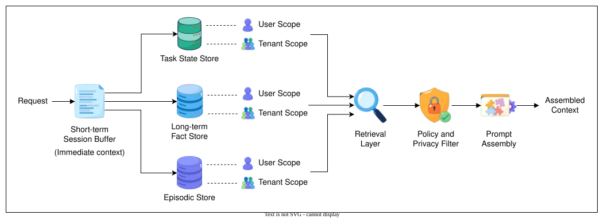

# Memory_and_State_Design_for_Scalable_AI_Agents

Source: https://www.educative.io/courses/generative-ai-system-design/memory-and-state-design

---

[Home](https://www.educative.io/)

[Courses](https://www.educative.io/search?tab=courses)

[Grokking the Generative AI System Design Interview](https://www.educative.io/courses/generative-ai-system-design)

# Memory and State Design

Explore how to design memory and state architectures for AI agents that provide operational continuity across sessions. Learn to separate conversational memory from workflow state, structure memory tiers, implement conflict resolution, enforce privacy, and maintain low-latency retrieval for scalable and secure generative AI systems.

We'll cover the following...

- [Why memory matters for agents](https://www.educative.io/courses/generative-ai-system-design/memory-and-state-design#Why-memory-matters-for-agents)
- [Memory types and what they store](https://www.educative.io/courses/generative-ai-system-design/memory-and-state-design#Memory-types-and-what-they-store)
- [Short-term memory and transient workflow state](https://www.educative.io/courses/generative-ai-system-design/memory-and-state-design#Short-term-memory-and-transient-workflow-state)
  - [Common short-term context patterns](https://www.educative.io/courses/generative-ai-system-design/memory-and-state-design#Common-short-term-context-patterns)
- [Long-term and episodic memory architectures](https://www.educative.io/courses/generative-ai-system-design/memory-and-state-design#Long-term-and-episodic-memory-architectures)
  - [Storage selection for durable facts](https://www.educative.io/courses/generative-ai-system-design/memory-and-state-design#Storage-selection-for-durable-facts)
  - [Retrieval orchestration and conflict resolution](https://www.educative.io/courses/generative-ai-system-design/memory-and-state-design#Retrieval-orchestration-and-conflict-resolution)
  - [Intentional forgetting and record expiration](https://www.educative.io/courses/generative-ai-system-design/memory-and-state-design#Intentional-forgetting-and-record-expiration)
  - [Memory poisoning and integrity](https://www.educative.io/courses/generative-ai-system-design/memory-and-state-design#Memory-poisoning-and-integrity)
- [Privacy and tenant isolation](https://www.educative.io/courses/generative-ai-system-design/memory-and-state-design#Privacy-and-tenant-isolation)
- [Putting the architecture together](https://www.educative.io/courses/generative-ai-system-design/memory-and-state-design#Putting-the-architecture-together)
- [Conclusion](https://www.educative.io/courses/generative-ai-system-design/memory-and-state-design#Conclusion)

In GenAI System Design, a fundamental challenge is that foundation models are completely stateless. Every request executes as an isolated computation. When an enterprise assistant must remember customer preferences across sessions or resume multi-step workflows after tool failures, software architecture must supply continuity.

Memory and state design provide this operational continuity without exceeding prompt token budgets. This lesson examines how to separate durable conversational memory from transient workflow execution state, structure memory tiers, implement conflict resolution and intentional forgetting, and enforce tenant privacy across memory lookups.

## Why memory matters for agents[#](https://www.educative.io/courses/generative-ai-system-design/memory-and-state-design#Why-memory-matters-for-agents)

A standard LLM does not retain conversational state between independent requests by default. Each request must provide the relevant conversation history and context for the model to generate a response. In contrast, an autonomous agent must maintain continuity across conversational turns, across customer sessions, and across multi-step execution graphs. The platform accomplishes this by loading selected memories into prompt context before inference and persisting newly learned outcomes after the interaction completes. Production architectures organize memory into three distinct operational tiers.

- **Short-term memory** stores recent dialogue turns and active plan constraints needed for the immediate task.
- **Long-term memory** stores durable profile facts such as language preference, time zone, or organizational role.
- **Episodic memory** stores structured historical records of past tasks, capturing attempted actions, tool outcomes, and failure reasons.

Each memory tier imposes different latency and storage requirements. Short-term memory executes reads and writes on every turn and requires low-latency in-memory buffers. Long-term memory changes infrequently, but corrupted facts mispersonalize every future conversation. Episodic memory grows rapidly with user traffic and demands selective semantic retrieval rather than unbounded replay.

1.

Why is saving complete conversation histories indefinitely an architectural anti-pattern?

Show Answer

Did you find this helpful?

This architecture view helps before looking at individual stores.

Agent memory stack

## Memory types and what they store[#](https://www.educative.io/courses/generative-ai-system-design/memory-and-state-design#Memory-types-and-what-they-store)

Different memory types address fundamentally different operational questions. The agent memory stack divides into four functional categories.

- **Short-term:** This type of memory answers what is happening right now. It contains recent user statements, active task goals, and temporary constraints.
- **Long-term:** This captures what the system should remember about the user. It contains persistent facts such as organizational department, product version, and environment restrictions.
- **Episodic memory:** This records what happened during previous tasks. It mainly contains structured summaries of completed tasks, including the initial prompt, tools selected, execution status, and human operator edits.
- **Procedural memory:** It includes workflow rules, system guardrails, and tool schemas. These policies govern orchestration logic and remain distinct from user memory.

Storage technologies must mirror access patterns rather than convenience. A low-latency in-memory key-value cache supports short-term dialogue buffers because reads occur on every turn. A relational database or document store fits long-term profile facts because updates require transactional audits. Episodic memory often uses a relational event table paired with vector embeddings for semantic similarity search.

Promoting facts from short-term memory to long-term memory requires explicit governance. A statement should become a durable profile record only when it is repeated across sessions, explicitly confirmed by the user, or validated by a classification model.

The table below contrasts operational trade-offs across common agent memory types.

|  |  |  |  |  |
| --- | --- | --- | --- | --- |
| **Memory tier** | **Typical stored payload** | **Retention policy** | **Recommended storage system** | **Primary failure risk** |
| Short-term | Recent dialogue turns and active task constraints | Active session duration | In-memory key-value cache | Token overflow and lost conversation context |
| Long-term | User preferences, technical configurations, and profile facts | Indefinite until updated or deleted | Relational database or profile store | Stale personalization and data isolation leaks |
| Episodic | Prior task execution records, tool sequences, and failure logs | Medium to long term | Event log paired with vector store | Retrieval noise and obsolete operational guidance |
| Procedural | Orchestration policies, system rules, and tool contracts | Permanent until software release | Versioned prompt and schema registry | Behavioral drift from unversioned policy changes |

## Short-term memory and transient workflow state[#](https://www.educative.io/courses/generative-ai-system-design/memory-and-state-design#Short-term-memory-and-transient-workflow-state)

A critical principle in agent System Design is separating short-term conversational memory from transient workflow state. Conversational memory supports linguistic coherence for the next model turn. Workflow state tracks in-flight operational progress such as pending tool calls, retry counters, and task completion checkpoints. Conflating these two responsibilities leads to bloated prompts and brittle crash recovery.

### Common short-term context patterns[#](https://www.educative.io/courses/generative-ai-system-design/memory-and-state-design#Common-short-term-context-patterns)

Production systems balance conversational continuity and context budgets using four complementary techniques. Most production systems combine a few patterns instead of relying on one.

- **Sliding window:** This keeps only the most recent turns and drops older dialogue once the token budget is exceeded.
- **Rolling summary:** This compresses older turns into a short synopsis so some context survives eviction.
- **Structured scratchpad:** This stores active entities, unresolved questions, or selected facts in fields instead of free text.
- **Separate task-state object:** This stores workflow progress outside the prompt, often in a low-latency store such as Redis.

When tools return massive data payloads such as database query dumps or network logs, the orchestrator must avoid dumping raw outputs into the conversation buffer. Instead, the runtime writes the full payload to object storage or a temporary cache, injecting only a lightweight reference pointer and key summary fields into the prompt.

While these session-level techniques stabilize the active conversation, an assistant that truly learns over time must also persist facts and outcomes that survive long after the current dialogue ends.

## Long-term and episodic memory architectures[#](https://www.educative.io/courses/generative-ai-system-design/memory-and-state-design#Long-term-and-episodic-memory-architectures)

Durable memory requires explicit data pipelines for writing, indexing, invalidating, and retrieving state across distributed nodes.

### Storage selection for durable facts[#](https://www.educative.io/courses/generative-ai-system-design/memory-and-state-design#Storage-selection-for-durable-facts)

Long-term memory implementations generally choose among three storage patterns.

- **Relational databases:** These provide strong consistency, structured schemas, and transactional audit trails for explicit user preferences.
- **Key-value stores:** These deliver single-digit millisecond latency when fetching user preference blobs by unique account identifier.
- **Vector databases:** These enable semantic similarity lookups across open-ended notes, past feedback, and qualitative preferences.

Episodic memory records must be structured before generating embeddings. A complete episode record includes the user request, the planned steps, the tools called, execution success or failure status, timestamps, and an optional reflection note. Storing metadata alongside vector embeddings enables precise pre-filtering before semantic retrieval.

### Retrieval orchestration and conflict resolution[#](https://www.educative.io/courses/generative-ai-system-design/memory-and-state-design#Retrieval-orchestration-and-conflict-resolution)

Fetching durable memories follows a disciplined four-stage pipeline.

- The retrieval gateway applies mandatory tenant and user metadata filters to restrict search to authorized records.
- The engine executes vector similarity search across the filtered memory index to identify candidate passages.
- An auxiliary cross-encoder reranker reorders candidate memories by relevance to the active query.
- The context assembler injects only the top-scoring memories into the prompt window under a strict token ceiling.

When stored memories contradict each other, the system evaluates record version timestamps, source confidence scores, and explicit user confirmation flags. A preference stated directly by a user in the current session always overrides an older inferred preference retrieved from episodic storage.

### Intentional forgetting and record expiration[#](https://www.educative.io/courses/generative-ai-system-design/memory-and-state-design#Intentional-forgetting-and-record-expiration)

Persisting all memory records permanently degrades retrieval precision. Production architectures implement intentional forgetting using TTL expiration on temporary preferences, automated background compaction to merge redundant records, and explicit deletion APIs to support user data removal mandates.

1.

Why should episodic memory store failure reasons separately from final outcomes?

Show Answer

Did you find this helpful?

This focused retrieval view is easier to grasp in a visual pipeline.

Retrieval orchestration flow

### Memory poisoning and integrity[#](https://www.educative.io/courses/generative-ai-system-design/memory-and-state-design#Memory-poisoning-and-integrity)

Memory poisoning occurs when an agent stores malicious, false, or manipulated information in persistent memory, causing it to influence future interactions. For example, an attacker could inject instructions into a conversation that the agent later saves as a user preference, leading the agent to repeat unsafe behavior across sessions.

Production systems mitigate memory poisoning by validating information before persisting it, distinguishing explicit user statements from model-inferred facts, and restricting which sources can update durable memory. They should also attach provenance and timestamps to memory records, enforce authorization on memory writes, and support auditing, correction, and deletion of suspicious entries.

Memory retrieval must treat stored content as data rather than trusted instructions. Tenant isolation prevents cross-user contamination, but it does not prevent an attacker from poisoning their own memory or manipulating information from an otherwise authorized source.

## Privacy and tenant isolation[#](https://www.educative.io/courses/generative-ai-system-design/memory-and-state-design#Privacy-and-tenant-isolation)

Memory retrieval must enforce access rules before similarity search results are considered usable. If namespace filtering is weak, the best embedding match can still be the wrong user's data.

A safe design usually includes several controls.

- **Per-user and per-tenant namespacing:** Every record carries tenant and user identifiers that scope reads and writes.
- **Row-level access control:** This is the authorization enforced at the record level based on identity and policy. It prevents broad table access from becoming broad memory access.
- **Encryption at rest and in transit:** This reduces exposure if storage or network boundaries are compromised.
- **Audit logging:** This records who read or wrote memory, which supports incident response and compliance review.
- **User controls:** This allows inspection, correction, deletion, and opt-out for persisted memories.

**Note:** Vector similarity alone is not a security boundary.

1.

Why is vector similarity search alone insufficient to guarantee tenant privacy?

Show Answer

Did you find this helpful?

Data minimization also changes what gets stored. Sensitive tool outputs should not enter durable memory unless there is a clear product requirement and a retention policy that justifies them. Good systems are personalized, but they are also governable. With memory retrieval, privacy, and retention policies in place, the next step is to bring these components together into an end-to-end architecture that balances correctness, latency, and prompt size.

## Putting the architecture together[#](https://www.educative.io/courses/generative-ai-system-design/memory-and-state-design#Putting-the-architecture-together)

A production memory pipeline has two paths. The write path captures the user turn, updates short-term session state, evaluates whether any stable fact should be promoted to long-term memory, and records a completed task in episodic storage when the workflow ends. The read path fetches session state, applies tenant and privacy filters, retrieves top-k long-term facts and relevant episodes, resolves conflicts, and assembles a bounded prompt.

Operational concerns sit around those paths. Cache hit rate affects profile lookup latency. Eventual consistency can cause a newly updated preference to appear stale during retrieval. Background compaction jobs, embedding refresh jobs, and replication lag all influence correctness at scale.

**Warning:** Dialogue state supports the next model turn, while workflow state supports retries and resumption. Merging them causes prompt bloat and brittle recovery.

In interview terms, call out the bottlenecks directly. Vector search can dominate latency, stale profile facts can break personalization, replication lag can surface outdated memories, and weak filtering can leak data. Once memory is sound, the remaining challenge is safe execution through a sandboxed tool layer.

## Conclusion[#](https://www.educative.io/courses/generative-ai-system-design/memory-and-state-design#Conclusion)

Memory architecture provides the operational continuity required for autonomous agent systems. Without deliberate memory design, systems alternate between amnesia and prompt context exhaustion.

Production systems separate short-term conversational context from workflow process state, structure long-term profile data within auditable stores, and format episodic task histories with explicit outcome tags. Implementing metadata-driven pre-filtering, intentional forgetting via TTL expirations, and strict tenant namespacing ensures that memory retrieval remains low-latency, accurate, and secure.

With conversational memory and execution state established, the next lesson moves to tool integration and agentic execution, exploring how agents invoke external Application Programming Interfaces, handle execution timeouts, and maintain sandboxed safety.

Test your knowledge!

1.

What is the main difference between memory and transient process state in an agent system?

A.

Memory stores future relevant facts and experiences, while process state tracks in flight execution details

B.

Memory is only for tool outputs, while process state is only for user preferences

C.

Memory is always durable, while process state should always be stored in prompts

D.

Memory and process state are the same and should be combined for simplicity

---

1 / 4

Input and Output Guardrail Design

Tool Layer and Sandboxed Execution

Ask

[Why memory matters for agents](https://www.educative.io/courses/generative-ai-system-design/memory-and-state-design#Why-memory-matters-for-agents)

[Memory types and what they store](https://www.educative.io/courses/generative-ai-system-design/memory-and-state-design#Memory-types-and-what-they-store)

[Short-term memory and transient workflow state](https://www.educative.io/courses/generative-ai-system-design/memory-and-state-design#Short-term-memory-and-transient-workflow-state)

[Common short-term context patterns](https://www.educative.io/courses/generative-ai-system-design/memory-and-state-design#Common-short-term-context-patterns)

[Long-term and episodic memory architectures](https://www.educative.io/courses/generative-ai-system-design/memory-and-state-design#Long-term-and-episodic-memory-architectures)

[Storage selection for durable facts](https://www.educative.io/courses/generative-ai-system-design/memory-and-state-design#Storage-selection-for-durable-facts)

[Retrieval orchestration and conflict resolution](https://www.educative.io/courses/generative-ai-system-design/memory-and-state-design#Retrieval-orchestration-and-conflict-resolution)

[Intentional forgetting and record expiration](https://www.educative.io/courses/generative-ai-system-design/memory-and-state-design#Intentional-forgetting-and-record-expiration)

[Memory poisoning and integrity](https://www.educative.io/courses/generative-ai-system-design/memory-and-state-design#Memory-poisoning-and-integrity)

[Privacy and tenant isolation](https://www.educative.io/courses/generative-ai-system-design/memory-and-state-design#Privacy-and-tenant-isolation)

[Putting the architecture together](https://www.educative.io/courses/generative-ai-system-design/memory-and-state-design#Putting-the-architecture-together)

[Conclusion](https://www.educative.io/courses/generative-ai-system-design/memory-and-state-design#Conclusion)