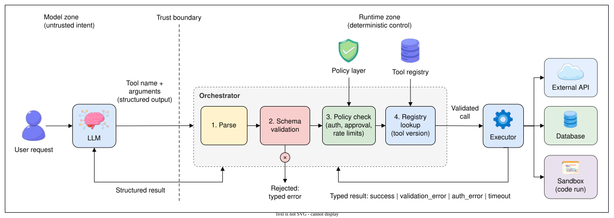

# Safe_Tool_Layer_and_Sandboxed_Execution_for_AI_Agents

Source: https://www.educative.io/courses/generative-ai-system-design/tool-layer-and-sandboxed-execution

---

[Home](https://www.educative.io/)

[Courses](https://www.educative.io/search?tab=courses)

[Grokking the Generative AI System Design Interview](https://www.educative.io/courses/generative-ai-system-design)

# Tool Layer and Sandboxed Execution

Explore how to design a tool layer that safely separates model reasoning from real-world effects. Understand server-side validation, tool schemas, governance via registries, and sandboxed execution principles that limit security risks and failures. Learn best practices for tool interface design, failure handling, and permission controls to build reliable, secure AI agents capable of safe tool usage and execution.

We'll cover the following...

- [Tool calls need safe boundaries](https://www.educative.io/courses/generative-ai-system-design/tool-layer-and-sandboxed-execution#Tool-calls-need-safe-boundaries)
- [How tool calling works](https://www.educative.io/courses/generative-ai-system-design/tool-layer-and-sandboxed-execution#How-tool-calling-works)
  - [Request life cycle](https://www.educative.io/courses/generative-ai-system-design/tool-layer-and-sandboxed-execution#Request-life-cycle)
    - [Why validation stays server-side](https://www.educative.io/courses/generative-ai-system-design/tool-layer-and-sandboxed-execution#Why-validation-stays-server-side)
- [Designing robust tool interfaces](https://www.educative.io/courses/generative-ai-system-design/tool-layer-and-sandboxed-execution#Designing-robust-tool-interfaces)
  - [Interface design rules](https://www.educative.io/courses/generative-ai-system-design/tool-layer-and-sandboxed-execution#Interface-design-rules)
  - [Write safety and output shape](https://www.educative.io/courses/generative-ai-system-design/tool-layer-and-sandboxed-execution#Write-safety-and-output-shape)
- [Registries and execution governance](https://www.educative.io/courses/generative-ai-system-design/tool-layer-and-sandboxed-execution#Registries-and-execution-governance)
  - [What the registry stores](https://www.educative.io/courses/generative-ai-system-design/tool-layer-and-sandboxed-execution#What-the-registry-stores)
  - [Protocol choices and governance](https://www.educative.io/courses/generative-ai-system-design/tool-layer-and-sandboxed-execution#Protocol-choices-and-governance)
- [Reliability and sandbox design](https://www.educative.io/courses/generative-ai-system-design/tool-layer-and-sandboxed-execution#Reliability-and-sandbox-design)
  - [Reliability controls in the runtime](https://www.educative.io/courses/generative-ai-system-design/tool-layer-and-sandboxed-execution#Reliability-controls-in-the-runtime)
  - [Sandboxed execution and blast radius](https://www.educative.io/courses/generative-ai-system-design/tool-layer-and-sandboxed-execution#Sandboxed-execution-and-blast-radius)
    - [Sandbox defaults](https://www.educative.io/courses/generative-ai-system-design/tool-layer-and-sandboxed-execution#Sandbox-defaults)
    - [Credential scoping](https://www.educative.io/courses/generative-ai-system-design/tool-layer-and-sandboxed-execution#Credential-scoping)
- [Failure patterns and design trade-offs](https://www.educative.io/courses/generative-ai-system-design/tool-layer-and-sandboxed-execution#Failure-patterns-and-design-trade-offs)
- [Conclusion](https://www.educative.io/courses/generative-ai-system-design/tool-layer-and-sandboxed-execution#Conclusion)

In GenAI System Design, giving an autonomous agent the ability to inspect data is relatively safe. However, granting that same agent the ability to cancel transactions, modify records, or execute arbitrary code introduces severe operational risks. Failures in production agent systems often stem from faulty linguistic reasoning. More frequently, they occur because the execution runtime grants the model unconstrained authority.

The tool layer functions as the deterministic boundary between model reasoning and real-world side effects. While an LLM can propose an action, the underlying orchestrator determines whether that action is validated, authorized, and executed. This lesson examines how to define strict tool schemas, govern discovery through registries, enforce server-side validation, isolate unsafe code in sandboxes, and contain blast radius during failures.

## Tool calls need safe boundaries[#](https://www.educative.io/courses/generative-ai-system-design/tool-layer-and-sandboxed-execution#Tool-calls-need-safe-boundaries)

A tool-enabled agent works in two different trust zones. In the first zone, the model reads context and produces structured intent. In the second zone, the runtime touches APIs, databases, files, or executable code. Mixing those zones is where most unsafe designs fail.

A good mental model is a web app backend. You would never trust a browser to enforce payment limits or admin access. Likewise, you should not trust the model to self-police arguments, permissions, or retries. The backend must do that work.

The request life cycle usually includes the following components.

- **Model intent:** The model selects a tool name and arguments based on user input and the tool descriptions it can see.
- **Orchestrator:** The orchestrator is the server-side component that validates, authorizes, schedules, and records every tool execution.
- **Executor:** The executor adapts a validated call into a concrete action such as an HTTP request, a database query, or a sandboxed code run.
- **Policy layer:** The policy layer applies approval rules, timeouts, rate limits, and permission boundaries before execution proceeds.

That separation sets up the mechanics of tool calling, which we can now walk through end to end.

## How tool calling works[#](https://www.educative.io/courses/generative-ai-system-design/tool-layer-and-sandboxed-execution#How-tool-calling-works)

A tool call is just structured output until the backend accepts it. The runtime converts that output into a governed action by following a fixed sequence, adding control at each step.

### Request life cycle[#](https://www.educative.io/courses/generative-ai-system-design/tool-layer-and-sandboxed-execution#Request-life-cycle)

The flow starts when the orchestrator sends the model a narrowed list of tools, each with a parameter schema, description, version, and permission tags. The model replies with a selected tool and arguments. The orchestrator then parses that payload, validates it against the server-side schema, checks policy, looks up the current tool version in the registry, and dispatches to the correct executor. The executor returns either a structured success object or a structured error object. The model then incorporates that result into its final response.

Several artifacts travel through this path and should stay explicit.

- **Parameter schema:** The schema defines required fields, types, allowed ranges, and whether extra properties are rejected.
- **Output schema:** The output schema describes result structure, so downstream planning logic can parse fields instead of guessing from prose.
- **Tool metadata:** Metadata includes version, owner, expected latency, sensitivity tags, and whether the tool is read-only or has side effects.
- **Permission tags:** Permission tags drive policy enforcement and sandbox setup, especially for file, network, or destructive actions.

#### Why validation stays server-side[#](https://www.educative.io/courses/generative-ai-system-design/tool-layer-and-sandboxed-execution#Why-validation-stays-server-side)

The model can produce malformed JSON, select stale versions, or invent fields. It can also be influenced by prompt injection hidden in user content or tool metadata. Server-side validation catches these cases before execution. Every call should end in a deterministic structure, such as `success`, `validation_error`, or `auth_error`, so future planning logic can branch reliably.

**Note:** A free-form text error forces the next model step to infer meaning. A typed error lets the next step react mechanically.

There is one more boundary to formalize before execution becomes reliable, and that is the interface itself. This life cycle is easier to see when rendered as a boundary diagram.

Tool lifecycle boundaries

## Designing robust tool interfaces[#](https://www.educative.io/courses/generative-ai-system-design/tool-layer-and-sandboxed-execution#Designing-robust-tool-interfaces)

Tool quality strongly shapes both model accuracy and runtime safety. If the interface is vague, the model chooses poorly. If the schema is loose, the executor receives dangerous ambiguity.

### Interface design rules[#](https://www.educative.io/courses/generative-ai-system-design/tool-layer-and-sandboxed-execution#Interface-design-rules)

Keep tools narrow enough to express a single clear action, but not so small that every user request expands into ten round trips. In commerce, `list_orders` and `cancel_order` usually work better than one generic `manage_order` tool. Verb-first names reduce confusion because the model can align intent with action more directly.

Use descriptions that state purpose, side effects, approval requirements, and limits. Treat descriptions as executable guidance for the model, not as marketing copy. A description should tell the orchestrator and the model what happens if the tool succeeds, what it may mutate, and when it must pause for approval.

For arguments, apply JSON-schema-like constraints with strict bounds.

- **Required fields:** Required fields prevent the model from omitting identifiers that the executor cannot safely infer.
- **Enums and bounds:** Enums, numeric ranges, and string length limits constrain the search space and reject impossible requests early.
- **Format checks:** Format validation catches malformed order IDs, dates, or SKU values before hitting downstream systems.
- **No extra properties:** Rejecting unknown fields prevents silent parameter injection and accidental compatibility drift.

Generic tools with blob arguments often hide multiple operations behind one schema. That makes auditing, retries, and approval logic much harder.

### Write safety and output shape[#](https://www.educative.io/courses/generative-ai-system-design/tool-layer-and-sandboxed-execution#Write-safety-and-output-shape)

Side-effecting tools should support idempotency. The orchestrator attaches an idempotency key to writes so a retry after timeout does not cancel the same order twice.

An output schema also matters. If the result always includes `status`, `reason`, and resource identifiers, downstream steps can plan with less guesswork and better observability.

The interface is only half the story, though. Tools still need a governed catalog and discovery path.

## Registries and execution governance[#](https://www.educative.io/courses/generative-ai-system-design/tool-layer-and-sandboxed-execution#Registries-and-execution-governance)

A registry is the catalog that tells the orchestrator which tools exist and how they are allowed to run. Without it, every model session becomes an unmanaged pile of functions.

### What the registry stores[#](https://www.educative.io/courses/generative-ai-system-design/tool-layer-and-sandboxed-execution#What-the-registry-stores)

A production registry stores more than names and schemas. It also tracks owners, versions, health, expected latency, sensitivity tags, and permission classes. That metadata lets the orchestrator narrow exposure before the model ever sees a tool.

Useful discovery patterns usually include the following controls.

- **Allow-lists:** The system exposes only tools explicitly permitted for the current agent, tenant, or workflow.
- **Domain filtering:** The registry can filter tools by business domain so a support agent does not see finance or deployment tools.
- **Dynamic narrowing:** The orchestrator can reduce the candidate set per request based on user role, task, and prior tool outputs.
- **Health awareness:** Degraded tools can be hidden or deprioritized when latency or failure rates exceed policy.

### Protocol choices and governance[#](https://www.educative.io/courses/generative-ai-system-design/tool-layer-and-sandboxed-execution#Protocol-choices-and-governance)

Modern agent architectures often leverage standardized protocols such as the Model Context Protocol (MCP). The MCP provides an open standard for discovering and executing tools across distributed servers, decoupling the agent reasoning runtime from underlying backend services.

To protect prompt token budgets and reduce model confusion, production architectures avoid exposing the entire tool catalog to every prompt. Instead, the registry dynamically narrows candidate tools using allow-lists based on active user roles, task classifications, and previous execution steps.

**Practical tip:** Cache registry metadata aggressively, but separate metadata caching from authorization checks so stale cache entries do not bypass policy.

That governance layer feeds directly into runtime behavior, where reliability and containment become operational concerns.

## Reliability and sandbox design[#](https://www.educative.io/courses/generative-ai-system-design/tool-layer-and-sandboxed-execution#Reliability-and-sandbox-design)

A safe tool layer does not stop at schema validation. It also needs predictable failure behavior, bounded retries, and isolated execution for code or risky operations.

### Reliability controls in the runtime[#](https://www.educative.io/courses/generative-ai-system-design/tool-layer-and-sandboxed-execution#Reliability-controls-in-the-runtime)

Each executor should emit typed failures such as `validation_error`, `timeout`, `auth_error`, `rate_limit`, `dependency_unavailable`, or `side_effect_conflict`. The planner can then distinguish a malformed request from a flaky dependency.

Retry logic must stay selective.

- **Read-only retries:** Read-only or idempotent operations can retry with exponential backoff when the dependency fails transiently.
- **Write protection:** Non-idempotent writes should not retry automatically because the first attempt may have succeeded after the caller timed out.
- **Circuit breaking:** A failing downstream service should trigger a circuit breaker so the orchestrator stops flooding it with repeated calls.
- **Budget propagation:** The orchestrator passes the remaining deadline and token or cost budget into nested calls so lower layers cannot outlive the parent request.

**Note:** A timeout without a deadline contract is just delayed failure. Propagated budgets make timeout behavior composable.

### Sandboxed execution and blast radius[#](https://www.educative.io/courses/generative-ai-system-design/tool-layer-and-sandboxed-execution#Sandboxed-execution-and-blast-radius)

When the model writes code to compose tools, run that code in isolation. A #key# sandbox: an execution environment with tightly restricted capabilities and resources #key# keeps generated code away from host credentials, unrestricted file systems, and open network access.

#### Sandbox defaults[#](https://www.educative.io/courses/generative-ai-system-design/tool-layer-and-sandboxed-execution#Sandbox-defaults)

Fresh containers or microVMs should start with clean state, stripped Linux capabilities, blocked outbound network access, restricted file-system mounts, and no subprocess spawning unless explicitly approved. This resembles giving a contractor a badge for one room instead of the whole building.

#### Credential scoping[#](https://www.educative.io/courses/generative-ai-system-design/tool-layer-and-sandboxed-execution#Credential-scoping)

Use least-privilege credentials, ephemeral tokens, path allow-lists, and domain allow-lists. That shrinks blast radius if something goes wrong.

In an ecommerce agent, `get_inventory` can run as read-only with aggressive retries. `cancel_order` should require approval, an idempotency key, shorter write-scoped credentials, and tighter timeout handling.

These constraints become the foundation for planning loops, which need bounded actions and known failure semantics.

## Failure patterns and design trade-offs[#](https://www.educative.io/courses/generative-ai-system-design/tool-layer-and-sandboxed-execution#Failure-patterns-and-design-trade-offs)

Most interview answers get stronger when they connect interface design to runtime behavior. Many small tools improve authorization precision and reuse, but they increase round trips and hidden latency. Coarse tools or sandboxed programmatic orchestration reduce hops, but they widen the security surface and complicate debugging.

Common failure patterns show up quickly in production.

- **Tool explosion:** Too many similar tools increase model confusion and registry complexity.
- **Ambiguous descriptions:** Poor descriptions lead to wrong selection or unsafe argument guesses.
- **Weak output structure:** Unstructured results break deterministic planning and monitoring.
- **Broad credentials:** Excess authority turns a single bad call into a larger incident.
- **Hidden latency:** Nested dependencies create tail latency that the planner cannot budget around.

AI Powered

Saved

1 attempt left

Reset

Containing code execution blast radius

An analytical agent generates and executes Python code to visualize database trends. An injection vulnerability in the user query causes the generated script to scan the local subnet and exfiltrate environment variables to a public server. Which sandbox isolation control directly prevents this security breach?

This is your last attempt.

## Conclusion[#](https://www.educative.io/courses/generative-ai-system-design/tool-layer-and-sandboxed-execution#Conclusion)

The tool layer is where an agent stops being a text system and starts acting on real infrastructure. The model proposes an action, but the runtime decides whether that action is valid, authorized, bounded, and observable.

The durable pattern is consistent across systems. Use precise schemas, curated registries, explicit permissions, structured errors, idempotent write paths, and sandboxed execution with least privilege. In the next lesson, planning loops, termination, and budgets will build on these guarantees so the agent can act repeatedly without losing control.

Memory and State Design

Planning Loops, Termination, and Budgets

Ask

[Tool calls need safe boundaries](https://www.educative.io/courses/generative-ai-system-design/tool-layer-and-sandboxed-execution#Tool-calls-need-safe-boundaries)

[How tool calling works](https://www.educative.io/courses/generative-ai-system-design/tool-layer-and-sandboxed-execution#How-tool-calling-works)

[Request life cycle](https://www.educative.io/courses/generative-ai-system-design/tool-layer-and-sandboxed-execution#Request-life-cycle)

[Why validation stays server-side](https://www.educative.io/courses/generative-ai-system-design/tool-layer-and-sandboxed-execution#Why-validation-stays-server-side)

[Designing robust tool interfaces](https://www.educative.io/courses/generative-ai-system-design/tool-layer-and-sandboxed-execution#Designing-robust-tool-interfaces)

[Interface design rules](https://www.educative.io/courses/generative-ai-system-design/tool-layer-and-sandboxed-execution#Interface-design-rules)

[Write safety and output shape](https://www.educative.io/courses/generative-ai-system-design/tool-layer-and-sandboxed-execution#Write-safety-and-output-shape)

[Registries and execution governance](https://www.educative.io/courses/generative-ai-system-design/tool-layer-and-sandboxed-execution#Registries-and-execution-governance)

[What the registry stores](https://www.educative.io/courses/generative-ai-system-design/tool-layer-and-sandboxed-execution#What-the-registry-stores)

[Protocol choices and governance](https://www.educative.io/courses/generative-ai-system-design/tool-layer-and-sandboxed-execution#Protocol-choices-and-governance)

[Reliability and sandbox design](https://www.educative.io/courses/generative-ai-system-design/tool-layer-and-sandboxed-execution#Reliability-and-sandbox-design)

[Reliability controls in the runtime](https://www.educative.io/courses/generative-ai-system-design/tool-layer-and-sandboxed-execution#Reliability-controls-in-the-runtime)

[Sandboxed execution and blast radius](https://www.educative.io/courses/generative-ai-system-design/tool-layer-and-sandboxed-execution#Sandboxed-execution-and-blast-radius)

[Sandbox defaults](https://www.educative.io/courses/generative-ai-system-design/tool-layer-and-sandboxed-execution#Sandbox-defaults)

[Credential scoping](https://www.educative.io/courses/generative-ai-system-design/tool-layer-and-sandboxed-execution#Credential-scoping)

[Failure patterns and design trade-offs](https://www.educative.io/courses/generative-ai-system-design/tool-layer-and-sandboxed-execution#Failure-patterns-and-design-trade-offs)

[Conclusion](https://www.educative.io/courses/generative-ai-system-design/tool-layer-and-sandboxed-execution#Conclusion)