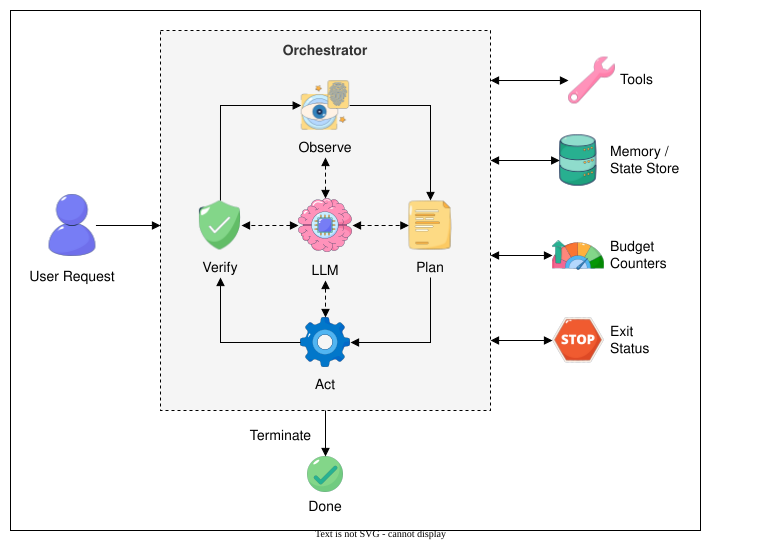

# Planning_Loops_and_Termination_Strategies_for_Reliable_AI_Agents

Source: https://www.educative.io/courses/generative-ai-system-design/planning-loops-termination-and-budgets

---

[Home](https://www.educative.io/)

[Courses](https://www.educative.io/search?tab=courses)

[Grokking the Generative AI System Design Interview](https://www.educative.io/courses/generative-ai-system-design)

# Planning Loops, Termination, and Budgets

Explore how to structure AI agent planning loops with clear termination conditions and resource budgets. Understand the differences between reactive and plan-then-execute models, and learn best practices for managing execution, verification, and observability. This lesson helps you design reliable, secure, and efficient AI agent workflows that prevent infinite loops and control operational costs effectively.

We'll cover the following...

- [The agent loop](https://www.educative.io/courses/generative-ai-system-design/planning-loops-termination-and-budgets#The-agent-loop)
  - [Why verification belongs in every step](https://www.educative.io/courses/generative-ai-system-design/planning-loops-termination-and-budgets#Why-verification-belongs-in-every-step)
- [Planning strategies](https://www.educative.io/courses/generative-ai-system-design/planning-loops-termination-and-budgets#Planning-strategies)
  - [Reactive loop](https://www.educative.io/courses/generative-ai-system-design/planning-loops-termination-and-budgets#Reactive-loop)
  - [Plan-then-execute and hybrid control](https://www.educative.io/courses/generative-ai-system-design/planning-loops-termination-and-budgets#Plan-then-execute-and-hybrid-control)
- [Workflows vs. agents](https://www.educative.io/courses/generative-ai-system-design/planning-loops-termination-and-budgets#Workflows-vs-agents)
- [Termination and loop safety](https://www.educative.io/courses/generative-ai-system-design/planning-loops-termination-and-budgets#Termination-and-loop-safety)
- [Budgets and observability](https://www.educative.io/courses/generative-ai-system-design/planning-loops-termination-and-budgets#Budgets-and-observability)
  - [Observability patterns](https://www.educative.io/courses/generative-ai-system-design/planning-loops-termination-and-budgets#Observability-patterns)
- [Takeaway](https://www.educative.io/courses/generative-ai-system-design/planning-loops-termination-and-budgets#Takeaway)

Giving an agent tool access without rigid execution boundaries can be an operational hazard. An agent tasked with troubleshooting an invoice export failure can easily enter infinite loops, alternating between querying database logs and reading API documentation. Within minutes, the system exhausts its token quota, violates latency SLOs, and incurs uncontrolled inference costs without resolving the underlying task.

Unbounded execution is an orchestration failure rather than a prompt defect. Useful production agents operate inside an external control harness that governs when the system may advance, when it must stop, and what state persists across iterations. This lesson examines how to structure agent planning loops, contrast reactive execution against structured plan-then-execute models, enforce multi-tiered termination policies, and apply hard resource budgets across distributed agent workflows.

## The agent loop[#](https://www.educative.io/courses/generative-ai-system-design/planning-loops-termination-and-budgets#The-agent-loop)

The loop is easiest to understand as an execution record managed outside the model. A request enters the orchestrator, which loads current state, tool outputs, and prior decisions. It then asks the model for the next action, executes that action, validates whether progress occurred, and records an updated state snapshot before deciding whether another step is allowed.

The orchestrator acts as the system of record for each run. It should track the following fields.

- **Step number:** This counter gives every action an ordering boundary and supports max-step termination.
- **Observed state:** This state includes user inputs, retrieved documents, tool outputs, open questions, and any compacted memory carried forward.
- **Chosen action:** This action records whether the model responded directly, invoked a tool, requested clarification, or escalated.
- **Tool metadata:** This metadata includes tool name, arguments, response payload, retry count, and execution status.
- **Resource usage:** This usage captures prompt tokens, completion tokens, elapsed wall time, and estimated cost per step.
- **Partial outputs:** These outputs preserve intermediate summaries, extracted facts, and unresolved gaps for debugging and recovery.

This trace turns free-form reasoning into a debuggable state machine. The next concern is where verification fits, because naive designs often skip it.

### Why verification belongs in every step[#](https://www.educative.io/courses/generative-ai-system-design/planning-loops-termination-and-budgets#Why-verification-belongs-in-every-step)

The model may internally believe it is making progress, but the orchestrator needs an external predicate. A predicate can test whether a ticket was resolved, whether a source is new, or whether a tool result changed the task state.

Every run should terminate in a named status rather than a generic failure. Common states include success, max steps exceeded, budget exceeded, timeout, no progress, repeated failure, and escalation.

Consider a research assistant. It searches, summarizes, removes duplicate sources, and keeps a ranked evidence list. If the token budget runs out before all subtopics are covered, the orchestrator returns the best-effort draft plus the exit reason instead of pretending the task completed. That pattern keeps the loop honest and sets up planning choices next.

For tasks that modify external state, budget exhaustion can leave a workflow partially complete. The orchestrator should track which actions succeeded and which remain pending, then either execute predefined compensating actions to reverse completed changes where possible or return a partial-completion report. For example, if an agent updates one record out of three before hitting its budget, it should report that record as updated and identify the two remaining records. It should never claim full completion or assume that stopping the loop automatically rolls back earlier actions.

The architecture is easier to see visually before comparing planning styles.

Orchestrator owns the loop

## Planning strategies[#](https://www.educative.io/courses/generative-ai-system-design/planning-loops-termination-and-budgets#Planning-strategies)

Production systems usually use one of three planning styles. A reactive loop, commonly associated with the ReAct pattern, makes decisions based on the latest observations, while plan-and-execute separates planning from execution. Hybrid systems combine both approaches through periodic checkpoints and re-planning. The right choice depends on how much uncertainty the task contains and how expensive each wrong step becomes.

### Reactive loop[#](https://www.educative.io/courses/generative-ai-system-design/planning-loops-termination-and-budgets#Reactive-loop)

A reactive loop makes a local decision at every step. The orchestrator sends the latest state to the model, receives the next action, executes it, and immediately observes the result before asking again. This style adapts quickly when tools return unexpected evidence.

Its weakness is oscillation. If each step is cheap to propose but expensive to execute, the system can bounce among search, retrieval, and summarization without building a stable plan. Token overhead also grows because every turn must restate enough context for the next decision.

### Plan-then-execute and hybrid control[#](https://www.educative.io/courses/generative-ai-system-design/planning-loops-termination-and-budgets#Plan-then-execute-and-hybrid-control)

A plan-then-execute system asks for a high-level task decomposition first, then executes those steps with limited variance. This works well when the structure is stable, such as compliance checks across known data sources.

A fixed plan lowers runtime variance and improves cost predictability. Debugging also gets simpler because failures attach to a named plan step rather than an unbounded trajectory.

Hybrid systems insert checkpoints. The orchestrator executes part of the plan, then triggers re-planning. This gives better long-horizon quality than purely reactive loops without paying full planning cost on every turn.

**Practical tip:** In interviews, choose the most constrained planning strategy that still handles uncertainty in the task.

Overplanning under uncertainty often creates hallucinated dependencies and wasted work. That trade-off leads directly into a side-by-side comparison.

|  |  |  |  |  |
| --- | --- | --- | --- | --- |
| **Strategy** | **Best fit** | **Strengths** | **Failure modes** | **Interview recommendation** |
| Reactive loop | Short tasks, dynamic environments, tool-heavy workflows | High responsiveness to new evidence; low upfront token overhead; simple to start | Weak long-horizon quality; can drift or loop; cost less predictable across many steps; harder to reason about final trajectory | Recommend for fast-changing tasks where adaptability matters more than global planning |
| Plan-then-execute | Well-scoped tasks, stable requirements, predictable workflows | Good cost predictability; lower debugging complexity; stronger long-horizon quality when plan is sound | Poor responsiveness once execution starts; upfront plan may become stale; failures compound if early assumptions are wrong | Recommend for structured tasks where requirements are clear and execution can follow a fixed plan |
| Hybrid with re-planning | Medium-to-long tasks with partial uncertainty and evolving evidence | Balances planning with adaptability; better long-horizon quality than reactive loop; more responsive than fixed plans | Higher token overhead from periodic re-planning; greater debugging complexity; can over-plan or re-plan too often | Recommend as the default for complex real-world tasks that need both direction and adjustment |

## Workflows vs. agents[#](https://www.educative.io/courses/generative-ai-system-design/planning-loops-termination-and-budgets#Workflows-vs-agents)

A fundamental design choice in agent System Design is deciding whether a task truly needs dynamic agent planning or just a deterministic workflow.

A **workflow** is a fixed directed graph where all branches, decisions, and state steps are hardcoded in software logic. The foundation model, if used at all, stays inside bounded steps to classify incoming text or extract specific schema fields. An **autonomous agen**t decides both the sequence and choice of actions dynamically at runtime based on environment observations.

Engineers should always choose the most constrained design that reliably solves the problem. Use workflows for tasks where the steps are well understood and bounded, such as user onboarding, refund checks, and data ingestion pipelines. Save autonomous agents for open-ended investigations where the exact list of steps cannot be predicted upfront.

Many robust enterprise architectures run agents inside deterministic workflows. An outer workflow manages user login, tenant boundaries, and compliance rules, while delegating open-ended research to a sandboxed, budget-capped agent.

## Termination and loop safety[#](https://www.educative.io/courses/generative-ai-system-design/planning-loops-termination-and-budgets#Termination-and-loop-safety)

Termination is a design input, not a cleanup task added at the end. When a run starts, the orchestrator should already know all legal exit states and the checks that trigger them. Otherwise, the loop has no hard boundary.

The system should terminate for the following categories.

- **Verified completion:** The orchestrator checks an external success condition rather than trusting the model to declare done.
- **Iteration limit:** The run stops after a fixed number of planning or tool steps.
- **Budget exhaustion:** The orchestrator ends the run when token, cost, or time limits are crossed.
- **Repeated failure:** The system exits after a tool repeatedly times out, returns invalid payloads, or fails schema validation.
- **Oscillation or no progress:** The run stops when the same tool and same arguments recur, the same search results keep appearing, or state remains unchanged across several steps.
- **Escalation:** The system hands control to a human or policy gate as a valid terminal state.

A plain-English rule works well here. If an outside observer cannot tell whether the system moved forward, the system should assume it did not.

**Note:** The model saying "resolved" is only a hypothesis until an external validator confirms the required condition.

Stalling and divergence are related but different. Stalling repeats local behavior with little state change. Divergence keeps producing new actions, but they move away from the original task. Both consume budget, so both need explicit detection. Long-running loops also need state compaction before observability becomes useful.

## Budgets and observability[#](https://www.educative.io/courses/generative-ai-system-design/planning-loops-termination-and-budgets#Budgets-and-observability)

Budgets belong in the harness because prompt instructions can drift, but external counters cannot be ignored. In most systems, the orchestrator checks five common budget classes before every new step and after every tool result.

- **Step budget:** This budget caps total loop iterations and bounds worst-case branching.
- **Token budget:** This budget limits prompt and completion growth, which also constrains context bloat.
- **Wall-clock budget:** This budget enforces latency targets and prevents long-tail runs from monopolizing workers.
- **Monetary budget:** This budget converts model and tool usage into a hard spend ceiling.
- **Per-tool quota:** This quota limits calls to expensive APIs or risky side-effecting tools.

A useful analogy is a cloud job scheduler. The job may still be logically correct, but once it exceeds CPU or time quota, the platform terminates it and records why.

### Observability patterns[#](https://www.educative.io/courses/generative-ai-system-design/planning-loops-termination-and-budgets#Observability-patterns)

Structured traces should record state snapshots, tool arguments, validation outcomes, retries, repeated-action alerts, and final exit reason. This is observability.

Dashboards should slice success rate by exit type, average steps to completion, repeated-action frequency, timeout distribution, and top failing tools. A strong production pattern returns best-effort output plus termination reason when a budget is hit, instead of a silent failure.

If you only log the final answer, you lose the trajectory that explains cost blowups and incorrect actions.

The monitoring view below should make those control points concrete.

Monitoring view to trace every step clearly

AI Powered

Saved

1 attempt left

Reset

Choosing between workflows and agents

An ecommerce company wants an AI system to process customer refund requests. The process requires validating the order date, confirming item return status in a database, calculating depreciation based on product category, and crediting the customer payment method. Should this system be designed as an autonomous agent or a deterministic workflow?

This is your last attempt.

## Takeaway[#](https://www.educative.io/courses/generative-ai-system-design/planning-loops-termination-and-budgets#Takeaway)

Reliable agents come from external control, explicit terminal states, and full-step visibility. The request enters an orchestrator, the orchestrator owns planning and enforcement, and the model operates inside those boundaries rather than defining them.

For interview answers, start with the loop, then narrow flexibility. Choose the least open planning style that still handles uncertainty, prefer workflows where the state machine is already known, and name concrete stop conditions with numerical budgets. Once those control points exist, adding policy enforcement and human approval becomes a natural extension rather than a redesign.

Tool Layer and Sandboxed Execution

Policy Enforcement and Human Approval

Ask

[The agent loop](https://www.educative.io/courses/generative-ai-system-design/planning-loops-termination-and-budgets#The-agent-loop)

[Why verification belongs in every step](https://www.educative.io/courses/generative-ai-system-design/planning-loops-termination-and-budgets#Why-verification-belongs-in-every-step)

[Planning strategies](https://www.educative.io/courses/generative-ai-system-design/planning-loops-termination-and-budgets#Planning-strategies)

[Reactive loop](https://www.educative.io/courses/generative-ai-system-design/planning-loops-termination-and-budgets#Reactive-loop)

[Plan-then-execute and hybrid control](https://www.educative.io/courses/generative-ai-system-design/planning-loops-termination-and-budgets#Plan-then-execute-and-hybrid-control)

[Workflows vs. agents](https://www.educative.io/courses/generative-ai-system-design/planning-loops-termination-and-budgets#Workflows-vs-agents)

[Termination and loop safety](https://www.educative.io/courses/generative-ai-system-design/planning-loops-termination-and-budgets#Termination-and-loop-safety)

[Budgets and observability](https://www.educative.io/courses/generative-ai-system-design/planning-loops-termination-and-budgets#Budgets-and-observability)

[Observability patterns](https://www.educative.io/courses/generative-ai-system-design/planning-loops-termination-and-budgets#Observability-patterns)

[Takeaway](https://www.educative.io/courses/generative-ai-system-design/planning-loops-termination-and-budgets#Takeaway)