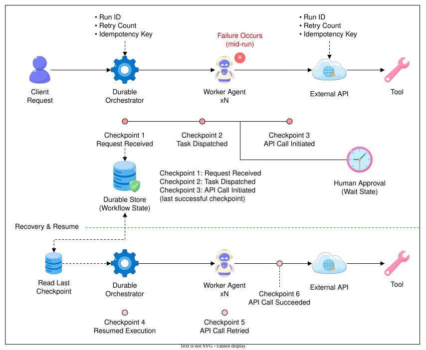

# Durable_Execution_and_Multi-Agent_Coordination_in_AI_Agents

Source: https://www.educative.io/courses/generative-ai-system-design/durable-execution-and-multi-agent-coordination

---

[Home](https://www.educative.io/)

[Courses](https://www.educative.io/search?tab=courses)

[Grokking the Generative AI System Design Interview](https://www.educative.io/courses/generative-ai-system-design)

# Durable Execution and Multi-Agent Coordination

Explore how to design resilient AI agent systems with durable execution that preserves state through failures and coordinated multi-agent workflows. Learn checkpointing, idempotency, retry strategies, and patterns for agent collaboration plus human oversight. Understand how to balance complexity, reliability, and scalability in production-grade AI workflows.

We'll cover the following...

- [Checkpointing and safe recovery](https://www.educative.io/courses/generative-ai-system-design/durable-execution-and-multi-agent-coordination#Checkpointing-and-safe-recovery)
  - [Where checkpoints belong](https://www.educative.io/courses/generative-ai-system-design/durable-execution-and-multi-agent-coordination#Where-checkpoints-belong)
    - [Ordering around side effects](https://www.educative.io/courses/generative-ai-system-design/durable-execution-and-multi-agent-coordination#Ordering-around-side-effects)
- [Retries and partial failure handling](https://www.educative.io/courses/generative-ai-system-design/durable-execution-and-multi-agent-coordination#Retries-and-partial-failure-handling)
  - [Failure taxonomy](https://www.educative.io/courses/generative-ai-system-design/durable-execution-and-multi-agent-coordination#Failure-taxonomy)
  - [Recovery mechanics](https://www.educative.io/courses/generative-ai-system-design/durable-execution-and-multi-agent-coordination#Recovery-mechanics)
- [How agents coordinate across a workflow](https://www.educative.io/courses/generative-ai-system-design/durable-execution-and-multi-agent-coordination#How-agents-coordinate-across-a-workflow)
  - [Common coordination patterns](https://www.educative.io/courses/generative-ai-system-design/durable-execution-and-multi-agent-coordination#Common-coordination-patterns)
  - [Context movement and shared state](https://www.educative.io/courses/generative-ai-system-design/durable-execution-and-multi-agent-coordination#Context-movement-and-shared-state)
    - [What downstream agents need](https://www.educative.io/courses/generative-ai-system-design/durable-execution-and-multi-agent-coordination#What-downstream-agents-need)
- [When coordination helps and when it hurts](https://www.educative.io/courses/generative-ai-system-design/durable-execution-and-multi-agent-coordination#When-coordination-helps-and-when-it-hurts)
- [Interview-ready design walk-through](https://www.educative.io/courses/generative-ai-system-design/durable-execution-and-multi-agent-coordination#Interview-ready-design-walk-through)
- [Conclusion](https://www.educative.io/courses/generative-ai-system-design/durable-execution-and-multi-agent-coordination#Conclusion)

An agent sends a renewal email, updates the Customer Relationship Management (CRM), and reserves a follow-up slot. Before it records those actions as complete, the pod restarts. When the workflow resumes, it cannot tell what already happened, so it may send the email twice, create a duplicate booking, or wait indefinitely.

This is where a demo agent becomes a production workflow. Once an agent interacts with external systems, waits for humans, or depends on slow APIs, its state must survive failures. Durable execution persists enough state to resume safely. Checkpoints record progress at logical boundaries, while idempotency protects external side effects from duplicate execution. Handoffs transfer work between agents or to humans.

This lesson brings these reliability and coordination patterns together as core building blocks of production agent systems.

## Checkpointing and safe recovery[#](https://www.educative.io/courses/generative-ai-system-design/durable-execution-and-multi-agent-coordination#Checkpointing-and-safe-recovery)

A simple way to think about durable execution is that the workflow keeps its memory outside the process. If the container dies, the run can still continue because the next worker reads the last committed state instead of guessing. The persisted record usually includes the following fields:

- **Run ID:** The system assigns a stable identifier so retries, logs, and side-effect deduplication all refer to the same workflow instance.
- **Current step:** The orchestrator stores where execution should resume rather than recomputing the full control path.
- **Intermediate outputs:** The system saves summaries, tool responses, or artifact pointers that later steps depend on.
- **Pending tasks:** The state tracks issued but unfinished work, including queued jobs and outstanding tool calls.
- **Retry counters:** The workflow records how many attempts each step has consumed.
- **Deadlines:** The engine stores expiration times so abandoned work does not wait forever.
- **Human wait states:** The state marks runs paused for approval, clarification, or escalation.
- **Workflow version:** The run carries the definition version that created it.

That list belongs in durable storage because process memory disappears during deployments, pod evictions, and timeout enforcement. A deterministic replay model lets the orchestrator rebuild decisions after restart.

### Where checkpoints belong[#](https://www.educative.io/courses/generative-ai-system-design/durable-execution-and-multi-agent-coordination#Where-checkpoints-belong)

Checkpoint boundaries usually sit after a logical step completes and around handoffs. The orchestrator decides, then persists, then schedules effectful work through separate activities.

#### Ordering around side effects[#](https://www.educative.io/courses/generative-ai-system-design/durable-execution-and-multi-agent-coordination#Ordering-around-side-effects)

If the system performs an external effect before recording progress, recovery may repeat that effect. If it records progress before the effect, the run may claim success for work that never happened. Many systems separate decision logic from activity execution and attach idempotency key values to effectful calls.

**Note:** Most platforms provide at-least-once activity execution, not true exactly-once effects across arbitrary external systems.

Versioning closes the loop. In-flight runs keep their original schema or resume through compatibility adapters after prompt or tool contract changes. That recovery story leads directly into failure handling.

The architecture becomes easier to see in a workflow diagram.

Durable workflow recovery

## Retries and partial failure handling[#](https://www.educative.io/courses/generative-ai-system-design/durable-execution-and-multi-agent-coordination#Retries-and-partial-failure-handling)

Once state survives crashes, the next question is how each failed step should behave. Distributed agent systems fail in different ways, and the retry policy has to match the failure class rather than applying one blanket rule.

### Failure taxonomy[#](https://www.educative.io/courses/generative-ai-system-design/durable-execution-and-multi-agent-coordination#Failure-taxonomy)

A plain rule works well here. Retry when the world might change soon. Stop when the input or policy is wrong.

- **Transient failure:** Timeouts, rate limits, temporary network partitions, and overloaded model endpoints often succeed later with bounded retries.
- **Permanent failure:** Invalid input, policy violations, missing entitlements, and malformed tool arguments will not improve by repeating the same request.
- **Unknown failure:** A step may fail with poor diagnostics, so the orchestrator first classifies it conservatively and may escalate after a small retry budget.

### Recovery mechanics[#](https://www.educative.io/courses/generative-ai-system-design/durable-execution-and-multi-agent-coordination#Recovery-mechanics)

The workflow engine usually applies exponential backoff with jitter, caps attempt counts, and opens a circuit breaker when a dependency is broadly unhealthy. When retries are exhausted, the failed item can move to a dead-letter queue for inspection instead of blocking the main queue.

Real workflows rarely roll back perfectly. If an agent reserved inventory and later failed to generate the invoice, the system may release the reservation or mark the order pending manual repair. Those are compensating actions.

**Warning:** “Retry everything” is not an interview answer. You need a boundary that says which component retries, when it stops, and what happens next.

Operational signals expose these decisions in production.

- **Per-step success rate:** The system measures which stage is failing rather than treating the workflow as one opaque system.
- **Retry inflation:** Rising attempts per completion signal hidden dependency pain before outright outages appear.
- **Stuck workflow count:** Runs waiting too long on approval, queues, or timers indicate missing recovery paths.
- **Duplicate-effect alarms:** Downstream deduplication hits reveal unsafe ordering or missing idempotency coverage.

That reliability layer sets up how multiple agents can coordinate on top of the same workflow substrate.

## How agents coordinate across a workflow[#](https://www.educative.io/courses/generative-ai-system-design/durable-execution-and-multi-agent-coordination#How-agents-coordinate-across-a-workflow)

Durability keeps one run correct. Coordination decides how many agents participate and how work moves between them. In interviews, three core coordination patterns cover most designs, while **human-in-the-loop** checkpoints add a review step when approval or governance is required. Each affects data flow, failure isolation, and cost.

### Common coordination patterns[#](https://www.educative.io/courses/generative-ai-system-design/durable-execution-and-multi-agent-coordination#Common-coordination-patterns)

Think of these patterns as different ways to divide responsibility. Some centralize decisions, some pass ownership, and some encode the workflow as a graph.

- **Orchestrator-worker:** One controller decomposes the request, issues specialized tasks, and later combines results. This fits parallel research, extraction, or verification subtasks where fan-out and fan-in are explicit.
- **Direct handoff:** One agent transfers control to another agent or a human reviewer. The receiving owner continues from a defined state instead of sharing a giant free-form transcript.
- **Directed graph pipeline:** Specialized nodes process artifacts in sequence or branches, which suits stable pipelines such as ingest, classify, enrich, verify, and publish.

### Context movement and shared state[#](https://www.educative.io/courses/generative-ai-system-design/durable-execution-and-multi-agent-coordination#Context-movement-and-shared-state)

Passing every token of prior history to every agent is like giving every team member the entire company inbox. It increases cost and spreads confusion. Systems usually combine narrow task context with a durable shared memory layer and lineage metadata. When multiple agents update shared state, use versioning with optimistic concurrency control or locking to prevent conflicting writes. With optimistic concurrency control, an update based on a stale version is rejected and must be retried against the latest state.

#### What downstream agents need[#](https://www.educative.io/courses/generative-ai-system-design/durable-execution-and-multi-agent-coordination#What-downstream-agents-need)

- **Task-relevant context:** Each worker receives only the artifacts and instructions needed for its own step.
- **Shared state reference:** Common data lives in durable storage, and messages carry pointers rather than full copies.
- **Lineage metadata:** Downstream stages record which tool, model, or human produced each artifact so later verification can reason about provenance.

**Practical tip:** Specialization should shrink ambiguity and blast radius. If a split creates more coordination traffic than useful isolation, keep the work in one agent.

The pattern trade-offs are easier to compare side by side.

|  |  |  |  |  |
| --- | --- | --- | --- | --- |
| **Pattern** | **Best fit** | **Reliability concerns** | **Cost profile** | **Interview trade-off** |
| Orchestrator-worker | Parallelizable tasks with clear decomposition and aggregation | Fan-out and fan-in overhead, queue durability for worker tasks, partial failure handling during result aggregation | Moderate to high due to coordinator logic, task dispatch, and aggregation retries | Strong for showing scalable decomposition, but adds coordination complexity and more failure modes to explain |
| Direct handoff | Simple sequential flows between specialized services or agents | Shared-state contention, weak recovery if a downstream step fails, harder end-to-end tracing across handoffs | Low to moderate with minimal coordination overhead | Easy to explain quickly, but can look brittle if reliability and observability are not addressed |
| Directed graph pipeline | Multi-stage workflows with branching, retries, and conditional routing | Debugging complexity, state propagation bugs, queue durability across stages, backpressure handling | Moderate to high depending on graph execution engine and persistence needs | Impressive for complex workflows, but can seem overengineered for smaller systems |

**Human-in-the-loop checkpoints:** Human approval can be added to any coordination pattern when an action requires review. The orchestrator pauses the workflow, routes the request to a reviewer, and resumes execution after approval. It must also handle rejections, timeouts, and escalations safely.

## When coordination helps and when it hurts[#](https://www.educative.io/courses/generative-ai-system-design/durable-execution-and-multi-agent-coordination#When-coordination-helps-and-when-it-hurts)

Multi-agent designs add real system overhead. Every extra agent introduces another prompt, message boundary, failure mode, and state transition. Debugging also gets harder because errors may come from bad decomposition rather than bad generation.

Use multiple agents when subtasks are independently specialized, when research can run in parallel, when one stage explicitly verifies another, or when governance requires a human approval gate. In those cases, the extra coordination buys isolation or throughput.

Avoid multi-agent decomposition for a mostly linear task with modest context, one tool path, and no independent subproblems. A single orchestrated workflow with clear internal steps usually gives lower latency, lower token cost, and simpler observability.

A practical heuristic works well in interviews. Start with one workflow and one orchestrating agent. Split it only when specialization, parallelism, or policy isolation clearly improves quality or control. That framing carries cleanly into the next section, where we turn these principles into an interview walk-through.

## Interview-ready design walk-through[#](https://www.educative.io/courses/generative-ai-system-design/durable-execution-and-multi-agent-coordination#Interview-ready-design-walk-through)

Take a market research report pipeline with researcher, summarizer, verifier, and publisher agents, plus optional human approval. The request enters an API layer, which creates a workflow run in a durable orchestrator, such as Temporal or AWS Step Functions. The orchestrator stores the run record, pushes tasks onto a queue or event bus, and workers write artifacts to object storage while updating step state in the durable store.

Checkpoint after research completes, after summarization completes, after verification finishes, and before publish. Human approval becomes an explicit waiting state with a deadline and callback token. If the verifier times out, only that step retries. Completed research and summary artifacts remain valid. Publish and notification calls carry idempotency keys so replay cannot send duplicate reports.

**Note:** In an interview, say where backpressure lives. Fan-out research stages can saturate queues and model endpoints long before storage becomes the bottleneck.

Nonfunctional concerns include availability during deployments, consistency of shared report metadata, and observability for stuck waits, retry spikes, and duplicate-effect alarms. That same structure generalizes well to the final assessment.

AI Powered

Saved

1 attempt left

Reset

Managing partial failures in multi-step booking workflows

A travel concierge agent reserves a non-refundable hotel room in step one and attempts to charge the corporate travel account in step two. Step two fails permanently due to an expired credit card token. Standard relational database rollbacks cannot undo the completed hotel reservation. How does the durable orchestrator maintain system consistency?

This is your last attempt.

## Conclusion[#](https://www.educative.io/courses/generative-ai-system-design/durable-execution-and-multi-agent-coordination#Conclusion)

Durable execution turns an agent loop into a production workflow by externalizing state, checkpointing logical progress, and protecting side effects with idempotent operations. Multi-agent coordination only pays off when specialization, isolation, parallelism, or governance requirements outweigh the added latency, cost, and failure surface.

In interviews, describe state transitions, queues, waiting states, retry boundaries, and compensating actions rather than speaking only about prompts or tools. Next, we'll put these ideas into practice with a mock interview on RAG and fine-tuning, and then bring the core concepts together through the SCALED framework and four recurring GenAI system design patterns.

Policy Enforcement and Human Approval

RAG and Finetuning

Ask

[Checkpointing and safe recovery](https://www.educative.io/courses/generative-ai-system-design/durable-execution-and-multi-agent-coordination#Checkpointing-and-safe-recovery)

[Where checkpoints belong](https://www.educative.io/courses/generative-ai-system-design/durable-execution-and-multi-agent-coordination#Where-checkpoints-belong)

[Ordering around side effects](https://www.educative.io/courses/generative-ai-system-design/durable-execution-and-multi-agent-coordination#Ordering-around-side-effects)

[Retries and partial failure handling](https://www.educative.io/courses/generative-ai-system-design/durable-execution-and-multi-agent-coordination#Retries-and-partial-failure-handling)

[Failure taxonomy](https://www.educative.io/courses/generative-ai-system-design/durable-execution-and-multi-agent-coordination#Failure-taxonomy)

[Recovery mechanics](https://www.educative.io/courses/generative-ai-system-design/durable-execution-and-multi-agent-coordination#Recovery-mechanics)

[How agents coordinate across a workflow](https://www.educative.io/courses/generative-ai-system-design/durable-execution-and-multi-agent-coordination#How-agents-coordinate-across-a-workflow)

[Common coordination patterns](https://www.educative.io/courses/generative-ai-system-design/durable-execution-and-multi-agent-coordination#Common-coordination-patterns)

[Context movement and shared state](https://www.educative.io/courses/generative-ai-system-design/durable-execution-and-multi-agent-coordination#Context-movement-and-shared-state)

[What downstream agents need](https://www.educative.io/courses/generative-ai-system-design/durable-execution-and-multi-agent-coordination#What-downstream-agents-need)

[When coordination helps and when it hurts](https://www.educative.io/courses/generative-ai-system-design/durable-execution-and-multi-agent-coordination#When-coordination-helps-and-when-it-hurts)

[Interview-ready design walk-through](https://www.educative.io/courses/generative-ai-system-design/durable-execution-and-multi-agent-coordination#Interview-ready-design-walk-through)

[Conclusion](https://www.educative.io/courses/generative-ai-system-design/durable-execution-and-multi-agent-coordination#Conclusion)