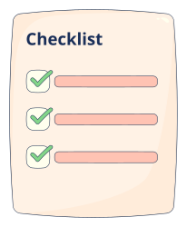

# SCALED_Framework_for_Systematic_Generative_AI_Design

Source: https://www.educative.io/courses/generative-ai-system-design/the-scaled-framework-for-unseen-problems

---

[Home](https://www.educative.io/)

[Courses](https://www.educative.io/search?tab=courses)

[Grokking the Generative AI System Design Interview](https://www.educative.io/courses/generative-ai-system-design)

# The SCALED Framework for Unseen Problems

Explore the SCALED framework to understand a structured six-step approach for designing generative AI systems. Learn to define requirements, select models, prepare data, train and evaluate AI, estimate resources, and build scalable system architectures. This lesson equips you to tackle diverse GenAI design challenges with a clear, systematic method.

We'll cover the following...

- [What is the SCALED framework?](https://www.educative.io/courses/generative-ai-system-design/the-scaled-framework-for-unseen-problems#What-is-the-SCALED-framework)
- [1. System requirements](https://www.educative.io/courses/generative-ai-system-design/the-scaled-framework-for-unseen-problems#1-System-requirements)
- [2. Choose an AI model](https://www.educative.io/courses/generative-ai-system-design/the-scaled-framework-for-unseen-problems#2-Choose-an-AI-model)
- [3. Acquire and prepare data](https://www.educative.io/courses/generative-ai-system-design/the-scaled-framework-for-unseen-problems#3-Acquire-and-prepare-data)
- [4. Leverage the AI model](https://www.educative.io/courses/generative-ai-system-design/the-scaled-framework-for-unseen-problems#4-Leverage-the-AI-model)
- [5. Estimate resources for the System Design](https://www.educative.io/courses/generative-ai-system-design/the-scaled-framework-for-unseen-problems#5-Estimate-resources-for-the-System-Design)
- [6. Design the system and evaluate the requirements](https://www.educative.io/courses/generative-ai-system-design/the-scaled-framework-for-unseen-problems#6-Design-the-system-and-evaluate-the-requirements)
- [What’s ahead?](https://www.educative.io/courses/generative-ai-system-design/the-scaled-framework-for-unseen-problems#Whats-ahead)
- [Conclusion](https://www.educative.io/courses/generative-ai-system-design/the-scaled-framework-for-unseen-problems#Conclusion)

Designing a GenAI system is challenging due to its diversity and complexity. With so many moving parts, solving any design problem is no small task. With each problem presenting varying complexity, a systematic approach is essential to break the problem into manageable pieces. Thus making it easier to tackle and address every design aspect effectively. Additionally, a structured method helps in handle unforeseen design problems within the GenAI paradigm. With this in mind, a novel approach called SCALED is proposed to design GenAI systems.

## What is the SCALED framework?[#](https://www.educative.io/courses/generative-ai-system-design/the-scaled-framework-for-unseen-problems#What-is-the-SCALED-framework)

**SCALED** is a step-by-step framework that guides the entire design process of a large-scale GenAI system. From defining system requirements, selecting the AI model, and deploying a robust, scalable system. Whether it is the creation of text generators, image synthesizers, or speech systems, SCALED ensures we place each piece of the puzzle in its right place. The following illustration shows what SCALED stands for:

Breakdown of each character in the SCALED framework for designing a GenAI system

Here are some key offerings of the SCALED framework:

1. The SCALED approach is a structured guide for navigating the key steps in every GenAI System Design process. It ensures that, at any stage, the next step is clearly defined and ready to be tackled.
2. By following this approach, the developed solutions will incorporate all the essential components needed to address any design challenge effectively. Moreover, SCALED ensures that the process is systematic and carefully thought out, resulting in robust and well-rounded outcomes.

Let’s discuss the six steps individually:

## 1. System requirements[#](https://www.educative.io/courses/generative-ai-system-design/the-scaled-framework-for-unseen-problems#1-System-requirements)

The development of every great system begins with a thorough understanding of what it is meant to achieve. In this step, we scope the design problem by identifying functional requirements, which outline what the system should do, and the nonfunctional requirements, which define how well it should perform. For example, in a text-to-image synthesis system, functional requirements could include generating images on descriptive prompts, while nonfunctional requirements might emphasize low latency and scalability to handle millions of requests.

Requirements identification

This step is also about understanding user expectations, who will use the system, and what problems we are solving for them. Consider this setting the foundation for the system, which determines its direction and ensures that subsequent steps align with the goals.

## 2. Choose an AI model[#](https://www.educative.io/courses/generative-ai-system-design/the-scaled-framework-for-unseen-problems#2-Choose-an-AI-model)

Choosing the right model is like selecting the engine for a high-performance car, the main component that drives the system. In this step, we analyze various model architectures and compare their pros and cons. For example, for the text-to-image synthesis system, we compare GANs, VAEs, and diffusion models such as DALL•E and Stable Diffusion and choose a model that stands out based on training stability, output quality, computational cost, etc.

Choosing a GenAI model tailored to the problem requirements

AI model selection also depends on the task, budget, expertise, etc. The following are some important factors to consider while selecting a model:

- **Open source vs. proprietary models:** Open source models offer flexibility, transparency, and cost savings, making them ideal for customization and iterative improvement. While often delivering cutting-edge performance and support, proprietary models may limit adaptability and come with higher costs.
- **Small vs. large models:** Small models are easier to train, require less computational power, and deliver faster inference, making them efficient for deployment. Large models may offer higher accuracy and handle complex tasks better, but at the expense of speed and resource efficiency.
- **Performance vs. cost-effectiveness:**High-performing models excel in understanding many languages, ensuring accuracy, and handling tasks like text-to-video, but they often require significant resources and time for inference. More lightweight models may trade some accuracy for faster response times and lower operational costs.
- **Flexibility vs. specialization:** Flexible models can adapt to evolving goals and system requirements, allowing adjustments to architecture or parameters. Highly specialized models may offer peak performance for specific tasks but lack the adaptability to address future changes or additional use cases.

## 3. Acquire and prepare data[#](https://www.educative.io/courses/generative-ai-system-design/the-scaled-framework-for-unseen-problems#3-Acquire-and-prepare-data)

Data is the fuel that powers the AI model. This step involves gathering and preparing high-quality, relevant data that reflects real-world use cases for the designed system. If the goal is text-to-speech for multiple languages, the dataset must include diverse accents and regional variations. Next is the dataset preprocessing phase, where noise is removed, missing values are handled, and a balanced dataset is chosen to avoid biases. This step is followed by data storage in special databases such as vector databases or blob storages, etc., to handle efficient storage and retrieval of the data. Augmentation techniques can also enhance the dataset by introducing variability and improving model robustness.

Acquiring, preparing, and storing training data

> **Note:** Poor data quality equals poor results, no matter how sophisticated the model is.

## 4. Leverage the AI model[#](https://www.educative.io/courses/generative-ai-system-design/the-scaled-framework-for-unseen-problems#4-Leverage-the-AI-model)

Training the selected model is where the system starts to take shape and evaluation ensures it is on the right track. In this step, we set up the infrastructure required for training the chosen AI model, such as GPUs or distributed clusters. We provide the concepts needed to train the model using the prepared data in a distributed fashion. We shed light on various relevant concepts to evaluate the model, such as Bilingual Evaluation Understudy (BLEU) and Fréchet inception distance (FID), enabling us to objectively measure the model’s process.

Training and evaluating the GenAI model

## 5. Estimate resources for the System Design[#](https://www.educative.io/courses/generative-ai-system-design/the-scaled-framework-for-unseen-problems#5-Estimate-resources-for-the-System-Design)

By this stage, the model has been trained and evaluated. Next, estimating the resources required to deploy the model is necessary. Now is the time to estimate what it will take to deploy and scale it. In this step, we estimate the model’s size by referring to the precision and quantization of different floating points. Next, we estimate the following resources based on the number of daily active users (DAU), which could range in the hundreds of millions for popular applications:

- **Storage requirements:** We estimate storage for different types of data, such as storing users’ profiles and interaction data, storage for the model, and storage required for redundancy and indexing the data.
- **Inference servers estimation:** We estimate the GPUs required to process many user requests.
- **Ingress and egress bandwidth:** Here, we find out the ingress and egress bandwidth the system would require to enable fast data communication between the backend servers and users.

Different resources required for the System Design

## 6. Design the system and evaluate the requirements[#](https://www.educative.io/courses/generative-ai-system-design/the-scaled-framework-for-unseen-problems#6-Design-the-system-and-evaluate-the-requirements)

This is the final step where all the pieces are gathered together into a cohesive System Design. This includes creating detailed architecture using a bottom-up approach. We first design and discuss different modules involved in the inference pipeline, and then they are combined into a detailed System Design. This modular design strategy allows for integrating different components and ensures system scalability and reliability.

This phase also outlines how the proposed system design can achieve different nonfunctional requirements (availability, scalability, reliability, etc.). We design the system with modularity so future upgrades or feature additions don’t disrupt the entire system.

Integrating different components into a cohesive System Design

> **Note:** In each design problem we present two distinct System Designs: one tailored for training the AI model and the other for deploying the AI model.

## What’s ahead?[#](https://www.educative.io/courses/generative-ai-system-design/the-scaled-framework-for-unseen-problems#Whats-ahead)

Before we apply SCALED, we’ll look at [the four recurring patterns](https://www.educative.io/courses/generative-ai-system-design/the-four-recurring-patterns) that show up across GenAI designs. Then we’ll [map SCALED to RESHADED](https://www.educative.io/courses/generative-ai-system-design/mapping-scaled-to-reshaded), so you can move between GenAI and traditional System Design interviews. After that, we’ll use SCALED to design GenAI systems in four groups:

1. **Core GenAI systems:** Text-to-text, text-to-image, text-to-speech, and text-to-video generation, image captioning, and speech recognition, starting with [Design a Text-to-Text Generation System](https://www.educative.io/courses/generative-ai-system-design/design-a-text-to-text-generation-system).
2. **Modern GenAI systems:** Cross-conversation memory, document Q&A, AI code assistants, LLM-powered search, unified query engines, and real-time voice assistants, starting with [Design Cross-Conversation Memory](https://www.educative.io/courses/generative-ai-system-design/design-cross-conversation-memory).
3. **Agentic systems:** Deep research agents, multi-step workflows, agentic customer support, and compliance-constrained generation, starting with [Design a Deep Research Agent](https://www.educative.io/courses/generative-ai-system-design/design-a-deep-research-agent).
4. **AI platforms and infrastructure:** GenAI gateways, GPU training job schedulers, content moderation, document extraction pipelines, and cost-efficient serving at scale, starting with [Design a GenAI Gateway](https://www.educative.io/courses/generative-ai-system-design/design-a-genai-gateway).

## Conclusion[#](https://www.educative.io/courses/generative-ai-system-design/the-scaled-framework-for-unseen-problems#Conclusion)

With the 6-step SCALED framework, we have a roadmap simplifying the complex journey of building GenAI systems. While every design problem will have a unique aspect requiring unique solutions, SCALED offers a step-wise approach to cover the indispensable aspects of any design problem. Each step in the SCALED framework ensures the system is functional, scalable, efficient, and ready for real-world applications. Irrespective of what system we are designing, the SCALED framework guarantees we will deliver a solution that truly makes an impact.

RAG and Finetuning

The Four Recurring Patterns

Ask

[What is the SCALED framework?](https://www.educative.io/courses/generative-ai-system-design/the-scaled-framework-for-unseen-problems#What-is-the-SCALED-framework)

[1. System requirements](https://www.educative.io/courses/generative-ai-system-design/the-scaled-framework-for-unseen-problems#1-System-requirements)

[2. Choose an AI model](https://www.educative.io/courses/generative-ai-system-design/the-scaled-framework-for-unseen-problems#2-Choose-an-AI-model)

[3. Acquire and prepare data](https://www.educative.io/courses/generative-ai-system-design/the-scaled-framework-for-unseen-problems#3-Acquire-and-prepare-data)

[4. Leverage the AI model](https://www.educative.io/courses/generative-ai-system-design/the-scaled-framework-for-unseen-problems#4-Leverage-the-AI-model)

[5. Estimate resources for the System Design](https://www.educative.io/courses/generative-ai-system-design/the-scaled-framework-for-unseen-problems#5-Estimate-resources-for-the-System-Design)

[6. Design the system and evaluate the requirements](https://www.educative.io/courses/generative-ai-system-design/the-scaled-framework-for-unseen-problems#6-Design-the-system-and-evaluate-the-requirements)

[What’s ahead?](https://www.educative.io/courses/generative-ai-system-design/the-scaled-framework-for-unseen-problems#Whats-ahead)

[Conclusion](https://www.educative.io/courses/generative-ai-system-design/the-scaled-framework-for-unseen-problems#Conclusion)