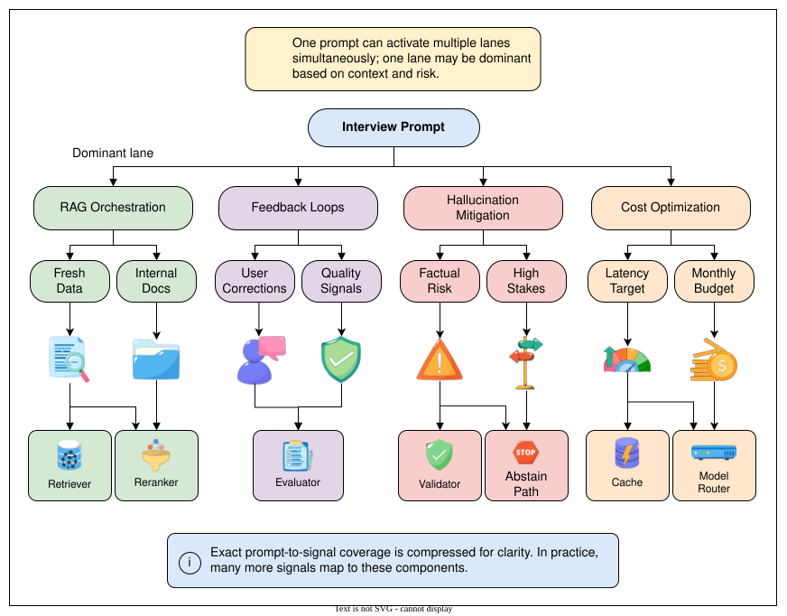

# Four_Recurring_Patterns_in_Generative_AI_System_Design_Interviews

Source: https://www.educative.io/courses/generative-ai-system-design/the-four-recurring-patterns

---

[Home](https://www.educative.io/)

[Courses](https://www.educative.io/search?tab=courses)

[Grokking the Generative AI System Design Interview](https://www.educative.io/courses/generative-ai-system-design)

# The Four Recurring Patterns

Explore how to quickly classify unfamiliar GenAI system design problems by recognizing four recurring patterns: RAG orchestration for fresh knowledge, feedback loops for improvement, hallucination mitigation for trust, and cost optimization for scale. Learn to map these patterns to architecture choices and trade-offs, enabling structured interview discussions and confident design decisions.

We'll cover the following...

- [What are the four recurring patterns](https://www.educative.io/courses/generative-ai-system-design/the-four-recurring-patterns#What-are-the-four-recurring-patterns)
- [How RAG and feedback show up](https://www.educative.io/courses/generative-ai-system-design/the-four-recurring-patterns#How-RAG-and-feedback-show-up)
  - [RAG orchestration in the request path](https://www.educative.io/courses/generative-ai-system-design/the-four-recurring-patterns#RAG-orchestration-in-the-request-path)
    - [Components that usually follow](https://www.educative.io/courses/generative-ai-system-design/the-four-recurring-patterns#Components-that-usually-follow)
    - [Distributed-system failure modes](https://www.educative.io/courses/generative-ai-system-design/the-four-recurring-patterns#Distributed-system-failure-modes)
  - [Feedback loops in the post-response path](https://www.educative.io/courses/generative-ai-system-design/the-four-recurring-patterns#Feedback-loops-in-the-post-response-path)
    - [What the loop actually updates](https://www.educative.io/courses/generative-ai-system-design/the-four-recurring-patterns#What-the-loop-actually-updates)
- [How hallucination and cost show up](https://www.educative.io/courses/generative-ai-system-design/the-four-recurring-patterns#How-hallucination-and-cost-show-up)
  - [Hallucination mitigation in high-risk flows](https://www.educative.io/courses/generative-ai-system-design/the-four-recurring-patterns#Hallucination-mitigation-in-high-risk-flows)
    - [A common validation stack](https://www.educative.io/courses/generative-ai-system-design/the-four-recurring-patterns#A-common-validation-stack)
    - [Trade-offs inside the flow](https://www.educative.io/courses/generative-ai-system-design/the-four-recurring-patterns#Trade-offs-inside-the-flow)
  - [Cost optimization in scaled serving](https://www.educative.io/courses/generative-ai-system-design/the-four-recurring-patterns#Cost-optimization-in-scaled-serving)
- [Recognizing patterns from question signals](https://www.educative.io/courses/generative-ai-system-design/the-four-recurring-patterns#Recognizing-patterns-from-question-signals)
- [Worked mappings for unfamiliar designs](https://www.educative.io/courses/generative-ai-system-design/the-four-recurring-patterns#Worked-mappings-for-unfamiliar-designs)
- [Conclusion](https://www.educative.io/courses/generative-ai-system-design/the-four-recurring-patterns#Conclusion)

A candidate gets a problem statement like "design a multilingual compliance assistant for a global bank," hears words like multilingual, compliance, and banking, and freezes on the domain. The stall usually has little to do with architecture skill. It happens because the surface language looks new while the underlying system shape is familiar.

Strong interview performance starts when you compress novelty into repeatable patterns. You already have [*SCALED*](https://www.educative.io/courses/generative-ai-system-design/the-scaled-framework-for-unseen-problems) as a way to turn requirements into a design. What you need now is a recognition layer that tells you which building blocks to activate first.

This lesson gives you that fast filter. You will map unfamiliar problem statements onto four recurring patterns: RAG orchestration, feedback loops, hallucination mitigation, and cost optimization. The goal is not to memorize canned answers. It is to decompose interview questions quickly into architecture choices, safety controls, and trade-offs, then move into a structured design discussion.

## What are the four recurring patterns[#](https://www.educative.io/courses/generative-ai-system-design/the-four-recurring-patterns#What-are-the-four-recurring-patterns)

Treat these patterns as a compact recognition toolkit for GenAI System Design interviews. An interview question often sounds domain-specific, but the request path usually reduces to one or more recurring mechanisms in the system.

The patterns usually appear in the following forms.

- **RAG orchestration:** The system must fetch external knowledge at request time when answers depend on private data, changing documents, or source-aware output.
- **Feedback loops:** The system must collect signals from usage, convert them into labels or metrics, and use them to improve prompts, retrieval, routing, or models over time.
- **Hallucination mitigation:** The system must reduce unsupported claims through grounding, validation, confidence estimation, and abstention when evidence is weak.
- **Cost optimization:** The system must stay within latency and budget constraints by controlling tokens, routing traffic, caching repeated work, and choosing model tiers.

One design problem can trigger several patterns at once. Your job is to identify the dominant signal first, then layer secondary patterns only where the requirements force them. The next sections turn those signals into concrete components and request flows.

Before we break down each lane, this visual frames how one interview question fans out into architectural consequences.

Problem to pattern map

That recognition map becomes more useful once you know what to listen for in prompt wording, so we will start with retrieval and learning loops.

## How RAG and feedback show up[#](https://www.educative.io/courses/generative-ai-system-design/the-four-recurring-patterns#How-RAG-and-feedback-show-up)

Most interview questions reveal themselves through request-time constraints. If the answer must come from changing documents, the design has to fetch evidence while serving the request. If the system should improve from usage, the design needs a learning loop after the request finishes.

### RAG orchestration in the request path[#](https://www.educative.io/courses/generative-ai-system-design/the-four-recurring-patterns#RAG-orchestration-in-the-request-path)

In plain terms, RAG means the model does not rely only on what it learned during training. It reads from an external knowledge source at serve time, much like an engineer checking the latest runbook before answering an on-call question.

Look for signals such as private enterprise data, policy lookup, document search, daily updates, citations, or evidence synthesis across long reports. Those signals imply chunking, an embedding pipeline, metadata filters, and usually a reranker.

#### Components that usually follow[#](https://www.educative.io/courses/generative-ai-system-design/the-four-recurring-patterns#Components-that-usually-follow)

The baseline RAG path usually includes these parts.

- **Ingestion pipeline:** The system parses PDFs, web pages, tickets, or wikis, extracts text and metadata, and writes normalized chunks into search indexes.
- **Hybrid retrieval:** The serving layer combines keyword search with dense embedding search so exact policy terms and semantic matches can both surface.
- **Context assembly:** The orchestrator selects top evidence, removes duplicates, formats citations, and builds a bounded prompt for generation.
- **Fallback logic:** The system detects low retrieval confidence and either asks a clarifying question, broadens search, or abstains instead of fabricating.

#### Distributed-system failure modes[#](https://www.educative.io/courses/generative-ai-system-design/the-four-recurring-patterns#Distributed-system-failure-modes)

RAG is not just an ML diagram. It has production failure modes.

- **Stale indexes:** Newly approved documents may miss the next query if ingestion lags or reindex jobs fail.
- **Hot partitions:** Popular documents or tenants can overload one shard in the vector or keyword index.
- **Latency inflation:** Retrieval, reranking, and long prompt assembly can dominate p95 even when generation itself is fast.

That covers the serve-time knowledge path. The second pattern shows up after the response leaves the model.

### Feedback loops in the post-response path[#](https://www.educative.io/courses/generative-ai-system-design/the-four-recurring-patterns#Feedback-loops-in-the-post-response-path)

A feedback loop starts with instrumentation. The system logs prompts, retrieval decisions, outputs, edits, accept or reject actions, and eventual business outcomes. Those events become the raw material for improvement.

> **Note:** Feedback loops are broader than RLHF. Many systems start with logging, offline evaluation, and safe prompt or routing updates long before model fine-tuning.

Design problems that mention "improves over time," user ratings, acceptance rate, policy drift, retraining cadence, or adaptation point to this pattern. The architecture usually adds telemetry, explicit labels from thumbs-up or audited corrections, implicit labels from edit distance or task completion, and a gated deployment process.

#### What the loop actually updates[#](https://www.educative.io/courses/generative-ai-system-design/the-four-recurring-patterns#What-the-loop-actually-updates)

The loop can improve several layers, not just the base model.

- **Prompt policy:** The team adjusts instructions or templates when logs reveal recurring failure shapes.
- **Retriever quality:** Hard queries can be added to evaluation sets, and retrieval parameters can be tuned against them.
- **Router behavior:** Traffic logs can retrain a complexity classifier that decides when to use larger models.
- **Model weights:** Fine-tuning or preference optimization can happen later if stable label quality exists.

> **Attention:** Biased feedback, delayed labels, and training-serving skew can make the loop optimize the wrong behavior. Always separate logging, evaluation, and deployment gates.

The next two patterns often appear in the same interview questions because trustworthy systems must also survive budget constraints.

## How hallucination and cost show up[#](https://www.educative.io/courses/generative-ai-system-design/the-four-recurring-patterns#How-hallucination-and-cost-show-up)

Some design problems are hard because a wrong answer is dangerous. Others are hard because success at scale becomes too expensive. In practice, these two constraints frequently collide inside the same serving path.

### Hallucination mitigation in high-risk flows[#](https://www.educative.io/courses/generative-ai-system-design/the-four-recurring-patterns#Hallucination-mitigation-in-high-risk-flows)

In simple terms, hallucination mitigation means the system should avoid sounding certain when its evidence is weak. In a bank, clinic, or legal workflow, unsupported confidence is often worse than a partial answer.

Signals include medical, legal, finance, compliance, source attribution, factual guarantees, and explicit concern about user trust. Those signals imply grounding with retrieval, citation formatting, claim extraction, verifier models, rule-based checks, and an abstain or clarify branch.

#### A common validation stack[#](https://www.educative.io/courses/generative-ai-system-design/the-four-recurring-patterns#A-common-validation-stack)

A robust answer path often includes layered checks.

- **Evidence grounding:** The generator receives retrieved passages and is instructed to answer only from those passages.
- **Claim validation:** A smaller verifier checks whether each claim has supporting evidence in the retrieved set.
- **Confidence scoring:** The system estimates whether support is sufficient and whether retrieved documents conflict.
- **Abstention flow:** The assistant declines, asks for clarification, or returns source snippets when confidence falls below threshold.

#### Trade-offs inside the flow[#](https://www.educative.io/courses/generative-ai-system-design/the-four-recurring-patterns#Trade-offs-inside-the-flow)

Every safety layer adds work to the request path. A second model for verification increases latency and cost. A strict abstention threshold lowers unsupported answers but may frustrate users with too many deferrals. Post hoc fact-checking can also become brittle if the checker sees the same weak evidence as the generator.

### Cost optimization in scaled serving[#](https://www.educative.io/courses/generative-ai-system-design/the-four-recurring-patterns#Cost-optimization-in-scaled-serving)

Cost optimization appears when the interview question mentions large user volume, fixed budget, target latency, or token-heavy contexts. The architecture then has to reduce expensive work per successful task, not just per request.

A practical design usually adds model routing, response caching, embedding caching, history summarization, context compression, and token budgets. Use the following comparison to anchor those levers in system behavior.

|  |  |  |  |
| --- | --- | --- | --- |
| **Cost lever** | **Where it sits in the request lifecycle** | **What it saves** | **Main failure mode** |
| **Response cache** | After request normalization, before model generation | Full inference cost, latency, repeat compute | Cache staleness or low hit rate from prompt variation |
| **Embedding cache** | During indexing or query embedding | Re-embedding cost, lookup latency | Stale vectors after content changes |
| **History summarization** | Before prompt assembly for multi-turn chats | Context window tokens, model cost | Lost context or summary drift |
| **Context compression** | During prompt construction before generation | Input tokens, retrieval payload size | Important details dropped in compression |
| **Small/large model tiering** | At model selection before inference | Average per-call model spend | Quality loss when tasks stay on too-small model |
| **Dynamic router** | Before retrieval or model invocation | Unnecessary tool, model, and retrieval cost | Route misclassification causing wrong path selection |
| **Retrieval depth control** | During retrieval before prompt assembly | Search cost, reranking cost, prompt tokens | Missed evidence at low depth; tail latency under burst traffic at high depth |

> **Practical tip:** Discuss cost per successful task, not token price alone. Extra retries, escalations, and validation passes can erase savings from a cheaper first model.

Safety and cost are often in tension. More validation reduces factual risk but raises p95 and spend. Strong candidates state that tension directly, then explain which metric wins for the given problem. That framing sets up a fast workflow for recognizing the dominant pattern during the interview itself.

The next step is to turn raw problem wording into a repeatable interview routine.

## Recognizing patterns from question signals[#](https://www.educative.io/courses/generative-ai-system-design/the-four-recurring-patterns#Recognizing-patterns-from-question-signals)

Use a four-step workflow when the interviewer drops an unfamiliar question. First, identify what makes the request hard. Usually the pain comes from freshness, trust, adaptation, or scale. Second, translate that pain into one or more recurring patterns. Third, name the minimum viable architecture implied by the dominant pattern. Fourth, discuss trade-offs and likely failure modes.

A few mappings become reliable shortcuts.

- **Cite sources:** This usually triggers RAG plus hallucination mitigation because retrieval fetches evidence and validation checks whether the answer stays grounded.
- **Improve from user edits:** This points to feedback loops because interaction logging, acceptance metrics, and gated updates become part of the system life cycle.
- **Serve millions cheaply:** This points to cost optimization because routing, caching, and token controls dominate the design.
- **Answer from company docs:** This points to RAG because request-time retrieval matters more than model retraining.

> **Attention:** Do not force all four patterns into every answer. State the primary pattern first, then add secondary ones only when requirements justify them.

That recognition habit becomes easier once you see it applied to concrete design problems.

## Worked mappings for unfamiliar designs[#](https://www.educative.io/courses/generative-ai-system-design/the-four-recurring-patterns#Worked-mappings-for-unfamiliar-designs)

A good interview answer sounds like a classification exercise followed by a focused architecture sketch. You name the dominant pattern, add supporting patterns, and tie each one to components in the request path or improvement loop.

Use these compact mappings as templates.

- **Internal HR assistant:** RAG orchestration is dominant because policies change and answers must come from private documents. Hallucination mitigation appears through citations, and cost optimization appears through caching repeated FAQ responses.
- **Medical triage assistant:** Hallucination mitigation is dominant because unsupported advice is dangerous. Retrieval may support grounding, but abstention, validation, and escalation are the primary controls.
- **Writing copilot with user edits:** Feedback loops are dominant because edits become labels for quality measurement, prompt updates, and later retraining gates.
- **Consumer support bot at huge scale:** Cost optimization is dominant because model routing, context budgets, and caching decide whether the service can meet traffic and budget goals. RAG activates only for knowledge-heavy cases.

The habit to copy is simple. Name the dominant pattern, list the minimum components it forces into the system, and then state one trade-off that could break the design if ignored.

This visual makes the same reasoning compact enough to rehearse quickly before an interview.

Worked pattern sketches

## Conclusion[#](https://www.educative.io/courses/generative-ai-system-design/the-four-recurring-patterns#Conclusion)

Unfamiliar interview questions become manageable when you classify them before you design them. RAG handles fresh or private knowledge, feedback loops handle improvement over time, hallucination mitigation handles factual risk, and cost optimization handles scale under budget.

Carry one habit into every interview. Detect the problem signals, identify the dominant pattern, add supporting patterns only as needed, and explain the trade-offs and failure modes in the request path.

The SCALED Framework for Unseen Problems

Mapping SCALED to RESHADED

Ask

[What are the four recurring patterns](https://www.educative.io/courses/generative-ai-system-design/the-four-recurring-patterns#What-are-the-four-recurring-patterns)

[How RAG and feedback show up](https://www.educative.io/courses/generative-ai-system-design/the-four-recurring-patterns#How-RAG-and-feedback-show-up)

[RAG orchestration in the request path](https://www.educative.io/courses/generative-ai-system-design/the-four-recurring-patterns#RAG-orchestration-in-the-request-path)

[Components that usually follow](https://www.educative.io/courses/generative-ai-system-design/the-four-recurring-patterns#Components-that-usually-follow)

[Distributed-system failure modes](https://www.educative.io/courses/generative-ai-system-design/the-four-recurring-patterns#Distributed-system-failure-modes)

[Feedback loops in the post-response path](https://www.educative.io/courses/generative-ai-system-design/the-four-recurring-patterns#Feedback-loops-in-the-post-response-path)

[What the loop actually updates](https://www.educative.io/courses/generative-ai-system-design/the-four-recurring-patterns#What-the-loop-actually-updates)

[How hallucination and cost show up](https://www.educative.io/courses/generative-ai-system-design/the-four-recurring-patterns#How-hallucination-and-cost-show-up)

[Hallucination mitigation in high-risk flows](https://www.educative.io/courses/generative-ai-system-design/the-four-recurring-patterns#Hallucination-mitigation-in-high-risk-flows)

[A common validation stack](https://www.educative.io/courses/generative-ai-system-design/the-four-recurring-patterns#A-common-validation-stack)

[Trade-offs inside the flow](https://www.educative.io/courses/generative-ai-system-design/the-four-recurring-patterns#Trade-offs-inside-the-flow)

[Cost optimization in scaled serving](https://www.educative.io/courses/generative-ai-system-design/the-four-recurring-patterns#Cost-optimization-in-scaled-serving)

[Recognizing patterns from question signals](https://www.educative.io/courses/generative-ai-system-design/the-four-recurring-patterns#Recognizing-patterns-from-question-signals)

[Worked mappings for unfamiliar designs](https://www.educative.io/courses/generative-ai-system-design/the-four-recurring-patterns#Worked-mappings-for-unfamiliar-designs)

[Conclusion](https://www.educative.io/courses/generative-ai-system-design/the-four-recurring-patterns#Conclusion)