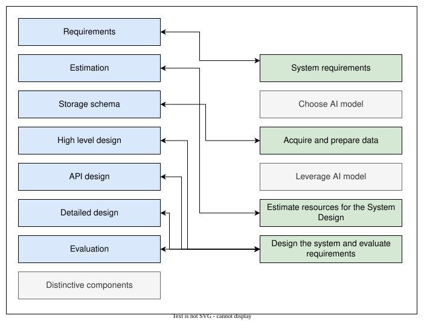

# Mapping_the_SCALED_Framework_to_RESHADED_for_GenAI_System_Design

Source: https://www.educative.io/courses/generative-ai-system-design/mapping-scaled-to-reshaded

---

[Home](https://www.educative.io/)

[Courses](https://www.educative.io/search?tab=courses)

[Grokking the Generative AI System Design Interview](https://www.educative.io/courses/generative-ai-system-design)

# Mapping SCALED to RESHADED

Map RESHADED to SCALED: keep your System Design habits, but add model choice, retrieval, token math, and quality evaluation.

We'll cover the following...

- [Recap of the SCALED framework](https://www.educative.io/courses/generative-ai-system-design/mapping-scaled-to-reshaded#Recap-of-the-SCALED-framework)
- [Recap of RESHADED for System Design](https://www.educative.io/courses/generative-ai-system-design/mapping-scaled-to-reshaded#Recap-of-RESHADED-for-System-Design)
- [Step-by-step mapping from RESHADED](https://www.educative.io/courses/generative-ai-system-design/mapping-scaled-to-reshaded#Step-by-step-mapping-from-RESHADED)
  - [Mapping the early steps](https://www.educative.io/courses/generative-ai-system-design/mapping-scaled-to-reshaded#Mapping-the-early-steps)
    - [Requirements become system requirements](https://www.educative.io/courses/generative-ai-system-design/mapping-scaled-to-reshaded#Requirements-become-system-requirements)
    - [Estimation becomes resource estimation](https://www.educative.io/courses/generative-ai-system-design/mapping-scaled-to-reshaded#Estimation-becomes-resource-estimation)
    - [Storage schema becomes data preparation](https://www.educative.io/courses/generative-ai-system-design/mapping-scaled-to-reshaded#Storage-schema-becomes-data-preparation)
  - [Mapping the later steps](https://www.educative.io/courses/generative-ai-system-design/mapping-scaled-to-reshaded#Mapping-the-later-steps)
    - [High-level, API, and detailed design become designing the system](https://www.educative.io/courses/generative-ai-system-design/mapping-scaled-to-reshaded#High-level-API-and-detailed-design-become-designing-the-system)
    - [Evaluation becomes evaluating against requirements](https://www.educative.io/courses/generative-ai-system-design/mapping-scaled-to-reshaded#Evaluation-becomes-evaluating-against-requirements)
    - [Steps without a direct counterpart](https://www.educative.io/courses/generative-ai-system-design/mapping-scaled-to-reshaded#Steps-without-a-direct-counterpart)
- [What stays the same and what GenAI adds](https://www.educative.io/courses/generative-ai-system-design/mapping-scaled-to-reshaded#What-stays-the-same-and-what-GenAI-adds)
- [A worked example through both lenses](https://www.educative.io/courses/generative-ai-system-design/mapping-scaled-to-reshaded#A-worked-example-through-both-lenses)
  - [First pass with classic RESHADED](https://www.educative.io/courses/generative-ai-system-design/mapping-scaled-to-reshaded#First-pass-with-classic-RESHADED)
  - [Reframing the same system with SCALED](https://www.educative.io/courses/generative-ai-system-design/mapping-scaled-to-reshaded#Reframing-the-same-system-with-SCALED)
- [Common mistakes when reusing classic habits](https://www.educative.io/courses/generative-ai-system-design/mapping-scaled-to-reshaded#Common-mistakes-when-reusing-classic-habits)
- [Conclusion](https://www.educative.io/courses/generative-ai-system-design/mapping-scaled-to-reshaded#Conclusion)

You get a design prompt for a customer-support chatbot. You estimate DAU, sketch API servers, add a search index, and call an LLM from one service. The answer sounds organized, but the interviewer asks three follow-up questions you did not plan for. How many tokens does each answer cost at peak load? What hallucination rate is acceptable when the bot answers from policy documents? What happens when the model produces unsafe or uncited advice?

That gap is exactly where many strong System Design candidates stumble. Their classic interview habits are useful, but they need a translation layer before they fit GenAI problems.

This lesson provides that layer by mapping the familiar RESHADED scaffold to the GenAI-focused SCALED framework. The goal is not to replace what you already know. The goal is to preserve your requirement gathering, estimation, and architecture habits, then retarget them toward model behavior, retrieval, safety, and evaluation.

We will not reteach both frameworks from scratch. We will connect them so you can answer GenAI design questions with the same rigor you already use in classic distributed systems.

## Recap of the SCALED framework[#](https://www.educative.io/courses/generative-ai-system-design/mapping-scaled-to-reshaded#Recap-of-the-SCALED-framework)

As discussed previously, [SCALED](https://www.educative.io/courses/generative-ai-system-design/the-scaled-framework-for-unseen-problems) is a six-step framework for designing generative AI systems. It keeps the interview structured, but it shifts attention toward model behavior and output quality.

The six steps are listed below.

- **System requirements:** The system starts by clarifying product behavior, latency, cost, safety, and quality targets.
- **Choose an AI model:** The design selects a model based on context length, reasoning ability, hosting constraints, and failure tolerance.
- **Acquire and prepare data:** The pipeline collects documents, cleans them, chunks them, embeds them, and stores them for retrieval.
- **Leverage the AI model:** The runtime builds prompts, retrieves context, calls the model, applies tools, and handles fallbacks.
- **Estimate resources:** The design computes token volume, serving throughput, storage growth, and hardware needs.
- **Design the system and evaluate against requirements:** The architecture is assembled, then checked against latency, cost, factuality, and safety goals.

In classic distributed systems, the center of gravity often sits around request routing, storage, scaling tiers, and interfaces. In GenAI systems, the request still flows through those layers, but the hard part often shifts to model choice, grounding data, cost per token, and guardrails.

> **Note:** SCALED extends standard architecture thinking. It does not discard it.

The next sections map these six steps back to RESHADED so your existing interview rhythm still works.

The visual below shows that alignment before we walk through it in detail.

RESHADED vs. SCALED framework

## Recap of RESHADED for System Design[#](https://www.educative.io/courses/generative-ai-system-design/mapping-scaled-to-reshaded#Recap-of-RESHADED-for-System-Design)

RESHADED remains a strong interview scaffold because it controls scope before complexity spreads. You clarify what the system must do, size it, decide how data is stored, sketch major services, define interfaces, dive deep where it matters, evaluate trade-offs, and then add one distinctive idea that signals senior judgment.

The eight steps are easy to reuse.

- **Requirements:** The interview begins by separating functional needs from nonfunctional constraints.
- **Estimation:** The system is sized through users, QPS, storage, bandwidth, and growth assumptions.
- **Storage schema:** The data layer is shaped around entities, indexes, access paths, and consistency needs.
- **High-level design:** Major components are connected so the interviewer can see request flow and dependencies.
- **API design:** Interfaces are defined so producers and consumers have clear contracts.
- **Detailed design:** One or two critical modules are opened up and explained precisely.
- **Evaluation:** Bottlenecks, failures, and trade-offs are inspected before ending the answer.
- **Distinctive component:** The design closes with a useful optimization or product-aware extension.

This works well in distributed systems because it forces pacing. You do not start with implementation trivia. You first understand scope and scale, then architecture.

Several parts transfer almost unchanged into GenAI interviews, especially requirement clarification, throughput estimation, storage reasoning, and failure analysis. The mismatch begins when the model is treated as an opaque microservice. Once that happens, the answer often ignores context windows, grounding, policy constraints, and probabilistic failures.

Before mapping step by step, keep one pacing reminder in mind.

## Step-by-step mapping from RESHADED[#](https://www.educative.io/courses/generative-ai-system-design/mapping-scaled-to-reshaded#Step-by-step-mapping-from-RESHADED)

You do not need a new interview personality for GenAI. You need to reroute familiar steps toward AI-specific bottlenecks.

### Mapping the early steps[#](https://www.educative.io/courses/generative-ai-system-design/mapping-scaled-to-reshaded#Mapping-the-early-steps)

The first half of the mapping is mostly about preserving habits while widening what you measure.

#### Requirements become system requirements[#](https://www.educative.io/courses/generative-ai-system-design/mapping-scaled-to-reshaded#Requirements-become-system-requirements)

Requirements map directly into SCALED system requirements. You still separate functional and nonfunctional needs, but the system now also asks for acceptable hallucination rate, citation behavior, refusal behavior, and policy boundaries.

#### Estimation becomes resource estimation[#](https://www.educative.io/courses/generative-ai-system-design/mapping-scaled-to-reshaded#Estimation-becomes-resource-estimation)

Estimation maps into SCALED resource estimation. You still compute DAU and QPS, but now each request carries prompt tokens, completion tokens, and context-window limits. If average tokens per request are tp+tct\_p + t\_ctp​+tc​, then daily token load is Q×(tp+tc)Q \times (t\_p + t\_c)Q×(tp​+tc​) for QQQ daily queries.

#### Storage schema becomes data preparation[#](https://www.educative.io/courses/generative-ai-system-design/mapping-scaled-to-reshaded#Storage-schema-becomes-data-preparation)

Storage schema maps into acquire and prepare data. A purely relational mindset is not enough. The system stores documents, metadata, embeddings, freshness markers, and versions. Think of a vector store like a library filing system that groups books by meaning instead of title alone.

### Mapping the later steps[#](https://www.educative.io/courses/generative-ai-system-design/mapping-scaled-to-reshaded#Mapping-the-later-steps)

The second half folds most of the classic architecture into a single SCALED step and highlights the steps that have no direct counterpart.

#### High-level, API, and detailed design become designing the system[#](https://www.educative.io/courses/generative-ai-system-design/mapping-scaled-to-reshaded#High-level-API-and-detailed-design-become-designing-the-system)

High-level design, API design, and detailed design all map into the SCALED step design the system and evaluate against requirements. You still connect major components and define clean contracts, but the runtime now includes an orchestrator, a retrieval service, a prompt builder, and an inference service. APIs now expose streaming responses, retrieval requests, feedback logging, and human-escalation paths. The deep dive opens up model-aware internals such as hosting trade-offs, prompting strategy, caching, chunking, and guardrails.

#### Evaluation becomes evaluating against requirements[#](https://www.educative.io/courses/generative-ai-system-design/mapping-scaled-to-reshaded#Evaluation-becomes-evaluating-against-requirements)

Evaluation maps into the evaluation half of the same SCALED step. You still inspect bottlenecks, failures, and trade-offs, but you now also check factuality, citation success, and safety against the targets set in the system requirements. Grounding becomes a core architectural behavior, not a side note.

#### Steps without a direct counterpart[#](https://www.educative.io/courses/generative-ai-system-design/mapping-scaled-to-reshaded#Steps-without-a-direct-counterpart)

Two SCALED steps are new: choose an AI model and leverage the AI model. Neither has a RESHADED equivalent, because classic designs rarely select a model or build prompts, retrieve context, call the model, and handle fallbacks at runtime. In the other direction, the RESHADED distinctive component has no dedicated SCALED step. Senior-level ideas such as model routing or human escalation still belong in your answer, but they surface while you design and evaluate the system.

That mapping is easier to trust once you separate stable foundations from genuinely new GenAI surface area.

## What stays the same and what GenAI adds[#](https://www.educative.io/courses/generative-ai-system-design/mapping-scaled-to-reshaded#What-stays-the-same-and-what-GenAI-adds)

A good GenAI answer still looks like System Design. The request enters an API layer, moves through core services, hits storage and compute bottlenecks, and returns under latency and cost constraints. The stable parts remain familiar.

Your classic toolkit still applies: requirements, traffic estimation, storage and indexing, clean service boundaries, trade-offs, and failure analysis all carry over unchanged.

GenAI adds a layer on top. You now track quality (factuality, hallucinations, citations), enforce safety filters, and fit prompts within context limits. Retrieved knowledge must stay fresh and traceable, some failures need human review to catch, and monitoring must cover answer quality, not just CPU and latency.

> **Attention:** A GenAI system can be perfectly available and still fail badly if answers are wrong or unsafe.

That changes how you define reliability. In classic systems, reliability often means uptime and successful responses. In GenAI systems, reliability also includes whether users can trust the response under ambiguity. The serving layer may be limited by GPU throughput, token generation speed, and context length rather than by stateless web-tier autoscaling alone.

Keep that distinction in mind as we move into one concrete problem.

## A worked example through both lenses[#](https://www.educative.io/courses/generative-ai-system-design/mapping-scaled-to-reshaded#A-worked-example-through-both-lenses)

Use one problem all the way through. Design a support chatbot over company documents.

### First pass with classic RESHADED[#](https://www.educative.io/courses/generative-ai-system-design/mapping-scaled-to-reshaded#First-pass-with-classic-RESHADED)

A classic answer starts with requirements such as answering support questions, authenticating employees, and meeting target latency. It estimates peak QPS, document storage, and search traffic. Then it defines schemas for users and documents, adds app servers and a search service, exposes a query API, and deep dives into indexing and cache behavior. The evaluation step checks latency, uptime, and search relevance.

That answer is organized, but it stops too early for GenAI.

### Reframing the same system with SCALED[#](https://www.educative.io/courses/generative-ai-system-design/mapping-scaled-to-reshaded#Reframing-the-same-system-with-SCALED)

Now the request flow changes. The user query reaches the API gateway, then an orchestrator classifies intent and retrieves relevant chunks from company documents. The retrieval service queries a vector database and document store, then returns grounded passages and metadata. The prompt builder composes instructions, the user question, and citations within token limits. The inference service generates an answer, and a safety filter blocks unsafe or uncited outputs. Feedback logging records the exchange for offline evaluation. If confidence is low, the system routes the case to human support.

The architecture adds several production modules.

- **Embedding pipeline:** The offline path chunks documents, computes embeddings, and keeps retrieval indexes fresh.
- **Model router:** The runtime can send simple queries to a cheaper model and risky ones to a stronger model.
- **Guardrail service:** The post-processing layer checks policy violations, missing citations, and refusal cases.
- **Evaluation pipeline:** Logged sessions are replayed against eval sets to track factuality and failure clusters.

> **Practical tip:** If the task is knowledge-heavy, retrieval is usually part of the baseline, not a fancy add-on.

The point is not to abandon classic design thinking. You keep it, then layer GenAI-specific modules and metrics on top.

The architecture sketch below makes that boundary visible.

Classic system components vs. GenAI components

That leads us into the interview mistakes that show up most often.

## Common mistakes when reusing classic habits[#](https://www.educative.io/courses/generative-ai-system-design/mapping-scaled-to-reshaded#Common-mistakes-when-reusing-classic-habits)

Most failures come from applying old instincts too literally. The answer sounds polished but misses the new bottleneck.

The common mistakes are listed below.

- **Jumping to a named model first:** Start with requirements before choosing a model.
- **Treating retrieval as optional for knowledge-heavy tasks:** Ground the system with data when answers must reflect company knowledge.
- **Ignoring token and context-window math:** Estimate token budgets before committing to prompt structure.
- **Measuring only latency and uptime:** Define quality metrics such as factuality and citation success.
- **Skipping eval data sets and human review:** Add offline evaluation and escalation paths for uncertain outputs.
- **Proposing complex agents too early:** Earn extra orchestration only after the baseline request path works.

> **Note:** Senior-level answers usually show disciplined scoping, explicit trade-offs, and awareness of probabilistic failure modes.

A strong answer stays boring in the right places. It clarifies scope, sizes the system, grounds the model, and only then adds sophistication.

## Conclusion[#](https://www.educative.io/courses/generative-ai-system-design/mapping-scaled-to-reshaded#Conclusion)

SCALED does not replace strong System Design fundamentals. It reorganizes them around model behavior, grounding data, token economics, and output quality.

You still begin with requirements and estimation. Then storage thinking evolves into retrieval preparation, high-level design expands into orchestration and guardrails, and evaluation now checks both system health and answer trustworthiness.

The Four Recurring Patterns

Design a Text-to-Text Generation System

Ask

[Recap of the SCALED framework](https://www.educative.io/courses/generative-ai-system-design/mapping-scaled-to-reshaded#Recap-of-the-SCALED-framework)

[Recap of RESHADED for System Design](https://www.educative.io/courses/generative-ai-system-design/mapping-scaled-to-reshaded#Recap-of-RESHADED-for-System-Design)

[Step-by-step mapping from RESHADED](https://www.educative.io/courses/generative-ai-system-design/mapping-scaled-to-reshaded#Step-by-step-mapping-from-RESHADED)

[Mapping the early steps](https://www.educative.io/courses/generative-ai-system-design/mapping-scaled-to-reshaded#Mapping-the-early-steps)

[Requirements become system requirements](https://www.educative.io/courses/generative-ai-system-design/mapping-scaled-to-reshaded#Requirements-become-system-requirements)

[Estimation becomes resource estimation](https://www.educative.io/courses/generative-ai-system-design/mapping-scaled-to-reshaded#Estimation-becomes-resource-estimation)

[Storage schema becomes data preparation](https://www.educative.io/courses/generative-ai-system-design/mapping-scaled-to-reshaded#Storage-schema-becomes-data-preparation)

[Mapping the later steps](https://www.educative.io/courses/generative-ai-system-design/mapping-scaled-to-reshaded#Mapping-the-later-steps)

[High-level, API, and detailed design become designing the system](https://www.educative.io/courses/generative-ai-system-design/mapping-scaled-to-reshaded#High-level-API-and-detailed-design-become-designing-the-system)

[Evaluation becomes evaluating against requirements](https://www.educative.io/courses/generative-ai-system-design/mapping-scaled-to-reshaded#Evaluation-becomes-evaluating-against-requirements)

[Steps without a direct counterpart](https://www.educative.io/courses/generative-ai-system-design/mapping-scaled-to-reshaded#Steps-without-a-direct-counterpart)

[What stays the same and what GenAI adds](https://www.educative.io/courses/generative-ai-system-design/mapping-scaled-to-reshaded#What-stays-the-same-and-what-GenAI-adds)

[A worked example through both lenses](https://www.educative.io/courses/generative-ai-system-design/mapping-scaled-to-reshaded#A-worked-example-through-both-lenses)

[First pass with classic RESHADED](https://www.educative.io/courses/generative-ai-system-design/mapping-scaled-to-reshaded#First-pass-with-classic-RESHADED)

[Reframing the same system with SCALED](https://www.educative.io/courses/generative-ai-system-design/mapping-scaled-to-reshaded#Reframing-the-same-system-with-SCALED)

[Common mistakes when reusing classic habits](https://www.educative.io/courses/generative-ai-system-design/mapping-scaled-to-reshaded#Common-mistakes-when-reusing-classic-habits)

[Conclusion](https://www.educative.io/courses/generative-ai-system-design/mapping-scaled-to-reshaded#Conclusion)