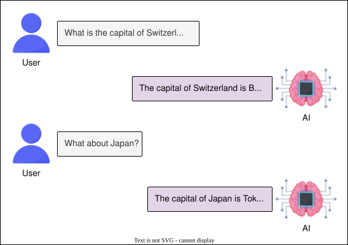
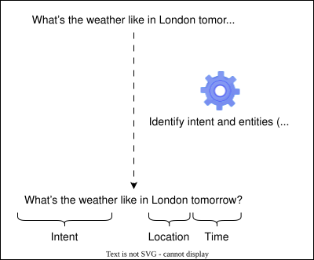
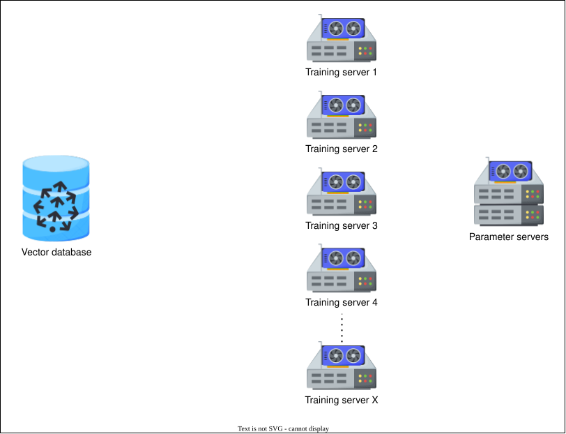
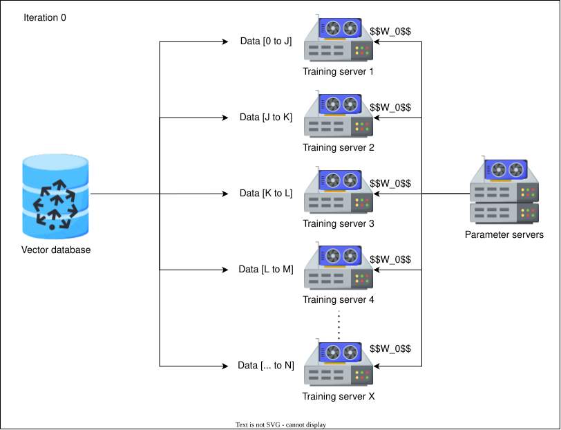
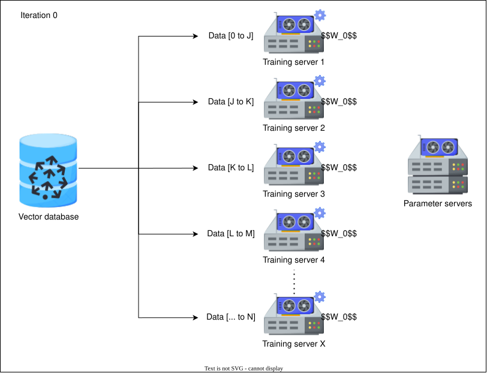

# Designing_a_Scalable_Text-to-Text_Generation_System_with_LLMs

Source: https://www.educative.io/courses/generative-ai-system-design/design-a-text-to-text-generation-system

---

[Home](https://www.educative.io/)

[Courses](https://www.educative.io/search?tab=courses)

[Grokking the Generative AI System Design Interview](https://www.educative.io/courses/generative-ai-system-design)

# Design a Text-to-Text Generation System

Design a conversational AI by training a Llama-style 3B model, then serving it through prompt embedding, long-term memory for context and personalization, and a moderated model host.

We'll cover the following...

- [Requirements](https://www.educative.io/courses/generative-ai-system-design/design-a-text-to-text-generation-system#Requirements)
  - [Functional requirements](https://www.educative.io/courses/generative-ai-system-design/design-a-text-to-text-generation-system#Functional-requirements)
  - [Nonfunctional requirements](https://www.educative.io/courses/generative-ai-system-design/design-a-text-to-text-generation-system#Nonfunctional-requirements)
- [Model selection](https://www.educative.io/courses/generative-ai-system-design/design-a-text-to-text-generation-system#Model-selection)
- [The training process](https://www.educative.io/courses/generative-ai-system-design/design-a-text-to-text-generation-system#The-training-process)
  - [Data acquisition and preparation](https://www.educative.io/courses/generative-ai-system-design/design-a-text-to-text-generation-system#Data-acquisition-and-preparation)
    - [Source of training data](https://www.educative.io/courses/generative-ai-system-design/design-a-text-to-text-generation-system#Source-of-training-data)
      - [Dataset format](https://www.educative.io/courses/generative-ai-system-design/design-a-text-to-text-generation-system#Dataset-format)
    - [Data preprocessing](https://www.educative.io/courses/generative-ai-system-design/design-a-text-to-text-generation-system#Data-preprocessing)
    - [Database selection](https://www.educative.io/courses/generative-ai-system-design/design-a-text-to-text-generation-system#Database-selection)
    - [Time estimation for data gathering and processing](https://www.educative.io/courses/generative-ai-system-design/design-a-text-to-text-generation-system#Time-estimation-for-data-gathering-and-processing)
  - [Model training and testing](https://www.educative.io/courses/generative-ai-system-design/design-a-text-to-text-generation-system#Model-training-and-testing)
    - [Distributing the training load](https://www.educative.io/courses/generative-ai-system-design/design-a-text-to-text-generation-system#Distributing-the-training-load)
  - [Model evaluation](https://www.educative.io/courses/generative-ai-system-design/design-a-text-to-text-generation-system#Model-evaluation)
- [Storage estimation](https://www.educative.io/courses/generative-ai-system-design/design-a-text-to-text-generation-system#Storage-estimation)
- [Inference servers estimation](https://www.educative.io/courses/generative-ai-system-design/design-a-text-to-text-generation-system#Inference-servers-estimation)
- [Bandwidth estimation](https://www.educative.io/courses/generative-ai-system-design/design-a-text-to-text-generation-system#Bandwidth-estimation)
- [System Design of text-to-text generation system](https://www.educative.io/courses/generative-ai-system-design/design-a-text-to-text-generation-system#System-Design-of-text-to-text-generation-system)
  - [High-level design](https://www.educative.io/courses/generative-ai-system-design/design-a-text-to-text-generation-system#High-level-design)
  - [Achieving functional requirements](https://www.educative.io/courses/generative-ai-system-design/design-a-text-to-text-generation-system#Achieving-functional-requirements)
- [A detailed System Design](https://www.educative.io/courses/generative-ai-system-design/design-a-text-to-text-generation-system#A-detailed-System-Design)
  - [Prompt embedding system](https://www.educative.io/courses/generative-ai-system-design/design-a-text-to-text-generation-system#Prompt-embedding-system)
  - [Long-term memory system](https://www.educative.io/courses/generative-ai-system-design/design-a-text-to-text-generation-system#Long-term-memory-system)
  - [Model host and content moderation system](https://www.educative.io/courses/generative-ai-system-design/design-a-text-to-text-generation-system#Model-host-and-content-moderation-system)
  - [Putting everything together](https://www.educative.io/courses/generative-ai-system-design/design-a-text-to-text-generation-system#Putting-everything-together)
  - [Workflow of the system](https://www.educative.io/courses/generative-ai-system-design/design-a-text-to-text-generation-system#Workflow-of-the-system)
- [Achieving nonfunctional requirements](https://www.educative.io/courses/generative-ai-system-design/design-a-text-to-text-generation-system#Achieving-nonfunctional-requirements)
- [Conclusion](https://www.educative.io/courses/generative-ai-system-design/design-a-text-to-text-generation-system#Conclusion)

**Text-to-text LLMs** are a subset of language models. Unlike their predecessors, which were primarily designed for text generation or translation tasks, conversational LLMs are specifically trained to engage in interactive dialogue. They can understand user input and generate human-like responses, making them ideal for applications like chatbots, virtual assistants, and interactive storytelling.

These are the brains behind those friendly AI assistants you interact with on websites or your smartphone. They are designed to understand your needs (even if you phrase them roundaboutly) and provide helpful, informative, and often entertaining responses.

A snapshot of what conversational text-to-text generation systems look like

Let’s see how we can design our own conversational AI. The first step is defining the requirements to guide the design process.

## Requirements[#](https://www.educative.io/courses/generative-ai-system-design/design-a-text-to-text-generation-system#Requirements)

Building the backend for a robust conversational AI system requires careful consideration of both functional and nonfunctional requirements.

### Functional requirements[#](https://www.educative.io/courses/generative-ai-system-design/design-a-text-to-text-generation-system#Functional-requirements)

- **Natural language understanding:** The system must decipher the meaning behind user input, including identifying intent, entities, and sentiment. Imagine asking your AI assistant, “What’s the weather like in London tomorrow?” The system needs to understand that you’re asking about the weather (intent), that “London” is the location (entity), and “tomorrow” is the time (entity).

Natural language understanding of a query

We can also look at an example of sentiment in a query. For instance, if the user says, “I’m so excited about the sunny weather tomorrow in London!” the system should extract:

- **Intent:** The user is expressing enthusiasm about the weather.
- **Entities:** *London* is the location, and *tomorrow* is the time.
- **Sentiment:** The user’s sentiment is positive, as their excitement shows.

- **Dialogue management:** The system must effectively manage conversations by retaining relevant information from previous interactions (context retention) and maintaining an awareness of the conversation’s progress (state management). This includes keeping track of user preferences, remembering recent topics, and understanding when to revisit or conclude a topic based on the conversation’s flow.
- **Natural language generation:** Once the system (LLM) understands the user’s input and the conversation context, it needs to respond accurately to the query.
- **Personalization:** The system should also be capable of tailoring responses based on user preferences and historical interaction.

How personalized LLMs respond to the same question

Modern conversational bots now include the ability to tailor their responses to each user. For example, we can tell Gemini to remember that our name is ABC, and it will remember that whenever we chat. We will see how LLMs can maintain memory in the next lesson.

### Nonfunctional requirements[#](https://www.educative.io/courses/generative-ai-system-design/design-a-text-to-text-generation-system#Nonfunctional-requirements)

- **Low latency:** The system should be optimized to minimize latency and provide a seamless conversational experience.

> **Note:** There can be trade-offs between latency and accuracy. For instance, achieving faster responses might mean sacrificing some degree of accuracy, as complex computations or larger models may require more processing time. Balancing latency and accuracy is essential, especially in applications where real-time interaction is critical, yet the accuracy of information remains important.

- **Scalability:** As the user base grows, the system needs to handle the increased demand without compromising performance. This means efficiently processing a large volume of requests concurrently.
- **Availability:** The text generation model should be accessible and operational whenever users need it. This means minimizing downtime and ensuring consistent uptime.
- **Reliability:** The model should give dependable and legitimate responses.
- **Security:** Protecting user data and ensuring privacy is paramount. User data typically includes personally identifiable information (PII) and, importantly, the user’s inputs to the system. Strong security measures must be implemented to safeguard this sensitive information.

Additionally, preventing prompt jailbreaking is an emerging challenge. Such incidents in models like ChatGPT and Gemini highlight the need for ongoing research and robust defenses against exploitation. We are trying to handle it in our system by ensuring ample training and cleaning data, as we will see later in the lesson, but of course, this is an inherent imperfection with generative models that can generate new data that cannot be predicted with certainty.

> **Note:** User inputs may also be used as training data for the model. Transparency about such practices is critical to maintaining user trust and complying with ethical and legal standards.

With our requirements decided, we can now discuss how to pick a GenAI model that can fulfill our system’s needs.

## Model selection[#](https://www.educative.io/courses/generative-ai-system-design/design-a-text-to-text-generation-system#Model-selection)

Building a conversational AI requires careful selection of the base language model, balancing capabilities with efficiency and cost-effectiveness. For this design, we’ll use the Llama 3.2 3B model, a 3-billion-parameter LLM optimized for handling natural language inputs.

Let’s understand the reasons behind choosing this model for our use case:

- **Open source:** Llama models provide flexibility and control. We can go into the model’s architecture, fine-tune it extensively, and adapt it precisely to our conversational needs without restrictions. The open-source nature of the Llama model provides the freedom to experiment with different training techniques and modify the model architecture if needed.
- **Smaller size, greater efficiency:** The 3B parameter size balances capability and efficiency. It’s significantly smaller than its 11B and 90B counterparts, making it more manageable for training and deployment, especially when resources might be limited. This translates to faster training, reduced computational costs, faster inference times, and easier deployment (since the model size is smaller, it takes less memory to store it).
- **Accuracy:** Despite its smaller size, Llama 3.2 3B demonstrates impressive accuracy on various language tasks, including dialogue generation and comprehension. It exhibits a good understanding of conversational nuances and can generate human-like responses.

The Llama 3.2 architecture

We’ll be training the Llama model (architecture) from scratch, which allows us to fully customize it for our specific conversational use case. This approach gives us granular control over the training data and optimization process.

Now that we have selected our model, we can talk about training this model from scratch.

## The training process[#](https://www.educative.io/courses/generative-ai-system-design/design-a-text-to-text-generation-system#The-training-process)

Let’s examine the process of training a text generation model. When working with large datasets, there are inherent challenges that need attention. In conversational datasets, data quality issues—such as incomplete sentences, slang, or inconsistencies in dialogue formatting—can affect model performance and reliability. Ensuring clean, high-quality data while handling large volumes also demands robust preprocessing to address issues like redundancy and irrelevant entries.

### Data acquisition and preparation[#](https://www.educative.io/courses/generative-ai-system-design/design-a-text-to-text-generation-system#Data-acquisition-and-preparation)

High-quality, relevant data is essential for training a conversational AI that understands language, generates meaningful responses, and engages in natural-sounding dialogue. There are several steps we usually take in data acquisition and preparation:

1. Collect or fetch the dataset.
2. Preprocess the dataset:

   1. Remove irrelevant or offensive content.
   2. Ensure consistency by formatting or converting the data.
3. Store the processed dataset.

Let’s look at each of these steps in detail.

#### Source of training data[#](https://www.educative.io/courses/generative-ai-system-design/design-a-text-to-text-generation-system#Source-of-training-data)

We can choose from multiple sources. For this application, we can choose a publicly available dataset that includes human conversations and real-world knowledge. Let’s assume this dataset is about 50 GB with 200 million rows of text.

##### Dataset format[#](https://www.educative.io/courses/generative-ai-system-design/design-a-text-to-text-generation-system#Dataset-format)

For text generation, we require the dataset to be in the following format:

|  |  |
| --- | --- |
| **Prompt/Query** | **Response (Label)** |
| What is the capital of Switzerland? | The capital of Switzerland is Bern. |
| What is the capital of Japan? | The capital of Japan is Tokyo. |
| Is Earth a star? | No, Earth is not a star. It is a planet located in the Sun’s habitable zone. |
| ... | ... |

> **Note:** Many off-the-shelf datasets will come in formats that may not be suitable for training immediately. We may need to remove or merge some columns (features) to prepare the dataset for training.

#### Data preprocessing[#](https://www.educative.io/courses/generative-ai-system-design/design-a-text-to-text-generation-system#Data-preprocessing)

Here are some considerations we will need to make and aspects we will need to review:

- **Topics:** Evaluate the distribution of topics within the dataset to ensure balanced representation. For instance, identify whether specific topics—like hobbies, current events, or social issues—appear more frequently than others. This can help prevent the model from biasing toward certain topics and ensure it responds well across various subjects.
- **Demographics:** Analyze the language used for potential biases regarding sex, age, ethnicity, or socioeconomic status. We consider metrics like portraying certain groups in stereotypical ways or excluding them altogether.
- **Sentiment and emotion:** Examine the distribution of sentiment and emotions expressed in the dialogues. Is there an imbalance toward positive or negative sentiment? Are certain emotions expressed more frequently by specific groups?

> **Note:** These are just some aspects we need to consider when handling text data. They might change depending on your use case and data. Others include rare word substitution, translating multilingual data, and removing noise.

This often requires manual reviews. We can train a separate sentiment analysis model to streamline this process, but expert review may still be necessary. If we do find discrepancies, here are a few techniques to mitigate bias:

- **Generate synthetic data:** Create new text data that address underrepresented topics or demographics, ensuring a more balanced and inclusive dataset.
- **Downsample overrepresented groups:** If certain groups are significantly overrepresented, consider downsampling their data to create a more balanced distribution.
- **Remove offensive content:** Filter out data containing hate speech, profanity, or other offensive language that could perpetuate harmful biases.

Techniques to process our data

With this, we can move on to processing our unbiased data.

Before we can move on to training, we need to process the data to ensure consistency. This will involve:

- **Formatting:** Ensuring consistent formatting and removing any unnecessary annotations.
- **Handling special characters and cases:** Standardizing punctuation and converting text to lowercase for consistency.

Then, we need to store this data in some database for efficient retrieval, as the training process will likely take a substantial amount of time, as discussed later.

AI Powered

Saved

1 attempt left

Reset

Pretraining vs. training

Transformers like GPT are usually pretrained on massive datasets before being adapted to specific applications. What is the difference between pretraining and training in this context?

This is your last attempt.

#### Database selection[#](https://www.educative.io/courses/generative-ai-system-design/design-a-text-to-text-generation-system#Database-selection)

We’ll use a [vector database](https://www.educative.io/courses/vector-database/introduction-to-vector-databases-and-embeddings) to handle efficient storage and retrieval of conversational data embeddings. After preprocessing, our data will be converted into vector embeddings and stored as vectors, each representing a conversation segment.

Factors influencing the choice of vector database include retrieval speed for a responsive conversational experience and robust indexing to optimize search and retrieval of relevant conversations. These considerations ensure our database choice aligns with the demands of real-time conversational AI applications.

Learn more about database selection [here](https://www.educative.io/courses/grokking-the-system-design-interview/introduction-to-databases).

To perform all of this preprocessing, we need to estimate the time it will take to complete this task and determine our resource requirements.

#### Time estimation for data gathering and processing[#](https://www.educative.io/courses/generative-ai-system-design/design-a-text-to-text-generation-system#Time-estimation-for-data-gathering-and-processing)

Let’s use some approximate values for our dataset:

Total data items=200 M\text{Total data items} = \text{200 M}Total data items=200 M

**Assuming:**

Time to preprocess a data item=1 msTime to convert a data item to a vector=1 msTime to store a vectorized data item into the database=0.1 ms\text{Time to preprocess a data item} = \text{1 ms}
\\
\text{Time to convert a data item to a vector} = \text{1 ms}
\\
\text{Time to store a vectorized data item into the database} = \text{0.1 ms}
Time to preprocess a data item=1 msTime to convert a data item to a vector=1 msTime to store a vectorized data item into the database=0.1 ms

**We get:**

Total preprocessing time (Tp)=Time to preprocess a data item×Total data itemsTp=1 ms×200 M=200,000 seconds\text{Total preprocessing time } (T\_p) = \text{Time to preprocess a data item} \times \text{Total data items}
\\
T\_p = \text{1 ms} \times \text{200 M} = \text{200,000 seconds}
Total preprocessing time (Tp​)=Time to preprocess a data item×Total data itemsTp​=1 ms×200 M=200,000 seconds

Total vectorization time (Tv)=Time to vectorize a data item×Total data itemsTv=1 ms×200 M=200,000 seconds\text{Total vectorization time } (T\_v) = \text{Time to vectorize a data item} \times \text{Total data items}
\\
T\_v = \text{1 ms} \times \text{200 M} = \text{200,000 seconds}Total vectorization time (Tv​)=Time to vectorize a data item×Total data itemsTv​=1 ms×200 M=200,000 seconds

Total storage time(Ts)=Time to store a data item×Total data itemsTs=0.1 ms×200 M=20,000 seconds\text{Total storage time} (T\_s) = \text{Time to store a data item} \times \text{Total data items}
\\
T\_s = \text{0.1 ms} \times \text{200 M} = \text{20,000 seconds}Total storage time(Ts​)=Time to store a data item×Total data itemsTs​=0.1 ms×200 M=20,000 seconds

**So the total time is:**

Total time=Tp+Tv+Ts\text{Total time} = T\_p + T\_v + T\_sTotal time=Tp​+Tv​+Ts​

Total time=200,000+200,000+20,000=420,000 seconds\text{Total time} = \text{200,000} + \text{200,000} + \text{20,000} = \text{420,000 seconds}Total time=200,000+200,000+20,000=420,000 seconds

Total time=7,000 minutes≈117 hours\text{Total time} = \text{7,000 minutes} \approx \text{117 hours}Total time=7,000 minutes≈117 hours

Total time taken to process our dataset using one machine

So, one machine would take about 117 hours to process all of this data at the speeds we assumed. To speed up this process, we can divide the data into multiple machines in parallel. For example, 16 machines would only take about 7.3 hours to process the 50 GB dataset.

> **Note:** In this case, splitting this data onto the 16 processing servers will also take time, but since we are calculating a rough estimate, we can use these numbers.

1.

Is there a way to further reduce the time it takes to process the data?

Show Answer

Did you find this helpful?

With our data training ready and stored, we can now discuss using this data to train the model.

### Model training and testing[#](https://www.educative.io/courses/generative-ai-system-design/design-a-text-to-text-generation-system#Model-training-and-testing)

To train our model on the dataset selected, we first need to estimate its training time by performing some back-of-the-envelope calculations. Let’s say we are using NVIDIA A100 80GB GPUs. These graphical processing units (GPUs) have 156 tera floating operations per second (TFLOPS) when doing TF32 calculations.

> **Note:** The RAM on these GPUs matters a lot for storing the model and the data used for training. If we cannot store these directly on the GPU, we may need to connect a database to the GPU to hold the data. However, this will also introduce latency into the system. The data is around 50 GB, and the model is around 12 GB (discussed later), so we can store them in a single A100 GPU if needed.

When training a model, selecting the right hyperparameters is crucial to guide the learning process. Key hyperparameters include:

- The **learning rate** is the step size at which a model updates its weights during training. It controls how quickly the model updates weights, impacting convergence and stability.
- **Batch size** is the number of training samples processed in a single iteration. It affects memory usage and the stability of gradient updates.
- Setting the **number of epochs**—the total passes through the training data—dictates the duration and depth of training.

Typically, training continues until validation loss stops improving. A **plateau** or a **rise** in validation loss indicates the model may have reached its optimal fit for the current data. We are unsure how many epochs it will take to train the model to a suitable standard. For large models, it’s common to begin with a baseline (e.g., 10-20 epochs) and evaluate how the validation metrics trend before committing to a larger number.

To estimate the time taken for training, we can use the formula created earlier:

Tsec=Nparams×NFLOPS×E×D×CRops×NGPUs\text{T}\_{\text{sec}} = \frac{\text{N}\_{\text{params}} \times \text{N}\_{\text{FLOPS}} \times \text{E} \times \text{D} \times \text{C}}{\text{R}\_{\text{ops}} \times \text{N}\_{\text{GPUs}}}Tsec​=Rops​×NGPUs​Nparams​×NFLOPS​×E×D×C​

During training, text-to-text models usually generate the entire output in one time step. So, we set the scaling variable C\text{C}C to 1. Let’s see how we can calculate the time taken for one GPU to train on this dataset:

Nparams=3 BillionNFLOPS=6E=1,000D=200 MillionC=1Rops=156 TFLOPSNGPUs=1Tseconds=3×109×6×1,000×200×106×1156×1012 FLOPS×1Tseconds≈23,076,923 secondsTdays≈267 days\begin{aligned}
\text{N}\_{\text{params}} &= 3 \ \text{Billion} \\
\text{N}\_{\text{FLOPS}} &= 6 \\
\text{E} &= 1{,}000 \\
\text{D} &= 200 \ \text{Million} \\
\text{C} &= 1 \\
\text{R}\_{\text{ops}} &= 156 \ \text{TFLOPS} \\
\text{N}\_{\text{GPUs}} &= 1 \\
\text{T}\_{\text{seconds}} &= \dfrac{3 \times 10^{9} \times 6 \times 1{,}000 \times 200 \times 10^{6} \times 1}{156 \times 10^{12} \ \text{FLOPS} \times 1} \\
\text{T}\_{\text{seconds}} &\approx 23{,}076{,}923 \ \text{seconds} \\
\text{T}\_{\text{days}} &\approx 267 \ \text{days}
\end{aligned}Nparams​NFLOPS​EDCRops​NGPUs​Tseconds​Tseconds​Tdays​​=3 Billion=6=1,000=200 Million=1=156 TFLOPS=1=156×1012 FLOPS×13×109×6×1,000×200×106×1​≈23,076,923 seconds≈267 days​

> If using one GPU and training for 1,000 epochs, training the model will take ~267 days.

This formula allows you to experiment using the calculator widget in the section below.

#### Distributing the training load[#](https://www.educative.io/courses/generative-ai-system-design/design-a-text-to-text-generation-system#Distributing-the-training-load)

As we can see, using only one server for a small training cycle of only 1,000 epochs results in an infeasible training time. We would want to train the model for far more epochs. This is where we can utilize distributed machine learning.

Since we already have the data stored in our vector database, we can split up that data using [data parallelism techniques](https://www.educative.io/courses/generative-ai-system-design/parallelism-in-genai-models) to train concurrently. Here is what that will look like:

1 / 7

We have X training servers

1 / 7

We split the data from the centralized database according to the server pool

1 / 7

The training servers pull model weights from the parameter servers

1 / 7

The training servers perform feedforward propagation on the data

1 / 7

The loss gradients are calculated on each server and are sent to the parameter servers

The time estimate when training for 1,000 epochs using 32 training servers is given below:

#### 

|  |  |  |  |
| --- | --- | --- | --- |
|  | A | B | C |
| 1 | Number of parameters | 3 | Billion |
| 2 | FLOPS per parameter update | 6 | FLOPS/parameter |
| 3 | Number of Epochs | 1000 | epochs |
| 4 | Size of data | 200 | Million entries |
| 5 | Time steps (C) | 1 | Steps |
| 6 | FLOPS for training | f3600000000 | TFLOPS |
| 7 | Rate of operations | 156 | TFLOPS |
| 8 | Number of GPUs | 32 | NVIDIA A100 GPUs |
| 9 | Training time (in seconds) | f721153.85 | Seconds |
| 10 | Training time (in days) | f8.35 | Days |

Try changing the values highlighted in yellow to see the effect on the time.

After training, the most essential step is to evaluate the model to ensure its output meets the criteria for our system. If the model is not up to the mark, the later steps, e.g., system design, deployment, and inference optimization, will be unproductive.

### Model evaluation[#](https://www.educative.io/courses/generative-ai-system-design/design-a-text-to-text-generation-system#Model-evaluation)

To evaluate our text generation model during and after training, we need to calculate metrics like [perplexity, BLEU, ROUGE score](https://www.educative.io/courses/generative-ai-system-design/evaluation-metrics-for-genai-systems), and loss on the validation set to evaluate our text generation model during and after training. Steady decreases in validation perplexity and loss generally indicate learning progress, while stagnation or an increase can signal overfitting.

Once the model is trained, we can fine-tune it to increase its accuracy or create a use-case-specific model.

The image below summarizes the complete training process from data acquisition to training and saving the model weights.

The model training architecture and process

Now, let’s look at how we can design the deployment infrastructure for this model to serve users.

For that, we will begin with estimating the resources required for system deployment. From there, we’ll explore how different components are integrated into a robust, efficient, and scalable architecture that can support real-world use cases.

Considering the [BOTECs chapter](https://www.educative.io/courses/generative-ai-system-design/estimating-training-compute-and-cost), we start with the different resources estimation, including:

- Storage estimation
- Inference servers
- Network bandwidth

Let’s dive into the details of each of the above:

## Storage estimation[#](https://www.educative.io/courses/generative-ai-system-design/design-a-text-to-text-generation-system#Storage-estimation)

Storage estimation includes model size, user profile and interaction data, and indexing storage:

- **Model size:** In the previous lesson, we established that we would use a model similar to Llama 3.2 3B to design a text-to-text generation system. For the 3 billion parameters model, 6 GB of storage would be required for FP16 floating-point precision.

Model size=3 billion×2 bytes=6 GB\text{Model size}= \text{3 billion} \times \text{2 bytes} =\text{6 GB}Model size=3 billion×2 bytes=6 GB

- **User profile data:** For storing users’ metadata, assume that each user’s data takes approximately 10 KB, translating to:

User data=100 M×10 KB=1 TB\text{User data} = 100 \text{ M} \times 10 \text{ KB} = 1 \text{ TB}User data=100 M×10 KB=1 TB

> **Note:** The model’s size (6 GB) and user profile data (1 TB) will remain constant unless the number of users increases. Therefore, we don’t include them in the subsequent storage estimation.

- **User interaction data:** If we store each user interaction data, the storage per interaction will depend on the size of each interaction. Assume that each user interacts 10 times daily with the system, consuming 2 KB of space per interaction. For 100 M users, this storage requirement per day would be:

User interaction data=100 M×10×2 KB=2 TB\text{User interaction data} = 100 \text{ M} \times 10 \times 2 \text{ KB} = 2 \text{ TB}User interaction data=100 M×10×2 KB=2 TB

- **Indexing storage:** We would need additional storage for indexing the user interaction data for fast retrieval. Let’s assume an average storage increase of 25% for indexing.

User interaction indexing storage=2 TB×0.25=0.5 TB\text{User interaction indexing storage} = 2 \text{ TB} \times 0.25 = 0.5 \text{ TB}
User interaction indexing storage=2 TB×0.25=0.5 TB

So, the total storage requirement for user interaction per day would be:

Storage required per day=2 TB+0.5 TB=2.5 TB/day\begin{align\*}
\text{Storage required per day}
&= 2 \text{ TB} + 0.5 \text{ TB} \\ &=2.5 \text{ TB/day}
\end{align\*}Storage required per day​=2 TB+0.5 TB=2.5 TB/day​

According to the above estimates, the monthly storage requirement is:

Monthly storage required=2.5 TB×30=75 TB/month\text{Monthly storage required} = \text{2.5 TB} \times 30 = \text{75 TB/month}Monthly storage required=2.5 TB×30=75 TB/month

Let’s move on to the estimation of inference servers.

## Inference servers estimation[#](https://www.educative.io/courses/generative-ai-system-design/design-a-text-to-text-generation-system#Inference-servers-estimation)

For daily 100 M users, the total number of requests per second (TRPS) is 11,574 for each user making 10 requests per day. Similarly, using [our proposed inference formula](https://www.educative.io/collection/page/10370001/5567964407791616/4719291315650560#Inference-server-estimation), an average query’s inference time for a 3B model (for 500 tokens) is approximately 9.6 milliseconds. This time is estimated using FP16 precision on an NVIDIA A100 GPU. According to this estimation, the QPS for an NVIDIA server having A100 GPU will be 104 QPS, which yields us the following number of inference servers:

Inference servers required=TRPSQPS=11574104≈112 GPU servers\text{Inference servers required} = \frac{\text{TRPS}}{\text{QPS}}= \frac{11574}{104} \approx 112 \text{ GPU servers}Inference servers required=QPSTRPS​=10411574​≈112 GPU servers

## Bandwidth estimation[#](https://www.educative.io/courses/generative-ai-system-design/design-a-text-to-text-generation-system#Bandwidth-estimation)

To calculate the ingress and egress network bandwidth for 11574 TRPS, we assume the single request size is approximately 2 KB. Also, as a result, the response size for each request is approximately 10 KB. According to the [BOTECs](https://www.educative.io/courses/generative-ai-system-design/estimating-inference-capacity-and-fleet-size), these assumptions give us the following bandwidths:

Ingress bandwidth=11574×2 KB=23.15 MBbps=23.15 MBps×8≈185 Mbps\begin{align\*}
\text{Ingress bandwidth}
&= 11574 \times \text{2 KB} \\ &=23.15 \text{ MBbps} \\ &=23.15 \text{ MBps} \times 8\approx 185 \text{ Mbps}
\end{align\*}Ingress bandwidth​=11574×2 KB=23.15 MBbps=23.15 MBps×8≈185 Mbps​

Egress bandwidth=11574×10 KB=115.74 MBps=115.74 MBps×8≈ 926 Mbps\begin{align\*}
\text{Egress bandwidth}
&= 11574 \times 10 \text{ KB} \\ &= 115.74 \text{ MBps} \\
& =115.74 \text{ MBps}\times 8\approx \ 926 \text{ Mbps}
\end{align\*}Egress bandwidth​=11574×10 KB=115.74 MBps=115.74 MBps×8≈ 926 Mbps​

So, we have the following number of estimated resources:

- **Storage required (approximately):** 2.5 TB/day2.5 \text{ TB/day}2.5 TB/day
- **Inference servers required:** 112112112 NVIDIA A100 GPU servers
- **Ingress bandwidth:** 185 Mbps185 \text{ Mbps}185 Mbps
- **Egress bandwidth:** 926 Mbps926 \text{ Mbps}926 Mbps

Estimated resources for inference

Let’s move on to the System Design of the text-to-text generation system in the following section:

## System Design of text-to-text generation system[#](https://www.educative.io/courses/generative-ai-system-design/design-a-text-to-text-generation-system#System-Design-of-text-to-text-generation-system)

Building the System Design of a text-to-text generation system requires a comprehensive understanding that integrates various subsystems to deliver efficient, scalable, and contextually aware interactions. This modular design ensures that each subsystem is specialized, contributing to the system’s overall reliability and performance. Let’s discuss the high-level design first to present a holistic view of the system:

### High-level design[#](https://www.educative.io/courses/generative-ai-system-design/design-a-text-to-text-generation-system#High-level-design)

Our proposed system is largely composed of the following key subsystems:

- **Prompt processing system:** This subsystem transforms user prompts into numerical vectors called embeddings, which capture semantic and contextual meaning.
- **Long-term memory system:**Thissubsystem stores user interactions, feedback, and preferences that enhance contextual accuracy and personalization of the prompts. It refines input prompts and processes them to align with the user’s intent and prior context.
- **Model host and content moderation system:** This service hosts the core model and generates results using the enhanced prompt. It also ensures that the generated content is clear, appropriate, and relevant.

These three subsystems work cohesively to deliver accurate, personalized, and context-aware responses, as shown in the following illustration:

The high-level design of a text-to-text generation system consisting of three subsystems

### Achieving functional requirements[#](https://www.educative.io/courses/generative-ai-system-design/design-a-text-to-text-generation-system#Achieving-functional-requirements)

We will analyze the system’s workflow and discuss how the functional requirements are fulfilled that we identified in the previous lesson:

- **Natural language understanding:** The prompt embedding and long-term memory systems convert user queries into numerical vectors that capture semantic meaning, enabling the system to interpret user intent effectively. The long-term memory system also refines the understanding by aligning the prompt with user intent and ensuring relevance. Thus, the goal of natural language understanding is reached.
- **Dialogue management:** The long-term memory system preprocesses user input by adding context to the dialogue, enabling the model host to generate context-aware responses.It also maintains session data, historical interactions, and user-specific preferences to manage coherent dialogues. The model host ensures continuity by managing fallback models for uninterrupted dialogue flow.
- **Natural language generation:** Based on the refined prompt, the model host generates linguistically accurate and contextually relevant responses. It ensures dynamic fallback handling for reliable response generation.
- **Personalization:** The long-term memory system leverages a service called context retrieval engine that utilizes user preferences and historical interactions to enhance prompts. This allows the model to generate responses tailored to each user’s needs.

We now understand the system at a high level. Let’s move ahead toward the detailed System Design.

## A detailed System Design[#](https://www.educative.io/courses/generative-ai-system-design/design-a-text-to-text-generation-system#A-detailed-System-Design)

Let’s describe each component involved in the text-to-text generation system. We follow a modular approach by describing each subsystem individually.

### Prompt embedding system[#](https://www.educative.io/courses/generative-ai-system-design/design-a-text-to-text-generation-system#Prompt-embedding-system)

This subsystem converts user queries into numeric vector representations (embeddings) that capture semantic meaning, facilitating efficient context retrieval and similarity searches. This system also filters the prompt to ensure safety, efficiency, and compliance by blocking inappropriate or invalid inputs early in the processing pipeline. If the prompt is appropriate, it is then provided to the next system, the long-term memory system, which further enhances its contextual accuracy.

Let’s look at the services required to build the prompt processing system:

- **Vector embedding service:** This service generates a numerical representation of the text.
- **Semantic cache:** This component caches embeddings of frequently encountered phrases and topics to reduce latency during inference. An effective caching strategy for this component is a [least recently used (LRU)](https://www.educative.io/implement-least-recently-used-cache) caching strategy, as it ensures frequently accessed embeddings remain in the cache while evicting the least recently used ones. This aligns well with the service’s need to prioritize commonly used phrases and topics for faster retrieval.
- **Vector database:** A specialized database like Pinecone stores and indexes embeddings, allowing for rapid retrieval of contextually relevant data (vectors) using similarity searches based on user query embeddings.
- **Data filter:** Cleans and refines retrieved data to ensure that only relevant and high-quality context information is passed to the long-term memory system.

Services involved in prompt embedding and analysis system

### Long-term memory system [#](https://www.educative.io/courses/generative-ai-system-design/design-a-text-to-text-generation-system#Long-term-memory-system)

This subsystem maintains user data (such as history, feedback, etc.) to improve contextual accuracy by tailoring the prompt according to user preferences. It uses the context retrieval engine coupled with several storages. Let’s look at the internal details:

- **Context retrieval engine:** This system identifies and retrieves relevant data from long-term storage. When the input prompt is received, the context retrieval engine searches the stored data to identify the most relevant past interactions, user preferences, or general knowledge based on the highest similarity scores using algorithms such as [cosine similarity](https://www.educative.io/answers/how-to-calculate-the-cosine-similarity), Euclidean distance, etc. This process ensures the system retrieves contextually accurate and personalized information to enrich the final output (prompt) with relevant data. It also ensures that the retrieved context aligns well with the user’s intent and the overall conversational flow. It scans and adjusts context-aware information, focusing on relevancy and clarity. This process also involves weighing the importance of different pieces of information, resolving contradictions, or adding missing details, depending on the user’s history and preferences.
- **Data privacy controls:** It incorporates compliance features to ensure transparency in data usage and adherence to regulatory requirements. An important role of this service is to ensure that user data remains private.

Internal details of a long-term memory system

- **Data stores:** To facilitate the long-term memory system, a number of storage services are required to store and maintain various forms of data:

  - **User profile and feedback data:** This database collects and stores user-specific data such as preferences and feedback. The purpose of this service is to enable personalization and continuous improvement of the prompt and, finally, the output generated by the model. A NoSQL database like MongoDB or Cassandra is ideal for storing user profile and feedback data due to its flexibility in handling unstructured or semi-structured data and scalability.
  - **Session storage and cache:** This keeps the context within a session for accurate and coherent interactions. A key-value store like Redis is often used as a session cache because it provides fast, in-memory data storage. It is also ideal for temporarily storing session data that needs to be quickly accessible and frequently updated, such as user login states, session IDs, or recent interactions in real-time applications.
  - **Long-term storage:** This stores historical data related to users' interactions over a period of time. This system helps the AI provide a personalized experience over multiple sessions with a user. A long-term memory is a system of databases such as SQL, NoSQL, and vector databases. The raw data is stored in SQL or NoSQL databases and is processed using encoding models like BERT or word2vec, which captures the semantic meaning. The encoded (embedded) data using these algorithms are stored in the vector database.
  - **Knowledge base:** Often referred to as a knowledge graph, this optional component is useful for applications requiring general knowledge reference. It captures structured relationships, concepts, and facts that the system may need to retain. A graph database is used for knowledge graph (knowledge base), with popular options like Neo4j or Amazon Neptune.

### Model host and content moderation system[#](https://www.educative.io/courses/generative-ai-system-design/design-a-text-to-text-generation-system#Model-host-and-content-moderation-system)

This service runs the core model, which generates responses based on the prompt it receives. It also scans the generated responses for inappropriate or sensitive content. This subsystem consists of the following components:

- **Model loader:** This service is responsible for loading and updating model weights in the model host, supporting versioning and efficient swapping for continuous deployment.
- **Model host:** This is where the core model runs. This service takes the optimized prompt and executes it to produce a response.
- **Model storage:** A repository of various models, their files, and configurations. It ensures quick access to various model versions and configurations for dynamic loading and facilitates updates and rollbacks. A combination of blob storage and distributed file systems is typically used for model storage.
- **Real-time content moderation service:** This service scans generated responses for inappropriate or sensitive content, ensuring they meet safety and compliance standards such as GDPR (General Data Protection Regulation) or HIPAA (Health Insurance Portability and Accountability Act) for data privacy, safety, and security. It enforces these standards to prevent the delivery of responses that could violate regulations or harm the user experience, ensuring compliance before responses are sent to the user.

Model host and content moderation system

### Putting everything together[#](https://www.educative.io/courses/generative-ai-system-design/design-a-text-to-text-generation-system#Putting-everything-together)

As shown below, all the subsystems are combined into one large system. We have also included some basic building blocks to complete the System Design, such as an API gateway and load balancer.

- **User interface (UI):** This is the interface the end-users utilize to submit queries and view the system’s responses. It may be a web browser, a desktop client, or a mobile app using APIs provided by the backend system.
- **API gateway:** This is the entry point for user requests. It handles authentication, rate limiting, and routing to ensure that only valid and authorized requests reach backend services.
- **Load balancer:** Distributes incoming requests across multiple backend instances, particularly the embedding service and model host servers, to maintain high availability and avoid overloading any instance.

System Design of a text-to-text generation system

### Workflow of the system[#](https://www.educative.io/courses/generative-ai-system-design/design-a-text-to-text-generation-system#Workflow-of-the-system)

The process starts when the user query, validated by the API gateway, reaches the load balancer. From the load balancer, the request goes to the prompt embedding system if it is an input prompt. Otherwise, if the input is user feedback, it is directed to the long-term memory system for improved personalization. The vector embedding service converts the user’s input into embeddings and is checked against a semantic cache to see if there’s a recent, similar query. If a matching response is already cached, it eliminates the need for the system to process the query through embedding and contextual adjustments, significantly reducing response time. The data filter screens the content to filter out inappropriate or irrelevant data.

Incoming requests flow in the system

The context retrieval engine retrieves historical interactions, user preferences, and relevant context from the user profile database, session cache, long-term memory, and knowledge graph storage. These data sources help the context retrieval engine enhance the prompt by integrating personalized information for each user. Before retrieving or using any data, the data privacy control ensures compliance with user privacy settings and access restrictions, ensuring only authorized data is retrieved. The enhanced prompt is provided to the inference server for generating a response.

The model loader loads and manages the appropriate language model in the model host. The model is also loaded based on the configuration settings, such as the user subscription, limit, availability of the latest model, etc. The model host processes the contextualized prompt and generates a response. This system can be distributed across multiple servers for load handling and low latency. The model loader loads a specific model based on the user subscription and limit.

Ultimately, the real-time content moderation service evaluates the responses’ quality and appropriateness, performs a final check to ensure compliance with content policies, and routes the response back to the user.

## Achieving nonfunctional requirements[#](https://www.educative.io/courses/generative-ai-system-design/design-a-text-to-text-generation-system#Achieving-nonfunctional-requirements)

- **Performance:** We can optimize the model’s performance through techniques like model quantization enabling faster inference times. Also, using caching mechanisms for frequently used responses and deploying the model close to users through edge computing can increase the system’s response time.
- **Scalability:** Deploying multiple model instances across a distributed infrastructure allows the system to handle increasing users. Utilizing load balancers to distribute requests evenly across servers and autoscaling groups ensures that the resources are dynamically adjusted based on demand.
- **Availability:** High availability can be achieved through multi-region deployments, where the global load balancer reroutes traffic in case of a disaster or large-scale failure in one region. Techniques such as load balancing, failover mechanisms, and monitoring ensure that requests are automatically redirected to a healthy server if one fails, maintaining system reliability.
- **Reliability:** Implementing robust error handling, checkpointing, and automated retries within each subsystem can increase the overall system’s reliability. Frequent model evaluations and monitoring detect and mitigate failures before they impact users. Using replicas and a distributed state management system helps ensure consistent service delivery.
- **Security:** Security can be enforced with encryption for data in transit and at rest, protecting user interactions. Access control measures, including role-based access and authentication (e.g., OAuth), limit access to the model and its data. Regular audits, logging, and anomaly detection also help safeguard against unauthorized access and attacks. Beyond traditional security measures, specific threats such as prompt injection attacks or vulnerabilities inherent to ML, AI, and LLMs must be addressed explicitly. Mitigation strategies include input sanitization, adversarial testing, fine-tuning models to resist manipulation, and implementing robust techniques to detect and neutralize malicious prompt patterns.

## Conclusion[#](https://www.educative.io/courses/generative-ai-system-design/design-a-text-to-text-generation-system#Conclusion)

In deploying a text-to-text generation model, careful planning is essential to meet scalability and performance demands. The process involves estimating the model’s resource requirements, such as storage, bandwidth, and server count, to ensure it can handle high volumes of interactions with minimal latency. We provided a modular approach toward the detailed design of the system, starting with the prompt embedding system followed by the long-term memory system and the model host and content moderation system. While real-world LLM systems like ChatGPT, Claud, or Gemini require rigorous planning, technical expertise, and numerous resources, this chapter provided a good starting point for the infrastructure for a text-to-text generation system.

Mapping SCALED to RESHADED

Design a Text-to-Image Generation System

Ask

[Requirements](https://www.educative.io/courses/generative-ai-system-design/design-a-text-to-text-generation-system#Requirements)

[Functional requirements](https://www.educative.io/courses/generative-ai-system-design/design-a-text-to-text-generation-system#Functional-requirements)

[Nonfunctional requirements](https://www.educative.io/courses/generative-ai-system-design/design-a-text-to-text-generation-system#Nonfunctional-requirements)

[Model selection](https://www.educative.io/courses/generative-ai-system-design/design-a-text-to-text-generation-system#Model-selection)

[The training process](https://www.educative.io/courses/generative-ai-system-design/design-a-text-to-text-generation-system#The-training-process)

[Data acquisition and preparation](https://www.educative.io/courses/generative-ai-system-design/design-a-text-to-text-generation-system#Data-acquisition-and-preparation)

[Source of training data](https://www.educative.io/courses/generative-ai-system-design/design-a-text-to-text-generation-system#Source-of-training-data)

[Dataset format](https://www.educative.io/courses/generative-ai-system-design/design-a-text-to-text-generation-system#Dataset-format)

[Data preprocessing](https://www.educative.io/courses/generative-ai-system-design/design-a-text-to-text-generation-system#Data-preprocessing)

[Database selection](https://www.educative.io/courses/generative-ai-system-design/design-a-text-to-text-generation-system#Database-selection)

[Time estimation for data gathering and processing](https://www.educative.io/courses/generative-ai-system-design/design-a-text-to-text-generation-system#Time-estimation-for-data-gathering-and-processing)

[Model training and testing](https://www.educative.io/courses/generative-ai-system-design/design-a-text-to-text-generation-system#Model-training-and-testing)

[Distributing the training load](https://www.educative.io/courses/generative-ai-system-design/design-a-text-to-text-generation-system#Distributing-the-training-load)

[Model evaluation](https://www.educative.io/courses/generative-ai-system-design/design-a-text-to-text-generation-system#Model-evaluation)

[Storage estimation](https://www.educative.io/courses/generative-ai-system-design/design-a-text-to-text-generation-system#Storage-estimation)

[Inference servers estimation](https://www.educative.io/courses/generative-ai-system-design/design-a-text-to-text-generation-system#Inference-servers-estimation)

[Bandwidth estimation](https://www.educative.io/courses/generative-ai-system-design/design-a-text-to-text-generation-system#Bandwidth-estimation)

[System Design of text-to-text generation system](https://www.educative.io/courses/generative-ai-system-design/design-a-text-to-text-generation-system#System-Design-of-text-to-text-generation-system)

[High-level design](https://www.educative.io/courses/generative-ai-system-design/design-a-text-to-text-generation-system#High-level-design)

[Achieving functional requirements](https://www.educative.io/courses/generative-ai-system-design/design-a-text-to-text-generation-system#Achieving-functional-requirements)

[A detailed System Design](https://www.educative.io/courses/generative-ai-system-design/design-a-text-to-text-generation-system#A-detailed-System-Design)

[Prompt embedding system](https://www.educative.io/courses/generative-ai-system-design/design-a-text-to-text-generation-system#Prompt-embedding-system)

[Long-term memory system](https://www.educative.io/courses/generative-ai-system-design/design-a-text-to-text-generation-system#Long-term-memory-system)

[Model host and content moderation system](https://www.educative.io/courses/generative-ai-system-design/design-a-text-to-text-generation-system#Model-host-and-content-moderation-system)

[Putting everything together](https://www.educative.io/courses/generative-ai-system-design/design-a-text-to-text-generation-system#Putting-everything-together)

[Workflow of the system](https://www.educative.io/courses/generative-ai-system-design/design-a-text-to-text-generation-system#Workflow-of-the-system)

[Achieving nonfunctional requirements](https://www.educative.io/courses/generative-ai-system-design/design-a-text-to-text-generation-system#Achieving-nonfunctional-requirements)

[Conclusion](https://www.educative.io/courses/generative-ai-system-design/design-a-text-to-text-generation-system#Conclusion)