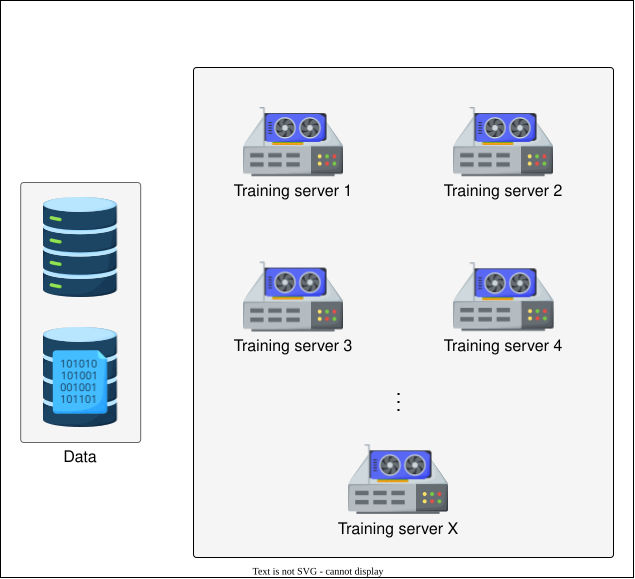
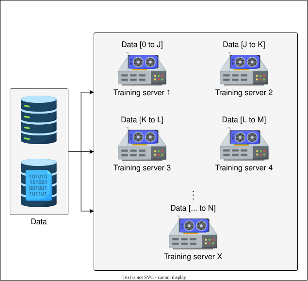
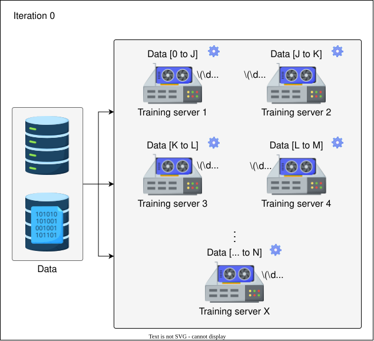

# Designing_Text-to-Image_Generation_Systems_with_Stable_Diffusion

Source: https://www.educative.io/courses/generative-ai-system-design/design-a-text-to-image-generation-system

---

[Home](https://www.educative.io/)

[Courses](https://www.educative.io/search?tab=courses)

[Grokking the Generative AI System Design Interview](https://www.educative.io/courses/generative-ai-system-design)

# Design a Text-to-Image Generation System

Design a text-to-image system around a diffusion model: train it on large image-text datasets, then serve it through prompt processing, contextualization, GPU hosting, and real-time moderation.

We'll cover the following...

- [Requirements](https://www.educative.io/courses/generative-ai-system-design/design-a-text-to-image-generation-system#Requirements)
  - [Functional requirements](https://www.educative.io/courses/generative-ai-system-design/design-a-text-to-image-generation-system#Functional-requirements)
  - [Nonfunctional requirements](https://www.educative.io/courses/generative-ai-system-design/design-a-text-to-image-generation-system#Nonfunctional-requirements)
- [Model selection](https://www.educative.io/courses/generative-ai-system-design/design-a-text-to-image-generation-system#Model-selection)
  - [Choosing the right model architecture](https://www.educative.io/courses/generative-ai-system-design/design-a-text-to-image-generation-system#Choosing-the-right-model-architecture)
    - [Why use the Stable Diffusion 3.5 Large model?](https://www.educative.io/courses/generative-ai-system-design/design-a-text-to-image-generation-system#Why-use-the-Stable-Diffusion-35-Large-model)
- [The training process](https://www.educative.io/courses/generative-ai-system-design/design-a-text-to-image-generation-system#The-training-process)
  - [Data acquisition and preparation](https://www.educative.io/courses/generative-ai-system-design/design-a-text-to-image-generation-system#Data-acquisition-and-preparation)
    - [Source of training data](https://www.educative.io/courses/generative-ai-system-design/design-a-text-to-image-generation-system#Source-of-training-data)
      - [Dataset format](https://www.educative.io/courses/generative-ai-system-design/design-a-text-to-image-generation-system#Dataset-format)
    - [Data preprocess](https://www.educative.io/courses/generative-ai-system-design/design-a-text-to-image-generation-system#Data-preprocess)
    - [Database selection](https://www.educative.io/courses/generative-ai-system-design/design-a-text-to-image-generation-system#Database-selection)
    - [Time estimation for data processing](https://www.educative.io/courses/generative-ai-system-design/design-a-text-to-image-generation-system#Time-estimation-for-data-processing)
  - [Model training and testing](https://www.educative.io/courses/generative-ai-system-design/design-a-text-to-image-generation-system#Model-training-and-testing)
    - [Distributing the training load](https://www.educative.io/courses/generative-ai-system-design/design-a-text-to-image-generation-system#Distributing-the-training-load)
  - [Model evaluation](https://www.educative.io/courses/generative-ai-system-design/design-a-text-to-image-generation-system#Model-evaluation)
    - [Evaluation metrics](https://www.educative.io/courses/generative-ai-system-design/design-a-text-to-image-generation-system#Evaluation-metrics)
- [Storage estimation](https://www.educative.io/courses/generative-ai-system-design/design-a-text-to-image-generation-system#Storage-estimation)
- [Inference servers estimation](https://www.educative.io/courses/generative-ai-system-design/design-a-text-to-image-generation-system#Inference-servers-estimation)
- [Bandwidth estimation](https://www.educative.io/courses/generative-ai-system-design/design-a-text-to-image-generation-system#Bandwidth-estimation)
- [Design consideration for the system](https://www.educative.io/courses/generative-ai-system-design/design-a-text-to-image-generation-system#Design-consideration-for-the-system)
  - [High-level design](https://www.educative.io/courses/generative-ai-system-design/design-a-text-to-image-generation-system#High-level-design)
    - [Achieving functional requirements](https://www.educative.io/courses/generative-ai-system-design/design-a-text-to-image-generation-system#Achieving-functional-requirements)
- [Detailed System Design](https://www.educative.io/courses/generative-ai-system-design/design-a-text-to-image-generation-system#Detailed-System-Design)
  - [Prompt processing and embedding system](https://www.educative.io/courses/generative-ai-system-design/design-a-text-to-image-generation-system#Prompt-processing-and-embedding-system)
  - [Dynamic contextualizer system](https://www.educative.io/courses/generative-ai-system-design/design-a-text-to-image-generation-system#Dynamic-contextualizer-system)
  - [Model hosting and content moderation system](https://www.educative.io/courses/generative-ai-system-design/design-a-text-to-image-generation-system#Model-hosting-and-content-moderation-system)
  - [Putting everything together](https://www.educative.io/courses/generative-ai-system-design/design-a-text-to-image-generation-system#Putting-everything-together)
  - [Workflow of the detailed design](https://www.educative.io/courses/generative-ai-system-design/design-a-text-to-image-generation-system#Workflow-of-the-detailed-design)
- [Fulfilling nonfunctional requirements](https://www.educative.io/courses/generative-ai-system-design/design-a-text-to-image-generation-system#Fulfilling-nonfunctional-requirements)
- [Conclusion](https://www.educative.io/courses/generative-ai-system-design/design-a-text-to-image-generation-system#Conclusion)

**Text-to-image generation models** are advanced neural networks that convert textual descriptions into visually accurate, realistic images. These models have many applications, from creative fields like art and design to business applications like e-commerce, where custom visuals can be generated on demand based on specific prompts. The ability to generate high-quality, prompt-driven images has opened new avenues for personalized content, accessible creative tools, and even therapeutic applications like guided imagery for mental health.

Building an effective image-generation model involves tackling several complex tasks. Unlike traditional image processing, where input data is typically visual, text-to-image models must comprehend textual prompts and translate them into visual elements that match the prompt’s intent. This requires a combination of natural language understanding and advanced image synthesis techniques. Notable models in this space include DALL•E, Stable Diffusion, and Midjourney, each known for producing diverse, high-quality images based on user-provided descriptions.

Let’s see how we can design our very own text-to-image system.

")

A snapshot of a text-to-image system (Source: AI-generated using Imagen 3.0)

## Requirements[#](https://www.educative.io/courses/generative-ai-system-design/design-a-text-to-image-generation-system#Requirements)

Building the backend for a robust text-to-image system requires careful consideration of both functional and nonfunctional requirements.

### Functional requirements[#](https://www.educative.io/courses/generative-ai-system-design/design-a-text-to-image-generation-system#Functional-requirements)

Here are the core functionalities we will need our system to perform:

- **Image generation:** The system should produce visually appealing, realistic, and contextually appropriate images based on user prompts.
- **Prompt understanding:** The system must accurately interpret the semantics of input prompts, including complex descriptions, emotional tones, and detailed scene compositions.
- **Personalization:** For a more user-centered experience, the system should support optional personalization features, such as style customization (e.g., impressionist, photorealistic) and unique characteristics (e.g., specific color palettes or themes).
- **Content moderation:** The system should include safeguards to filter inappropriate or unsafe content. This involves identifying harmful prompts and ensuring that generated images do not violate ethical or legal standards.

### Nonfunctional requirements[#](https://www.educative.io/courses/generative-ai-system-design/design-a-text-to-image-generation-system#Nonfunctional-requirements)

Here are the quality attributes that should be present in our system:

- **Availability:** The system should be available anytime, with minimal downtime to ensure accessibility. This might involve techniques like load balancing and redundancy to maintain uptime.
- **Scalability:** As demand for image generation can fluctuate significantly, the system must be scalable to handle large user requests without compromising performance or quality.
- **Performance:** Low-latency generation is essential for an optimal user experience. To minimize response times, efficient model architecture and hardware acceleration should be employed.
- **Reliability:** The system should consistently produce high-quality images with accurate prompt fidelity, regardless of the input’s complexity.
- **Security and privacy:** The system must protect user data and maintain privacy, particularly when handling custom prompts or sensitive data.

## Model selection[#](https://www.educative.io/courses/generative-ai-system-design/design-a-text-to-image-generation-system#Model-selection)

Selecting the right model architecture and preparing the training data are critical steps in building a text-to-image system. This section will focus on understanding available options.

### Choosing the right model architecture[#](https://www.educative.io/courses/generative-ai-system-design/design-a-text-to-image-generation-system#Choosing-the-right-model-architecture)

Text-to-image models have evolved significantly over recent years, with multiple architectures emerging as options. Some of the primary architectures include:

1. **Generative adversarial networks (GANs):** GANs are a class of neural networks that use two competing networks (a generator and a discriminator) to create high-quality images. While GANs have successfully generated realistic images, they can struggle with prompt comprehension and often require substantial tuning and training data to produce diverse outputs. In a GAN, there are two neural networks at play. The generator creates images (e.g., handwritten digits) from random noise, while the discriminator classifies images as real (from a dataset) or fake (generated). The two networks compete, improving each other over time.

")

A generative adversarial network (GAN)

2. **Variational autoencoders (VAEs):** VAEs are effective for image generation but typically produce less detailed results than GANs or diffusion models. They are also less commonly used for text-to-image generation because they don’t handle complex prompt translation as effectively. In a VAE, the probabilistic encoder maps input data (e.g., an image of a digit) into a latent vector by estimating its mean and standard deviation. The probabilistic decoder reconstructs the input from the latent vector, learning a probabilistic representation of the data.

")

A variational autoencoder network (VAE)

3. **Diffusion models:** Recently, diffusion models have become the architecture of choice for many text-to-image generation tasks, including popular applications like DALL•E and Stable Diffusion. Diffusion models iteratively denoise a random noise image until it matches the prompt’s content. This approach has shown superior results in generating high-quality, diverse images with detailed visual features. It works in the following way:

   1. The **encoder** converts the input (e.g., a digit) into a latent representation V1V\_1V1​.
   2. **Forward diffusion** gradually and iteratively adds noise to V1V\_1V1​, producing a highly noisy latent representation ofVNV\_NVN​.
   3. The **model** (e.g., a U-Net) predicts and removes the noise in a step-by-step (iterative) process, refining VNV\_NVN​ back toward VLV\_LVL​. This is also known as **backward diffusion**.
   4. The **decoder** reconstructs the final output image from the denoised latent representation.
   5. **Conditioning** (e.g., text prompts or semantic maps) guides the generation process to match specific criteria using a text encoder for additional input signals.

A high-level architecture of a diffusion model

When choosing which model suits our needs, we need to weigh the trade-offs of each:

|  |  |  |  |
| --- | --- | --- | --- |
| **Aspect** | **GANs** | **VAEs** | **Diffusion Models** |
| **Training Stability** | Difficult to train due to adversarial setup; prone to mode collapse | Relatively stable but may generate blurry images due to the nature of the reconstruction loss | Training is stable but requires intensive computation due to iterative denoising |
| **Image Quality** | High-quality, sharp images, especially when well-tuned | Often produces lower-quality, blurrier images | High-quality, realistic images. It can surpass GANs with enough steps |
| **Computational Cost** | Relatively fast to generate images after training | Very fast at inference but may lack image detail | Computationally expensive, especially during inference due to its iterative nature |
| **Training Data Requirements** | Can achieve good results with a moderate dataset size | Can work with smaller datasets but with limited realism in output | Often requires large-scale datasets for optimal performance |
| **Suitability for Text-to-Image Tasks** | Generally suitable but struggles with complex prompts or multi-object scenes | Limited suitability; struggles to capture complex text-image relationships. | Best suited among the three, it excels at complex prompts and realistic scene generation |

We’ll use a diffusion model for this system, like the Stable Diffusion 3.5 Large (8.1B). This choice is driven by its ability to generate photorealistic images while effectively handling prompt complexity.

#### Why use the Stable Diffusion 3.5 Large model?[#](https://www.educative.io/courses/generative-ai-system-design/design-a-text-to-image-generation-system#Why-use-the-Stable-Diffusion-35-Large-model)

- **Performance:** Stable Diffusion 3.5 Large is optimized for high-quality image generation. It can capture fine details and render complex scenes. It performs well across various image generation tasks, from simple object representations to intricate, multi-object scenes.
- **Flexibility with prompt understanding:** Stable Diffusion models use a specialized text encoder to understand detailed prompts, making translating complex, nuanced descriptions into visual representations easier. This model can interpret attributes like color, style, and even abstract concepts specified by the user.

> **Note:** Stable Diffusion 3.5 Large typically uses a CLIP (Contrastive Language–Image Pretraining) text encoder. This encoder is trained to understand detailed textual prompts and effectively match them with generated images. In this design problem, we will not focus on training the text encoder.

- **Scalability and efficiency:** Stable Diffusion 3.5 Large balances model size and computational efficiency. While still a large model designed for optimized inference, meaning it can generate images relatively quickly compared to larger diffusion models without sacrificing quality.
- **Customization:** As an open-source model, Stable Diffusion provides extensive flexibility for fine-tuning and adaptation. This allows us to modify and retrain the model to meet specific requirements, such as fine-tuning custom datasets for particular styles or industries.

By employing a SOTA architecture like Stable Diffusion 3.5 Large, we ensure that our system can meet high standards in image quality, prompt fidelity, and user adaptability, all while maintaining scalability and efficiency, similar to what the Stable Diffusion team has achieved.

## The training process[#](https://www.educative.io/courses/generative-ai-system-design/design-a-text-to-image-generation-system#The-training-process)

Next, we’ll discuss the process of training text-to-image systems and how these models learn to generate images based on textual descriptions.

### Data acquisition and preparation[#](https://www.educative.io/courses/generative-ai-system-design/design-a-text-to-image-generation-system#Data-acquisition-and-preparation)

Data acquisition is one of the most crucial aspects when training an image generation model. To effectively generate images based on text prompts, the dataset needs to include diverse and rich pairings of images and text descriptions that capture a wide range of visual styles, object types, scenes, and contexts.

#### Source of training data[#](https://www.educative.io/courses/generative-ai-system-design/design-a-text-to-image-generation-system#Source-of-training-data)

Text-to-image models are often trained on large, open-source datasets, but proprietary datasets can offer advantages for niche applications:

- **Public image-text datasets:** Public datasets like LAION and COCO are commonly used for general-purpose image generation. The LAION dataset, particularly, is popular for training large-scale diffusion models as it contains billions of image-text pairs, enabling models to learn associations between various prompts and images.
- **Proprietary datasets:** A proprietary dataset may provide better results for applications with specific requirements—such as medical imaging, architectural visualization, or fashion. These datasets can be collected or purchased to include images with detailed, relevant descriptions, ensuring the model is exposed to high-quality, domain-specific examples.

For this application, we can choose a publicly available dataset that includes image-text pairs (like LAION). Let’s assume this dataset is about 10 TB in size with 10 M rows, which means each row (text-image pair) will be around 1 MB.

##### Dataset format[#](https://www.educative.io/courses/generative-ai-system-design/design-a-text-to-image-generation-system#Dataset-format)

For image generation, we require the dataset to be in the following format:

")

Required dataset format (Source: AI-generated using Imagen 3.0)

> **Note:** Many off-the-shelf datasets will come in formats that may not be suitable for training immediately. We may need to remove or merge some columns (features) to prepare the dataset for training.

#### Data preprocess[#](https://www.educative.io/courses/generative-ai-system-design/design-a-text-to-image-generation-system#Data-preprocess)

Before we can move on to training, we need to process the data to ensure consistency. This will involve:

- **Data cleaning:** This step involves filtering out low-quality or irrelevant data, such as blurred images, nonsensical captions, or duplicate entries. Inappropriate or offensive content is also removed to maintain ethical standards.
- **Image preprocessing:** Images are resized to a standard resolution and format to ensure consistency during training. Color normalization, cropping, and data augmentation (like rotations or flips) may be applied to diversify the data and improve model robustness.
- **Text preprocessing:** Text descriptions must be standardized, which includes removing special characters, lowercasing, and correcting spelling errors. Longer descriptions might be truncated or summarized to fit within the input size limits of the text encoder.
- **Text-image pairing quality checks:** Text-to-image models rely on accurate pairings, so confirming that the text closely describes the image’s content is essential. Automated techniques, like the [CLIP score](https://www.educative.io/collection/page/10370001/5567964407791616/5559581239803904#CLIP-score), can help identify mismatches or irrelevant pairings.

Then, we need to store this data in some data stores.

#### Database selection[#](https://www.educative.io/courses/generative-ai-system-design/design-a-text-to-image-generation-system#Database-selection)

As we do not need to convert our data into vector embeddings right away, we can store this in an SQL database like MySQL, and the images can be stored in a blob store.

> **Note:** The CLIP encoder converts the text and images into vector embeddings.

#### Time estimation for data processing[#](https://www.educative.io/courses/generative-ai-system-design/design-a-text-to-image-generation-system#Time-estimation-for-data-processing)

Let’s use some approximate values for our dataset:

Total data items=10 M\text{Total data items} = 10\,\text{M}Total data items=10M

**Assuming:**

Time to preprocess an image=10 msTime to preprocess a text description=1 msTime to store a text-image pair into the database=1 ms\text{Time to preprocess an image} = 10 \, \text{ms} \\
\text{Time to preprocess a text description} = 1 \, \text{ms} \\
\text{Time to store a text-image pair into the database} = 1 \, \text{ms} \\Time to preprocess an image=10msTime to preprocess a text description=1msTime to store a text-image pair into the database=1ms

**We get:**

Total image processing time (Tpi)=Time to preprocess an image×Total data itemsTpi=10 ms×10 M=100,000 seconds≈28 hours\text{Total image processing time} \, (T\_{pi}) = \text{Time to preprocess an image} \times \text{Total data items} \\
T\_{pi} = 10 \, \text{ms} \times 10 \, \text{M} = 100,000 \, \text{seconds} \approx 28 \text{ hours}Total image processing time(Tpi​)=Time to preprocess an image×Total data itemsTpi​=10ms×10M=100,000seconds≈28 hours

Total text processing time (Tpt)=Time to preprocess text×Total data itemsTpt=1 ms×10 M=10,000 seconds≈2.5 hours\text{Total text processing time} \, (T\_{pt}) = \text{Time to preprocess text} \times \text{Total data items} \\
T\_{pt} = 1 \, \text{ms} \times 10 \, \text{M} = 10,000 \, \text{seconds} \approx 2.5 \text{ hours} Total text processing time(Tpt​)=Time to preprocess text×Total data itemsTpt​=1ms×10M=10,000seconds≈2.5 hours

Total storage time (Ts)=Time to store a text-image pair×Total data itemsTs=1 ms×10 M=10,000  seconds≈2.5 hours\text{Total storage time }(T\_s) = \text{Time to store a text-image pair} \times \text{Total data items} \\
T\_s = 1 \, \text{ms} \times 10 \, \text{M} = 10,000 \, \text{ seconds} \approx 2.5 \text{ hours} Total storage time (Ts​)=Time to store a text-image pair×Total data itemsTs​=1ms×10M=10,000 seconds≈2.5 hours

**So the total time taken is:**

Total time=Tpi+Tpt+Ts\text{Total time} = T\_{pi} + T\_{pt} + T\_s Total time=Tpi​+Tpt​+Ts​

Total time=100,000+10,000+10,000=120,000 seconds\text{Total time} = 100,000 + 10,000 + 10,000 = 120,000 \, \text{seconds} Total time=100,000+10,000+10,000=120,000seconds

Total time≈2,000 minutes≈33 hours\text{Total time} \approx 2,000 \text{ minutes} \approx 33 \text{ hours}Total time≈2,000 minutes≈33 hours

Time taken to process our dataset

So, one machine would take about 33 hours to process all of this data at the speeds we assumed. To speed up this process, we can divide the data into multiple machines in parallel. For example, 4 machines would only take about 8 hours to process the 10 TB dataset.

Other factors must be considered when parallelizing compute tasks in the real world. These include the time to split the data, the network latency and speed, computational power differences, and many more. We are taking the *ideal* estimates for these values, a common approach in [back-of-the-envelope estimations](https://www.educative.io/courses/grokking-the-system-design-interview/put-back-of-the-envelope-numbers-in-perspective).

### Model training and testing[#](https://www.educative.io/courses/generative-ai-system-design/design-a-text-to-image-generation-system#Model-training-and-testing)

To train our model on the dataset selected, we first need to estimate its training time. Let’s say we are using NVIDIA H100 80 GB GPUs. These GPUs can perform 989 TFLOPS of TF32 calculations.

> **Note:** Choosing any GPU (e.g., H100 vs. A100) depends on the task and the GPU’s computing power. For example, we are using NVIDIA H100s here for training, as it is a more compute-intensive task than inferencing. We can also use NVIDIA A100s for inferencing (as discussed in the next lesson).

To estimate the time taken for training, we can use the same formula from the previous lesson:

Tsec=Nparams×NFLOPS×E×D×CRops×NGPUs\text{T}\_{\text{sec}} = \frac{\text{N}\_{\text{params}} \times \text{N}\_{\text{FLOPS}} \times \text{E} \times \text{D} \times \text{C}}{\text{R}\_{\text{ops}} \times \text{N}\_{\text{GPUs}}}Tsec​=Rops​×NGPUs​Nparams​×NFLOPS​×E×D×C​

Where C\text{C}C becomes the number of diffusion (denoising) steps to create one image. We can call this Nsteps\text{N}\_{\text{steps}}Nsteps​. So, the formula becomes:

Tsec=Nparams×NFLOPS×E×D×NstepsRops×NGPUs\text{T}\_{\text{sec}} = \frac{\text{N}\_{\text{params}} \times \text{N}\_{\text{FLOPS}} \times \text{E} \times \text{D} \times \text{N}\_{\text{steps}}}{\text{R}\_{\text{ops}} \times \text{N}\_{\text{GPUs}}}Tsec​=Rops​×NGPUs​Nparams​×NFLOPS​×E×D×Nsteps​​

It is usually advisable to train the model using a large number of diffusion steps to ensure that the model learns the relationships between different elements of the images. We can assume around 1,000 steps while training, and we can lower the number to between 20-100 for inferencing. We choose a lower number of steps for inferencing because:

- Once the model is trained, it can generate competent images in much fewer steps.
- In real-world applications, latency is a crucial consideration. Reducing the number of denoising steps will significantly decrease the time it takes to generate the image.

> Using one GPU will take over 5,600 days to train the model.

#### Distributing the training load[#](https://www.educative.io/courses/generative-ai-system-design/design-a-text-to-image-generation-system#Distributing-the-training-load)

To distribute the training load, we need to keep one consideration in mind: it will take significantly longer to train this model due to the number of parameters and the nature of the inputs. So, we will employ [peer-to-peer distributed machine learning](https://www.educative.io/collection/page/10370001/5567964407791616/4840000481263616#Data-parallelism). Here’s what that would look like:

1 / 8

We have X training servers

1 / 8

We split the data from the centralized database according to the server pool

")

1 / 8

The training servers pull model weights from each other (P2P)

1 / 8

The training servers perform feedforward propagation on the data

1 / 8

The loss gradients are calculated on each server

The time estimate when training for 1,000 epochs using 512 training servers is given below:

#### 

|  |  |  |  |
| --- | --- | --- | --- |
|  | A | B | C |
| 1 | Number of parameters | 8.1 | Billion |
| 2 | FLOPS per parameter update | 6 | FLOPS/parameter |
| 3 | Number of Epochs | 1000 | epochs |
| 4 | Size of data | 10 | Million entries |
| 5 | Number of steps | 1000 | Steps |
| 6 | FLOPS for training | f486000000000 | TFLOPS |
| 7 | Rate of operations | 989 | TFLOPS |
| 8 | Number of GPUs | 512 | NVIDIA H100 GPUs |
| 9 | Training time (in seconds) | f959776.29 | Seconds |
| 10 | Training time (in days) | f11.11 | Days |

Try changing the values highlighted in yellow to see the effect on the time.

1.

Why train a text-to-image model for 20,000 epochs, even though it takes a long time?

Show Answer

Did you find this helpful?

### Model evaluation[#](https://www.educative.io/courses/generative-ai-system-design/design-a-text-to-image-generation-system#Model-evaluation)

For diffusion-based models, a denoising loss function is used. The model learns to predict the noise added to an image at each diffusion step, and the loss function is based on minimizing the difference between the actual noise and the predicted noise.

#### Evaluation metrics[#](https://www.educative.io/courses/generative-ai-system-design/design-a-text-to-image-generation-system#Evaluation-metrics)

- **Fréchet inception distance (FID):** FID measures the distance between generated and real images’ distributions. A lower FID score indicates higher similarity and, hence, better quality.
- **Precision and recall****:** Precision refers to the quality of the generated image to the given text prompt. High precision indicates image generation that closely aligns with the text description. Recall, conversely, measures the model’s capacity to generate a diverse range of valid images for a single prompt, reflecting its ability to explore different interpretations and visual styles.

Test your knowledge!

1.

What other metric(s) from the [evaluation metrics fundamental lesson](https://www.educative.io/collection/page/10370001/5567964407791616/5559581239803904) should we use in evaluating text-to-image models? Multi-select

A.

CLIP score

B.

Mean opinion score (MOS)

C.

BLEU score

D.

ROUGE score

---

1 / 1

The illustration below summarizes the complete training process from data acquisition to training. The model weights are saved and synced at each training server.

The model training architecture and process

As with the previous models, we can always fine-tune this model to increase its accuracy or to create a use case-specific model.

Deploying a powerful text-to-image generation model like Stable Diffusion 3.5 Large requires careful consideration of the infrastructure and resources needed to make it available to the public. Before designing the deployment infrastructure, estimating the storage capacity, necessary number of servers, and bandwidth is crucial. Let’s start with the storage estimation:

## Storage estimation[#](https://www.educative.io/courses/generative-ai-system-design/design-a-text-to-image-generation-system#Storage-estimation)

Storage estimation includes model size, user profile and interaction data, along with the indexing storage. Let’s estimate all these resources considering 100 million daily active users:

- **Model size estimation:** The Stable Diffusion 3.5 Large has significant memory and computational requirements. We’ll consider the half-precision floating-point format (FP16) to estimate the model’s size, which takes 16 bits (2 bytes) per parameter. This yields us the following size:

Model size=8.1 billion×2 bytes=16.2 GB\text{Model size}= \text{8.1 billion} \times \text{2 bytes} =\text{16.2 GB}Model size=8.1 billion×2 bytes=16.2 GB

- **User profile data:** For storing users’ data, assume that each user’s data takes approximately 10 KB, translating to:

User data=100 M×10 KB=1 TB\text{User data} = 100 \text{ M} \times 10 \text{ KB} = 1 \text{ TB}User data=100 M×10 KB=1 TB

> **Note:** The model’s size (16.2 GB) and user profile data (1 TB) will remain constant unless the number of users increases. Therefore, we don’t include them in the storage required per day or month.

- **User interaction data:** If we store each user interaction data, the storage per interaction will depend on the size of each interaction and the image size produced during each interaction. Assume that each user interacts 10 times per day with the system, and the model generates a 1 MB image for the user; this gives us the following:

Users interaction data=100 M×(1 MB×10)=1000 TB\text{Users interaction data} = 100 \text{ M} \times (1 \text{ MB} \times 10) = 1000 \text{ TB}Users interaction data=100 M×(1 MB×10)=1000 TB

- **Indexing storage:** To make user interactions searchable and efficiently accessible, additional storage for indexing and metadata would be required. This might add another 25% of storage.

Indexing storage=1000 TB×0.25=250 TB\text{Indexing storage} = 1000 \text{ TB} \times 0.25 = 250 \text{ TB}Indexing storage=1000 TB×0.25=250 TB

So, the total storage requirement for user interaction per day would be:

Storage required per day=Users interaction data+Indexing storage=1000 TB+250 TB≈1250 TB/day\begin{align\*}
\text{Storage required per day} &= \text{Users interaction data} + \text{Indexing storage} \\
&= 1000 \text{ TB} + 250 \text{ TB} \\ &\approx 1250 \text{ TB/day}
\end{align\*}Storage required per day​=Users interaction data+Indexing storage=1000 TB+250 TB≈1250 TB/day​

According to the above estimates, the monthly storage requirement is:

Monthly storage required=1250 TB×30=37.5 PB/month\text{Monthly storage required} = \text{1250 TB} \times 30 = \text{37.5 PB/month}Monthly storage required=1250 TB×30=37.5 PB/month

Let’s move on to the estimation of inference servers:

## Inference servers estimation[#](https://www.educative.io/courses/generative-ai-system-design/design-a-text-to-image-generation-system#Inference-servers-estimation)

At 100 million DAUs, each user generating around 10 images daily, the estimated Total Requests Per Second (TRPS) is approximately 11574. Similarly, using [our proposed inference formula](https://www.educative.io/collection/page/10370001/5567964407791616/4719291315650560#Inference-server-estimation), an average query’s inference time for an 8.1 billion model (for 100 iterations) is approximately 5.2 milliseconds. This time is estimated using FP16 precision on an NVIDIA A100 GPU. According to this estimation, the QPS for NVIDIA server having A100 GPU will be approximately 192 QPS, which yields us the following number of GPUs:

Inference servers required=TRPSQPS=11574192≈61 GPUs\text{Inference servers required} = \frac{\text{TRPS}}{\text{QPS}}=\frac{11574}{192} \approx 61 \text{ GPUs}Inference servers required=QPSTRPS​=19211574​≈61 GPUs

We need 61 GPUs to handle 11574 text-to-image requests per second.

## Bandwidth estimation[#](https://www.educative.io/courses/generative-ai-system-design/design-a-text-to-image-generation-system#Bandwidth-estimation)

Assuming that each request takes approximately 2 KB of size, for 11574 TRPS, ingress bandwidth will be estimated to:

Ingress bandwidth=11574×2 KB=23.15 MBps≈23.15 MBps×8 bits=185 Mbps\begin{align\*}
\text{Ingress bandwidth}
& = 11574 \times \text{2 KB}
\\
&= 23.15 \text{ MBps} \\ &\approx \text{23.15 MBps} \times 8 \text{ bits} =185 \text{ Mbps}
\end{align\*}
Ingress bandwidth​=11574×2 KB=23.15 MBps≈23.15 MBps×8 bits=185 Mbps​

Assume the response size is 1 MB for an image request with dimensions of 512x512, including the associated metadata. This gives us the following egress bandwidth:

Egress bandwidth=11574×1 MB=11574 MBps=11574 MBps×8 bits≈93000 Mbps≈93 Gbps\begin{align\*}
\text{Egress bandwidth}
&= \text{11574} \times \text{1 MB}
\\
&= 11574 \text{ MBps}
\\
& = \text{11574 MBps} \times 8 \text{ bits}\approx 93000 \text{ Mbps} \\ &\approx 93 \text{ Gbps}
\end{align\*}Egress bandwidth​=11574×1 MB=11574 MBps=11574 MBps×8 bits≈93000 Mbps≈93 Gbps​

So, we have the following number of resource estimations:

- Storage required: 1250 TB / day\text{1250 TB / day}1250 TB / day
- Inference servers with GPUs:  61 NVIDIA A100 GPUs\text{ 61 NVIDIA A100 GPUs} 61 NVIDIA A100 GPUs
- Ingress bandwidth: 185 Mbps\text{185 Mbps}185 Mbps
- Egress bandwidth: 93 Gbps\text{93 Gbps}93 Gbps

Estimated resources for a text-to-speech generation system

Until now, we have estimated the required resources for deploying an image generation model. Let’s move on to some important factors and challenges that need to be carefully evaluated during the inference phase:

## Design consideration for the system[#](https://www.educative.io/courses/generative-ai-system-design/design-a-text-to-image-generation-system#Design-consideration-for-the-system)

Some of the important factors that we need to consider while designing the image generation systems are as follows:

- **Inference strategies:** We will use efficient denoising schedulers like the denoising diffusion implicit model (DDIM) or diffusion probabilistic model solver (DPM-Solver) to reduce steps and speed up image generation without sacrificing quality. As we have seen, the half-precision floating point is ideal for fast computation (and reducing the number of GPUs). Attention layers can be optimized with libraries like xFormers for better memory and speed performance. Using batching and parallelization can maximize GPU usage, especially in high-throughput scenarios.
- **Inference time:** For inference time, high-end GPUs like the NVIDIA A100 and H100 can produce a 512x512 image in around 2-6 seconds with 20-30 steps. Reducing denoising steps to around 20-30, using lower resolutions, or utilizing latent space upsampling can also help balance speed and quality.
- **Resolution scaling:** Resolution scaling is another key consideration, as generating high-resolution images (e.g., 1024x1024 or above) requires significant memory and processing power. We can implement latent space upsampling or two-stage generation, where the model produces a smaller, lower-resolution image and then upscales it with a secondary process. This approach allows the system to deliver high-quality images efficiently, optimizing resources for scalable deployment.
- **User experience (UX):** Text-to-image models, especially large ones like Stable Diffusion, can have considerable latency, which impacts user experience.
- **Prompt filtering:** Prompt filtering is critical for production environments to ensure users do not generate inappropriate or harmful images. There should be content filtering systems that can evaluate the input prompt, applying restrictions as needed. This layer helps organizations adhere to responsible AI guidelines and mitigate potential misuse.

We have seen several design considerations that must be carefully addressed while deploying an image generation model. Now let’s dive deep into the System Design of such a system.

Let’s describe each subsystem and component in the text-to-image generation System Design. We follow a modular approach by describing different subsystems combined into one detailed system, as discussed in the high-level design below.

### High-level design[#](https://www.educative.io/courses/generative-ai-system-design/design-a-text-to-image-generation-system#High-level-design)

Let’s start with the high-level design of the system, which consists of the following four subsystems:

- **Prompt processing and embedding system:** This subsystem is the foundational component that transforms user inputs into meaningful data for text-to-image generation. It processes and enhances prompts to extract semantic meanings and expressive styles, providing encoded inputs for subsequent stages.
- **Dynamic contextualizer system:** This subsystem combines dynamic prompt interpretation with user feedback, enabling the model to generate contextually rich and detailed outputs. This system ensures user intent is balanced across concepts, styles, and aesthetics while the different databases retain relevant knowledge for informed image creation.
- **Model hosting and content moderation system:** The core computational engine of the text-to-image generation system utilizes structured inputs to generate high-quality, visually appealing images. This system also has a service that evaluates generated content in real time to filter inappropriate or harmful outputs and ensures the system adheres to safety guidelines and ethical considerations.

The high-level design of a text-to-image generation system consisting of four subsystems

#### Achieving functional requirements[#](https://www.educative.io/courses/generative-ai-system-design/design-a-text-to-image-generation-system#Achieving-functional-requirements)

Let’s discuss how the functional requirements are fulfilled that were identified in the previous lesson:

- **Image generation:** The model hosting system fulfills this functional requirement, transforming structure parameters into high-quality images.
- **Prompt understanding:** This functional requirement is achieved via the prompt processing and embedding system, which ensures a comprehensive understanding of user inputs by cleaning, tokenizing, and encoding text. The prompt understanding is further enhanced using the dynamic contextualizer to obtain the user’s intended results.
- **Personalization:** Personalization can be achieved using the dynamic contextualizer, which uses a service called a reinforcement learning engine to adapt outputs to user preferences and feedback. These services also integrate user style and aesthetic preferences into generated images.
- **Content moderation:** The model hosting and content moderation systems evaluate the generated outputs for inappropriate or harmful content through a specialized service.

We now have a broad picture of the text-to-image generation system. Let’s move ahead to expand each of the subsystems in the following detailed System Design:

## Detailed System Design[#](https://www.educative.io/courses/generative-ai-system-design/design-a-text-to-image-generation-system#Detailed-System-Design)

Let’s describe each subsystem and component involved in the text-to-image generation system individually as follows:

### Prompt processing and embedding system[#](https://www.educative.io/courses/generative-ai-system-design/design-a-text-to-image-generation-system#Prompt-processing-and-embedding-system)

This system is the critical starting point for transforming user prompts into actionable data that enables text-to-image generation. This subsystem thoroughly analyzes, enhances, and encodes textual input to extract semantic meaning and stylistic preferences, laying the foundation for creating visually appealing and contextually accurate images. This system consists of the following services:

Prompt processing and embedding system

- **Language detection:**  This service identifies the input language to ensure multilingual support. It is necessary because users may submit prompts in different languages, and the model needs to interpret the input correctly. By detecting the language, this service ensures smooth downstream processing and reduces errors caused by mismatched language handling.
- **Text preprocessor:** This service cleans the prompt and normalizes the text to remove textual noise and inconsistencies. It is critical because unprocessed prompts can include typos, irregular formats, or unnecessary characters that disrupt accurate semantic understanding.
- **Tokenizer:** This service breaks the text prompt into individual tokens. Tokenization is essential because it allows the model to focus on individual words or phrases. Without proper token segmentation, the system might struggle to understand complex inputs and interpret subtle differences.
- **CLIP text encoder**: The CLIP text encoder generates initial embeddings that capture the semantic meaning of the input text. These embeddings exist in a shared space aligned with visual data, making them suitable for tasks that link language to visuals. Its primary role is to create a general-purpose embedding that connects the user’s textual intent to the visual domain.
- **Vector embedding:**This service refines or transforms the CLIP-generated embeddings, such as task-specific refinements and dimensional adjustments, to align with the image generation model’s requirements. This service ensures the encoded data is optimally structured for the next subsystem.

1.

Why do we need a vector embedding service if we already have the CLIP text encoder, which converts the tokenized prompt into embeddings to capture the semantic meaning?

Show Answer

Did you find this helpful?

- **Concept extractor:** This service identifies specific objects and themes from the input, such as mountains, sunsets, water streams, etc. It is crucial because understanding the key visual elements in the input allows the system to focus on generating images that align with these components.
- **Style analyzer:** This service evaluates the input and interprets stylistic cues or aesthetic preferences, such as minimalist or cinematic lighting. It is necessary because style plays a significant role in how users think of their desired images, and capturing these elements ensures the output aligns with their artistic intent. The system can generate images with the appropriate mood, texture, and appearance by analyzing visual styles.
- **Aesthetic scorer:** This service evaluates the visual elements identified by the concept extractor and style analyzer. It relies on a pretrained model fine-tuned to recognize aesthetic qualities and assigns a score based on learned aesthetic preferences, which reflect various factors such as harmony, visual appeal, creativity, or alignment with cultural or historical standards. If the score is low, the embedding is adjusted by emphasizing desired stylistic elements. Without this service, the system might produce semantically correct images that lack visual polish or artistic coherence.

Each of the above services has its associated databases and caches:

- The vector embedding uses a vector database to store high-dimensional vector embeddings efficiently.
- The concept extractor, the style analyzer, and the aesthetic scorer can use a NoSQL (such as Cassandra) or Vector database (such as Pinecode). The choice of database depends on the performance, scalability, and data complexity.

  - NoSQL can be used to store the embeddings and the associated metadata.
  - A vector database can be used to retrieve concepts and styles with similar embeddings efficiently.

All the databases use Redis cache, which provides fast in-memory data storage, making the data retrieval fast.

The next subsystem is the dynamic contextualizer system, which takes input from the prompt processing and embedding system. Let’s look at it in detail:

### Dynamic contextualizer system[#](https://www.educative.io/courses/generative-ai-system-design/design-a-text-to-image-generation-system#Dynamic-contextualizer-system)

The dynamic contextualizer system further enhances the input and makes it more coherent and contextually relevant based on prior interactions. It contains the following services:

- **Dynamic contextualizer:** This component processes the input from the vector embedding and aesthetic scorer in real time to align it with the user’s intent, producing contextual embeddings. Through the reinforcement learning engine, it modifies the input according to the user’s feedback and preferences. It adapts to complex prompts, ensuring relevance and delivering a refined understanding of concept relationships.
- **Reinforcement learning engine:** The reinforcement learning engine processes user feedback to guide the dynamic contextualizer in adapting to user preferences and context. This service is vital because it enables the system to iteratively improve its outputs based on user feedback, ensuring that the model becomes more aligned with user expectations over time.
- **User interaction feedback data:** This database stores user-specific data such as preferences, historical questions, and feedback on generated images. It allows the reinforcement learning engine to process the user feedback and provide important information to the dynamic contextualizer, ensuring that the generated image aligns closely with the users’ historical style preferences.

The dynamic contextualizer system

- **Session storage and cache:** The session cache, like Redis, maintains session-specific context for accurate and coherent interactions. A key-value store like Redis is often used as a session cache because it provides fast, in-memory data storage. These components are necessary because users often provide iterative feedback or refine their prompts within a session, requiring the system to dynamically retain and utilize past context. The session database stores the session data permanently.
- **Data privacy controls:** This service anonymizes and monitors data usage to prevent unauthorized access or misuse throughout the system.
- **Knowledge base:** The knowledge base is a vector database for commonly encountered visual concepts, embeddings, and style references. This is essential because it allows the system to leverage prelearned information, improving response times and ensuring consistency in generating frequently requested themes and aesthetics. It reduces the computational load by reusing stored embeddings and knowledge for similar prompts.
- **Contextual embedding storage:** This database stores the contextual embeddings produced by the dynamic contextualizer. This allows the system to refer to past context embeddings for similar prompts.

As discussed, the dynamic contextualizer system enhances the input by balancing concepts, styles, and aesthetic parameters. It outputs embeddings that contain contextual information aligned with the user’s intent. These embeddings are then passed to the model hosting system as inputs. Let’s discuss the model hosting system in detail:

### Model hosting and content moderation system[#](https://www.educative.io/courses/generative-ai-system-design/design-a-text-to-image-generation-system#Model-hosting-and-content-moderation-system)

The model hosting system is the core system that takes the inputs from the dynamic contextualizer system and generates visually smooth and natural images. This system has the following services:

- **Model loader:** This service is responsible for loading and updating model weights in the model host, supporting versioning and efficient swapping for continuous deployment. It is also responsible for loading an alternate model when the primary model faces failure, increasing the system’s availability.
- **Model host:** This is the server that executes the core model. It takes the input requests from the queue, executes them, and generates an image.
- **Model storage:** It’s a repository that stores different models, their associated files, and configurations. It is designed to provide quick access to various model versions for dynamic loading and support seamless updates and rollbacks. Blob storage and distributed file systems are typically used for model storage, enabling easy version control, efficient dynamic loading, and effective management of updates or rollbacks.

> **Note:** ML models are typically stored as binary files, containing serialized weights, biases, and architecture information. Formats like TensorFlow’s `.pb`, PyTorch’s `.pth`, or ONNX’s `.onnx` ensure models are efficiently saved and loaded for training or deployment. These binary formats enable fast access and compatibility across different systems.

Model hosting system and content moderation service

- **Queue:** It keeps a batch of the prompts fed to the model for image generation. This allows the model to process multiple requests in parallel, especially during peak times.
- **Real-time content moderation system:** This service scans generated images for inappropriate or sensitive content, ensuring they meet safety and compliance standards for data privacy, safety, and security.

### Putting everything together[#](https://www.educative.io/courses/generative-ai-system-design/design-a-text-to-image-generation-system#Putting-everything-together)

As shown below, all the sub-systems are combined into one large system. We have also included some basic building blocks to complete the System Design, such as an API gateway and load balancer.

- **User interface:**The user interface is the platform through which users interact with the text-to-image generation system, provide queries, and see generated images.
- **API gateway:** This is the entry point for user requests, handling authentication, rate limiting, and routing to ensure only valid and authorized requests reach backend services.
- **Load balancer:** This distributes incoming requests across multiple backend instances, particularly the different subsystems and the host servers, to maintain high availability and avoid overloading any instance.

System Design of a text-to-image generation system

### Workflow of the detailed design[#](https://www.educative.io/courses/generative-ai-system-design/design-a-text-to-image-generation-system#Workflow-of-the-detailed-design)

The system’s flow starts with the users submitting a prompt for generating an image, passed through the API gateway to the load balancer. The load balancer directs requests to the prompt processing and embedding system if it is a request for generating an image or to the user feedback database if it is user feedback on an output (image). The prompt processor system detects the language, tokenizes the output, and forwards it to the CLIP text encoder, capturing the semantic meaning. The output of the CLIP text encoder is passed to three different services, including vector embedding, concept extractors, and style analyzers, where different pieces of information are extracted from the input. The output of the concept extractors and style analyzers is fed to the aesthetic scorer for further enhancement.

The output of the vector embedding and aesthetic scorer is passed to the dynamic contextualizer, where the input is further enhanced. The dynamic contextualizer works with the reinforcement learning engine to enhance the prompt according to the user feedback from the relevant databases. The output of the dynamic contextualizer is directed to the queue buffer, where it is placed in the queue with other incoming requests. The inference servers take image generation requests (embedded and enhanced prompts) from the queue and generate an image. The generated images are posted to the content moderation service, which is checked for inappropriate or sensitive content and provided to the user.

## Fulfilling nonfunctional requirements[#](https://www.educative.io/courses/generative-ai-system-design/design-a-text-to-image-generation-system#Fulfilling-nonfunctional-requirements)

Let’s describe how our proposed system fulfills the nonfunctional requirements:

- **Availability:** To ensure high availability, multiple strategies are used to maximize uptime and maintain continuous service. Redundant infrastructure is key, with replicated instances of critical components (such as GPU clusters and databases) deployed to handle failures without interrupting service. Load balancing distributes traffic evenly across available resources, preventing any single server from becoming a bottleneck and allowing the system to reroute requests if a server goes down. Multi-region deployment further enhances availability by allowing requests to be served from geographically dispersed regions, reducing latency and avoiding disruption if one region experiences downtime. Additionally, autoscaling enables the system to dynamically adjust resources based on demand, maintaining performance during traffic spikes without sacrificing availability.
- **Scalability:** Multiple strategies can be used to optimize resource usage and request handling to improve scalability. GPU cluster management with automated load balancing can distribute load evenly across the servers. A multi-region deployment enhances scalability by offering redundancy and distributing load globally. Cache optimization lowers GPU load by reusing frequently requested data, reducing latency and cost. Concurrent request handling with asynchronous processing maximizes GPU usage and prevents bottlenecks. Together, these strategies increase the system’s scalability, as shown in the illustration below.

Enhancing scalability via a cluster of GPU servers, task scheduler, ZooKeeper, and Kafka

- **Performance:** To optimize performance, several key strategies enhance speed, resource efficiency, and overall throughput. For example, profiling the model to identify bottlenecks and tuning critical layers to maximize processing speed. Model quantization and layer pruning reduce computations without significant loss in generated images’ quality. Pipeline parallelization divides the generation process across multiple stages, allowing different pipeline parts (e.g., prompt processing and dynamic contextualization) to run simultaneously, accelerating end-to-end processing. Batch processing groups similar requests, utilizing the model’s parallel processing capabilities to serve multiple users simultaneously, which is especially effective in reducing latency for high-throughput applications.
- **Reliability:** Enhancing the system’s reliability starts with error handling, which involves identifying and managing failures at each pipeline stage, logging, and monitoring to detect and address real-time failures. Fallback mechanisms provide alternative processing paths if the primary model fails or encounters performance issues; for example, using a smaller, faster model temporarily ensures continued service with reduced quality when necessary. Checkpoint management allows intermediate states to be saved at key stages, enabling the system to resume from a recent point in case of a failure rather than restarting the entire process. Recovery strategies are critical for restoring normal operation quickly after unexpected failures, incorporating automated retries, rollback options, and graceful degradation to maintain user experience and prevent data loss.
- **Security and privacy:** Several measures are implemented to protect data and ensure user trust. Data encryption protects sensitive information in transit and at rest, using protocols like TLS for network communication and AES for stored data to prevent unauthorized access. Access control enforces strict permissions, ensuring only authenticated and authorized users and services can access specific system components. User data anonymization further protects privacy by removing personally identifiable information from processing and storage pipelines, limiting data exposure. Also, during inference, secure input validation and content filtering block harmful inputs and outputs in real time. Similarly, regular security audits and compliance checks ensure the system adheres to privacy regulations and best practices.

## Conclusion[#](https://www.educative.io/courses/generative-ai-system-design/design-a-text-to-image-generation-system#Conclusion)

This chapter discussed the System Design of the text-to-image generation system and some relevant concepts, including model size and resource estimation for deployment. We discussed various subsystems constituting the whole image generation sequence in the System Design. In reality, such systems are more complex than they might look like. Several technologies and algorithms can be used at each stage to expedite the process, introducing some trade-offs. For example, choosing the NVIDIA A100 GPU may have less inference time, but it has reduced cost, while this is the reverse for the NVIDIA H100 GPU, which speeds up the inference process but comes with a cost. Similarly, in the design, it is understood that there will be a cluster of databases (distributed databases) while following the different horizontal scaling techniques. Nevertheless, we have covered the concepts enough to provide a good starting point in your journey of designing a large-scale text-to-image generation system.

Design a Text-to-Text Generation System

Design a Text-to-Speech Generation System

Ask

[Requirements](https://www.educative.io/courses/generative-ai-system-design/design-a-text-to-image-generation-system#Requirements)

[Functional requirements](https://www.educative.io/courses/generative-ai-system-design/design-a-text-to-image-generation-system#Functional-requirements)

[Nonfunctional requirements](https://www.educative.io/courses/generative-ai-system-design/design-a-text-to-image-generation-system#Nonfunctional-requirements)

[Model selection](https://www.educative.io/courses/generative-ai-system-design/design-a-text-to-image-generation-system#Model-selection)

[Choosing the right model architecture](https://www.educative.io/courses/generative-ai-system-design/design-a-text-to-image-generation-system#Choosing-the-right-model-architecture)

[Why use the Stable Diffusion 3.5 Large model?](https://www.educative.io/courses/generative-ai-system-design/design-a-text-to-image-generation-system#Why-use-the-Stable-Diffusion-35-Large-model)

[The training process](https://www.educative.io/courses/generative-ai-system-design/design-a-text-to-image-generation-system#The-training-process)

[Data acquisition and preparation](https://www.educative.io/courses/generative-ai-system-design/design-a-text-to-image-generation-system#Data-acquisition-and-preparation)

[Source of training data](https://www.educative.io/courses/generative-ai-system-design/design-a-text-to-image-generation-system#Source-of-training-data)

[Dataset format](https://www.educative.io/courses/generative-ai-system-design/design-a-text-to-image-generation-system#Dataset-format)

[Data preprocess](https://www.educative.io/courses/generative-ai-system-design/design-a-text-to-image-generation-system#Data-preprocess)

[Database selection](https://www.educative.io/courses/generative-ai-system-design/design-a-text-to-image-generation-system#Database-selection)

[Time estimation for data processing](https://www.educative.io/courses/generative-ai-system-design/design-a-text-to-image-generation-system#Time-estimation-for-data-processing)

[Model training and testing](https://www.educative.io/courses/generative-ai-system-design/design-a-text-to-image-generation-system#Model-training-and-testing)

[Distributing the training load](https://www.educative.io/courses/generative-ai-system-design/design-a-text-to-image-generation-system#Distributing-the-training-load)

[Model evaluation](https://www.educative.io/courses/generative-ai-system-design/design-a-text-to-image-generation-system#Model-evaluation)

[Evaluation metrics](https://www.educative.io/courses/generative-ai-system-design/design-a-text-to-image-generation-system#Evaluation-metrics)

[Storage estimation](https://www.educative.io/courses/generative-ai-system-design/design-a-text-to-image-generation-system#Storage-estimation)

[Inference servers estimation](https://www.educative.io/courses/generative-ai-system-design/design-a-text-to-image-generation-system#Inference-servers-estimation)

[Bandwidth estimation](https://www.educative.io/courses/generative-ai-system-design/design-a-text-to-image-generation-system#Bandwidth-estimation)

[Design consideration for the system](https://www.educative.io/courses/generative-ai-system-design/design-a-text-to-image-generation-system#Design-consideration-for-the-system)

[High-level design](https://www.educative.io/courses/generative-ai-system-design/design-a-text-to-image-generation-system#High-level-design)

[Achieving functional requirements](https://www.educative.io/courses/generative-ai-system-design/design-a-text-to-image-generation-system#Achieving-functional-requirements)

[Detailed System Design](https://www.educative.io/courses/generative-ai-system-design/design-a-text-to-image-generation-system#Detailed-System-Design)

[Prompt processing and embedding system](https://www.educative.io/courses/generative-ai-system-design/design-a-text-to-image-generation-system#Prompt-processing-and-embedding-system)

[Dynamic contextualizer system](https://www.educative.io/courses/generative-ai-system-design/design-a-text-to-image-generation-system#Dynamic-contextualizer-system)

[Model hosting and content moderation system](https://www.educative.io/courses/generative-ai-system-design/design-a-text-to-image-generation-system#Model-hosting-and-content-moderation-system)

[Putting everything together](https://www.educative.io/courses/generative-ai-system-design/design-a-text-to-image-generation-system#Putting-everything-together)

[Workflow of the detailed design](https://www.educative.io/courses/generative-ai-system-design/design-a-text-to-image-generation-system#Workflow-of-the-detailed-design)

[Fulfilling nonfunctional requirements](https://www.educative.io/courses/generative-ai-system-design/design-a-text-to-image-generation-system#Fulfilling-nonfunctional-requirements)

[Conclusion](https://www.educative.io/courses/generative-ai-system-design/design-a-text-to-image-generation-system#Conclusion)