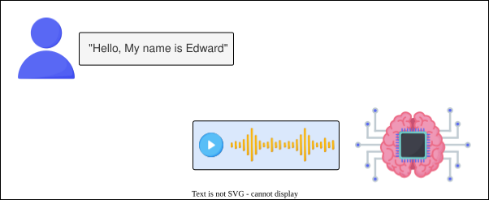

# Designing_a_Scalable_Text-to-Speech_Generation_System

Source: https://www.educative.io/courses/generative-ai-system-design/design-a-text-to-speech-generation-system

---

[Home](https://www.educative.io/)

[Courses](https://www.educative.io/search?tab=courses)

[Grokking the Generative AI System Design Interview](https://www.educative.io/courses/generative-ai-system-design)

# Design a Text-to-Speech Generation System

Design a text-to-speech system around a Fish Speech-style model: train it on large text-audio datasets, then serve it through linguistic extraction, voice profiling, speech generation, and moderation.

We'll cover the following...

- [Requirements](https://www.educative.io/courses/generative-ai-system-design/design-a-text-to-speech-generation-system#Requirements)
  - [Functional requirements](https://www.educative.io/courses/generative-ai-system-design/design-a-text-to-speech-generation-system#Functional-requirements)
  - [Nonfunctional requirements](https://www.educative.io/courses/generative-ai-system-design/design-a-text-to-speech-generation-system#Nonfunctional-requirements)
- [Model selection](https://www.educative.io/courses/generative-ai-system-design/design-a-text-to-speech-generation-system#Model-selection)
  - [Why use the Fish Speech model?](https://www.educative.io/courses/generative-ai-system-design/design-a-text-to-speech-generation-system#Why-use-the-Fish-Speech-model)
- [The training process](https://www.educative.io/courses/generative-ai-system-design/design-a-text-to-speech-generation-system#The-training-process)
  - [Data acquisition and preparation](https://www.educative.io/courses/generative-ai-system-design/design-a-text-to-speech-generation-system#Data-acquisition-and-preparation)
    - [Source of training data](https://www.educative.io/courses/generative-ai-system-design/design-a-text-to-speech-generation-system#Source-of-training-data)
      - [Dataset format](https://www.educative.io/courses/generative-ai-system-design/design-a-text-to-speech-generation-system#Dataset-format)
    - [Data preprocessing](https://www.educative.io/courses/generative-ai-system-design/design-a-text-to-speech-generation-system#Data-preprocessing)
    - [Database selection](https://www.educative.io/courses/generative-ai-system-design/design-a-text-to-speech-generation-system#Database-selection)
    - [Time estimation for data processing](https://www.educative.io/courses/generative-ai-system-design/design-a-text-to-speech-generation-system#Time-estimation-for-data-processing)
  - [Model training and testing](https://www.educative.io/courses/generative-ai-system-design/design-a-text-to-speech-generation-system#Model-training-and-testing)
    - [Distributing the training load](https://www.educative.io/courses/generative-ai-system-design/design-a-text-to-speech-generation-system#Distributing-the-training-load)
  - [Model evaluation](https://www.educative.io/courses/generative-ai-system-design/design-a-text-to-speech-generation-system#Model-evaluation)
    - [Evaluation metrics](https://www.educative.io/courses/generative-ai-system-design/design-a-text-to-speech-generation-system#Evaluation-metrics)
- [Storage estimation](https://www.educative.io/courses/generative-ai-system-design/design-a-text-to-speech-generation-system#Storage-estimation)
- [Inference servers estimation](https://www.educative.io/courses/generative-ai-system-design/design-a-text-to-speech-generation-system#Inference-servers-estimation)
- [Bandwidth estimation](https://www.educative.io/courses/generative-ai-system-design/design-a-text-to-speech-generation-system#Bandwidth-estimation)
- [Design consideration for the text-to-speech system](https://www.educative.io/courses/generative-ai-system-design/design-a-text-to-speech-generation-system#Design-consideration-for-the-text-to-speech-system)
- [System Design of the text-to-speech generation system](https://www.educative.io/courses/generative-ai-system-design/design-a-text-to-speech-generation-system#System-Design-of-the-text-to-speech-generation-system)
  - [High-level design](https://www.educative.io/courses/generative-ai-system-design/design-a-text-to-speech-generation-system#High-level-design)
    - [Achieving functional requirements](https://www.educative.io/courses/generative-ai-system-design/design-a-text-to-speech-generation-system#Achieving-functional-requirements)
  - [Detailed System Design](https://www.educative.io/courses/generative-ai-system-design/design-a-text-to-speech-generation-system#Detailed-System-Design)
    - [Prompt processing and embedding subsystem](https://www.educative.io/courses/generative-ai-system-design/design-a-text-to-speech-generation-system#Prompt-processing-and-embedding-subsystem)
    - [Linguistic features extraction subsystem](https://www.educative.io/courses/generative-ai-system-design/design-a-text-to-speech-generation-system#Linguistic-features-extraction-subsystem)
    - [Acoustic representation subsystem](https://www.educative.io/courses/generative-ai-system-design/design-a-text-to-speech-generation-system#Acoustic-representation-subsystem)
    - [Speech generation and content moderation subsystem](https://www.educative.io/courses/generative-ai-system-design/design-a-text-to-speech-generation-system#Speech-generation-and-content-moderation-subsystem)
    - [Putting everything together](https://www.educative.io/courses/generative-ai-system-design/design-a-text-to-speech-generation-system#Putting-everything-together)
      - [Workflow of the system](https://www.educative.io/courses/generative-ai-system-design/design-a-text-to-speech-generation-system#Workflow-of-the-system)
- [Fulfilling nonfunctional requirements](https://www.educative.io/courses/generative-ai-system-design/design-a-text-to-speech-generation-system#Fulfilling-nonfunctional-requirements)
- [Conclusion](https://www.educative.io/courses/generative-ai-system-design/design-a-text-to-speech-generation-system#Conclusion)

**Text-to-speech (TTS)** models are a class of neural networks that convert written text into realistic spoken audio. TTS technology enables dynamic and personalized interactions, allowing machines to convey information in natural, human-like speech, enhancing the user experience in numerous domains.

Speech generation models have evolved rapidly, with advances in natural language processing and audio synthesis techniques enabling the creation of highly expressive, lifelike voices. Modern TTS models like the NVIDIA Tacotron2 and xTTS aim to produce clear and natural-sounding speech, allowing customization regarding voice tone, emotion, and even accents. These customizable aspects make TTS models valuable in applications that demand high personalization, such as voiceovers for content creation, real-time translation, and assistive technologies. Systems using these models include everything from assistants like Siri to modern LLM-based chatbots like ChatGPT.

Let’s see how to design a robust and versatile text-to-speech system. Our focus will be to design a system capable of handling text inputs and generating high-quality, legible speech from them.

A user’s interaction with a TTS system

## Requirements[#](https://www.educative.io/courses/generative-ai-system-design/design-a-text-to-speech-generation-system#Requirements)

The first step in designing our system is to define its requirements. These requirements ensure that the system can deliver high-quality audio output, manage various user needs, and maintain scalability and reliability in production.

### Functional requirements[#](https://www.educative.io/courses/generative-ai-system-design/design-a-text-to-speech-generation-system#Functional-requirements)

The core functionalities that our TTS system should support include:

- **Natural language understanding:** The system must accurately interpret text input, understanding grammar, punctuation, and semantic nuances to produce coherent and contextually appropriate speech.
- **Speech generation:** The system must produce high-quality natural audio with minimal distortion or artifacts.
- **Customization:** Users should be able to customize voice options, including parameters for sex, age, accent, and emotional tone.
- **Multiple audio** **resolutions****:** To accommodate different use cases, the system should support multiple audio quality settings, from low-resolution for quick previews to high-resolution for professional applications.
- **Multilingual support:** The system should be able to generate audio in multiple languages.

> **Note:** We focus on creating a TTS system replicating the human voice. The requirements would change slightly if we wanted to create a system for something else, like generating robotic voices or sound effects.

### Nonfunctional requirements[#](https://www.educative.io/courses/generative-ai-system-design/design-a-text-to-speech-generation-system#Nonfunctional-requirements)

The nonfunctional requirements ensure that the TTS system performs reliably, scales effectively, and maintains security:

- **Scalability:** The system must scale to meet increased demand without sacrificing audio quality or response time.
- **Performance:** Quick audio generation is essential for real-time applications, such as voice assistants, where immediate feedback is expected.
- **Reliability:** The model should consistently produce contextually accurate audio outputs.
- **Availability:** The system should be highly available, using redundancy and failover strategies to maintain uptime.
- **Security and privacy:** User data, including custom inputs and generated audio, must be handled securely to protect sensitive information and comply with privacy regulations.

## Model selection[#](https://www.educative.io/courses/generative-ai-system-design/design-a-text-to-speech-generation-system#Model-selection)

For our TTS system, we want to select an open-source model with a modern architecture that is generative and has a larger number of trainable parameters for accuracy. Keeping this in view, we will go with a Fish Speech-like model. The Fish Speech base architecture uses an innovative **dual** **autoregressive** **(Dual-AR)** structure. It can handle complex linguistic features, polyphonic words, and multilingual inputs efficiently. Fish-Speech’s architecture integrates an LLM for linguistic feature extraction, providing streamlined multilingual synthesis.

The Fish Speech TTS architecture

The Fish Speech architecture begins with an LLM that processes the input text and extracts linguistic features. These features are fed into a *slow transformer*, which generates token logits. The first AR model uses RMSNorm and slow transformer layers to generate hidden states. Another AR model with fast embedding and fast transformer layers uses these hidden states to generate codebook logits. These logits are then passed to a decoder as quantized mel tokens.

Finally, these codebook logits produce the output speech waveform. This Dual-AR structure allows Fish Speech to effectively model both the linguistic and acoustic aspects of speech, resulting in high-quality and natural-sounding synthesized speech.

In Fish Speech’s architecture, the *slow* transformer focuses on processing the linguistic features extracted by the LLM. It operates at a slower pace due to the complexity of language modeling. On the other hand, the “fast” transformer handles the acoustic information (mel spectrograms) and operates more quickly to generate the final speech waveform. A **Firefly-GAN (FF-GAN)** is used as the decoder.

Use the widget below to strengthen your knowledge of the Fish Speech architecture.

AI Powered

Saved

20 attempts left

Reset

You have 20 attempts to answer.

### Why use the Fish Speech model?[#](https://www.educative.io/courses/generative-ai-system-design/design-a-text-to-speech-generation-system#Why-use-the-Fish-Speech-model)

Fish Speech offers several compelling advantages in text-to-speech synthesis:

- **High-quality speech synthesis:** Fish Speech delivers natural and expressive speech with improved prosody and phoneme accuracy using modern techniques. The dual-stream processing ensures that the generated speech maintains global coherence and fine acoustic detail, meeting the requirements for high-quality synthesis across different linguistic contexts.

> **Note:** Older TTS systems used long short-term memory models(LSTMs) and basic neural networks. These have been largely replaced by technologies like recurrent neural networks (RNNs) and transformer-based models. This is another reason to choose this architecture over something like NVIDIA’s Tacotron2 (LSTM-based).

- **Efficiency and scalability:** Fish Speech demonstrates remarkable efficiency through its optimized codebook utilization and reduced inference latency. The model’s modular design allows for scalability, enabling straightforward adaptation to datasets of varying sizes and linguistic complexity.
- **Multilingual capability:** Fish Speech excels at handling multilingual inputs due to its integrated LLM feature extraction, which can capture linguistic nuances across diverse languages. This eliminates the need for language-specific preprocessing or additional model components.
- **Parameter size:** We will create our model based on Fish Speech’s architecture, containing around 2 billion parameters. That is much larger than any comparative models available today for speech synthesis. We can see the comparison in the table below.

We can see the comparison of modern TTS models in the table below.

|  |  |  |  |  |
| --- | --- | --- | --- | --- |
| **Feature** | **Fish Speech v1** | **Tacotron 2** | **xTTS** | **WaveNet** |
| **Parameters** | 1 B | ~50 M | ~500 M | ~24 M |
| **Multilingual Capability** | Native | Limited support | Native | None (language-specific) |
| **Audio Quality (MOS)** | ~4.05 | ~4.5 | ~4.0 | ~4.2 |
| **Open Source?** | ✅ | ✅ | ✅ | ❌ |
| **Limitations** | Requires a lot of memory | Requires large datasets to train | Complex architecture | Slow inference |

1.

Why do we prefer a model with a large number of trainable parameters?

Show Answer

Did you find this helpful?

Fish Speech provides our multilingual TTS system’s ideal balance of innovation, efficiency, and flexibility.

## The training process[#](https://www.educative.io/courses/generative-ai-system-design/design-a-text-to-speech-generation-system#The-training-process)

Let’s discuss how to train a speech synthesis model like Fish Speech, starting with the dataset.

### Data acquisition and preparation[#](https://www.educative.io/courses/generative-ai-system-design/design-a-text-to-speech-generation-system#Data-acquisition-and-preparation)

High-quality, well-curated data is crucial for training an effective text-to-speech model. The dataset must include various text-audio pairs to ensure the model can generate natural, expressive, and contextually accurate speech. These pairs should encompass diverse linguistic features such as different speech styles, tones, emotions, accents, and intonations. Additionally, the dataset should cover a broad spectrum of contexts and scenarios, ensuring that the model can adapt to varying speaking conditions and produce realistic and coherent speech in any given situation.

#### Source of training data[#](https://www.educative.io/courses/generative-ai-system-design/design-a-text-to-speech-generation-system#Source-of-training-data)

We can create our dataset for this system or use a publicly available dataset like the Common Voice corpus (19.0). Collecting audio data is especially difficult due to its intensive nature. Common Voice, for example, has 3,587 hours of audio data. Recording this would take one person about half a year, not to mention the concerns of language and tonality.

So, we will use the Common Voice datasets to equal around 50,000 hours of data, which should be around 1-2 TB. We will assume 2 TB. According to the Common Voice datasets numbers, this should have around 2 M rows.

##### Dataset format[#](https://www.educative.io/courses/generative-ai-system-design/design-a-text-to-speech-generation-system#Dataset-format)

For speech generation, we require the dataset to be in the following format:

The required dataset format to train a TTS model

> **Note:** Many off-the-shelf datasets will come in formats that may not be suitable for training immediately. We may need to remove or merge some columns (features) to prepare the dataset for training.

#### Data preprocessing[#](https://www.educative.io/courses/generative-ai-system-design/design-a-text-to-speech-generation-system#Data-preprocessing)

Before we can move on to training, we need to process the data to ensure consistency. This will involve:

- **Data cleaning:** This step involves filtering out low-quality or irrelevant data, such as inaudible or duplicate entries. Inappropriate or offensive content is also removed to maintain ethical standards.

> **Note:** To remove inappropriate or offensive content from the dataset requires an expert review of each recording, and doing that for 2 M rows may be infeasible. If we are using a reputable dataset, we may skip this part.

- **Noise reduction:** Removing background noise from audio clips using filters.
- **Standardization:** This includes normalizing to a consistent sampling rate (e.g., 16 kHz) and bit-depth (16-bit) to ensure compatibility during training.
- **Silence trimming:** Trimming leading and trailing silences to reduce unnecessary padding in the data.

Then, we need to store this data in some data stores.

#### Database selection[#](https://www.educative.io/courses/generative-ai-system-design/design-a-text-to-speech-generation-system#Database-selection)

Like the previous design problem, we can store our data in a simple SQL database and use a blob store for audio file storage.

We can store our processed dataset in a blob store and an SQL database

#### Time estimation for data processing[#](https://www.educative.io/courses/generative-ai-system-design/design-a-text-to-speech-generation-system#Time-estimation-for-data-processing)

Let’s use some approximate values for our dataset:

Total data items=2 M\text{Total data items} = \text{2 M}Total data items=2 M

**Assuming:**

Time to preprocess an audio file=100 msTime to preprocess a text description=1 msTime to store a row into the database=0.5 ms\text{Time to preprocess an audio file} = \text{100 ms}
\\
\text{Time to preprocess a text description} = \text{1 ms}
\\
\text{Time to store a row into the database} = \text{0.5 ms}Time to preprocess an audio file=100 msTime to preprocess a text description=1 msTime to store a row into the database=0.5 ms

**We get:**

Total audio processing time (Tpa)=Time to preprocess an audio file×Total data itemsTpa=100 ms×2 M=200,000 seconds≈56 hours\text{Total audio processing time } (T\_{pa}) = \text{Time to preprocess an audio file} \times \text{Total data items}
\\
T\_{pa} = \text{100 ms} \times \text{2 M} = \text{200,000 seconds} \approx \text{56 hours}Total audio processing time (Tpa​)=Time to preprocess an audio file×Total data itemsTpa​=100 ms×2 M=200,000 seconds≈56 hours

Total text processing time (Tpt)=Time to preprocess text×Total data itemsTpt=1 ms×2 M=2,000 seconds≈0.5 hours\text{Total text processing time } (T\_{pt}) = \text{Time to preprocess text} \times \text{Total data items}
\\
T\_{pt} = \text{1 ms} \times \text{2 M} = \text{2,000 seconds} \approx \text{0.5 hours}Total text processing time (Tpt​)=Time to preprocess text×Total data itemsTpt​=1 ms×2 M=2,000 seconds≈0.5 hours

Total storage time (Ts)=Time to store a row×Total data itemsTs=1 ms×2 M=2,000 seconds≈0.5 hours\text{Total storage time } (T\_s) = \text{Time to store a row} \times \text{Total data items}
\\
T\_s = \text{1 ms} \times \text{2 M} = \text{2,000 seconds}\approx \text{0.5 hours}Total storage time (Ts​)=Time to store a row×Total data itemsTs​=1 ms×2 M=2,000 seconds≈0.5 hours

**So the total time taken is:**

Total time=Tpa+Tpt+Ts\text{Total time} = T\_{pa} + T\_{pt} + T\_sTotal time=Tpa​+Tpt​+Ts​

Total time=200,000 seconds+2,000 seconds+2,000 seconds=204,000 seconds\text{Total time} = \text{200,000 seconds} + \text{2,000 seconds} + \text{2,000 seconds} = \text{204,000 seconds}Total time=200,000 seconds+2,000 seconds+2,000 seconds=204,000 seconds

Total time≈3,400 minutes≈57 hours\text{Total time} \approx \text{3,400 minutes} \approx \text{57 hours}Total time≈3,400 minutes≈57 hours

Time taken to process and store our text-voice dataset

So, one machine would take about 57 hours to process all of this data at the speeds we assumed. To speed up this process, we can divide the data into multiple machines in parallel. For example, 8 machines would only take about 7 hours to process the 2 TB dataset.

1.

Can we process the audio and the text in parallel since their preprocessing is independent?

Show Answer

Did you find this helpful?

### Model training and testing[#](https://www.educative.io/courses/generative-ai-system-design/design-a-text-to-speech-generation-system#Model-training-and-testing)

To train our model on the dataset selected, we first need to estimate its training time. Let’s say we are using NVIDIA A100 80 GB GPUs. These GPUs can perform 156 TFLOPS of TF32 calculations.

To estimate the time taken for training, we can use the following equation:

Tsec=Nparams×NFLOPS×E×D×CRops×NGPUs\text{T}\_{\text{sec}} = \frac{\text{N}\_{\text{params}} \times \text{N}\_{\text{FLOPS}} \times \text{E} \times \text{D} \times \text{C}}{\text{R}\_{\text{ops}} \times \text{N}\_{\text{GPUs}}}Tsec​=Rops​×NGPUs​Nparams​×NFLOPS​×E×D×C​

Where C\text{C}C becomes the number of autoregressive steps to create an audio output. This depends on how long the audio is (Laudio\text{L}\_{\text{audio}}Laudio​) and how many iterations it takes to generate one second of audio (Isec\text{I}\_{\text{sec}}Isec​). We can call this Nsteps=Laudio×Isec\text{N}\_{\text{steps}} = \text{L}\_{\text{audio}} \times \text{I}\_{\text{sec}}Nsteps​=Laudio​×Isec​. So, the formula becomes:

Tsec=Nparams×NFLOPS×E×D×NstepsRops×NGPUs\text{T}\_{\text{sec}} = \frac{\text{N}\_{\text{params}} \times \text{N}\_{\text{FLOPS}} \times \text{E} \times \text{D} \times \text{N}\_{\text{steps}}}{\text{R}\_{\text{ops}} \times \text{N}\_{\text{GPUs}}}Tsec​=Rops​×NGPUs​Nparams​×NFLOPS​×E×D×Nsteps​​

We will assume 10 seconds for the length of the audio and that it takes 100 iterations to generate one second of audio. So:

Nsteps=Laudio×Isec\text{N}\_{\text{steps}} = \text{L}\_{\text{audio}} \times \text{I}\_{\text{sec}}Nsteps​=Laudio​×Isec​
  
Nsteps=10×100=1,000\text{N}\_{\text{steps}} = 10 \times 100 = 1{,}000Nsteps​=10×100=1,000

Let’s use the previous numbers to calculate the time it takes to train for 1,000 epochs on a single GPU.

Nparams=1 Billion\text{N}\_{\text{params}} = 1 \ \text{Billion}Nparams​=1 Billion
  
NFLOPS=6\text{N}\_{\text{FLOPS}} = 6NFLOPS​=6
  
E=1,000\text{E} = 1{,}000E=1,000
  
D=2 Million\text{D} = 2 \ \text{Million}D=2 Million
  
Nsteps=1,000\text{N}\_{\text{steps}} = 1{,}000Nsteps​=1,000
  
Rops=156 TFLOPS\text{R}\_{\text{ops}} = 156 \ \text{TFLOPS}Rops​=156 TFLOPS
  
NGPUs=1\text{N}\_{\text{GPUs}} = 1NGPUs​=1
  
Tseconds=1×109×6×1,000×2×106×1,000156×1012 FLOPS×1\text{T}\_{\text{seconds}} = \frac{1 \times 10^{9} \times 6 \times 1{,}000 \times 2 \times 10^{6} \times 1,000}{156 \times 10^{12} \ \text{FLOPS} \times 1}Tseconds​=156×1012 FLOPS×11×109×6×1,000×2×106×1,000​
  
Tseconds≈76,923,077 seconds\text{T}\_{\text{seconds}} \approx 76{,}923{,}077 \ \text{seconds}Tseconds​≈76,923,077 seconds
  
Tdays≈890 days\text{T}\_{\text{days}} \approx 890 \ \text{days}Tdays​≈890 days

> Using one GPU will take ~890 days to train the model.

#### Distributing the training load[#](https://www.educative.io/courses/generative-ai-system-design/design-a-text-to-speech-generation-system#Distributing-the-training-load)

We can distribute the training process over multiple machines to reach a realistic timeframe using the same method we did in the [training infrastructure of the text-to-text generation system](https://www.educative.io/collection/page/10370001/5567964407791616/5785696764035072#Distributing-the-training-load). The time estimate when training for 1,000 epochs using 64 training servers is given below:

#### 

|  |  |  |  |
| --- | --- | --- | --- |
|  | A | B | C |
| 1 | Number of parameters | 1 | Billion |
| 2 | FLOPS per parameter update | 6 | FLOPS/parameter |
| 3 | Number of Epochs | 1000 | epochs |
| 4 | Size of data | 2 | Million entries |
| 5 | Number of steps | 1000 | Steps |
| 6 | FLOPS for training | f12000000000 | TFLOPS |
| 7 | Rate of operations | 156 | TFLOPS |
| 8 | Number of GPUs | 64 | NVIDIA A100 GPUs |
| 9 | Training time (in seconds) | f1201923.08 | Seconds |
| 10 | Training time (in days) | f13.91 | Days |

Try changing the values highlighted in yellow in the calculator widget to see the effect on the time.

### Model evaluation[#](https://www.educative.io/courses/generative-ai-system-design/design-a-text-to-speech-generation-system#Model-evaluation)

The evaluation focuses on the Fish Speech model’s ability to generate high-quality, intelligible audio that faithfully represents the desired speech characteristics. The primary loss function during training is a **spectral reconstruction loss**. This loss function measures the difference between the target and the predicted audio spectrogram. Lowering this difference ensures accurate audio generation while preserving the desired style and tone fidelity.

The spectral reconstruction loss used in Fish Speech aims to minimize the difference between the target audio’s mel spectrogram by the model. Specifically, we use the mean squared error (MSE) between the two spectrograms. This encourages the model to lead to natural and high-fidelity audio output.

#### Evaluation metrics[#](https://www.educative.io/courses/generative-ai-system-design/design-a-text-to-speech-generation-system#Evaluation-metrics)

Let’s look at what metrics we can use to measure the quality of the model we trained:

- **Mean opinion score (MOS):**

  - MOS is a subjective evaluation metric where human evaluators rate the audio on a scale from 1 to 5, assessing naturalness, clarity, and quality.
  - Higher MOS indicates better performance, with ratings averaging across multiple evaluators to account for variance in perception.
- [**Word error rate (WER)**](https://www.educative.io/answers/what-is-word-error-rate)**:**

  - WER measures the transcription accuracy of the generated speech compared to the input prompt.
  - A lower WER indicates greater precision in replicating intended linguistic content.

> **Note:** To evaluate WER, we will need a speech-to-text model to convert the generated speech back into text and compare it to the original prompt. We can use something like Whisper v3 for this task. Also, since we rely on another model to calculate WER, the results can be biased by the accuracy of the speech-to-text model used.

- **Perceptual evaluation of speech quality (PESQ)****:**

  - PESQ is an objective metric for assessing speech quality using an algorithm. It computes a score based on the perceptual similarity between the output and reference speech.
  - PESQ considers several factors that affect speech quality, such as spectral distortions, temporal alignment, and noise level.
  - Scores range from -0.5 (poor) to 4.5 (excellent), focusing on intelligibility and quality.

The illustration below summarizes the complete training process from data acquisition to training and saving the model weights.

The data acquisition, preprocessing, and model training process

As with the previous models, we can always fine-tune this model to increase its accuracy or to create a use case-specific model.

1.

How might you adapt the Fish Speech model to generate singing voices instead of just spoken language? What modifications to the architecture or training data might be necessary?

Show Answer

Did you find this helpful?

Now, let’s examine how to design the deployment infrastructure for this model to serve users.

will base our System Design on the model selection and training infrastructure discussed previously. Specifically, we will estimate the necessary resources for deploying a model similar to the Fish Speech model and design the system architecture required to efficiently run the model in a production environment.

Let’s start the journey with storage estimation:

## Storage estimation[#](https://www.educative.io/courses/generative-ai-system-design/design-a-text-to-speech-generation-system#Storage-estimation)

Storage estimation includes model size, user profile and related data, along with indexing storage. Let’s estimate all these resources considering 100 million daily active users:

- **Model size estimation:** Due to the complexity of the data they process and the nature of their tasks, text-to-speech models generally have fewer parameters than text-to-image generation models. Therefore, we assume that the number of parameters is 2 billion. Let’s consider the FP16 floating-point data format for the model, which gives us a size of 4 GB, as calculated below:

Model size=2 billion×2 bytes=4 GB\text{Model size} = 2 \text{ billion} \times 2 \text{ bytes} = 4 \text{ GB}
Model size=2 billion×2 bytes=4 GB

- **User profile data:** For storing users’ data, assume that each user’s data takes approximately 10 KB, translating to:

User data=100 M×10 KB=1 TB\text{User data} = 100 \text{ M} \times 10 \text{ KB} = 1 \text{ TB}User data=100 M×10 KB=1 TB

> **Note:** The model's size (4 GB) and user profile data (1 TB) will remain constant unless the number of users increases. Therefore, we don't include them in the storage required per day or month.

- **User interaction data:** If we store each user interaction data, the storage per interaction will depend on the size of each interaction and the generated audio size produced by the model. Assuming each user interacts with the system 10 times daily, the model generates 10 seconds of audio per interaction, with an audio size of 0.2 MB per interaction. To calculate the storage required for user interaction data, the calculations proceed as follows:

Users interaction data=100 M×(0.2 MB×10)=200 TB\text{Users interaction data} = 100 \text{ M} \times (0.2 \text{ MB} \times 10) = 200 \text{ TB}Users interaction data=100 M×(0.2 MB×10)=200 TB

> **Note:** The 200 TB of storage is required when the audio is produced at 128 kbps. This number is reduced to 80 TB if the audio is produced at 64 kbps.

- **Indexing storage:** To make user interactions searchable and efficiently accessible, additional storage for indexing would be required. This might add up to 25% of storage.

Indexing storage=200 TB×0.25=50 TB\text{Indexing storage} = 200 \text{ TB} \times 0.25 = 50 \text{ TB}Indexing storage=200 TB×0.25=50 TB

So, the total storage requirement per day would be:

Storage required per day=User interaction data+Indexing storage=200 TB+50 TB=250 TB/day
\begin{align\*}
\text{Storage required per day} &= \text{User interaction data} + \text{Indexing storage} \\
&= 200 \text{ TB} + 50 \text{ TB} \\
&=250\text{ TB/day}
\end{align\*}Storage required per day​=User interaction data+Indexing storage=200 TB+50 TB=250 TB/day​

According to the above estimates, the monthly storage requirement is:

Monthly storage required=250 TB×30=7.5 PB\text{Monthly storage required} = 250 \text{ TB} \times 30 =7.5 \text{ PB}Monthly storage required=250 TB×30=7.5 PB

## Inference servers estimation[#](https://www.educative.io/courses/generative-ai-system-design/design-a-text-to-speech-generation-system#Inference-servers-estimation)

At 100 million DAUs, each user generating around 1 billion audio speeches, the estimated Total Requests Per Second (TRPS) is approximately 11574. We assumed that the model generates 160 samples per iteration at a frequency of 16 KHz, resulting in 1000 iterations (C\text{C}C) per 10-second video. Based on [our proposed inference formula](https://www.educative.io/collection/page/10370001/5567964407791616/4719291315650560#Inference-server-estimation), the estimated inference time for generating audio of 10 seconds using a 2 billion model is approximately 12.8 milliseconds. This is the estimated inference time when using FP16 precision on an NVIDIA A100 GPU. The calculation steps are shown below:

Tinference=2×109×2×1000312×1012=12.8 milliseconds\text{T}\_{\text{inference}} = \frac{2 \times 10^{9} \times 2 \times 1000}{312 \times 10^{12}} = 12.8 \text{ milliseconds}Tinference​=312×10122×109×2×1000​=12.8 milliseconds

According to this estimation, the QPS for NVIDIA server having A100 GPU will be 78.125 QPS, which yields us the following number of GPUs:

Inference servers required=TRPSQPS=1157478.125≈148 GPUs\text{Inference servers required} = \frac{\text{TRPS}}{\text{QPS}}=\frac{11574}{78.125} \approx 148 \text{ GPUs}Inference servers required=QPSTRPS​=78.12511574​≈148 GPUs

We need approximately 148 GPUs to convert 11574 text-to-speech requests per second.

## Bandwidth estimation[#](https://www.educative.io/courses/generative-ai-system-design/design-a-text-to-speech-generation-system#Bandwidth-estimation)

To serve 100 million users uninterruptedly, we need to estimate the required ingress and egress bandwidths. The ingress bandwidth depends on the size of the user request. Assuming that each request takes approximately 2 KB of size, the ingress bandwidth can be estimated for 11,574 requests as follows:

Ingress bandwidth=11574×2 KB=23.15 MBps=23.15 MBps×8≈185 Mbps\begin{align\*}
\text{Ingress bandwidth}
&= 11574 \times 2 \text{ KB} \\
&= 23.15 \text{ MBps} \\ & = 23.15 \text{ MBps} \times 8\approx 185 \text{ Mbps}
\end{align\*}Ingress bandwidth​=11574×2 KB=23.15 MBps=23.15 MBps×8≈185 Mbps​

The egress bandwidth depends on the size of the response. For 10-second audio having a size of 0.2 MB, the total response size is estimated to be 0.3 MB, including the associated metadata. This gives us the following egress bandwidth for a total of 11574 responses:

Egress bandwidth=11574×0.3 MB=3472.2 MBps=3472.2 MBps×8≈27777.6 Mbps≈27.8 Gbps\begin{align\*}
\text{Egress bandwidth}
&= 11574 \times 0.3 \text{ MB} \\
&= 3472.2 \text{ MBps} \\
&=3472.2 \text{ MBps} \times 8\approx 27777.6 \text{ Mbps} \\
&\approx 27.8 \text{ Gbps}
\end{align\*}Egress bandwidth​=11574×0.3 MB=3472.2 MBps=3472.2 MBps×8≈27777.6 Mbps≈27.8 Gbps​

So, we have the following number of resource estimations for inference:

- Storage required: 250 TB/day\text{250 TB/day}250 TB/day
- GPUs required to process 115741157411574 TRPS: 148  NVIDIA  A100  GPUs\text{148 \ NVIDIA \ A100 \ GPUs}148  NVIDIA  A100  GPUs
- Ingress bandwidth: 185 Mbps\text{185 Mbps}185 Mbps
- Egressh bandwidth: 27.8 Gbps\text{27.8 Gbps}27.8 Gbps

Estimated resources for a text-to-speech generation system

These estimations are not set in stone; they are rough estimates that serve as a starting point for the design process. These numbers can change significantly when more specific requirements, constraints, and factors like scalability (handling a large number of concurrent users), performance, and redundancy are considered.

We have estimated the required resources for deploying a text-to-speech generation system until now. Let’s move on to some important factors and challenges that must be carefully evaluated during the inference phase.

## Design consideration for the text-to-speech system[#](https://www.educative.io/courses/generative-ai-system-design/design-a-text-to-speech-generation-system#Design-consideration-for-the-text-to-speech-system)

Some of the important factors that we need to consider for text-to-speech (TTS) generation systems are:

- **Audio quality:** During training, we will ensure that the generated speech meets high-quality standards, including natural prosody and clarity via high-resolution vocoders (such as HiFi-GAN) and perceptual loss functions to produce realistic high-fidelity outputs.
- **Multilingual and adaptive capabilities:** Our system supports multiple languages and dialects by efficiently designing the system to handle multilingual training datasets. We must leverage strategies to support multilingual capability to ensure adaptability and scalability across languages.
- **Resource optimization:** Given the high computational demands of the TTS generation system, efficient resource allocation is a key design consideration. We must utilize model quantization, pruning, and lower floating-point precision to reduce memory and processing power needs.

After estimating resources and reviewing the design considerations, we are in a good position to move toward the System Design of a text-to-speech generation system.

## System Design of the text-to-speech generation system[#](https://www.educative.io/courses/generative-ai-system-design/design-a-text-to-speech-generation-system#System-Design-of-the-text-to-speech-generation-system)

Let’s start with the high-level design of the TTS system, which involves various subsystems. These subsystems complement each other and work together to perform different tasks. The following high-level design presents the interaction and responsibilities of each subsystem:

### High-level design[#](https://www.educative.io/courses/generative-ai-system-design/design-a-text-to-speech-generation-system#High-level-design)

The high-level design consists of the following four subsystems:

- **Prompt processing and embedding system:** This subsystem prepares the input text from the user by analyzing and refining it to capture the user’s intent. It detects the language, tokenizes and normalizes the input, and generates embeddings that effectively represent the text’s context and semantics.
- **Linguistic features extraction system:** This subsystem refines the linguistic elements of the input to ensure accurate pronunciation and natural rhythm. Analyzing phonemes, syllables, stress patterns, and pronunciation nuances prepares features that make the output sound human-like and adaptable.
- **Acoustic representation system:** This subsystem tailors the acoustic properties to align with user preferences, such as sex, voice, and accent. It prepares audio embeddings and selects suitable audio models (profiles) to achieve personalized and context-appropriate speech generation.
- **Speech generation system:** This core subsystem synthesizes the final speech by combining the refined linguistic features and acoustic representations. It ensures the generated speech meets the intended goals of naturalness and personalization.

These subsystems work together to deliver high-quality audio outputs from text inputs, as shown in the following illustration:

The high-level design of a TTS system consisting of four subsystems

#### Achieving functional requirements[#](https://www.educative.io/courses/generative-ai-system-design/design-a-text-to-speech-generation-system#Achieving-functional-requirements)

Let’s understand the workflow for key functional requirements that we identified:

- **Natural language understanding:** The prompt processing and embedding system processes the input text and generates embeddings that capture the semantic meaning of the text, enabling the system to interpret it accurately. This fulfills the requirement for the system to understand grammar, punctuation, and semantic nuances.
- **Speech generation:** The linguistic features extraction and acoustic representation systems work in tandem to select appropriate audio models and audio embeddings, which the speech generation system uses to synthesize high-quality audio. This process ensures the generation of high-quality audio with minimal distortion.
- **Customization:** The acoustic representation system allows for customization by selecting voices based on user preferences (sex, accent, etc.) and personalized voice creation. This fulfills the requirement for users to customize voice options.
- **Multiple audio resolutions:** This functional requirement is met by the speech generation system, which can be configured to produce audio at various quality levels. This allows the system to support different use cases and bandwidth requirements.
- **Multilingual support:**This functional requirement can be achieved via the prompt processing and embedding service, which detects the respective language and performs the tokenization and multilingual embeddings via advanced ML models.

Let’s dive deep into the working details and components of each subsystem.

### Detailed System Design[#](https://www.educative.io/courses/generative-ai-system-design/design-a-text-to-speech-generation-system#Detailed-System-Design)

In this section, we describe each component involved in the TTS system. We follow a modular approach by describing different subsystems combined into one detailed design. Let’s start with the prompt processing and embedding system.

#### Prompt processing and embedding subsystem[#](https://www.educative.io/courses/generative-ai-system-design/design-a-text-to-speech-generation-system#Prompt-processing-and-embedding-subsystem)

The prompt processing and embedding subsystem transforms raw user input into refined and enriched embeddings for downstream tasks. It detects the language, cleans the prompt, and is converted into a format suitable for advanced processing, all while considering user-specific preferences. It has the following components:

- **Language analyzer:** This service identifies the input language, enabling accurate text processing and embedding. It is necessary because users may submit prompts in different languages, and the model needs to correctly interpret the input.
- **Text preprocessor and normalizer:** This service standardizes the input text by cleaning and normalizing it to ensure consistency and clarity. It resolves ambiguities caused by variations in punctuation, numbers, and abbreviations, which is critical for generating accurate embeddings and natural-sounding speech. For example, converting “15” to “fifteen” ensures proper pronunciation by the TTS system.
- **Tokenizer:** It breaks the text prompt into individual tokens. Tokenization is essential because it allows the model to focus on individual words or phrases. Without proper token segmentation, the system might struggle to understand complex inputs and interpret subtle differences.
- **Embedding service:** This service transforms tokens into dense vector embeddings that capture semantic and linguistic information for downstream processing. It ensures multilingual support using advanced models like mBert, XML-R, or any custom multilingual transformer (like in Fish Speech), enabling accurate linguistic feature extraction regardless of the input language. The service is foundational for generating speech that aligns with the meaning and context of the text.
- **Audio profile storage:** This database contains data that enables customization of the user experience by storing preferences for language, voice, tone, and speed. It ensures the generated speech aligns with individual user needs, such as a formal tone for business or a casual tone for storytelling. NoSQL databases like MongoDB are ideal for storing audio profiles due to their flexible schema, which can handle diverse and unstructured data such as pitch, tone, and accent.

Prompt preprocessing and embedding subsystem

#### Linguistic features extraction subsystem[#](https://www.educative.io/courses/generative-ai-system-design/design-a-text-to-speech-generation-system#Linguistic-features-extraction-subsystem)

The embedding generated in the previous steps captures semantic meaning, syntactic structure, and context. The linguistic features extraction subsystem extracts phonetic and prosodic features. It also produces syllable boundaries, pronunciation nuances, and contextual intonation.

As we know, the Fish Speech model directly integrates an LLM, which performs these tasks implicitly. However, for clarity, this section unwraps how these tasks are performed as separate services:

- **Phoneme converter:** This service transforms embeddings into phonemes, enabling the system to map text to precise pronunciation. It is typically achieved using strategies such as neural mapping and sequence alignment. In **neural mapping**, an artificial neural network is trained on a dataset of text and phoneme pairs and uses embedding as input to predict phonemes. The embeddings contain contextual information about the words, such as stress patterns, semantics, and syntax, which guide the phoneme prediction. Similarly, the attention mechanism aligns text embeddings with the corresponding phonemes in **sequence alignment**. This is particularly useful for handling multi-syllabic words or ambiguous pronunciations. For example, consider that we have fed the embedding of the word “record” (as in “to record”) vs. “record” (as in “a music record”). The output phonemes would be `/rɪˈkɔːd/` for the verb vs. `/ˈrɛkɔːd/` for the noun. This service ensures that the phoneme output reflects the correct context, stress, and syntax, which are critical for natural-sounding speech.
- **Pronunciation analyzer:** This service determines how words should be pronounced based on their embeddings. It resolves pronunciation ambiguities by considering sentence-level context, such as “lead” (to guide) vs. “lead” (a metal). The input embeddings provide cues for stress and rhythm in multi-syllabic words, which are crucial for natural pronunciation. It also adapts pronunciation for accents or dialects using embedding variations specific to regions.

The phoneme converter transforms embeddings into phonemes to map text to precise pronunciations, while the pronunciation analyzer evaluates these phonemes in context to resolve ambiguities and adapt pronunciation for natural speech.

- **Syllable analyzer:** This service breaks the input into syllables, ensuring prompt rhythm and intonation during speech generation. It uses deep learning models such as recurrent neural networks (RNNs), transformer-based models, graph neural networks (GNNs), or heuristic rules to identify syllable boundaries. For example, if the input word is “education,” the output syllable would be “ed-u-ca-tion.”

The linguistic features extraction subsystem

- **Lexicon engine:** This service compares the input with embeddings stored in a lexicons database, often precomputed for various words or phrases. The comparison uses similarity algorithms such as cosine similarity to find the closest match. If a word is not in the database, the system may dynamically generate the most likely pronunciation based on similar embeddings in the database. By referencing a database of precomputed embeddings, it standardizes pronunciations and provides fallback mechanisms to generate likely pronunciations for unknown or out-of-vocabulary words.

Each of the above services has its associated databases. The pronunciation analyzer uses embedding to resolve pronunciation ambiguities based on content. Therefore, a vector database is suitable for efficiently storing and retrieving contextually enriched embeddings. Alternatively, a NoSQL database like MongoDB can be used for complex data involving user-specific dialects or accents, providing data storage and retrieval flexibility. The syllable analyzer uses a NoSQL database to store unstructured or semi-structured data such as syllable patterns. The lexicon engine uses a vector database, which is optimal for storing large sets of precomputed embeddings and performing fast similarity searches.

The linguistic features extraction subsystem’s tasks can also be handled by invoking an LLM API like GPT or Claude. However, to make the process easy to understand, we have discussed all the essential services to extract key features crucial for the subsequent systems.

The extractions from linguistic features are provided to the following two different subsystems:

- **Acoustic representation subsystem:** The phonetic and prosodic features are fed to the acoustic representation system for further processing.
- **Speech generation subsystem:**The syllable boundaries, pronunciation nuances, and contextual intonations are provided to the speech generation system, which maps them to acoustic parameters.

#### Acoustic representation subsystem[#](https://www.educative.io/courses/generative-ai-system-design/design-a-text-to-speech-generation-system#Acoustic-representation-subsystem)

The acoustic representation subsystem transforms linguistic and phonetic features into audio outputs in a TTS generation system. It connects the linguistic features extraction subsystem with the speech generation system. Following are some of the essential services:

- **Audio model (profile) manager:** This service ensures the selection of the most suitable audio model (profile) based on user preferences or contextual needs, such as sex, accent, or tone. It enables dynamic switching between models for multilingual or mixed-accent scenarios, ensuring the synthesized voice matches the intended style.
- **Audio cloning engine:** This is an optional service that generates custom voice profiles from user-provided samples, capturing unique characteristics (i.e., pitch, tone, and timber) to allow the speech generation system to create personalized voices. It adapts the cloned voice to extracted linguistic and prosodic features, ensuring the output is natural and consistent with the source voice. This service is essential for applications requiring highly tailored or mimicked voices.
- **Audio model storage:** This is a NoSQL database that stores user-specific preferences for audio generation, such as pitch, speed, sex, and accent. It also acts as a storage system for personalized audio settings. This database facilitates the audio model manager and voice cloning engine, which apply the correct model parameters and dynamic adjustments, such as switching between faster and slower speech rates based on the context.

The acoustic representation subsystem

- **Audio features embedding service:**The input received by this service is an aggregate output of the linguistic features extraction system, audio model manager, and audio cloning engine. Using this information, the audio features embedding service generates a vector representation of a voice’s characteristics, such as pitch, tone, accent, and rhythm, to ensure that the synthesized audio is consistent with the selected or cloned voice profile. This service takes input from the audio model manager or audio cloning engine and outputs embeddings that guide speech generation. The embeddings are updated dynamically during voice adaptation processes, such as adjusting for user-specific accents or prosody.

The acoustic representation subsystem prepares acoustic parameters and selected voice profiles, generates the vector representation, and provides them to the speech generation subsystem’s acoustic model (a service).

#### Speech generation and content moderation subsystem[#](https://www.educative.io/courses/generative-ai-system-design/design-a-text-to-speech-generation-system#Speech-generation-and-content-moderation-subsystem)

This subsystem corresponds directly to the core text-to-speech model, where linguistic and prosodic features are converted into high-quality audio. This system consists of the following:

- **Acoustic model:** It maps linguistic features, audio embeddings, and audio models to acoustic (sound) features like pitch, duration, and intensity. It also ensures appropriate stress and intonation for natural-sounding speech. For example, it differentiates the intonation of a question from a statement based on context from the linguistic features.
- **Audio generator:** The audio generator transforms the processed linguistic features (by the acoustic model) into intermediate acoustic representations, such as mel-spectrograms. It also ensures that the stress, rhythm, and tone derived from the linguistic features extraction system are accurately embedded into the mel-spectrogram.
- **Vocoder:** It transforms the mel-spectrograms into an audible waveform. It synthesizes high-quality audio using advanced neural vocoders such as WaveNet or HiFi-GAN. It ensures that the waveform aligns with the acoustic features provided by the audio generator service.
- **Waveform synthesizer:** It produces the final audio output from the waveform, focusing on enhancing naturalness and ensuring smooth transitions. It refines the raw waveform produced by the vocoder system and applies post-processing techniques like noise reduction and smoothing.
- **Content moderation service:**This service scans generated speech for inappropriate or sensitive content, ensuring it meets safety and compliance standards.

The speech generation and content moderation subsystem

The three services—audio generator, vocoder, and waveform synthesizer—correspond to the core components of the text-to-speech model. In other words, the model itself performs these tasks. As illustrated in the diagram below, the model host coordinates the generation of audio, conversion of features to speech, and final generation of the waveform, seamlessly combining these functions for natural-sounding speech output.

The audio generator, vocoder, and waveform synthesizer integrated within the model host

#### Putting everything together[#](https://www.educative.io/courses/generative-ai-system-design/design-a-text-to-speech-generation-system#Putting-everything-together)

Let’s combine all the subsystems above into a detailed System Design of the text-to-speech generation system. Below, we describe the detailed workflow:

##### Workflow of the system[#](https://www.educative.io/courses/generative-ai-system-design/design-a-text-to-speech-generation-system#Workflow-of-the-system)

The user’s inputs (prompts) are passed through the load balancer, which directs them to the language analyzer within the prompt processing and embedding subsystem. The output is then fed to the respective tokenizer, text preprocessor, and normalizer to tokenize the prompt and bring it into standard format. Further, the output of these services is passed to the embedding service to generate vector representation. The vector representation contains contextual and semantic information, which is then fed to the linguistic features extraction system. This system comprises several services like the phoneme converter, syllable analyzer, lexicon engine, and pronunciation analyzer. These services work with the respective databases to transform text embeddings into linguistic features such as phonemes, syllables, and stress patterns.

The extracted linguistic features are passed to the acoustic representation system where services like the audio model manager, audio embedding generator, and audio cloning engine prepare audio models (profiles) for voice generation. The audio model manager chooses appropriate models, while the audio cloning engine personalizes the voice based on the user-specific settings stored in the audio model storage. Next, the acoustic model processes input from linguistic feature extraction and acoustic representation subsystems to map linguistic features to acoustic features. The speech generation and context moderation subsystem convert the acoustic features into mel-spectrograms, converted into audible waveforms and transformed into natural, smooth audio (speech).

The following detailed design ensures accurate, personalized, and high-quality text-to-speech generation.

System Design of a text-to-speech generation system

All the databases mentioned in the detailed design of the system utilize their caches, such as Redis, for fast data retrieval. For the sake of brevity, these are not shown in the illustration.

## Fulfilling nonfunctional requirements[#](https://www.educative.io/courses/generative-ai-system-design/design-a-text-to-speech-generation-system#Fulfilling-nonfunctional-requirements)

- **Scalability:** The proposed system is modular, with each system operating independently. The advantage of such a system is that it can scale horizontally based on the load. Components in each subsystem are dynamically scaled to handle increasing user demands. Also, caching frequently used embeddings or audio profiles reduces computational overhead, which can serve many users in less time.
- **Performance:** Our system supports parallel processing between multiple services to generate quick responses. One example is the parallelism between the model hosting service and the acoustic representation subsystem.
- **Reliability:**Having redundant backup servers ensures reliability. Databases such as lexicon or audio model storage use replication to prevent data loss and low-latency read time. Fault-tolerant systems with automatic failure mechanisms maintain uninterrupted operations.
- **Availability**: High availability is achieved through local and global load balancers and distributed deployments across multiple geographic regions. The system’s modular architecture and circuit breakers ensure that failures in one component or subsystem do not impact the functionality of others. Additionally, continuous health monitoring and rollback mechanisms maintain service uptime.
- **Security and privacy**: Security and privacy are ensured through multiple measures. Data encryption protects user inputs and generated speech during transmission and storage, while anonymization techniques remove or mask sensitive information. Secure storage practices prevent unauthorized access to user data, and user consent protocols ensure compliance with privacy regulations like GDPR.

> **Note:** It is possible to leverage a third-party API to extract linguistic features. While this approach simplifies the overall design, it may introduce performance issues and dependency challenges.

## Conclusion[#](https://www.educative.io/courses/generative-ai-system-design/design-a-text-to-speech-generation-system#Conclusion)

In this chapter, we discussed the System Design of the text-to-speech generation system and its relevant components. We explored various subsystems involved in the speech generation process, from prompt processing to linguistic feature extraction and acoustic representation. Also, the System Design involves using distributed databases and horizontal scaling techniques to ensure reliability and fault tolerance. In reality, such systems are more complex than they appear, with various technologies and algorithms employed at each stage, each with its tradeoffs. However, we have covered the key concepts to provide a solid foundation for designing a large-scale text-to-speech generation system.

Design a Text-to-Image Generation System

Design a Text-to-Video Generation System

Ask

[Requirements](https://www.educative.io/courses/generative-ai-system-design/design-a-text-to-speech-generation-system#Requirements)

[Functional requirements](https://www.educative.io/courses/generative-ai-system-design/design-a-text-to-speech-generation-system#Functional-requirements)

[Nonfunctional requirements](https://www.educative.io/courses/generative-ai-system-design/design-a-text-to-speech-generation-system#Nonfunctional-requirements)

[Model selection](https://www.educative.io/courses/generative-ai-system-design/design-a-text-to-speech-generation-system#Model-selection)

[Why use the Fish Speech model?](https://www.educative.io/courses/generative-ai-system-design/design-a-text-to-speech-generation-system#Why-use-the-Fish-Speech-model)

[The training process](https://www.educative.io/courses/generative-ai-system-design/design-a-text-to-speech-generation-system#The-training-process)

[Data acquisition and preparation](https://www.educative.io/courses/generative-ai-system-design/design-a-text-to-speech-generation-system#Data-acquisition-and-preparation)

[Source of training data](https://www.educative.io/courses/generative-ai-system-design/design-a-text-to-speech-generation-system#Source-of-training-data)

[Dataset format](https://www.educative.io/courses/generative-ai-system-design/design-a-text-to-speech-generation-system#Dataset-format)

[Data preprocessing](https://www.educative.io/courses/generative-ai-system-design/design-a-text-to-speech-generation-system#Data-preprocessing)

[Database selection](https://www.educative.io/courses/generative-ai-system-design/design-a-text-to-speech-generation-system#Database-selection)

[Time estimation for data processing](https://www.educative.io/courses/generative-ai-system-design/design-a-text-to-speech-generation-system#Time-estimation-for-data-processing)

[Model training and testing](https://www.educative.io/courses/generative-ai-system-design/design-a-text-to-speech-generation-system#Model-training-and-testing)

[Distributing the training load](https://www.educative.io/courses/generative-ai-system-design/design-a-text-to-speech-generation-system#Distributing-the-training-load)

[Model evaluation](https://www.educative.io/courses/generative-ai-system-design/design-a-text-to-speech-generation-system#Model-evaluation)

[Evaluation metrics](https://www.educative.io/courses/generative-ai-system-design/design-a-text-to-speech-generation-system#Evaluation-metrics)

[Storage estimation](https://www.educative.io/courses/generative-ai-system-design/design-a-text-to-speech-generation-system#Storage-estimation)

[Inference servers estimation](https://www.educative.io/courses/generative-ai-system-design/design-a-text-to-speech-generation-system#Inference-servers-estimation)

[Bandwidth estimation](https://www.educative.io/courses/generative-ai-system-design/design-a-text-to-speech-generation-system#Bandwidth-estimation)

[Design consideration for the text-to-speech system](https://www.educative.io/courses/generative-ai-system-design/design-a-text-to-speech-generation-system#Design-consideration-for-the-text-to-speech-system)

[System Design of the text-to-speech generation system](https://www.educative.io/courses/generative-ai-system-design/design-a-text-to-speech-generation-system#System-Design-of-the-text-to-speech-generation-system)

[High-level design](https://www.educative.io/courses/generative-ai-system-design/design-a-text-to-speech-generation-system#High-level-design)

[Achieving functional requirements](https://www.educative.io/courses/generative-ai-system-design/design-a-text-to-speech-generation-system#Achieving-functional-requirements)

[Detailed System Design](https://www.educative.io/courses/generative-ai-system-design/design-a-text-to-speech-generation-system#Detailed-System-Design)

[Prompt processing and embedding subsystem](https://www.educative.io/courses/generative-ai-system-design/design-a-text-to-speech-generation-system#Prompt-processing-and-embedding-subsystem)

[Linguistic features extraction subsystem](https://www.educative.io/courses/generative-ai-system-design/design-a-text-to-speech-generation-system#Linguistic-features-extraction-subsystem)

[Acoustic representation subsystem](https://www.educative.io/courses/generative-ai-system-design/design-a-text-to-speech-generation-system#Acoustic-representation-subsystem)

[Speech generation and content moderation subsystem](https://www.educative.io/courses/generative-ai-system-design/design-a-text-to-speech-generation-system#Speech-generation-and-content-moderation-subsystem)

[Putting everything together](https://www.educative.io/courses/generative-ai-system-design/design-a-text-to-speech-generation-system#Putting-everything-together)

[Workflow of the system](https://www.educative.io/courses/generative-ai-system-design/design-a-text-to-speech-generation-system#Workflow-of-the-system)

[Fulfilling nonfunctional requirements](https://www.educative.io/courses/generative-ai-system-design/design-a-text-to-speech-generation-system#Fulfilling-nonfunctional-requirements)

[Conclusion](https://www.educative.io/courses/generative-ai-system-design/design-a-text-to-speech-generation-system#Conclusion)