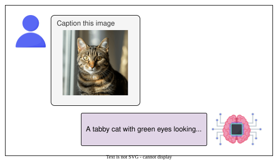

# Designing_a_Scalable_Image_Captioning_System_with_Vision-Language_Models

Source: https://www.educative.io/courses/generative-ai-system-design/design-an-image-captioning-system

---

[Home](https://www.educative.io/)

[Courses](https://www.educative.io/search?tab=courses)

[Grokking the Generative AI System Design Interview](https://www.educative.io/courses/generative-ai-system-design)

# Design an Image Captioning System

Design an image captioning system around a BLIP-2-style vision-language model that extracts image features, generates captions, personalizes them with context and feedback, and moderates the output.

We'll cover the following...

- [Vision-language models (VLMs)](https://www.educative.io/courses/generative-ai-system-design/design-an-image-captioning-system#Vision-language-models-VLMs)
  - [How VLMs work](https://www.educative.io/courses/generative-ai-system-design/design-an-image-captioning-system#How-VLMs-work)
- [Requirements](https://www.educative.io/courses/generative-ai-system-design/design-an-image-captioning-system#Requirements)
  - [Functional requirements](https://www.educative.io/courses/generative-ai-system-design/design-an-image-captioning-system#Functional-requirements)
  - [Non-functional requirements](https://www.educative.io/courses/generative-ai-system-design/design-an-image-captioning-system#Non-functional-requirements)
- [Model selection](https://www.educative.io/courses/generative-ai-system-design/design-an-image-captioning-system#Model-selection)
- [The training process](https://www.educative.io/courses/generative-ai-system-design/design-an-image-captioning-system#The-training-process)
  - [Model training and testing](https://www.educative.io/courses/generative-ai-system-design/design-an-image-captioning-system#Model-training-and-testing)
    - [Distributing the training load](https://www.educative.io/courses/generative-ai-system-design/design-an-image-captioning-system#Distributing-the-training-load)
  - [Model evaluation](https://www.educative.io/courses/generative-ai-system-design/design-an-image-captioning-system#Model-evaluation)
    - [Evaluation metrics](https://www.educative.io/courses/generative-ai-system-design/design-an-image-captioning-system#Evaluation-metrics)
- [Storage estimation](https://www.educative.io/courses/generative-ai-system-design/design-an-image-captioning-system#Storage-estimation)
- [Inference servers estimation](https://www.educative.io/courses/generative-ai-system-design/design-an-image-captioning-system#Inference-servers-estimation)
- [Bandwidth estimation](https://www.educative.io/courses/generative-ai-system-design/design-an-image-captioning-system#Bandwidth-estimation)
- [High-level design for an image captioning system](https://www.educative.io/courses/generative-ai-system-design/design-an-image-captioning-system#High-level-design-for-an-image-captioning-system)
  - [Achieving functional requirements](https://www.educative.io/courses/generative-ai-system-design/design-an-image-captioning-system#Achieving-functional-requirements)
- [A detailed System Design](https://www.educative.io/courses/generative-ai-system-design/design-an-image-captioning-system#A-detailed-System-Design)
  - [Image processing and feature extraction system](https://www.educative.io/courses/generative-ai-system-design/design-an-image-captioning-system#Image-processing-and-feature-extraction-system)
  - [Model hosting and caption generation system](https://www.educative.io/courses/generative-ai-system-design/design-an-image-captioning-system#Model-hosting-and-caption-generation-system)
  - [Contextual enhancement and moderation system](https://www.educative.io/courses/generative-ai-system-design/design-an-image-captioning-system#Contextual-enhancement-and-moderation-system)
  - [Putting everything together](https://www.educative.io/courses/generative-ai-system-design/design-an-image-captioning-system#Putting-everything-together)
  - [Workflow of the image captioning system](https://www.educative.io/courses/generative-ai-system-design/design-an-image-captioning-system#Workflow-of-the-image-captioning-system)
- [Conclusion](https://www.educative.io/courses/generative-ai-system-design/design-an-image-captioning-system#Conclusion)

**Image captioning** involves creating a textual description of an image that accurately and concisely represents its visual content. It is a fundamental problem in vision-language research, enabling applications such as automatic photo tagging, assisting visually impaired individuals, and improving content retrieval systems.

A snapshot of an image captioning system

Image captioning has many real-world applications, including:

- Tagging images for offensive/inappropriate image detection
- Generating automatic caption suggestions on social media
- Producing alt text for users with visual impairments

Early image captioning solutions faced challenges with visual understanding, context awareness, and computational efficiency because they relied on template-based methods and rule-based systems. Modern models use deep neural networks, particularly transformers, to achieve state-of-the-art performance. Recent advancements in deep learning and vision-language models (VLMs) have significantly improved image captioning systems.

## Vision-language models (VLMs)[#](https://www.educative.io/courses/generative-ai-system-design/design-an-image-captioning-system#Vision-language-models-VLMs)

**Vision-language models (VLMs)** are a class of machine learning models designed to bridge the gap between visual and textual understanding. These models integrate computer vision and natural language processing (NLP) techniques to enable machines to process and generate meaningful textual descriptions of images.

### How VLMs work[#](https://www.educative.io/courses/generative-ai-system-design/design-an-image-captioning-system#How-VLMs-work)

VLMs typically consist of two core components:

1. **Image encoder:** This component extracts visual features from an image. It usually uses a convolutional neural network (CNN) or a Vision Transformer (ViT) pretrained on large-scale image datasets.
2. **Language decoder:** This component generates text based on extracted visual features. This is often a transformer-based language model trained on vast amounts of textual data.

To align visual and textual modalities, these models employ cross-attention mechanisms, contrastive learning, or other fusion techniques to ensure the generated captions are contextually relevant. Popular VLMs for image captioning include CLIP, Flamingo, and BLIP-2.

Let’s examine the requirements we need to meet to build an image captioning system.

## Requirements[#](https://www.educative.io/courses/generative-ai-system-design/design-an-image-captioning-system#Requirements)

Building a good image captioning system starts with its requirements. These requirements help ensure that the captions are accurate and the system runs smoothly in real situations.

### Functional requirements[#](https://www.educative.io/courses/generative-ai-system-design/design-an-image-captioning-system#Functional-requirements)

We will need our system to perform the following functionalities:

- **Image understanding:** The system must accurately recognize objects, scenes, and relationships (between objects) within an image.
- **Caption generation:** The system should generate grammatically correct, semantically meaningful, and contextually relevant captions.
- **Personalization:** Users should be able to adjust caption styles (e.g., formal, humorous, concise) for different applications.

Functional requirements for the image captioning system

### Non-functional requirements[#](https://www.educative.io/courses/generative-ai-system-design/design-an-image-captioning-system#Non-functional-requirements)

The non-functional requirements of the image captioning system include:

- **Performance:** Caption generation should be fast, ideally under a second for real-time applications.
- **Scalability:** The system should efficiently handle large volumes of images, particularly for enterprise use cases.
- **Accuracy:** The generated captions should be precise and consistent across similar images.
- **Security and privacy:** The system must handle user data securely, especially in applications that involve personal or sensitive images.

With our requirements decided, we can proceed to selecting a model for our system.

## Model selection[#](https://www.educative.io/courses/generative-ai-system-design/design-an-image-captioning-system#Model-selection)

Selecting the right model architecture is a critical step in designing an image captioning system. The choice of model impacts the system’s performance, efficiency, and ability to generate high-quality captions.

As stated earlier, we will focus on using VLMs due to their advantages over earlier models, such as the basic encoder-decoder models. We will create a model similar to BLIP-2 (Bootstrapping Language-Image Pre-training) for this system. Like the original architecture of BLIP-2, we will consider approximately 1 billion trainable parameters and a total of 4 billion parameters (including the language decoder).

The BLIP-2 architecture

The architecture consists of three main components:

1. **Image encoder** **(e.g., ViT):** Extracts visual features from the input image.
2. **Q-Former (Querying transformer):** A transformer module that bridges vision and language by learning compact multimodal representations from the image features. It interacts with conditioning text or queries to refine the feature extraction process.
3. **Language decoder** **(e.g., FLAN-T5):** Generates a textual description of the image based on the refined visual features. The decoder remains frozen during training, utilizing pretrained language knowledge for efficient caption generation.

The model follows a two-stage processing pipeline:

- **Encoding stage** **(Trainable):** The image encoder extracts image features, which the Q-Former processes to create multimodal queries.
- **Decoding stage (Frozen):** The language decoder converts these queries into natural language descriptions.

> **Note:** We will train the image encoder and query transformer of our VLM, specifically the 1 billion-parameter model. We will keep the language decoder (FLAN-T5 XL in the case of BLIP-2) frozen. We have covered language models and their applications for text-to-text generation systems in [the previous lessons](https://www.educative.io/courses/generative-ai-system-design/design-a-text-to-text-generation-system).

1.

Can we use a text-to-image model for image captioning?

Show Answer

Did you find this helpful?

Let’s see how we will train this model to build an image captioning system.

## The training process[#](https://www.educative.io/courses/generative-ai-system-design/design-an-image-captioning-system#The-training-process)

Now, we will explore how image captioning models are trained and how they learn to create captions from images.

The dataset to train this system will be the same image-text data used to train our text-to-image generation system, so let’s proceed directly to the training time estimation.

AI Powered

Saved

1 attempt left

Reset

Ethical considerations for image captioning systems

What ethical considerations should be prioritized when deploying image captioning systems at scale, especially when captions may shape user perception or support automated decisions?

This is your last attempt.

### Model training and testing[#](https://www.educative.io/courses/generative-ai-system-design/design-an-image-captioning-system#Model-training-and-testing)

To train our model on the selected dataset, we first need to estimate its training time. Let’s say we are using NVIDIA A100 80 GB GPUs. These GPUs can perform 156 TFLOPS of TF32 calculations.

To estimate the time taken for training, we can use the same formula from the previous lessons:

Tsec=Nparams×NFLOPS×E×D×CRops×NGPUs\text{T}\_{\text{sec}} = \frac{\text{N}\_{\text{params}} \times \text{N}\_{\text{FLOPS}} \times \text{E} \times \text{D} \times \text{C}}{\text{R}\_{\text{ops}} \times \text{N}\_{\text{GPUs}}}Tsec​=Rops​×NGPUs​Nparams​×NFLOPS​×E×D×C​

We need to modify this formula as we did in our text-to-video generation system. We use an FLAN-T5 XL model for text generation, which is a 3B-parameter language model. We also need to consider these parameters in our forward pass. So, we need to add:

A=Np (endcoder)×2×D×E\text{A} = \text{N}\_{\text{p (endcoder)}} \times 2 \times D \times E A=Np (endcoder)​×2×D×E

As the image encoding can be done in one step, so C\text{C}C is 1.

Tsec=Nparams×NFLOPS×E×D+ARops×NGPUs\text{T}\_{\text{sec}} = \frac{\text{N}\_{\text{params}} \times \text{N}\_{\text{FLOPS}} \times \text{E} \times \text{D} + \text{A}}{\text{R}\_{\text{ops}} \times \text{N}\_{\text{GPUs}}}Tsec​=Rops​×NGPUs​Nparams​×NFLOPS​×E×D+A​

> Using one GPU will take ~9 days to train the model.

#### Distributing the training load[#](https://www.educative.io/courses/generative-ai-system-design/design-an-image-captioning-system#Distributing-the-training-load)

We can distribute the training process across multiple machines to achieve a realistic timeframe, using the same method employed in the [training infrastructure of the text-to-text generation system](https://www.educative.io/collection/page/10370001/5567964407791616/5785696764035072#Distributing-the-training-load). The time estimate when training for 1,000 epochs using 8 training servers is given below:

#### 

|  |  |  |  |
| --- | --- | --- | --- |
|  | A | B | C |
| 1 | Number of parameters | 1 | Billion |
| 2 | FLOPS per parameter update | 6 | FLOPS/parameter |
| 3 | Number of Epochs | 1000 | epochs |
| 4 | Size of data | 10 | Million entries |
| 5 | Number of steps | 1 | Steps |
| 6 | FLOPS for training | f120000000 | TFLOPS |
| 7 | Rate of operations | 156 | TFLOPS |
| 8 | Number of GPUs | 8 | NVIDIA A100 GPUs |
| 9 | Training time (in seconds) | f96153.85 | Seconds |
| 10 | Training time (in days) | f1.11 | Days |

Try changing the values highlighted in yellow to see the effect on the time.

### Model evaluation[#](https://www.educative.io/courses/generative-ai-system-design/design-an-image-captioning-system#Model-evaluation)

To evaluate an image captioning system, various automated and human-centric approaches are employed to assess the quality, accuracy, and relevance of the generated captions. The model is assessed based on its ability to generate coherent,contextually rich, and factually accurate captions for images.

#### Evaluation metrics[#](https://www.educative.io/courses/generative-ai-system-design/design-an-image-captioning-system#Evaluation-metrics)

- **BLEU (Bilingual Evaluation Understudy):** Measures n-gram overlap between generated and reference captions, focusing on precision.
- **CIDEr (Consensus-Based Image Description Evaluation):** Uses TF-IDF weighting to emphasize important words, improving relevance evaluation.
- **ROUGE (Recall-Oriented Understudy for Gisting Evaluation):** Measures recall of key words and phrases, useful for assessing completeness.
- **Precision and recall****:** Precision refers to the quality of the generated text. High precision indicates text generation that closely aligns with the reference text. Recall, conversely, measures the model’s capacity to generate a diverse range of valid text descriptions for a single image, reflecting its ability to explore different interpretations and visual styles.

The illustration below summarizes the complete training process from data acquisition to training. The model weights are saved and synced at each training server.

The model training architecture and process

As with the previous models, we can always fine-tune this model to increase its accuracy or to create a use-case-specific model.

Now, let’s examine how to design the deployment infrastructure for this model to create an end-to-end system.

Unlike text-to-image systems, which generate visual outputs from textual prompts, image captioning requires interpreting rich visual content and translating it into coherent textual descriptions, demanding different architectural considerations, such as efficient image processing pipelines and response-time constraints. Understanding how to deploy such a system is crucial not just for ensuring scalability and reliability, but also for handling the specific challenges that arise when visual input needs to be converted into meaningful text at scale.

Considering the [BOTECs](https://www.educative.io/courses/generative-ai-system-design/estimating-training-compute-and-cost) chapter, let’s begin with the resource estimation for the following key areas:

- Storage estimation
- Inference server requirements
- Network bandwidth estimation

Let’s start with the storage estimation:

## Storage estimation[#](https://www.educative.io/courses/generative-ai-system-design/design-an-image-captioning-system#Storage-estimation)

In storage estimation, we consider the size of the model files, users’ profiles, interactions, and the additional indexing storage needed to organize and quickly retrieve captions:

- **Model size:** For the model we selected in the previous lesson, with approximately 4 billion parameters, we would need around 8 GB of storage when using FP16 (16-bit floating-point) precision.

Model size=4 billion×2 bytes=8 GB\text{Model size}= \text{4 billion} \times \text{2 bytes} =\text{8 GB}Model size=4 billion×2 bytes=8 GB

- **User profile data:** Assuming each user’s data takes approximately 10 KB, we would need 1 TB to store this data:

User data=100 M×10 KB=1 TB\text{User data} = 100 \text{ M} \times 10 \text{ KB} = 1 \text{ TB}User data=100 M×10 KB=1 TB

**Note:** The model size (8 GB) and user profile data (1 TB) will stay the same unless the user base grows. So, for now, we won’t include them in the ongoing storage calculations.

- **User interaction data:** If we store data for every user interaction, the storage required will depend on the size of each interaction. Assume that the user uploads an image for 500×500500 \times 500500×500 pixels in each interaction, having a size of 250 KB. Also, if each user has 10 interactions per day, then for 100 million users, the daily storage needed would be:

User interaction data=100 M×10×250 KB= 250 TB\text{User interaction data} = 100 \text{ M} \times 10 \times 250 \text{ KB} = \text{ 250 TB}User interaction data=100 M×10×250 KB= 250 TB

- **Indexing storage:** We also require additional storage to index user interaction data for quick retrieval. Let’s assume the indexing adds about 25% more to the total storage.

User interaction indexing storage=250 TB×0.25= 62.5 TB\text{User interaction indexing storage} = 250 \text{ TB} \times 0.25 = \text{ 62.5 TB}
User interaction indexing storage=250 TB×0.25= 62.5 TB

So, the total storage requirement for user interaction per day would be:

Storage required per day=250 TB+62.5 TB=312.5 TB/day\begin{align\*}
\text{Storage required per day}
&= 250 \text{ TB} + 62.5 \text{ TB} \\ &= 312.5\text{ TB/day}
\end{align\*}Storage required per day​=250 TB+62.5 TB=312.5 TB/day​

According to the above estimates, the monthly storage requirement is:

Monthly storage required=312.5 TB×30≈ 9.4 PB/month\text{Monthly storage required} = \text{312.5 TB} \times 30 \approx \text{ 9.4 PB/month}Monthly storage required=312.5 TB×30≈ 9.4 PB/month

Let’s move on to the estimation of inference servers.

## Inference servers estimation[#](https://www.educative.io/courses/generative-ai-system-design/design-an-image-captioning-system#Inference-servers-estimation)

For 100 M daily users, the total number of requests per second (TRPS) is 11,574, with each user making 10 requests per day. Models similar to BLIP-2 may require multiple steps to produce the output, assuming 100 iterations. Therefore, using [our proposed inference formula](https://www.educative.io/courses/generative-ai-system-design/estimating-inference-capacity-and-fleet-size#Inference-server-estimation), an average query’s inference time for the 4 B BLIP-2 model is approximately 2.56 milliseconds. This time is estimated using FP16 precision on an NVIDIA A100 GPU. According to this estimation, the QPS for an NVIDIA server having an A100 GPU will be 391 QPS, which yields us the following number of inference servers:

Inference servers required=TRPSQPS=11574391≈30 GPU servers\text{Inference servers required} = \frac{\text{TRPS}}{\text{QPS}}= \frac{11574}{391} \approx 30 \text{ GPU servers}Inference servers required=QPSTRPS​=39111574​≈30 GPU servers

## Bandwidth estimation[#](https://www.educative.io/courses/generative-ai-system-design/design-an-image-captioning-system#Bandwidth-estimation)

To calculate the ingress and egress network bandwidth for 11574 TRPS, we assume that the single request size is approximately 250 KB, as each request typically contains an input image. Also, assume that, on average, the model produces a summary of around 50 tokens (≈200\approx 200≈200 characters). As a result, the response size for each request is approximately 200 bytes. According to the [BOTECs](https://www.educative.io/courses/generative-ai-system-design/estimating-inference-capacity-and-fleet-size), we estimate the following bandwidth requirements:

Ingress bandwidth=11574×250 KB= 2893.5 MBbps= 2893.5 MBps×8≈23 Gbps\begin{align\*}
\text{Ingress bandwidth}
&= 11574 \times \text{250 KB} \\ &=\text{ 2893.5 MBbps} \\ &=\text{ 2893.5 MBps} \times 8 \\ & \approx 23 \text{ Gbps}
\end{align\*}Ingress bandwidth​=11574×250 KB= 2893.5 MBbps= 2893.5 MBps×8≈23 Gbps​

Egress bandwidth=11574×200 B= 2.3 MBps=2.3 MBps×8≈ 19 Mbps\begin{align\*}
\text{Egress bandwidth}
&= 11574 \times 200 \text{ B} \\ &= \text{ 2.3 MBps} \\
& =2.3 \text{ MBps}\times 8\approx \ 19 \text{ Mbps}
\end{align\*}Egress bandwidth​=11574×200 B= 2.3 MBps=2.3 MBps×8≈ 19 Mbps​

So, we estimate the following resource requirements:

- **Storage required (approximately):** 312.5 TB/day312.5 \text{ TB/day}312.5 TB/day
- **Inference servers required:** 303030 NVIDIA A100 GPU servers
- **Ingress bandwidth:** 23 Gbps23 \text{ Gbps}23 Gbps
- **Egress bandwidth:** 19 Mbps19 \text{ Mbps}19 Mbps

Estimated resources required for the image captioning system during inference

## High-level design for an image captioning system[#](https://www.educative.io/courses/generative-ai-system-design/design-an-image-captioning-system#High-level-design-for-an-image-captioning-system)

Designing an image captioning system requires multiple subsystems working in harmony to process images, extract meaningful information, and generate captions that are both human-readable and accurate. The system must be modular to ensure efficiency, scalability, and personalization. Below is a high-level design outlining the key components.

- **The image processing and features extraction system:** This system normalizes and resizes the input images to ensure consistency, extracts visual features, and converts these features into a numerical representation that the language model can process. This step ensures the system understands the visual content effectively before generating captions.
- **The model hosting and caption generation system:** This system houses the BLIP-2 model, which generates text descriptions based on the extracted image features.
- **The contextual enhancement system:** It improves caption quality by incorporating external knowledge and user feedback.
- **The moderation system:** This system ensures that the generated captions adhere to ethical standards and maintain high quality. It uses automated filtering techniques to remove sensitive, offensive, or biased content. Additionally, this system evaluates the coherence and accuracy of captions.

These systems work in tandem to deliver accurate and context-aware captions, as shown below:

A high-level design of an image-captioning system

### Achieving functional requirements[#](https://www.educative.io/courses/generative-ai-system-design/design-an-image-captioning-system#Achieving-functional-requirements)

The proposed image captioning system must ensure accurate image understanding, generate meaningful captions, and provide user-driven personalization. Below, we analyze how the system fulfills these functional requirements based on the designed workflow.

- **Image understanding:** The image processing system addresses this requirement by analyzing images and extracting meaningful visual features. These features capture object details, scene composition, and relationships between different entities in an image, enabling the caption generation system to associate visual elements with relevant textual descriptions.
- **Caption generation:** Once visual features are extracted, the model hosting system processes them to align vision and language representations. This ensures that captions are grammatically correct, semantically meaningful, and contextually appropriate.
- **Personalization:** The contextual enhancement subsystem stores user interactions and preferences, allowing captions to be customized based on historical data. Users can adjust caption styles through predefined settings or adaptive learning mechanisms.

We now have a high-level understanding of the system. Let’s move ahead toward the detailed System Design.

## A detailed System Design[#](https://www.educative.io/courses/generative-ai-system-design/design-an-image-captioning-system#A-detailed-System-Design)

Let’s describe each component involved in the image-captioning system. We follow a modular approach by describing each subsystem individually.

### Image processing and feature extraction system[#](https://www.educative.io/courses/generative-ai-system-design/design-an-image-captioning-system#Image-processing-and-feature-extraction-system)

The image processing and feature extraction system consists of the following modules:

- **Image preprocessing module:** The image preprocessing module transforms raw images into a format suitable for deep learning processing,  such as converting CMYK images to RGBA or RGB, or transforming `unit8` to `float32`. It resizes images to a fixed resolution while maintaining the aspect ratio to prevent distortions. Additionally, it normalizes pixel values using mean subtraction and standardization techniques to align with the requirements of the image captioning model, i.e., BLIP-2. The image is then converted into a tensor format, making it compatible with neural network processing. These steps ensure that every input image is consistently processed before being extracted for features.
- **Feature extraction module:** The feature extraction module in BLIP-2 uses a Querying Transformer (Q-Transformer). The transformer selectively extracts relevant visual features from a frozen pretrained vision model. Instead of processing images densely, the Q-Transformer learns query tokens that attend to key image regions through self-attention. This approach reduces computational overhead while retaining meaningful scene and object information for caption generation.
- **Scene understanding and object detection module:** This module enhances feature extraction by identifying key objects and contextual information in an image. This helps the captioning model generate more accurate and relevant captions, especially for images with multiple elements or complex backgrounds.

The scene understanding and object detection module could utilize a vector database, such as Milvus, to store precomputed features for faster inference.

The image processing and feature extraction system

The output of this system is digested by the model hosting system, as explained below.

### Model hosting and caption generation system[#](https://www.educative.io/courses/generative-ai-system-design/design-an-image-captioning-system#Model-hosting-and-caption-generation-system)

The model hosting and caption generation system is the core of the image captioning process, transforming extracted visual features into meaningful text. It leverages a two-stage vision-language alignment process, advanced language modeling techniques, and fine-tuning mechanisms to ensure fluent, context-aware, and adaptable caption generation. It consists of the following services:

- **The model host:** This service is the core of the overall system.It uses the features provided by the image processing and feature extraction system. It follows a two-stage approach, first aligning vision-language representations and then refining them for improved text generation.
- **Language modeling and caption refinement:** This component further refines captions using beam search, nucleus sampling, and top-k sampling. Beam search selects the most probable caption, while nucleus sampling introduces variation for more natural text. BLIP-2 relies on a pretrained language model (OPT or Flan-T5) for high-quality generation, learning fluency, and coherence from its training corpus without needing a separate grammatical correction module.
- **Fine-tuning and adaptation engine:**  This service enables domain-specific adjustments to the captioning model, allowing for the creation of tailored content. It enables the system to be trained on specialized datasets, such as medical images, autonomous driving datasets, or satellite imagery, ensuring accurate captions across various industries. This service also incorporates continual learning mechanisms that adapt model behavior based on real-world feedback. By dynamically fine-tuning the model, the system remains effective and adaptable to evolving data and user requirements.

The fine-tuning and adaptation engine utilizes a model training database, such as PostgreSQL or MongoDB, to store fine-tuning datasets, past user captions, and updated model weights.

The model hosting and caption generation system

### Contextual enhancement and moderation system[#](https://www.educative.io/courses/generative-ai-system-design/design-an-image-captioning-system#Contextual-enhancement-and-moderation-system)

The contextual enhancement and moderation system improves caption quality by incorporating user feedback, external knowledge, and personalization. It consists of the following services:

- **User interaction and feedback storage:** This service records user interactions and responses to generated captions. It allows the system to learn from user feedback, refining captions based on user preferences. The system can improve accuracy over time by maintaining a historical record of past captions and ratings, aligning with individual user needs. Reinforcement learning techniques enable the model to learn to favor captions that receive positive feedback, thereby increasing its likelihood of producing similar high-quality captions in the future.

The user interaction and feedback storage utilizes a user feedback database, such as PostgreSQL, DynamoDB, or Firebase Firestore, to store past user interactions, feedback, and preferences.

- **Metadata and knowledge retrieval engine:** It enhances captions by integrating contextual data from external sources. It retrieves metadata, such as location information, capture time, and camera settings, from the image’s EXIF data, if available. It can also access knowledge graphs, allowing the system to recognize well-known objects, landmarks, or events. This additional context helps generate richer and more informative captions, making the system more intelligent and aware of real-world concepts.

The metadata and knowledge retrieval engine utilizes a metadata database, such as a knowledge graph store or Neo4j, to retrieve contextual information, including object metadata and historical references.

- **Personalization engine:** This service allows users to customize the style and tone of generated captions. It provides options for concise, humorous, formal, or detailed captions, tailoring the output based on user preferences. The system adapts over time by learning from individual usage patterns, improving caption generation for each user. This module can also integrate with user profiles, providing personalized experiences tailored to various application needs.

The personalization engine utilizes a user profile database, such as MySQL or Amazon DynamoDB, to store user-specific settings and preferences for generating tailored captions.

The contextual enhancement and moderation system

- **Moderation system:** The content moderation and quality control system ensures that generated captions are appropriate and fluent. It employs pretrained NLP models to detect harmful language, filtering out bias, hate speech, or inappropriate terms to maintain ethical AI standards. Another module, known as the linguistic and semantic coherence checker, evaluates fluency and readability using BERT-based models or traditional NLP techniques, refining captions by eliminating ambiguities and redundancies.

### Putting everything together[#](https://www.educative.io/courses/generative-ai-system-design/design-an-image-captioning-system#Putting-everything-together)

As shown below, all the subsystems are combined into one large system. We have also included some basic building blocks to complete the System Design, such as an API gateway and load balancer.

- **User interface (UI):** This is the front-end that allows users to submit queries (images) and receive system-generated captions. It can be a web application, a desktop client, or a mobile app that interacts with the backend via APIs.
- **API gateway:** Serves as the main access point for user requests, managing authentication, rate limiting, and request routing to ensure only authorized and valid queries reach backend services.
- **Load balancer:** Efficiently distributes incoming traffic across multiple backend servers, including the embedding service and model host, to ensure high availability and prevent server overload.

System design of an image captioning system

### Workflow of the image captioning system[#](https://www.educative.io/courses/generative-ai-system-design/design-an-image-captioning-system#Workflow-of-the-image-captioning-system)

The image processing and feature extraction system first preprocesses the image, standardizing its format, and then extracts meaningful visual features. If necessary, the scene understanding and object detection module enhances these features by identifying objects and their relationships, and storing precomputed embeddings in a vector database for faster inference.

The processed image features are then sent to the model host and caption generation system, where the AI model aligns visual and language representations. The language modeling and caption refinement service generates fluent, contextually accurate captions using a pretrained language model (OPT or Flan-T5). If needed, the fine-tuning and adaptation engine refines captions based on specialized datasets, storing updates in the model fine-tuning database. Once the caption is generated, the contextual enhancement and moderation system personalizes it based on user preferences, metadata, and historical interactions. The user interaction service retrieves past feedback, while the metadata and knowledge retrieval engine enriches captions using external data sources, such as a knowledge graph store. The personalization engine adapts to style preferences using information stored in the user profile database, while the moderation system ensures the appropriateness of content. Finally, the refined and moderated caption is returned to the user through the UI.

AI Powered

Saved

1 attempt left

Reset

Scene understanding and object detection in image captioning systems

In an image captioning system, the scene understanding and object detection module is used only when necessary. What is the most likely reason for designing the system this way?

This is your last attempt.

> Take a look at the following table explaining how we can achieve the non-functional requirements that were identified in the previous lesson:

|  |  |
| --- | --- |
| **Non-Functional Requirement** | **Solution** |
| **Performance** | - Optimized image processing with precomputed embeddings stored in vector databases - Efficient Q-Transformer for feature extraction - Model quantization using TensorRT for faster inference - Load balancing to distribute requests efficiently |
| **Scalability** | - Horizontal and vertical scaling via Kubernetes and Docker - API gateway and load balancer for traffic distribution - Distributed inference using multi-GPU - Database sharding for high availability |
| **Accuracy** | - Fine-tuning BLIP-2 with domain-specific datasets - Metadata enrichment for contextual accuracy - Coherence validation using NLP models - Iterative learning from user feedback |
| **Security and privacy** | - End-to-end encryption for data protection - Authentication via OAuth/JWT - Content moderation for safety - Data anonymization for privacy compliance (GDPR) - Security audits for threat monitoring |

## Conclusion[#](https://www.educative.io/courses/generative-ai-system-design/design-an-image-captioning-system#Conclusion)

The image captioning system, powered by BLIP-2, seamlessly integrates cutting-edge vision-language alignment, scalable infrastructure, and intelligent contextual enhancement to generate highly accurate and meaningful captions. The system meets current performance and scalability demands by leveraging pretrained models, real-time inference optimizations, and user-driven feedback loops, and adapts to evolving user needs. Future enhancements could include multilingual support, zero-shot captioning for unseen objects, and real-time video captioning to expand its capabilities beyond static images. With ongoing advancements in AI and deep learning, this system provides a foundation for more context-aware multimedia analysis and supports future improvements in AI-driven content generation.

Design a Text-to-Video Generation System

Design an Automatic Speech Recognition System

Ask

[Vision-language models (VLMs)](https://www.educative.io/courses/generative-ai-system-design/design-an-image-captioning-system#Vision-language-models-VLMs)

[How VLMs work](https://www.educative.io/courses/generative-ai-system-design/design-an-image-captioning-system#How-VLMs-work)

[Requirements](https://www.educative.io/courses/generative-ai-system-design/design-an-image-captioning-system#Requirements)

[Functional requirements](https://www.educative.io/courses/generative-ai-system-design/design-an-image-captioning-system#Functional-requirements)

[Non-functional requirements](https://www.educative.io/courses/generative-ai-system-design/design-an-image-captioning-system#Non-functional-requirements)

[Model selection](https://www.educative.io/courses/generative-ai-system-design/design-an-image-captioning-system#Model-selection)

[The training process](https://www.educative.io/courses/generative-ai-system-design/design-an-image-captioning-system#The-training-process)

[Model training and testing](https://www.educative.io/courses/generative-ai-system-design/design-an-image-captioning-system#Model-training-and-testing)

[Distributing the training load](https://www.educative.io/courses/generative-ai-system-design/design-an-image-captioning-system#Distributing-the-training-load)

[Model evaluation](https://www.educative.io/courses/generative-ai-system-design/design-an-image-captioning-system#Model-evaluation)

[Evaluation metrics](https://www.educative.io/courses/generative-ai-system-design/design-an-image-captioning-system#Evaluation-metrics)

[Storage estimation](https://www.educative.io/courses/generative-ai-system-design/design-an-image-captioning-system#Storage-estimation)

[Inference servers estimation](https://www.educative.io/courses/generative-ai-system-design/design-an-image-captioning-system#Inference-servers-estimation)

[Bandwidth estimation](https://www.educative.io/courses/generative-ai-system-design/design-an-image-captioning-system#Bandwidth-estimation)

[High-level design for an image captioning system](https://www.educative.io/courses/generative-ai-system-design/design-an-image-captioning-system#High-level-design-for-an-image-captioning-system)

[Achieving functional requirements](https://www.educative.io/courses/generative-ai-system-design/design-an-image-captioning-system#Achieving-functional-requirements)

[A detailed System Design](https://www.educative.io/courses/generative-ai-system-design/design-an-image-captioning-system#A-detailed-System-Design)

[Image processing and feature extraction system](https://www.educative.io/courses/generative-ai-system-design/design-an-image-captioning-system#Image-processing-and-feature-extraction-system)

[Model hosting and caption generation system](https://www.educative.io/courses/generative-ai-system-design/design-an-image-captioning-system#Model-hosting-and-caption-generation-system)

[Contextual enhancement and moderation system](https://www.educative.io/courses/generative-ai-system-design/design-an-image-captioning-system#Contextual-enhancement-and-moderation-system)

[Putting everything together](https://www.educative.io/courses/generative-ai-system-design/design-an-image-captioning-system#Putting-everything-together)

[Workflow of the image captioning system](https://www.educative.io/courses/generative-ai-system-design/design-an-image-captioning-system#Workflow-of-the-image-captioning-system)

[Conclusion](https://www.educative.io/courses/generative-ai-system-design/design-an-image-captioning-system#Conclusion)