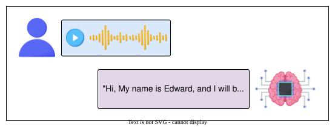

# How_to_Design_an_Automatic_Speech_Recognition_System_Using_Whisper

Source: https://www.educative.io/courses/generative-ai-system-design/design-an-automatic-speech-recognition-system

---

[Home](https://www.educative.io/)

[Courses](https://www.educative.io/search?tab=courses)

[Grokking the Generative AI System Design Interview](https://www.educative.io/courses/generative-ai-system-design)

# Design an Automatic Speech Recognition System

Design an ASR system around a Whisper-style model that preprocesses audio into spectrograms, transcribes it on GPUs, and post-processes the text with confidence-based quality control.

We'll cover the following...

- [Requirements](https://www.educative.io/courses/generative-ai-system-design/design-an-automatic-speech-recognition-system#Requirements)
  - [Functional requirements](https://www.educative.io/courses/generative-ai-system-design/design-an-automatic-speech-recognition-system#Functional-requirements)
  - [Nonfunctional requirements](https://www.educative.io/courses/generative-ai-system-design/design-an-automatic-speech-recognition-system#Nonfunctional-requirements)
- [Model selection](https://www.educative.io/courses/generative-ai-system-design/design-an-automatic-speech-recognition-system#Model-selection)
- [The training process](https://www.educative.io/courses/generative-ai-system-design/design-an-automatic-speech-recognition-system#The-training-process)
  - [Data acquisition and preparation](https://www.educative.io/courses/generative-ai-system-design/design-an-automatic-speech-recognition-system#Data-acquisition-and-preparation)
    - [Source of training data](https://www.educative.io/courses/generative-ai-system-design/design-an-automatic-speech-recognition-system#Source-of-training-data)
      - [Dataset format](https://www.educative.io/courses/generative-ai-system-design/design-an-automatic-speech-recognition-system#Dataset-format)
    - [Data preprocessing](https://www.educative.io/courses/generative-ai-system-design/design-an-automatic-speech-recognition-system#Data-preprocessing)
    - [Database selection](https://www.educative.io/courses/generative-ai-system-design/design-an-automatic-speech-recognition-system#Database-selection)
    - [Time estimation for data processing](https://www.educative.io/courses/generative-ai-system-design/design-an-automatic-speech-recognition-system#Time-estimation-for-data-processing)
  - [Model training and testing](https://www.educative.io/courses/generative-ai-system-design/design-an-automatic-speech-recognition-system#Model-training-and-testing)
    - [Distributing the training load](https://www.educative.io/courses/generative-ai-system-design/design-an-automatic-speech-recognition-system#Distributing-the-training-load)
  - [Model evaluation](https://www.educative.io/courses/generative-ai-system-design/design-an-automatic-speech-recognition-system#Model-evaluation)
    - [Evaluation metrics](https://www.educative.io/courses/generative-ai-system-design/design-an-automatic-speech-recognition-system#Evaluation-metrics)
- [Resource estimation](https://www.educative.io/courses/generative-ai-system-design/design-an-automatic-speech-recognition-system#Resource-estimation)
  - [Storage estimation](https://www.educative.io/courses/generative-ai-system-design/design-an-automatic-speech-recognition-system#Storage-estimation)
    - [Stable storage](https://www.educative.io/courses/generative-ai-system-design/design-an-automatic-speech-recognition-system#Stable-storage)
    - [Dynamic storage](https://www.educative.io/courses/generative-ai-system-design/design-an-automatic-speech-recognition-system#Dynamic-storage)
- [Inference server estimation](https://www.educative.io/courses/generative-ai-system-design/design-an-automatic-speech-recognition-system#Inference-server-estimation)
- [Bandwidth estimation](https://www.educative.io/courses/generative-ai-system-design/design-an-automatic-speech-recognition-system#Bandwidth-estimation)
- [High-level System Design](https://www.educative.io/courses/generative-ai-system-design/design-an-automatic-speech-recognition-system#High-level-System-Design)
- [Achieving functional requirements](https://www.educative.io/courses/generative-ai-system-design/design-an-automatic-speech-recognition-system#Achieving-functional-requirements)
- [Detailed System Design](https://www.educative.io/courses/generative-ai-system-design/design-an-automatic-speech-recognition-system#Detailed-System-Design)
  - [1. Audio ingestion and preprocessing system](https://www.educative.io/courses/generative-ai-system-design/design-an-automatic-speech-recognition-system#1-Audio-ingestion-and-preprocessing-system)
  - [2. Model hosting and transcription system](https://www.educative.io/courses/generative-ai-system-design/design-an-automatic-speech-recognition-system#2-Model-hosting-and-transcription-system)
  - [3. Post-processing and quality control system](https://www.educative.io/courses/generative-ai-system-design/design-an-automatic-speech-recognition-system#3-Post-processing-and-quality-control-system)
- [Putting it all together](https://www.educative.io/courses/generative-ai-system-design/design-an-automatic-speech-recognition-system#Putting-it-all-together)
  - [Infrastructure components](https://www.educative.io/courses/generative-ai-system-design/design-an-automatic-speech-recognition-system#Infrastructure-components)
  - [End-to-end workflow](https://www.educative.io/courses/generative-ai-system-design/design-an-automatic-speech-recognition-system#End-to-end-workflow)
- [Achieving nonfunctional requirements](https://www.educative.io/courses/generative-ai-system-design/design-an-automatic-speech-recognition-system#Achieving-nonfunctional-requirements)
- [Conclusion](https://www.educative.io/courses/generative-ai-system-design/design-an-automatic-speech-recognition-system#Conclusion)

**Automatic speech recognition (ASR)** systems convert spoken language into text, enabling seamless human-computer interaction. ASR technology is used in virtual assistants, transcription pipelines, voice search systems, and accessibility tools. Recent advancements in deep learning and neural networks have significantly improved the accuracy and efficiency of ASR systems, making them integral to modern applications.

An abstract of an automatic speech recognition system

Traditional ASR systems face several challenges, including sensitivity to background noise, speaker accents, and variations in speech patterns, which reduce accuracy in real-world conditions. These systems often have limitations in multilingual recognition, code-switching, and the recognition of diverse accents, which can reduce accessibility and impact inclusivity. Modern ASR models like OpenAI’s Whisper v3 and Google DeepMind’s Canary have significantly improved ASR by leveraging large-scale self-supervised learning on diverse, multilingual datasets. These models demonstrate superior robustness to noise, accents, and low-resource languages, enabling more accurate transcription in real-world scenarios.

> **Note:**In this lesson, we will look at the fundamental concepts of ASR, the architecture of ASR models, the training process, and evaluation methods to build an end-to-end ASR system. As with any system, we will start with the requirements.

## Requirements[#](https://www.educative.io/courses/generative-ai-system-design/design-an-automatic-speech-recognition-system#Requirements)

The development of an image captioning system begins with identifying the functional requirements that shape its essential behaviors and the non-functional requirements that determine its performance and reliability.

### Functional requirements[#](https://www.educative.io/courses/generative-ai-system-design/design-an-automatic-speech-recognition-system#Functional-requirements)

The functional requirements of an ASR system are:

- **Speech-to-text conversion:** The model should accurately transcribe spoken language into text while accounting for pronunciation, accent, and background noise variations.
- **Audio preprocessing:** The system must handle noise reduction, echo cancellation, and feature extraction.
- **Real-time processing:** The ASR model must support low-latency, real-time transcription for use cases such as live captioning and virtual assistants.
- **Multilingual support:** The ASR system must support recognition across multiple languages and dialects while maintaining consistent accuracy.

### Nonfunctional requirements[#](https://www.educative.io/courses/generative-ai-system-design/design-an-automatic-speech-recognition-system#Nonfunctional-requirements)

The nonfunctional requirements for an ASR system are:

- **Accuracy:** The error rate (e.g., WER) should be minimized, particularly in noisy environments and for diverse accents and dialects.
- **Low latency:** The ASR system should process and transcribe speech with minimal delay to support real-time applications.
- **Security and privacy:** All user data (audio, text, and metadata) must be securely stored, encrypted, and handled according to data protection regulations.
- **Scalability:** The system should handle large-scale deployments, supporting multiple users and languages simultaneously.

With our requirements decided, we can choose a model for our system.

## Model selection[#](https://www.educative.io/courses/generative-ai-system-design/design-an-automatic-speech-recognition-system#Model-selection)

Selecting the right model architecture is a key step in designing an automatic speech recognition (ASR) system. Model selection directly affects how well the system can generalize, scale to large datasets, and maintain accuracy under different workload conditions, and impacts both training complexity and deployment constraints.

We will focus on modern self-supervised learning (SSL) architectures for ASR, as they have demonstrated superior generalization and robustness over traditional methods. One such model is Whisper, a transformer-based ASR model that leverages large-scale pretraining on diverse audio datasets to achieve state-of-the-art accuracy across multiple languages and acoustic environments.

The Whisper v3 architecture

The Whisper model follows a sequence-to-sequence transformer architecture trained on a vast dataset of audio-text pairs. The core components of Whisper’s architecture are:

1. **Feature extraction:** The input audio is first converted into a log-mel spectrogram representation. This is done using a 2D convolutional layer with GELU activation, followed by adding sinusoidal positional encoding to retain the temporal structure of the audio sequence.
2. **Encoder:** he encoder consists of multiple encoding layers (blocks) that operate on log-mel spectrogram features. This stage enables the model to learn high-dimensional representations of the speech signal.
3. **Decoder:** The decoder takes the encoded speech representation and, using cross-attention and learned positional encoding, predicts text tokens one by one in an autoregressive manner, similar to how large language models like GPT generate text.

In the illustration above, “tokens in multitask training format” refers to how the model is trained to perform multiple speech-related tasks using a unified token-based representation.

Each input sequence starts with special tokens that guide the model on what task to perform. For example:

- **SOT (Start of transcript):** This usually marks the beginning of a transcription task.
- **EN** **(Language token):** We can specify the language of the speech (e.g., English).
- **Other tokens (like timestamps or punctuations):** We can provide additional context for tasks such as translation, transcription, speaker diarization, or summarization.

This multitask tokenization helps the model generalize across different ASR-related tasks, making it more versatile and efficient in handling diverse speech-processing needs.

This system uses a Whisper-like model with 1 billion parameters. With the model architecture defined, the next step is to examine the training process and data requirements needed to train the ASR system.

## The training process[#](https://www.educative.io/courses/generative-ai-system-design/design-an-automatic-speech-recognition-system#The-training-process)

Start with how to train a speech recognition model similar to Whisper v3, beginning with the dataset.

### Data acquisition and preparation[#](https://www.educative.io/courses/generative-ai-system-design/design-an-automatic-speech-recognition-system#Data-acquisition-and-preparation)

High-quality, well-curated data is crucial for training an effective ASR model. The dataset must include a wide variety of audio-transcription pairs to ensure the model can accurately recognize and transcribe speech across different conditions. These pairs should cover diverse linguistic features such as different speech styles, accents, tones, emotions, and intonations. The dataset must cover a wide range of contexts and environments to ensure the model can handle diverse acoustic conditions and maintain transcription accuracy in production settings.

#### Source of training data[#](https://www.educative.io/courses/generative-ai-system-design/design-an-automatic-speech-recognition-system#Source-of-training-data)

We can either build our own dataset or use a publicly available one, such as the Common Voice corpus (v19.0). Collecting audio data from scratch is particularly challenging due to the time and resources involved. Common Voice, for example, contains 3,587 hours of audio; recording that amount alone would take a single person roughly half a year, and that’s before accounting for linguistic diversity and tonal variation.

For our ASR system, we will use Common Voice datasets totaling approximately 50,000 hours of audio, which translates to around 1–2 TB of storage (we’ll assume 2 TB). Based on Common Voice’s data distribution, this volume should contain roughly 2 million rows of audio-transcription pairs.

##### Dataset format[#](https://www.educative.io/courses/generative-ai-system-design/design-an-automatic-speech-recognition-system#Dataset-format)

For training an ASR model, the dataset needs to follow a specific structure:

|  |  |
| --- | --- |
| **Column** | **Description** |
| `audio` | The raw audio file or array (e.g., .wav, .flac) |
| `transcription` | The ground-truth text corresponding to the audio |
| `language` | The language of the spoken audio |
| `duration` | Length of the audio clip in seconds |

**Note:** Many publicly available datasets are not directly compatible with training pipelines. This often requires dropping, renaming, or merging columns to match the input schema expected by Whisper V3.

#### Data preprocessing[#](https://www.educative.io/courses/generative-ai-system-design/design-an-automatic-speech-recognition-system#Data-preprocessing)

Before training begins, the raw data must go through several preprocessing steps to ensure consistency and quality:

- **Data cleaning:** It involves filtering out low-quality or irrelevant entries, such as inaudible recordings, duplicate clips, or mismatched transcriptions. Offensive or inappropriate content should also be removed to maintain ethical standards. However, manually reviewing 2 million rows is largely infeasible, so if you are using a reputable dataset like Common Voice, this step can be partially skipped with reasonable confidence.
- **Noise reduction:** This step involves removing background noise from audio data using signal processing filters or noise suppression libraries. As ASR models like Whisper V3 are sensitive to audio quality, cleaner inputs directly translate to better transcription accuracy during training.
- **Standardization:** It ensures all audio files share a consistent format. This typically means resampling everything to *16 kHz* and encoding at *16-bit* *PCM*, which are the standard requirements for Whisper V3. Inconsistent sampling rates or bit depths can introduce errors and slow down training.
- **Silence trimming:** This step removes leading and trailing silences from audio clips. This reduces unnecessary padding in the data and helps the model focus on the actual spoken content rather than empty audio space.

Once preprocessing is complete, the cleaned and formatted data needs to be stored in an appropriate data store before it can be fed into the training pipeline.

#### Database selection[#](https://www.educative.io/courses/generative-ai-system-design/design-an-automatic-speech-recognition-system#Database-selection)

Like the previous design problem, we can store our data in a simple SQL database and use a blob store for audio file storage.

#### Time estimation for data processing[#](https://www.educative.io/courses/generative-ai-system-design/design-an-automatic-speech-recognition-system#Time-estimation-for-data-processing)

Let’s use some approximate values for our dataset:

Total data items=2 M\text{Total data items} = \text{2 M}Total data items=2 M

**Assuming:**

Time to preprocess an audio file=100 msTime to preprocess a text description=1 msTime to store a row into the database=0.5 ms\text{Time to preprocess an audio file} = \text{100 ms}
\\
\text{Time to preprocess a text description} = \text{1 ms}
\\
\text{Time to store a row into the database} = \text{0.5 ms}Time to preprocess an audio file=100 msTime to preprocess a text description=1 msTime to store a row into the database=0.5 ms

**We get:**

Total audio processing time (Tpa)=Time to preprocess an audio file×Total data itemsTpa=100 ms×2 M=200,000 seconds≈56 hours\text{Total audio processing time } (T\_{pa}) = \text{Time to preprocess an audio file} \times \text{Total data items}
\\
T\_{pa} = \text{100 ms} \times \text{2 M} = \text{200,000 seconds} \approx \text{56 hours}Total audio processing time (Tpa​)=Time to preprocess an audio file×Total data itemsTpa​=100 ms×2 M=200,000 seconds≈56 hours

Total text processing time (Tpt)=Time to preprocess text×Total data itemsTpt=1 ms×2 M=2,000 seconds≈0.5 hours\text{Total text processing time } (T\_{pt}) = \text{Time to preprocess text} \times \text{Total data items}
\\
T\_{pt} = \text{1 ms} \times \text{2 M} = \text{2,000 seconds} \approx \text{0.5 hours}Total text processing time (Tpt​)=Time to preprocess text×Total data itemsTpt​=1 ms×2 M=2,000 seconds≈0.5 hours

Total storage time (Ts)=Time to store a row×Total data itemsTs=1 ms×2 M=2,000 seconds≈0.5 hours\text{Total storage time } (T\_s) = \text{Time to store a row} \times \text{Total data items}
\\
T\_s = \text{1 ms} \times \text{2 M} = \text{2,000 seconds}\approx \text{0.5 hours}Total storage time (Ts​)=Time to store a row×Total data itemsTs​=1 ms×2 M=2,000 seconds≈0.5 hours

**So the total time taken is:**

Total time=Tpa+Tpt+Ts\text{Total time} = T\_{pa} + T\_{pt} + T\_sTotal time=Tpa​+Tpt​+Ts​

Total time=200,000 seconds+2,000 seconds+2,000 seconds=204,000 seconds\text{Total time} = \text{200,000 seconds} + \text{2,000 seconds} + \text{2,000 seconds} = \text{204,000 seconds}Total time=200,000 seconds+2,000 seconds+2,000 seconds=204,000 seconds

Total time≈3,400 minutes≈57 hours\text{Total time} \approx \text{3,400 minutes} \approx \text{57 hours}Total time≈3,400 minutes≈57 hours

Time taken to process and store our voice-text dataset

So, one machine would take about 57 hours to process all of this data at the speeds we assumed. To speed up this process, we can divide the data into multiple machines in parallel. For example, 8 machines would only take about 7 hours to process the 2 TB dataset.

### Model training and testing[#](https://www.educative.io/courses/generative-ai-system-design/design-an-automatic-speech-recognition-system#Model-training-and-testing)

To train our model on the dataset selected, we first need to estimate its training time. Let’s say we are using NVIDIA A100 80 GB GPUs. These GPUs can perform 156 TFLOPS of TF32 calculations.

To estimate the time taken for training, we can use the following equation:

Tsec=Nparams×NFLOPS×E×D×CRops×NGPUs\text{T}\_{\text{sec}} = \frac{\text{N}\_{\text{params}} \times \text{N}\_{\text{FLOPS}} \times \text{E} \times \text{D} \times \text{C}}{\text{R}\_{\text{ops}} \times \text{N}\_{\text{GPUs}}}Tsec​=Rops​×NGPUs​Nparams​×NFLOPS​×E×D×C​

Where C\text{C}C becomes the number of autoregressive steps to produce a text output. This depends on how long the audio is (Laudio\text{L}\_{\text{audio}}Laudio​) and how many tokens are generated per second of audio (Tokenssec\text{Tokens}\_{\text{sec}}Tokenssec​). We can call this Nsteps=Laudio×Tokenssec\text{N}\_{\text{steps}} = \text{L}\_{\text{audio}} \times \text{Tokens}\_{\text{sec}}Nsteps​=Laudio​×Tokenssec​. So, the formula becomes:

Tsec=Nparams×NFLOPS×E×D×NstepsRops×NGPUs\text{T}\_{\text{sec}} = \frac{\text{N}\_{\text{params}} \times \text{N}\_{\text{FLOPS}} \times \text{E} \times \text{D} \times \text{N}\_{\text{steps}}}{\text{R}\_{\text{ops}} \times \text{N}\_{\text{GPUs}}}Tsec​=Rops​×NGPUs​Nparams​×NFLOPS​×E×D×Nsteps​​

We will assume 10 seconds for the length of the audio, and 5 tokens are generated for each second of audio. So:

> Using one GPU will take ~45 days to train the model.

#### Distributing the training load[#](https://www.educative.io/courses/generative-ai-system-design/design-an-automatic-speech-recognition-system#Distributing-the-training-load)

We can distribute the training process over multiple machines to reach a realistic time frame using the same method we used in the [training infrastructure of the text-to-text generation system](https://www.educative.io/collection/page/10370001/5567964407791616/5785696764035072#Distributing-the-training-load). The time estimate for training for 1,000 epochs using 8 training servers is given below:

#### 

|  |  |  |  |
| --- | --- | --- | --- |
|  | A | B | C |
| 1 | Number of parameters | 1 | Billion |
| 2 | FLOPS per parameter update | 6 | FLOPS/parameter |
| 3 | Number of Epochs | 1000 | epochs |
| 4 | Size of data | 2 | Million entries |
| 5 | Number of steps | 50 | Steps |
| 6 | FLOPS for training | f600000000 | TFLOPS |
| 7 | Rate of operations | 156 | TFLOPS |
| 8 | Number of GPUs | 8 | NVIDIA A100 GPUs |
| 9 | Training time (in seconds) | f480769.23 | Seconds |
| 10 | Training time (in days) | f5.56 | Days |

Try changing the values highlighted in yellow in the calculator widget to see the effect on the time.

### Model evaluation[#](https://www.educative.io/courses/generative-ai-system-design/design-an-automatic-speech-recognition-system#Model-evaluation)

Evaluating an Automatic Speech Recognition (ASR) system involves assessing its accuracy, efficiency, and robustness in transcribing spoken language into text. The model is judged based on how well it captures spoken words while handling variations in accents, noise, and speech patterns.

#### Evaluation metrics[#](https://www.educative.io/courses/generative-ai-system-design/design-an-automatic-speech-recognition-system#Evaluation-metrics)

- **Word error rate (WER):** The most common ASR metric, WER calculates the percentage of errors in the transcription by considering insertions, deletions, and substitutions compared to a reference transcript. Lower WER indicates better performance.
- **Character error rate (CER):** Similar to WER but evaluates errors at the character level. Useful for languages with complex word structures or when dealing with spelling-sensitive tasks.
- **BLEU (Bilingual Evaluation Understudy):** Measures the similarity between predicted and reference transcriptions based on n-gram overlap. It is commonly used in machine translation, but it also applies to ASR.
- **Perplexity:** Evaluates how well the language model predicts the next word, reflecting its ability to generate grammatically and contextually correct transcriptions. Lower perplexity means better predictions.

With these evaluation metrics, we can ensure that the ASR system produces high-quality and efficient transcriptions. The illustration below summarizes the complete training process from data acquisition to training. The model weights are saved and synced at each training server.

The model training architecture and process

As with the previous systems we have created, we can always fine-tune this model to increase its accuracy or to create a use-case-specific model.

Now, let’s look at how we can design the deployment infrastructure for this model to create an end-to-end system.

We will walk through the full System Design, from resource estimation to a detailed architecture, showing how different services work together to handle real-world audio transcription traffic reliably and efficiently.

Let’s start with the resource estimation.

## Resource estimation[#](https://www.educative.io/courses/generative-ai-system-design/design-an-automatic-speech-recognition-system#Resource-estimation)

Before designing the system, we need to estimate the resources required. We’ll look at three key areas: storage, inference servers, and network bandwidth. All estimates are based on 100 million daily active users, each submitting 10 audio clips per day.

### Storage estimation[#](https://www.educative.io/courses/generative-ai-system-design/design-an-automatic-speech-recognition-system#Storage-estimation)

Storage requirements can be divided into two categories: stable storage (updated infrequently) and dynamic storage (scales with usage).

#### Stable storage[#](https://www.educative.io/courses/generative-ai-system-design/design-an-automatic-speech-recognition-system#Stable-storage)

- **Model weights (Whisper V3, ~1.5 billion parameters at FP16 precision):** 3 GB\text{3 GB}3 GB
- **User profile data (100 M users x 10 KB each):**  1 TB\text{~1 TB} 1 TB

#### Dynamic storage[#](https://www.educative.io/courses/generative-ai-system-design/design-an-automatic-speech-recognition-system#Dynamic-storage)

Each audio clip is assumed to be 30 seconds long, encoded at 256 kbps, roughly 1 MB per clip.

- **Daily audio uploads:** 100 M users × 10 clips × 1 MB = 1 PB/day\text{100 M users × 10 clips × 1 MB = 1 PB/day}100 M users × 10 clips × 1 MB = 1 PB/day
- **Indexing overhead (25% for fast querying and retrieval):** 250 TB/day\text{250 TB/day}250 TB/day
- **Total daily storage:**  1.25 PB/day\text{~1.25 PB/day} 1.25 PB/day
- **Monthly storage requirement:**  37.5 PB/month\text{~37.5 PB/month} 37.5 PB/month

**Note:** These figures are approximate. In production, compression and deduplication techniques can reduce actual storage requirements significantly.

With storage estimation in hand, now let’s move on to inference server estimation.

## Inference server estimation[#](https://www.educative.io/courses/generative-ai-system-design/design-an-automatic-speech-recognition-system#Inference-server-estimation)

With 100 million daily users making 10 requests each, we get approximately 11,574 requests per second (RPS). The Whisper V3 model processes a 30-second audio clip in about 50 ms on an NVIDIA A100 GPU using FP16 precision.

- **Throughput per GPU:** 1 ÷ 50 ms = 20 requests per second \text{1 ÷ 50 ms = 20 requests per second }1 ÷ 50 ms = 20 requests per second
- **GPU servers required:** 11,574 ÷ 20 ≈ 579 A100 GPU servers\text{11,574 ÷ 20 ≈ 579 A100 GPU servers}11,574 ÷ 20 ≈ 579 A100 GPU servers

**Note:** This is a baseline. In production, add a 20–30% buffer to handle traffic spikes and server failures, bringing the realistic total closer to 700–750 GPU servers.

The final step in the estimation is bandwidth requirements.

## Bandwidth estimation[#](https://www.educative.io/courses/generative-ai-system-design/design-an-automatic-speech-recognition-system#Bandwidth-estimation)

Bandwidth needs are driven by audio uploads (ingress) and transcription responses (egress).

- **Request size (audio clip):**  1 MB per clip\text{~1 MB per clip} 1 MB per clip
- **Response size (transcription text):**  0.5 KB per clip\text{~0.5 KB per clip} 0.5 KB per clip (roughly 400–600 characters for 30 seconds of speech)
- **Ingress bandwidth:** 11574 RPS × 1 MB × 8 ≈ 92.6 Gbps\text{11574 RPS × 1 MB × 8 ≈ 92.6 Gbps}11574 RPS × 1 MB × 8 ≈ 92.6 Gbps
- **Egress bandwidth:** 11574 RPS × 0.5 KB × 8 ≈ 46.3 Mbps\text{11574 RPS × 0.5 KB × 8 ≈ 46.3 Mbps}11574 RPS × 0.5 KB × 8 ≈ 46.3 Mbps

**Note:** Egress bandwidth is much smaller than ingress because text is far more compact than audio. Streaming and chunked uploads can further reduce peak ingress load.

Here's a summary of resource estimation:

|  |  |
| --- | --- |
| **Resource** | **Estimate (approximate)** |
| Daily Storage | 1.25 PB/day |
| Monthly Storage | 37.5 PB/month |
| GPU Inference Servers (baseline) | 579 NVIDIA A100s |
| GPU Inference Servers (with buffer) | 700–750 NVIDIA A100s |
| Ingress Bandwidth | 92.6 Gbps |
| Egress Bandwidth | 46.3 Mbps |

Here's a pictorial representation of the given estimated resources:

Estimated resources required for the image captioning system during inference

We have estimated the required resources for an ASR infrastructure to build. Now let’s focus on the high-level design of an ASR system.

## High-level System Design[#](https://www.educative.io/courses/generative-ai-system-design/design-an-automatic-speech-recognition-system#High-level-System-Design)

The ASR system is built around three main subsystems, each handling a distinct stage of the transcription pipeline. The design is modular, which makes it easier to scale, update, or replace individual parts without affecting the whole system. The three subsystems are shown in the following figure.

A high-level design of an automatic speech recognition system

Let’s discuss the three working of the three subsystems of an ASR system.

1. **Audio ingestion and preprocessing system:** This subsystem receives raw audio from users and prepares it for the AI model. It standardizes audio formats, resamples to the correct rate, normalizes volume levels, and converts the waveform into a log-mel spectrogram, the input format that Whisper V3 requires.
2. **Model hosting and transcription system:** This is the core of the pipeline. It runs Whisper V3 on GPU inference servers to convert log-mel spectrograms into text. It handles language detection, decoding strategy selection, and supports both real-time and batch transcription.
3. **Post-processing and quality control system:** This subsystem takes the raw model output and transforms it into clean, readable text. It applies punctuation and formatting, detects low-confidence segments, filters inappropriate content, and can apply domain-specific vocabulary rules.

## Achieving functional requirements[#](https://www.educative.io/courses/generative-ai-system-design/design-an-automatic-speech-recognition-system#Achieving-functional-requirements)

The following table outlines how the proposed system is intended to meet the functional requirements.

|  |  |
| --- | --- |
| **Requirement** | **How It's Achieved** |
| Audio preprocessing | The ingestion system converts audio to a 16 kHz mono waveform and generates an 80-channel log-mel spectrogram, the exact format Whisper V3 expects. |
| Speech-to-text conversion | The model hosting system runs Whisper V3 to decode spectrograms into natural language text using autoregressive decoding. |
| Multilingual support | Whisper V3 natively handles up to 99 languages and auto-detects the input language, requiring no manual configuration. |
| Real-time processing | GPU-accelerated inference, efficient audio chunking, and lightweight preprocessing keep end-to-end latency low. |

Let’s present the detailed System Design of the ASR system to understand the system’s backend.

## Detailed System Design[#](https://www.educative.io/courses/generative-ai-system-design/design-an-automatic-speech-recognition-system#Detailed-System-Design)

Let’s look at each subsystem in depth, focusing on the individual services that make up each component.

### 1. Audio ingestion and preprocessing system[#](https://www.educative.io/courses/generative-ai-system-design/design-an-automatic-speech-recognition-system#1-Audio-ingestion-and-preprocessing-system)

This subsystem is made up of four services that work in sequence to transform raw audio into a model-ready spectrogram.

- **Audio input handling service:** Accepts audio in any common format (MP3, WAV, FLAC, etc.) and converts it into a standardized waveform using libraries such as FFmpeg or Librosa. This ensures consistent input regardless of how the user submitted the audio. It supports both real-time streaming and batch file uploads. This service uses PostgreSQL or MongoDB for storing and indexing audio metadata with flexible querying.
- **Resampling and normalization service:** Whisper V3 requires audio at 16 kHz in mono channel format. This service resamples incoming audio to the target specification and normalizes the amplitude to prevent distortion caused by high or low-amplitude signals. It uses blob storage for efficiently storing large binary audio files.

The audio ingestion and preprocessing system

- **Spectrogram generation service:** Converts the waveform into an 80-channel log-mel spectrogram using a Short-Time Fourier Transform (STFT) with a 25 ms window and 10 ms hop length. For a 30-second audio clip, this produces an 80 × 3000 matrix, the direct input to Whisper V3. It uses a key-value store (e.g., Redis) for low-latency storage and retrieval of intermediate feature matrices.
- **Segmentation and chunking service:** Whisper V3 is trained to process a maximum of 30 seconds of audio in a single pass. For longer audio, this service splits the input into 30-second chunks with overlapping boundaries to preserve context across segments. It also uses a PostgreSQL or MongoDB database for tracking chunk metadata and maintaining their order for reassembly.

### 2. Model hosting and transcription system[#](https://www.educative.io/courses/generative-ai-system-design/design-an-automatic-speech-recognition-system#2-Model-hosting-and-transcription-system)

After the spectrogram is generated, it is passed to the transcription system, which consists of four services that handle inference and generate text output.

- **Model loader service:** Loads the Whisper V3 model weights into GPU memory at startup. The model is initialized in evaluation mode using FP16 or INT8 precision and remains loaded in memory to avoid cold-start latency for each request. Shared across all incoming requests on the same server. This service uses a model registry (e.g., MLflow) or a relational database for tracking model versions and deployment history.
- **Model host service:** The core inference engine. Takes the log-mel spectrogram and produces text tokens using autoregressive decoding. It supports two decoding strategies: **greedy decoding**, which is faster and selects the highest-probability token at each step, but with lower accuracy. **Beam search** is slower but more accurate, exploring multiple token paths simultaneously; a beam size of 5 is commonly used in production to balance speed and quality. This service uses a relational or document database for storing inference metadata and performance logs.

The model host and transcription system

- **Language detection and task configuration service:** Whisper V3 automatically detects the language of the input during inference using its internal token prediction mechanism. This service also allows operators to override the detected language or set the task explicitly.   
  For example, configuring English transcription or enabling speech-to-English translation using task-specific prompt tokens. This service uses a key-value store for fast retrieval of task configurations per request.
- **Multilingual and multitask support service:** Leverages Whisper V3’s training on diverse multilingual data to support transcription across up to 99 languages. Also supports timestamped transcription and translation to English from other languages. Task tokens (e.g., <`transcribe`>, <`translate`>) and Whisper’s alignment heads are used to control output format. This service uses a time-series or analytical database for tracking per-language usage and task distribution over time.

### 3. Post-processing and quality control system[#](https://www.educative.io/courses/generative-ai-system-design/design-an-automatic-speech-recognition-system#3-Post-processing-and-quality-control-system)

Raw model output is a sequence of tokens, not yet user-friendly text. This system converts those tokens into clean, readable transcriptions while checking for quality issues.

- **Text decoding and enhancement service:** Converts the model’s output tokens into UTF-8 text, strips internal special tokens, and applies punctuation restoration, capitalization, and sentence segmentation. These improvements are applied using rule-based heuristics or lightweight NLP tools without changing the meaning of the transcription. This service uses a relational or document database for storing text formatting rules and domain-specific patterns.
- **Quality control and adaptation service:** Evaluates transcription confidence using Whisper V3’s internal confidence scores. Flags or rejects low-confidence segments that may contain hallucinations (a known issue in large speech models where the model generates plausible but incorrect text). Also applies content moderation filters and can incorporate domain-specific vocabulary for specialized industries like healthcare or legal. This service also uses a relational or document database for storing moderation rules and vocabulary lists.

The post-processing and quality control system

Let’s integrate all the subsystems into a single system to understand it holistically.

## Putting it all together[#](https://www.educative.io/courses/generative-ai-system-design/design-an-automatic-speech-recognition-system#Putting-it-all-together)

The three subsystems of the ASR system are integrated via a shared infrastructure that manages request routing, load balancing, and user-facing access.

### Infrastructure components[#](https://www.educative.io/courses/generative-ai-system-design/design-an-automatic-speech-recognition-system#Infrastructure-components)

- **User interface (UI):** This is the frontend application through which users upload audio files or stream live speech. It can be a web, mobile, or desktop client. Communicates with the backend via secure REST or WebSocket APIs.
- **API gateway:** Acts as the single entry point for all incoming requests. Handles authentication, rate limiting, and request validation to ensure only well-formed, authorized requests reach the processing pipeline.
- **Load balancer:** Distributes incoming traffic across multiple backend instances. Ensures no single server is overwhelmed and keeps the system available during traffic spikes. Enables horizontal scaling by adding more servers behind the load balancer as demand grows.

System design of an automatic speech recognition system

### End-to-end workflow[#](https://www.educative.io/courses/generative-ai-system-design/design-an-automatic-speech-recognition-system#End-to-end-workflow)

The following describes how a request moves through the system from the moment a user uploads audio:

- User uploads an audio file through the UI.
- The request passes through the API gateway (auth, validation) and load balancer (routing).
- The *audio input handling service* decodes and standardizes the audio format.
- The *resampling and normalization service* converts it to 16 kHz mono and normalizes the volume.
- The *spectrogram generation service* creates the 80 × 3000 log-mel spectrogram.
- If the audio exceeds 30 seconds, the *segmentation and chunking service* splits it into overlapping segments.
- The *model host* runs Whisper V3 inference and produces text tokens.
- Language detection and task tokens are applied to guide the output format.
- The *text decoding service* converts tokens to readable UTF-8 text with punctuation.
- The *quality control service* filters low-confidence segments and applies domain rules.
- The final transcription is returned to the user.

With this, let’s see how the proposed ASR system fulfils the nonfunctional requirements.

## Achieving nonfunctional requirements[#](https://www.educative.io/courses/generative-ai-system-design/design-an-automatic-speech-recognition-system#Achieving-nonfunctional-requirements)

|  |  |
| --- | --- |
| **Requirement** | **Solution** |
| Low latency | GPU-accelerated inference with Whisper V3; efficient preprocessing pipeline; real-time audio chunking to begin transcription before the full file is uploaded. |
| Accuracy | Whisper V3 trained on large-scale multilingual and noisy data; post-processing adds punctuation and formatting; low-confidence segments are flagged for fallback or review. |
| Scalability | Stateless microservices allow horizontal scaling; the load balancer distributes traffic evenly; Whisper V3 supports 99 languages out of the box for global coverage. |
| Security and privacy | Audio and transcription data are encrypted in transit (TLS) and optionally at rest; the architecture supports GDPR and HIPAA compliance; role-based access control and audit logging in place. |

## Conclusion[#](https://www.educative.io/courses/generative-ai-system-design/design-an-automatic-speech-recognition-system#Conclusion)

The ASR system integrates audio preprocessing, GPU-accelerated Whisper V3 inference, and post-processing within a scalable, production-ready pipeline.

By treating each stage as an independent, modular service, the system can scale horizontally under heavy load, be updated without full redeployment, and handle diverse languages and audio conditions.

Looking ahead, potential enhancements include:

- **Speaker diarization:** Identifying who said what in multi-speaker audio
- **Custom vocabulary adaptation:** Fine-tuning for domain-specific terms
- **Edge deployment:** Running a lightweight model on-device for offline, privacy-preserving transcription

This architecture serves as a strong foundation for building inclusive, responsive, and context-aware voice applications across industries.

Design an Image Captioning System

Core Design Problems Under Interview Conditions

Ask

[Requirements](https://www.educative.io/courses/generative-ai-system-design/design-an-automatic-speech-recognition-system#Requirements)

[Functional requirements](https://www.educative.io/courses/generative-ai-system-design/design-an-automatic-speech-recognition-system#Functional-requirements)

[Nonfunctional requirements](https://www.educative.io/courses/generative-ai-system-design/design-an-automatic-speech-recognition-system#Nonfunctional-requirements)

[Model selection](https://www.educative.io/courses/generative-ai-system-design/design-an-automatic-speech-recognition-system#Model-selection)

[The training process](https://www.educative.io/courses/generative-ai-system-design/design-an-automatic-speech-recognition-system#The-training-process)

[Data acquisition and preparation](https://www.educative.io/courses/generative-ai-system-design/design-an-automatic-speech-recognition-system#Data-acquisition-and-preparation)

[Source of training data](https://www.educative.io/courses/generative-ai-system-design/design-an-automatic-speech-recognition-system#Source-of-training-data)

[Dataset format](https://www.educative.io/courses/generative-ai-system-design/design-an-automatic-speech-recognition-system#Dataset-format)

[Data preprocessing](https://www.educative.io/courses/generative-ai-system-design/design-an-automatic-speech-recognition-system#Data-preprocessing)

[Database selection](https://www.educative.io/courses/generative-ai-system-design/design-an-automatic-speech-recognition-system#Database-selection)

[Time estimation for data processing](https://www.educative.io/courses/generative-ai-system-design/design-an-automatic-speech-recognition-system#Time-estimation-for-data-processing)

[Model training and testing](https://www.educative.io/courses/generative-ai-system-design/design-an-automatic-speech-recognition-system#Model-training-and-testing)

[Distributing the training load](https://www.educative.io/courses/generative-ai-system-design/design-an-automatic-speech-recognition-system#Distributing-the-training-load)

[Model evaluation](https://www.educative.io/courses/generative-ai-system-design/design-an-automatic-speech-recognition-system#Model-evaluation)

[Evaluation metrics](https://www.educative.io/courses/generative-ai-system-design/design-an-automatic-speech-recognition-system#Evaluation-metrics)

[Resource estimation](https://www.educative.io/courses/generative-ai-system-design/design-an-automatic-speech-recognition-system#Resource-estimation)

[Storage estimation](https://www.educative.io/courses/generative-ai-system-design/design-an-automatic-speech-recognition-system#Storage-estimation)

[Stable storage](https://www.educative.io/courses/generative-ai-system-design/design-an-automatic-speech-recognition-system#Stable-storage)

[Dynamic storage](https://www.educative.io/courses/generative-ai-system-design/design-an-automatic-speech-recognition-system#Dynamic-storage)

[Inference server estimation](https://www.educative.io/courses/generative-ai-system-design/design-an-automatic-speech-recognition-system#Inference-server-estimation)

[Bandwidth estimation](https://www.educative.io/courses/generative-ai-system-design/design-an-automatic-speech-recognition-system#Bandwidth-estimation)

[High-level System Design](https://www.educative.io/courses/generative-ai-system-design/design-an-automatic-speech-recognition-system#High-level-System-Design)

[Achieving functional requirements](https://www.educative.io/courses/generative-ai-system-design/design-an-automatic-speech-recognition-system#Achieving-functional-requirements)

[Detailed System Design](https://www.educative.io/courses/generative-ai-system-design/design-an-automatic-speech-recognition-system#Detailed-System-Design)

[1. Audio ingestion and preprocessing system](https://www.educative.io/courses/generative-ai-system-design/design-an-automatic-speech-recognition-system#1-Audio-ingestion-and-preprocessing-system)

[2. Model hosting and transcription system](https://www.educative.io/courses/generative-ai-system-design/design-an-automatic-speech-recognition-system#2-Model-hosting-and-transcription-system)

[3. Post-processing and quality control system](https://www.educative.io/courses/generative-ai-system-design/design-an-automatic-speech-recognition-system#3-Post-processing-and-quality-control-system)

[Putting it all together](https://www.educative.io/courses/generative-ai-system-design/design-an-automatic-speech-recognition-system#Putting-it-all-together)

[Infrastructure components](https://www.educative.io/courses/generative-ai-system-design/design-an-automatic-speech-recognition-system#Infrastructure-components)

[End-to-end workflow](https://www.educative.io/courses/generative-ai-system-design/design-an-automatic-speech-recognition-system#End-to-end-workflow)

[Achieving nonfunctional requirements](https://www.educative.io/courses/generative-ai-system-design/design-an-automatic-speech-recognition-system#Achieving-nonfunctional-requirements)

[Conclusion](https://www.educative.io/courses/generative-ai-system-design/design-an-automatic-speech-recognition-system#Conclusion)