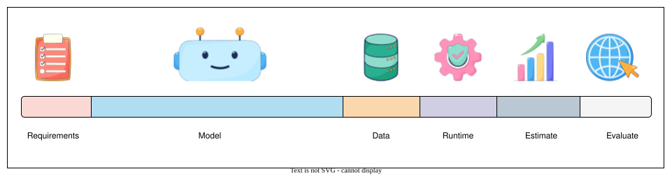
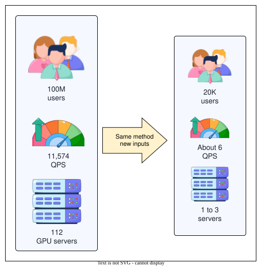

# Design_Core_GenAI_Systems_Under_Interview_Conditions

Source: https://www.educative.io/courses/generative-ai-system-design/core-design-problems-under-interview-conditions

---

[Home](https://www.educative.io/)

[Courses](https://www.educative.io/search?tab=courses)

[Grokking the Generative AI System Design Interview](https://www.educative.io/courses/generative-ai-system-design)

# Core Design Problems Under Interview Conditions

Apply core GenAI concepts in interviews by using them to drive design decisions scaled to the prompt, not by reciting facts. Avoid common pitfalls such as ignoring existing models, safety, or cost, and frame each model pipeline within the surrounding system’s requirements, estimation, and evaluation.

We'll cover the following...

- [Say a concept only when it changes a decision](https://www.educative.io/courses/generative-ai-system-design/core-design-problems-under-interview-conditions#Say-a-concept-only-when-it-changes-a-decision)
- [Rescale the numbers to the prompt](https://www.educative.io/courses/generative-ai-system-design/core-design-problems-under-interview-conditions#Rescale-the-numbers-to-the-prompt)
  - [What changes when you don’t train](https://www.educative.io/courses/generative-ai-system-design/core-design-problems-under-interview-conditions#What-changes-when-you-dont-train)
  - [Where each fundamental comes back](https://www.educative.io/courses/generative-ai-system-design/core-design-problems-under-interview-conditions#Where-each-fundamental-comes-back)
- [From fundamentals to any design problem](https://www.educative.io/courses/generative-ai-system-design/core-design-problems-under-interview-conditions#From-fundamentals-to-any-design-problem)
- [Common mistakes](https://www.educative.io/courses/generative-ai-system-design/core-design-problems-under-interview-conditions#Common-mistakes)
- [Conclusion](https://www.educative.io/courses/generative-ai-system-design/core-design-problems-under-interview-conditions#Conclusion)

A candidate can explain how diffusion denoises, how Whisper decodes, and how to estimate training time, then spend half the interview on the model and never reach evaluation. The fundamentals are raw material, not the answer. This lesson shows how to turn them into interview moves, and where each one comes back in the lessons that follow.

Where a typical answer spends its 45 minutes

## Say a concept only when it changes a decision[#](https://www.educative.io/courses/generative-ai-system-design/core-design-problems-under-interview-conditions#Say-a-concept-only-when-it-changes-a-decision)

Each fundamentals lesson designed one model pipeline in depth: pick a model, train it, size it, serve it. In an interview, name a concept only when it changes what you build.

|  |  |  |
| --- | --- | --- |
| **Fundamental** | **Say it when** | **Skip it when** |
| Architecture comparison (GAN, VAE, diffusion) | The prompt forces a model choice | The prompt names a model or a hosted API |
| Training-time formula | You are asked to train or fine-tune | You are using an existing model |
| Inference and token estimate | Sizing serving capacity, which drives cost | Never skip |
| Preprocessing and chunking | Data quality or retrieval is the risk | The input is a plain user prompt |
| Metrics (WER, FID, MOS, BLEU) | Defining “good” for this task | Listing every metric you know |
| Moderation and quality control | The output reaches users | The system is internal and read-only |

A weak answer says, “Diffusion models denoise iteratively.” A strong one says, “I’d use diffusion for prompt fidelity, but 20 to 30 steps keeps latency under a few seconds.” Both mention diffusion, but only the second uses it to make a decision.

## Rescale the numbers to the prompt[#](https://www.educative.io/courses/generative-ai-system-design/core-design-problems-under-interview-conditions#Rescale-the-numbers-to-the-prompt)

Every fundamentals lesson assumes 100 million daily users making 10 requests each, about 11,574 requests per second. An interview prompt rarely does, so reuse the method and replace the inputs.

Take a prompt for a Q&A bot over product manuals, with 20,000 daily users asking 5 questions each. That is 100,000 queries per day, about 1.2 QPS on average and roughly 6 at a 5 times peak. Using the batched method from the inference capacity lesson, one A100 serving a 3B model delivers about 5,333 output tokens per second, or roughly 18 queries per second at about 300 output tokens per answer, so throughput needs a single server. Availability still argues for two or three. The text-to-text lesson’s fleet of 112 servers shrinks to a handful, and the real question becomes cost.

Same formula, different scale

Suppose each query sends about 1,500 input tokens, including retrieved passages, and returns 300. Daily volume is 150 million input and 30 million output tokens. At assumed rates of $3 and $15 per million tokens (rates vary by provider and model, so plug in current prices), that is about $900 per day, split evenly between input and output. At this scale, token cost matters more than GPU count.

Most later lessons rescale in the same way, each from its own prompt. The code assistant starts from 5 million developers and about 1 billion requests per day. The GenAI gateway starts from 8 million requests per day, only about 93 per second, and sizes its load by open streams instead. The deep research agent starts from a budget of $0.40 per run. The method stays the same, but each design takes its load from its own prompt.

### What changes when you don’t train[#](https://www.educative.io/courses/generative-ai-system-design/core-design-problems-under-interview-conditions#What-changes-when-you-dont-train)

The fundamentals train or adapt their own models, from training a text model from scratch to fine-tuning an open diffusion model. Most prompts assume a model you can host or call, so three steps change.

|  |  |  |
| --- | --- | --- |
| **SCALED step** | **In the fundamentals** | **In later lessons and interviews** |
| **Choose an AI model** | Compare architectures, then train | Choose a size or tier, then host or call it |
| **Estimate resources** | Training time dominates | Inference, tokens, and fan-out dominate |
| **Design and evaluate** | Loss and benchmark metrics | Groundedness, safety, and task-level metrics |

Training math still has a place when the prompt asks about fine-tuning. The GPU training job scheduler lesson is where it returns, as a platform problem instead of a model problem.

### Where each fundamental comes back[#](https://www.educative.io/courses/generative-ai-system-design/core-design-problems-under-interview-conditions#Where-each-fundamental-comes-back)

Each fundamentals lesson planted a component that a later lesson grows into a full design.

|  |  |  |
| --- | --- | --- |
| **Fundamental** | **What it introduced** | **Where it grows** |
| Text-to-Text | Prompt embedding, long-term memory, model host | Cross-Conversation Memory and Document Q&A Assistant turn memory and retrieval into subsystems |
| Text-to-Text | One model, 112 GPU servers | Cost at 1M Queries a Day applies the same serving choices to a retrieval-based assistant under a per-query cost ceiling |
| Text-to-Speech and ASR | Audio pipelines and streaming | Real-Time Voice Assistant adds turn-taking, barge-in, and a tight latency budget |
| Image Captioning | Turning unstructured input into text | Document Extraction and Decision Pipeline adds validation and human review |
| Training formula | Time and GPU estimates for one job | GPU Training Job Scheduler shares those GPUs across many jobs |
| Content moderation service | A final check before output | AI Content Moderation System and Compliance-Constrained Generation make it the core design |
| Model loader and fallback model | Swapping models safely | GenAI Gateway adds routing, token-aware limits, and provider fallback |
| Evaluation metrics (WER, FID, BLEU) | Offline quality scores | Deep Research Agent scores citation accuracy, and LLM-Powered Search Engine adds groundedness |

Read the table as a map. When a later problem starts, ask which fundamental it extends, then spend your time on the part that is new.

## From fundamentals to any design problem[#](https://www.educative.io/courses/generative-ai-system-design/core-design-problems-under-interview-conditions#From-fundamentals-to-any-design-problem)

Start with the text-to-text system, then change the prompt to “answer questions from our company documents, with citations.”

Text-to-text plus one new requirement

The requirements gain a quality target: every claim must trace to a source. The model barely changes, since a hosted model works. The data step now matters, because documents must be chunked, embedded, and kept fresh. The runtime adds retrieval, a prompt that carries evidence, and a fallback for when evidence is weak. The estimate switches from GPU count to tokens per query, because retrieved passages dominate input size. Evaluation adds groundedness and citation accuracy to the metrics. The Document Q&A lesson builds the retrieval and data pipeline for this kind of system; citation checks, the weak-evidence fallback, and the token-based estimate are the layers this requirement adds on top. The fundamentals supplied the model host, the moderation step, and the estimation method, and the new requirement supplied everything else.

## Common mistakes[#](https://www.educative.io/courses/generative-ai-system-design/core-design-problems-under-interview-conditions#Common-mistakes)

The most common one is reciting a lesson’s result without checking the prompt’s scale. Quoting the text-to-text lesson’s 112 GPU servers for a prompt that peaks at 6 QPS signals that you memorized a number instead of a method. A second mistake is designing a training pipeline when the prompt says to use an existing model. A third is drawing the model host and stopping, without reaching safety, cost, or evaluation. The last is sizing before asking, since scale, latency target, and data sensitivity change the whole design.

Knowledge Check

Q1. A prompt asks for a support Q&A bot at 50,000 requests per day and says to use a hosted model. Which fundamental should you skip?

Do you find this helpful?

## Conclusion[#](https://www.educative.io/courses/generative-ai-system-design/core-design-problems-under-interview-conditions#Conclusion)

The fundamentals gave you the building blocks of a model pipeline. In an interview, use them selectively, rescale the numbers to the prompt, and spend most of your time on the system around the model. The lessons that follow cover the same ground (requirements, estimation, design, and evaluation), even when they don’t label each SCALED step, and add the layers the fundamentals skipped: memory, retrieval, agents, and platforms.

Design an Automatic Speech Recognition System

ChatGPT

Ask

[Say a concept only when it changes a decision](https://www.educative.io/courses/generative-ai-system-design/core-design-problems-under-interview-conditions#Say-a-concept-only-when-it-changes-a-decision)

[Rescale the numbers to the prompt](https://www.educative.io/courses/generative-ai-system-design/core-design-problems-under-interview-conditions#Rescale-the-numbers-to-the-prompt)

[What changes when you don’t train](https://www.educative.io/courses/generative-ai-system-design/core-design-problems-under-interview-conditions#What-changes-when-you-dont-train)

[Where each fundamental comes back](https://www.educative.io/courses/generative-ai-system-design/core-design-problems-under-interview-conditions#Where-each-fundamental-comes-back)

[From fundamentals to any design problem](https://www.educative.io/courses/generative-ai-system-design/core-design-problems-under-interview-conditions#From-fundamentals-to-any-design-problem)

[Common mistakes](https://www.educative.io/courses/generative-ai-system-design/core-design-problems-under-interview-conditions#Common-mistakes)

[Conclusion](https://www.educative.io/courses/generative-ai-system-design/core-design-problems-under-interview-conditions#Conclusion)