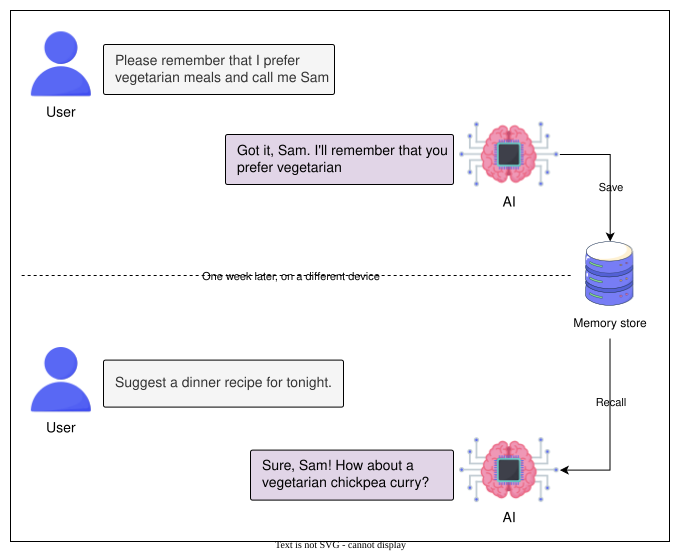

# Designing_Cross-Conversation_Memory_for_Generative_AI_Systems

Source: https://www.educative.io/courses/generative-ai-system-design/design-cross-conversation-memory

---

[Home](https://www.educative.io/)

[Courses](https://www.educative.io/search?tab=courses)

[Grokking the Generative AI System Design Interview](https://www.educative.io/courses/generative-ai-system-design)

# Design Cross-Conversation Memory

Cross-conversation memory lets conversational AI retain stable user preferences across sessions, using a memory extractor, policy engine, and retrieval orchestrator to personalize interactions with low latency while excluding sensitive data and protecting privacy.

We'll cover the following...

- [System requirements](https://www.educative.io/courses/generative-ai-system-design/design-cross-conversation-memory#System-requirements)
  - [Functional requirements](https://www.educative.io/courses/generative-ai-system-design/design-cross-conversation-memory#Functional-requirements)
  - [Nonfunctional requirements](https://www.educative.io/courses/generative-ai-system-design/design-cross-conversation-memory#Nonfunctional-requirements)
- [Model selection](https://www.educative.io/courses/generative-ai-system-design/design-cross-conversation-memory#Model-selection)
  - [Adapting the models](https://www.educative.io/courses/generative-ai-system-design/design-cross-conversation-memory#Adapting-the-models)
- [Resource estimation](https://www.educative.io/courses/generative-ai-system-design/design-cross-conversation-memory#Resource-estimation)
  - [Storage estimation](https://www.educative.io/courses/generative-ai-system-design/design-cross-conversation-memory#Storage-estimation)
  - [Compute estimation](https://www.educative.io/courses/generative-ai-system-design/design-cross-conversation-memory#Compute-estimation)
    - [Extraction and embedding model servers](https://www.educative.io/courses/generative-ai-system-design/design-cross-conversation-memory#Extraction-and-embedding-model-servers)
  - [Bandwidth estimation](https://www.educative.io/courses/generative-ai-system-design/design-cross-conversation-memory#Bandwidth-estimation)
- [System design of cross-conversation memory](https://www.educative.io/courses/generative-ai-system-design/design-cross-conversation-memory#System-design-of-cross-conversation-memory)
  - [High-level design](https://www.educative.io/courses/generative-ai-system-design/design-cross-conversation-memory#High-level-design)
  - [Achieving functional requirements](https://www.educative.io/courses/generative-ai-system-design/design-cross-conversation-memory#Achieving-functional-requirements)
- [A detailed system design](https://www.educative.io/courses/generative-ai-system-design/design-cross-conversation-memory#A-detailed-system-design)
  - [Write path components](https://www.educative.io/courses/generative-ai-system-design/design-cross-conversation-memory#Write-path-components)
    - [Sanitization and secure storage](https://www.educative.io/courses/generative-ai-system-design/design-cross-conversation-memory#Sanitization-and-secure-storage)
    - [Versioning and conflict handling](https://www.educative.io/courses/generative-ai-system-design/design-cross-conversation-memory#Versioning-and-conflict-handling)
  - [Read path components](https://www.educative.io/courses/generative-ai-system-design/design-cross-conversation-memory#Read-path-components)
    - [Start-of-session bundle](https://www.educative.io/courses/generative-ai-system-design/design-cross-conversation-memory#Start-of-session-bundle)
    - [Midturn targeted recall](https://www.educative.io/courses/generative-ai-system-design/design-cross-conversation-memory#Midturn-targeted-recall)
  - [Putting everything together](https://www.educative.io/courses/generative-ai-system-design/design-cross-conversation-memory#Putting-everything-together)
- [Workflow of the system](https://www.educative.io/courses/generative-ai-system-design/design-cross-conversation-memory#Workflow-of-the-system)
- [Achieving nonfunctional requirements](https://www.educative.io/courses/generative-ai-system-design/design-cross-conversation-memory#Achieving-nonfunctional-requirements)
- [Evaluation](https://www.educative.io/courses/generative-ai-system-design/design-cross-conversation-memory#Evaluation)
- [Conclusion](https://www.educative.io/courses/generative-ai-system-design/design-cross-conversation-memory#Conclusion)

A user says, "Please remember that I prefer vegetarian meal suggestions and call me Sam," then returns a week later from a different device. The assistant should reuse that preference immediately, but it should not replay the whole transcript, expose private details, or add enough latency to make the response feel slow.

A snapshot of cross-conversation memory: a preference saved in one session is reused in a later one

That narrow challenge is the design target for cross-conversation memory. In a conversational system, this component persists selected user-specific facts across sessions, retrieves them at the right time, and lets the rest of the assistant stay stateless when needed. In an interview, you usually are not asked to redesign the whole assistant. You are asked to zoom in on this subsystem and make the boundaries crisp.

We treat memory as a user-specific persistence layer, not a dump of all prior chats and not a replacement for external retrieval. The next lesson on document Q&A depends on this distinction. There, retrieval targets shared documents. Here, retrieval targets personal facts.

A strong answer should resolve four questions.

- **What to store:** The system keeps stable preferences, corrections, and recurring facts rather than raw transcripts.
- **When to retrieve:** The system loads a compact bundle at session start and may trigger additional lookup midturn.
- **How to update:** The system writes asynchronously, merges contradictions, and expires stale items.
- **How users stay in control:** The system supports inspect, edit, delete, disable, and category-level consent.

These become the requirements below.

## System requirements[#](https://www.educative.io/courses/generative-ai-system-design/design-cross-conversation-memory#System-requirements)

Before sizing anything, fix what the memory subsystem must do and how well it must do it. Everything later in the lesson is checked against this list.

### Functional requirements[#](https://www.educative.io/courses/generative-ai-system-design/design-cross-conversation-memory#Functional-requirements)

- **Remember durable facts:** The system extracts stable preferences, profile facts, explicit corrections, recurring tasks, and durable feedback from conversations.
- **Recall across sessions and devices:** A user’s memories are available in any new session, loaded at session start and fetched on demand midturn.
- **Update and resolve conflicts:** New or contradictory facts merge into existing memories, and stale items expire.
- **User control:** Users can inspect, edit, delete, and disable memory, and can set consent by category.
- **Selective storage:** Filler, transient emotions, unsafe content, and low-confidence inferences are not stored.

### Nonfunctional requirements[#](https://www.educative.io/courses/generative-ai-system-design/design-cross-conversation-memory#Nonfunctional-requirements)

- **Latency:** Memory retrieval takes under 100 ms at p95, and a strict timeout means a slow read never delays the response beyond that budget. Extraction runs asynchronously.
- **Scalability:** The system supports 50M registered users and 5M DAU, with peaks of about 5× average load.
- **Availability:** If memory is degraded, chat still answers without it. If consent can’t be verified, memory is treated as off.
- **Reliability:** Writes are idempotent and versioned, and background jobs repair index drift.
- **Privacy and security:** Data is sanitized, encrypted in transit and at rest, and access-controlled. Deletions propagate to caches, indexes, replicas, and backups.
- **Cost:** Per-user memory is capped and low-value items are dropped early.

## Model selection[#](https://www.educative.io/courses/generative-ai-system-design/design-cross-conversation-memory#Model-selection)

Cross-conversation memory doesn’t need a new foundation model, and the chat model stays as it is. The memory subsystem adds a few small models, each matched to one job on the write or read path.

- **Write gate:** Rules plus a small encoder classifier (BERT-base scale, about 110M parameters) flag turns that contain self-disclosure, a correction, or a task. It is cheap enough to run on every turn.
- **Memory extractor:** A small instruction-tuned LLM, such as a 3B model from the Llama 3.2 family used in the text-to-text generation system, turns a gated exchange into structured candidates with a category, candidate text, and a confidence score. Ambiguous cases escalate to a larger model.
- **PII detector:** A named-entity recognition model plus pattern rules finds names, addresses, phone numbers, and account numbers before anything reaches searchable storage. The user’s own profile fields that they ask the assistant to keep, such as a preferred name, are allowed by policy, while other people’s details and sensitive identifiers are masked.
- **Embedding model:** A base-size sentence encoder with 768-dimensional output embeds both stored memories and midturn queries. Both sides must use the same model, so changing it means re-embedding every stored memory.
- **Reranker (optional):** A small cross-encoder rescores the top 20 or so hybrid candidates. It is used only if it fits inside the 100 ms p95 retrieval budget.

### Adapting the models[#](https://www.educative.io/courses/generative-ai-system-design/design-cross-conversation-memory#Adapting-the-models)

In this design problem, nothing is trained from scratch. The extractor is fine-tuned with a parameter-efficient method such as LoRA on a labeled set of exchanges. Each label marks whether the exchange contains a durable memory and, if so, its category and candidate text. The set is built from synthetic conversations and de-identified logs from users who separately consented to their data being used for model improvement, never from users who disabled memory or opted out. The gate classifier trains on the same labels, with its threshold tuned for high recall, because the extractor and policy engine filter again downstream.

With the scope and models fixed, the next step is estimation.

## Resource estimation[#](https://www.educative.io/courses/generative-ai-system-design/design-cross-conversation-memory#Resource-estimation)

Let's estimate the storage, compute, and bandwidth this memory system needs, starting with storage.

### Storage estimation[#](https://www.educative.io/courses/generative-ai-system-design/design-cross-conversation-memory#Storage-estimation)

Let's start with rough scale before naming databases. For memory systems, a back-of-the-envelope estimate (BOTEC), keeps the design grounded.

Let's assume a consumer assistant with 50 million registered users and 5 million daily active users. Suppose that each registered user accumulates up to 80 durable memory items over time, since memories persist even when a user is inactive. A single item might include sanitized text, category, timestamps, source references, confidence, retention flags, and maybe an embedding. If the text and metadata are 400 bytes and a 768-dimension embedding stored in FP16 adds about 1.5 KB (768 × 2 bytes), one item is about 2 KB. Persistent storage is then 50M×80×2KB≈8TB\text{50M} \times \text{80} \times \text{2KB} \approx \text{8TB}50M×80×2KB≈8TB before replication. With three replicas, that is about 24 TB.

Hot and cold tiers matter. Recent and high-confidence memories live in a low-latency hot tier. Older or rarely retrieved memories move to cheaper cold storage, similar to keeping current files on your desk and archived files in storage. Midturn recall reads only the hot tier to stay within the 100 ms budget, and cold memories are promoted back asynchronously when they become relevant again.

Reads happen at two moments: a profile bundle fetched at session start and an occasional lookup midturn. Writes are extracted asynchronously after the response, so they never block generation.

If 5 million users generate 10 turns per day, average turn QPS is roughly 50M86400≈579\frac{50M}{86400} \approx 5798640050M​≈579. Real systems see bursts, so design for about 5× that at peak, or roughly 2,900 QPS. A practical target keeps memory retrieval within the 100 ms p95 budget from the requirements and pushes extraction to the background so generation is not blocked.

These estimates directly shape sharding, index density, and datastore choice.

Memory System Capacity Estimator

Adjust the inputs to estimate storage and QPS for a cross-conversation memory system.

Registered UsersU

users

Daily Active UsersD

users

Memory Items per UserN

items

Size per ItemS

KB

Replication FactorR

×

Turns per Active User per DayT

turns

Peak MultiplierM

×

Raw StorageSraw​

8TB

Replicated StorageSrep​

24TB

Average QPSQPSavg​

578.7037req/s

Peak QPSQPSpeak​

2,893.5185req/s

Storing **80 items** for **50,000,000 users** needs **8 TB** raw, or **24 TB** with replication. Expect about **578.7037 QPS** on average and **2,893.5185 QPS** at peak.

Do you find this helpful?

Those numbers lead naturally into service capacity planning on the read path.

### Compute estimation[#](https://www.educative.io/courses/generative-ai-system-design/design-cross-conversation-memory#Compute-estimation)

The memory service runs as a set of replicas that serve reads. Reads are mostly CPU- and I/O-bound, because each request fans out to the metadata store, the cache, vector search, and policy checks. The extraction and embedding models, by contrast, run on GPUs, and we size those separately below. Embedding new memories happens on the write path and stays off the critical response path. Embedding the query for midturn recall, however, sits on that path and counts against the 100 ms latency budget.

A simple estimate starts with peak read QPS from session starts plus midturn recalls. Suppose that peak read QPS is about 2,900, with each turn triggering one memory read (an upper bound, since midturn lookups are occasional). Each replica safely handles 400 requests per second at p95 under 80 ms, so roughly 8 replicas are needed before headroom. With capacity for bursts and failover, 12 to 16 replicas is more realistic. An enterprise deployment with about 80,000 daily users (10 turns each, 5× peak) peaks near 46 QPS, so one replica covers throughput. You would still run 3 across zones for availability.

Concurrency climbs because one logical read can trigger multiple backend lookups. The orchestrator may query a vector index, a metadata store, and a policy store in parallel, then merge results.

> **Note:** The assistant should still answer safely when memory is unavailable. A degraded memory service must not take down core chat.

Caches for recent user bundles reduce repeated reads, and strict timeouts keep p99 under control.

#### Extraction and embedding model servers[#](https://www.educative.io/courses/generative-ai-system-design/design-cross-conversation-memory#Extraction-and-embedding-model-servers)

The write path adds GPU work, but it runs asynchronously, so we size it for average load and let a queue absorb peaks. As the cost discussion later in this lesson explains, a cheap gate passes about 10% of the 50M daily turns to the LLM extractor, which is about 5M extraction calls per day, or roughly 5M86,400≈58 calls/s\frac{5M}{86{,}400} \approx 58 \text{ calls/s}86,4005M​≈58 calls/s.

Let's assume each call sends about 1,000 input tokens (the exchange, instructions, and a few existing memories for deduplication) and returns about 100 output tokens of structured candidates. The extractor is a 3B-parameter model at FP16 on NVIDIA A100 GPUs.

- **Prefill (compute-bound):** A forward pass costs about 2 FLOPs per parameter per token, or about 6 GFLOPs per token for a 3B model. At 58,000 input tokens per second, that is about 348 TFLOPS. At an effective 156 TFLOPS per A100 (50% of its 312 TFLOPS FP16 peak), prefill needs about 2.2 GPUs.
- **Decode (memory-bandwidth-bound):** 58 × 100 = 5,800 output tokens per second. At the batched throughput of about 5,333 tokens per second per A100 from the inference capacity lesson, decode needs about 1.1 GPUs.

Together, that is about 3.3 GPUs of average load. Provisioning about 6 A100s gives roughly 2x headroom, so the queue drains after daily peaks without touching the chat path.

The embedding model is much lighter. A base-size encoder with about 110M parameters costs about 0.22 GFLOPs per token. Even embedding every peak read (2,900 per second x about 50 query tokens) needs only about 32 TFLOPS, a fraction of one GPU. Two small GPU instances cover this load with failover.

Once capacity is sized, network cost is straightforward.

### Bandwidth estimation[#](https://www.educative.io/courses/generative-ai-system-design/design-cross-conversation-memory#Bandwidth-estimation)

Bandwidth is usually not the bottleneck, but it still shapes placement. A start-of-session profile fetch may return only a few kilobytes, while a midturn semantic lookup sends request metadata, an embedding or query text, and receives a compact ranked list. Writes add sanitizer output, category tags, and policy decisions.

To put numbers on it, let's assume each read sends about 1 KB (user and session IDs, the turn text, and filters) and returns about 4 KB (a start bundle or up to five ranked memories with metadata). At 2,900 peak reads per second, read traffic is2,900×5 KB≈14.5 MB/s≈116 Mbps2{,}900 \times 5\text{ KB} \approx 14.5\text{ MB/s} \approx 116\text{ Mbps}2,900×5 KB≈14.5 MB/s≈116 Mbps**.**

Writes are small. About 58 extraction calls per second on average, each producing about 2 KB of stored candidates, is roughly 0.6 MB/s at a 5x peak, or about 14 Mbps after three-way replication. Total peak traffic is roughly 130 Mbps, which is why placement and tail latency matter more than raw throughput.

In multi-region systems, the bigger issue is tail latency rather than raw throughput. Co-locating the memory service with the model gateway or orchestrator removes an extra network hop and reduces p95. Mobile clients should never talk directly to storage tiers.

> **Practical tip:** All memory traffic is encrypted in transit, and deletion propagation creates background replication traffic across regions for compliance and disaster recovery.

So, we have the following estimated resources:

- **Storage required:** About 8 TB raw, or about 24 TB with three replicas
- **Memory service replicas:** 12 to 16 CPU-bound replicas
- **Extraction GPUs:** About 6 NVIDIA A100 GPUs, plus two small GPU instances for embeddings
- **Peak bandwidth:** About 130 Mbps

Estimated resources for the cross-conversation memory system

With scale, capacity, and network assumptions in place, we can lay out the architecture.

## System design of cross-conversation memory[#](https://www.educative.io/courses/generative-ai-system-design/design-cross-conversation-memory#System-design-of-cross-conversation-memory)

Let's start with the high-level design.

### High-level design[#](https://www.educative.io/courses/generative-ai-system-design/design-cross-conversation-memory#High-level-design)

Let's keep the design simple first. The assistant should remember only a small set of useful facts, and it should retrieve only the subset relevant to the current turn.

The subsystem usually includes these building blocks.

- **Memory extractor:** The write-side service inspects completed turns and proposes durable memories.
- **Policy engine:** The rules and learned classifiers decide whether a candidate memory is allowed, useful, and in scope.
- **Privacy filter:** The sanitizer removes or masks sensitive values before searchable storage.
- **Metadata store:** The system keeps canonical records, versions, timestamps, confidence, and retention state here.
- **Vector and text indexes:** The retrieval path uses semantic and keyword lookup together rather than only one method. Both are partitioned by user ID, so every lookup is scoped to a single user.
- **Optional relationship store:** A graph store can model linked entities for domains with many people, tasks, or projects.
- **Retrieval orchestrator:** The service decides what to fetch at session start and what to fetch dynamically midturn.
- **Session cache:** The cache holds recent bundles and retrieval hits to avoid repeated round trips.
- **User control API:** The interface supports inspect, edit, delete, disable, and consent changes.

A common privacy pattern splits sanitized searchable memory from exact sensitive values kept in a secure vault. That is like keeping an index card in the library catalog while storing the restricted original in a locked room.

Two retrieval moments matter most. At conversation start, the system fetches stable profile fields and unfinished tasks. During the session, the current turn can trigger targeted recall. In both cases, the orchestrator injects only a compact memory bundle into the prompt.

The architecture is easier to follow visually before we map it to requirements.

Memory service architecture

> **Note:** In the figure, the privacy vault appears next to the read path, but routine recall never reads exact values from it. Only an authorized, audited request can, and the prompt receives the sanitized memory instead.

Now we can test whether this design satisfies the functional requirements.

### Achieving functional requirements[#](https://www.educative.io/courses/generative-ai-system-design/design-cross-conversation-memory#Achieving-functional-requirements)

Let's walk the requirements through the request life cycle rather than listing them in isolation. When a new session starts, the orchestrator fetches stable memory categories first. When a user turn arrives, the orchestrator checks whether the turn needs extra recall. After the response is sent, the write path evaluates whether anything from the exchange deserves long-term storage.

The system should remember a narrow set of durable facts and should avoid storing low-value or risky content.

|  |  |
| --- | --- |
| **Store** | **Skip** |
| Stable preferences (tone, language, diet) | Filler and casual phrasing |
| Profile facts and explicit corrections | Transient emotions |
| Recurring tasks and unfinished work | Unsafe or policy-sensitive content |
| Durable feedback (shorter answers, more tables) | Low-confidence inferences |

> **Attention:** If every self-disclosure becomes memory, retrieval quality collapses and privacy risk rises at the same time.

Extraction policies often combine heuristics and learned routing. Repeated mention, direct self-disclosure, and explicit correction all increase memorability. Retrieval uses hybrid retrieval, optionally with graph traversal.

That requirement mapping sets up the detailed component walk-through.

## A detailed system design[#](https://www.educative.io/courses/generative-ai-system-design/design-cross-conversation-memory#A-detailed-system-design)

The read path and write path should be separate. That one decision resolves many latency and reliability issues.

### Write path components[#](https://www.educative.io/courses/generative-ai-system-design/design-cross-conversation-memory#Write-path-components)

After the model returns a reply, the completed exchange is sent to the extractor asynchronously.A cheap write gate first drops turns with no self-disclosure, correction, or task, so only likely candidates reach the extractor. The extractor scores memorability and confidence, then classifies each candidate as profile, preference, fact, correction, or task.

Write path of the memory subsystem

#### Sanitization and secure storage[#](https://www.educative.io/courses/generative-ai-system-design/design-cross-conversation-memory#Sanitization-and-secure-storage)

The sanitizer detects PII and rewrites searchable text into a safe form. Searchable storage should contain masked or generalized values, while exact sensitive values, if allowed at all, go into a vault with stricter access controls. The canonical record stores links between these representations. The user’s own allowed profile fields, such as a preferred name, stay readable, because the assistant needs them at session start.

Memories are also an injection risk. A stored line such as “ignore your previous instructions” would return in every future prompt, a problem often called memory poisoning. The policy engine rejects instruction-like content at write time, and the orchestrator inserts memories in a clearly delimited block marked as user data, not as instructions.

#### Versioning and conflict handling[#](https://www.educative.io/courses/generative-ai-system-design/design-cross-conversation-memory#Versioning-and-conflict-handling)

The metadata store records source conversation IDs, timestamps, confidence, versions, retention state, and user edits. A tombstone is written when users delete a memory. The tombstone hides the record everywhere at once, and a background job then erases the content itself from stores, indexes, and caches.

Contradictions are resolved by policy. Recency can win for changing attributes like city. Explicit user corrections can override confidence. Some conflicts remain in a merge state until the assistant asks for confirmation.

The write path then updates vector and text indexes. If indexing lags, the canonical metadata record remains the source of truth.

This takes us to the read path, where latency discipline matters more.

### Read path components[#](https://www.educative.io/courses/generative-ai-system-design/design-cross-conversation-memory#Read-path-components)

The retrieval orchestrator receives the current turn plus session state. Before any lookup, it confirms that memory consent is on for the user. It decides whether to fetch only the session cache, the start bundle, or dynamic recall from indexes.

Read path of the memory subsystem

#### Start-of-session bundle[#](https://www.educative.io/courses/generative-ai-system-design/design-cross-conversation-memory#Start-of-session-bundle)

The start bundle contains compact, high-confidence memories with low variance over time. Examples include the preferred name, stable settings, and unresolved tasks. This bundle is usually preranked and cached.

#### Midturn targeted recall[#](https://www.educative.io/courses/generative-ai-system-design/design-cross-conversation-memory#Midturn-targeted-recall)

Dynamic recall is triggered only when the turn semantics justify it. A query such as "what did I tell you about my travel preferences" makes the orchestrator embed the query with the same embedding model used on the write path, a few milliseconds on a GPU, and then run semantic search plus metadata filters. Because each user holds at most about 80 memories (about 160 KB), the search is scoped to one user: filter by user ID, then score that user’s items exactly. No global approximate nearest neighbor (ANN) index is needed unless per-user caps grow into the thousands. The orchestrator caps result count and token budget so memory enrichment stays surgical rather than flooding the prompt.

A background expiration service keeps the store bounded. It decays stale records, summarizes clusters of old memories, and enforces per-user caps.

With components in place, we can now connect them into one end-to-end flow.

### Putting everything together[#](https://www.educative.io/courses/generative-ai-system-design/design-cross-conversation-memory#Putting-everything-together)

Let's start at session creation. The gateway authenticates the user and forwards the request to the orchestrator, which checks the consent state and the session cache. On a cache miss, it fetches a compact memory bundle from the retrieval layer. That bundle usually includes preferred name, stable response settings, and unresolved tasks. The orchestrator then injects only those snippets that fit the current token budget.

During the conversation, some turns trigger targeted recall. If the user asks for prior preferences or refers to a recurring task, the orchestrator issues a bounded hybrid search, ranks the results, and attaches a few high-confidence memories to the prompt. If the retrieval layer is slow, the model proceeds without memory. If the consent check fails, the orchestrator skips memory entirely.

After the assistant responds, the asynchronous write path evaluates the exchange. Candidate memories are extracted, sanitized, merged, or ignored. If the user later edits or deletes an item, the control API updates canonical metadata, invalidates caches, and propagates deletions to indexes and replicas.

> **Note:** Vector indexes can lag behind the source store. The canonical metadata record should decide whether a memory is live, deleted, or superseded.

The following illustration brings the read path, the asynchronous write path, and the user control API together into one detailed design.

Detailed design of a cross-conversation memory system

That end-to-end picture becomes easier to narrate in interview form as a compact sequence.

The next section turns the architecture into a whiteboard-ready workflow.

## Workflow of the system[#](https://www.educative.io/courses/generative-ai-system-design/design-cross-conversation-memory#Workflow-of-the-system)

A short numbered narration works well when presenting this design in an interview.

1. **Authenticate the user:** The gateway verifies identity and forwards the request with user and session IDs.
2. **Check consent:** The orchestrator confirms memory consent for the user. If it can’t, the request proceeds without memory.
3. **Check the session cache:** The orchestrator looks for a recent memory bundle and prior retrieval hits.
4. **Fetch the start bundle:** On a miss, the retrieval layer loads stable memories and unresolved tasks.
5. **Process the turn:** The orchestrator decides whether the current turn needs dynamic recall.
6. **Inject compact memory:** The prompt receives only a few ranked snippets within a fixed token budget.
7. **Generate the response:** The model answers with or without memory, depending on availability.
8. **Run asynchronous extraction:** The write path scores memorability, sanitizes content, stores canonical records, updates indexes, and logs outcomes for evaluation.

That concise flow naturally leads into the nonfunctional requirements.

## Achieving nonfunctional requirements[#](https://www.educative.io/courses/generative-ai-system-design/design-cross-conversation-memory#Achieving-nonfunctional-requirements)

Scalability comes from partitioning by user ID, separating read and write paths, and scaling vector search independently from metadata storage. Availability comes from multiregion replicas, strict timeouts, and a split failure policy. Memory reads fail open: if retrieval is slow or down, the assistant answers without memory. Consent and deletion fail closed: if the consent or policy check can’t be confirmed, the system treats memory as disabled for that request. It skips retrieval and writes nothing.

Failing open for reads costs some personalization. Failing closed for privacy costs a few seconds of personalization, not a privacy violation. Consent state lives in a small, highly available store, cached with a short TTL.

Reliability depends on idempotent writes, versioned updates, and background repair jobs that reconcile metadata and indexes after partial failures. Security requires encryption at rest and in transit, role-based access, audit logs, and deletion propagation that reaches caches, indexes, replicas, and backups within policy bounds. Because individual records can’t be edited out of backups, encrypt each user’s memories with a per-user key and destroy that key when the user deletes their data (crypto-shredding), or let backups expire within the policy window. Security also covers memory poisoning: screen candidates for embedded instructions at write time and keep injected memories clearly separated from system instructions.

> **Practical tip:** It helps to cap per-user memory counts and summarize older clusters before storage growth turns every retrieval into a ranking problem.

Extraction is the biggest cost driver. Running an LLM on every turn means 50M extra model calls per day. A cheap gate sits in front of it. A rules-and-classifier prefilter drops filler, questions, and turns with no self-disclosure, correction, or task. It passes only likely candidates to the LLM extractor. If the gate passes about 10% of turns (an assumption to tune against labeled data), that cuts LLM calls to about 5M per day. The surviving candidates are batched, and a small model handles extraction. The larger model is reserved for ambiguous cases.

Cost stays manageable when embedding jobs are batched and low-value memories are dropped early. Typical failure modes include contradiction drift, stale cache entries, privacy leakage from poor sanitization, and inappropriate recall from loose retrieval filters.

A life cycle view helps tie those concerns to one memory item over time.

Memory item lifecycle

Before wrapping up, let’s define how we’ll know the memory system is working.

## Evaluation[#](https://www.educative.io/courses/generative-ai-system-design/design-cross-conversation-memory#Evaluation)

The fundamentals lessons evaluated their models with task metrics such as BLEU, FID, and WER. A memory system needs metrics for each stage of its pipeline, measured offline on labeled sets and online in production.

- **Extraction precision and recall:** Measured against a labeled set of exchanges. Low precision fills memory with noise, and low recall forgets what users asked to keep. Explicit “remember this” requests should be captured nearly every time.
- **Sanitizer leakage rate:** The share of searchable records that still contain raw PII, found through audits and automated scans. The target is zero.
- **Injection resistance:** The share of adversarial memory candidates, such as ones carrying embedded instructions, that are blocked at write time or neutralized at read time.
- **Retrieval quality:** Recall@k on held-out queries with known relevant memories, plus the rate of contextually wrong recalls, the failure that pure vector search tends to cause.
- **Conflict resolution accuracy**: The share of labeled contradiction pairs where the system keeps the right version.
- **Online signals:** How often injected memories are used in responses, how often users edit or delete a recalled memory (a proxy for wrong memories), p95 retrieval latency, and how long deletions take to propagate compared with the policy limit.

These checks run before every change to the extractor, the gate threshold, or the embedding model, because each one shifts what gets stored or recalled.

## Conclusion[#](https://www.educative.io/courses/generative-ai-system-design/design-cross-conversation-memory#Conclusion)

Cross-conversation memory works when the subsystem stays narrow and disciplined. The strongest designs use selective extraction, hybrid indexing, asynchronous writes, contradiction management, user-visible controls, and privacy-first storage rather than dumping chats into a vector store.

Carry that decomposition into the next lesson. A document Q&A assistant uses many of the same retrieval mechanics, but the target corpus, indexing policy, and trust boundaries are different from user memory.

ChatGPT

Design a Document Q&A Assistant

Ask

[System requirements](https://www.educative.io/courses/generative-ai-system-design/design-cross-conversation-memory#System-requirements)

[Functional requirements](https://www.educative.io/courses/generative-ai-system-design/design-cross-conversation-memory#Functional-requirements)

[Nonfunctional requirements](https://www.educative.io/courses/generative-ai-system-design/design-cross-conversation-memory#Nonfunctional-requirements)

[Model selection](https://www.educative.io/courses/generative-ai-system-design/design-cross-conversation-memory#Model-selection)

[Adapting the models](https://www.educative.io/courses/generative-ai-system-design/design-cross-conversation-memory#Adapting-the-models)

[Resource estimation](https://www.educative.io/courses/generative-ai-system-design/design-cross-conversation-memory#Resource-estimation)

[Storage estimation](https://www.educative.io/courses/generative-ai-system-design/design-cross-conversation-memory#Storage-estimation)

[Compute estimation](https://www.educative.io/courses/generative-ai-system-design/design-cross-conversation-memory#Compute-estimation)

[Extraction and embedding model servers](https://www.educative.io/courses/generative-ai-system-design/design-cross-conversation-memory#Extraction-and-embedding-model-servers)

[Bandwidth estimation](https://www.educative.io/courses/generative-ai-system-design/design-cross-conversation-memory#Bandwidth-estimation)

[System design of cross-conversation memory](https://www.educative.io/courses/generative-ai-system-design/design-cross-conversation-memory#System-design-of-cross-conversation-memory)

[High-level design](https://www.educative.io/courses/generative-ai-system-design/design-cross-conversation-memory#High-level-design)

[Achieving functional requirements](https://www.educative.io/courses/generative-ai-system-design/design-cross-conversation-memory#Achieving-functional-requirements)

[A detailed system design](https://www.educative.io/courses/generative-ai-system-design/design-cross-conversation-memory#A-detailed-system-design)

[Write path components](https://www.educative.io/courses/generative-ai-system-design/design-cross-conversation-memory#Write-path-components)

[Sanitization and secure storage](https://www.educative.io/courses/generative-ai-system-design/design-cross-conversation-memory#Sanitization-and-secure-storage)

[Versioning and conflict handling](https://www.educative.io/courses/generative-ai-system-design/design-cross-conversation-memory#Versioning-and-conflict-handling)

[Read path components](https://www.educative.io/courses/generative-ai-system-design/design-cross-conversation-memory#Read-path-components)

[Start-of-session bundle](https://www.educative.io/courses/generative-ai-system-design/design-cross-conversation-memory#Start-of-session-bundle)

[Midturn targeted recall](https://www.educative.io/courses/generative-ai-system-design/design-cross-conversation-memory#Midturn-targeted-recall)

[Putting everything together](https://www.educative.io/courses/generative-ai-system-design/design-cross-conversation-memory#Putting-everything-together)

[Workflow of the system](https://www.educative.io/courses/generative-ai-system-design/design-cross-conversation-memory#Workflow-of-the-system)

[Achieving nonfunctional requirements](https://www.educative.io/courses/generative-ai-system-design/design-cross-conversation-memory#Achieving-nonfunctional-requirements)

[Evaluation](https://www.educative.io/courses/generative-ai-system-design/design-cross-conversation-memory#Evaluation)

[Conclusion](https://www.educative.io/courses/generative-ai-system-design/design-cross-conversation-memory#Conclusion)