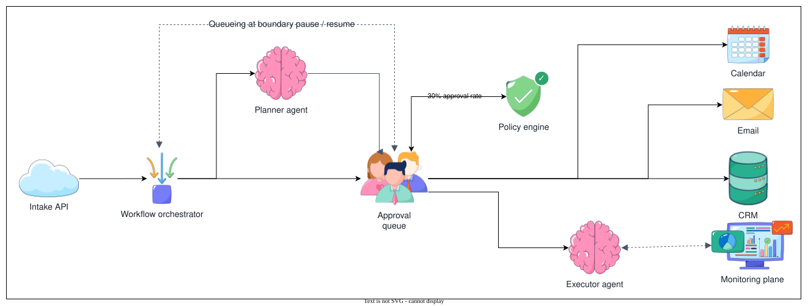

# Designing_Safe_Multi-Step_Agentic_AI_Workflows

Source: https://www.educative.io/courses/generative-ai-system-design/design-a-multi-step-agentic-workflow

---

[Home](https://www.educative.io/)

[Courses](https://www.educative.io/search?tab=courses)

[Grokking the Generative AI System Design Interview](https://www.educative.io/courses/generative-ai-system-design)

# Design a Multi-Step Agentic Workflow

Explore how to design multi-step agentic workflows that integrate planning, approval gates, and execution within governed systems. Learn to structure workflows for safety, durability, scalability, and auditability, ensuring business tasks complete reliably under policy controls. Understand the key components and considerations for managing risk, approvals, and recovery in agent-driven systems.

We'll cover the following...

- [System requirements](https://www.educative.io/courses/generative-ai-system-design/design-a-multi-step-agentic-workflow#System-requirements)
  - [Functional requirements](https://www.educative.io/courses/generative-ai-system-design/design-a-multi-step-agentic-workflow#Functional-requirements)
  - [Nonfunctional requirements](https://www.educative.io/courses/generative-ai-system-design/design-a-multi-step-agentic-workflow#Nonfunctional-requirements)
- [Resource estimation](https://www.educative.io/courses/generative-ai-system-design/design-a-multi-step-agentic-workflow#Resource-estimation)
  - [Workload estimation](https://www.educative.io/courses/generative-ai-system-design/design-a-multi-step-agentic-workflow#Workload-estimation)
  - [Execution capacity estimation](https://www.educative.io/courses/generative-ai-system-design/design-a-multi-step-agentic-workflow#Execution-capacity-estimation)
    - [Planning pool](https://www.educative.io/courses/generative-ai-system-design/design-a-multi-step-agentic-workflow#Planning-pool)
    - [Execution pool](https://www.educative.io/courses/generative-ai-system-design/design-a-multi-step-agentic-workflow#Execution-pool)
    - [Approval event handlers](https://www.educative.io/courses/generative-ai-system-design/design-a-multi-step-agentic-workflow#Approval-event-handlers)
  - [Payload and audit storage estimation](https://www.educative.io/courses/generative-ai-system-design/design-a-multi-step-agentic-workflow#Payload-and-audit-storage-estimation)
- [System design of a multi-step agent](https://www.educative.io/courses/generative-ai-system-design/design-a-multi-step-agentic-workflow#System-design-of-a-multi-step-agent)
  - [High-level design](https://www.educative.io/courses/generative-ai-system-design/design-a-multi-step-agentic-workflow#High-level-design)
  - [Main request path](https://www.educative.io/courses/generative-ai-system-design/design-a-multi-step-agentic-workflow#Main-request-path)
  - [Supported workflows](https://www.educative.io/courses/generative-ai-system-design/design-a-multi-step-agentic-workflow#Supported-workflows)
    - [Meeting scheduling](https://www.educative.io/courses/generative-ai-system-design/design-a-multi-step-agentic-workflow#Meeting-scheduling)
    - [Campaign execution](https://www.educative.io/courses/generative-ai-system-design/design-a-multi-step-agentic-workflow#Campaign-execution)
  - [Achieving functional requirements](https://www.educative.io/courses/generative-ai-system-design/design-a-multi-step-agentic-workflow#Achieving-functional-requirements)
- [A detailed system design](https://www.educative.io/courses/generative-ai-system-design/design-a-multi-step-agentic-workflow#A-detailed-system-design)
  - [Component responsibilities](https://www.educative.io/courses/generative-ai-system-design/design-a-multi-step-agentic-workflow#Component-responsibilities)
  - [Versioning and rollback](https://www.educative.io/courses/generative-ai-system-design/design-a-multi-step-agentic-workflow#Versioning-and-rollback)
  - [Request parsing and intake guardrails](https://www.educative.io/courses/generative-ai-system-design/design-a-multi-step-agentic-workflow#Request-parsing-and-intake-guardrails)
  - [Workflow memory and event history](https://www.educative.io/courses/generative-ai-system-design/design-a-multi-step-agentic-workflow#Workflow-memory-and-event-history)
  - [Model roles and moderation](https://www.educative.io/courses/generative-ai-system-design/design-a-multi-step-agentic-workflow#Model-roles-and-moderation)
  - [Putting everything together](https://www.educative.io/courses/generative-ai-system-design/design-a-multi-step-agentic-workflow#Putting-everything-together)
- [Workflow of the system](https://www.educative.io/courses/generative-ai-system-design/design-a-multi-step-agentic-workflow#Workflow-of-the-system)
- [Achieving nonfunctional requirements](https://www.educative.io/courses/generative-ai-system-design/design-a-multi-step-agentic-workflow#Achieving-nonfunctional-requirements)
- [Conclusion](https://www.educative.io/courses/generative-ai-system-design/design-a-multi-step-agentic-workflow#Conclusion)

A sales lead asks the system to "set up a follow-up campaign and book time with top prospects." The agent can draft email copy, inspect calendars, and estimate budget in seconds. The risk begins when those drafts become actions. An unconstrained agent might message the wrong recipients, schedule over blocked calendars, or spend budget without review.

This lesson treats that problem as a system design exercise. In this chapter, you move from isolated agent behaviors to governed multistep systems. The design target is not a clever model. It is a workflow that separates planning, approval, and execution so business tasks can complete safely.

We can think of it like a junior operator preparing a packet for a manager. The packet can be generated automatically, but approvals and side effects still pass through explicit gates. That pattern becomes the foundation for the next lesson on customer support agents, where similar controls apply to refunds, escalations, and account changes.

## System requirements[#](https://www.educative.io/courses/generative-ai-system-design/design-a-multi-step-agentic-workflow#System-requirements)

Let's turn this goal into concrete functional and nonfunctional requirements.

### Functional requirements[#](https://www.educative.io/courses/generative-ai-system-design/design-a-multi-step-agentic-workflow#Functional-requirements)

- **Request intake**: The system should parse a natural-language business request into a structured workflow with goals, constraints, and target systems.
- **Planning**: The system should break the request into steps and select tools within policy constraints.
- **Approval gates**: The system should pause risky actions, such as sending messages, booking time, or spending budget, until a reviewer approves them.
- **Tool execution**: The system should execute approved steps through constrained tools and record their results.
- **Recovery and audit**: The system should resume paused or failed workflows from durable state and keep a full audit trail.

### Nonfunctional requirements[#](https://www.educative.io/courses/generative-ai-system-design/design-a-multi-step-agentic-workflow#Nonfunctional-requirements)

- **Safety**: No side effect should run without passing policy checks and, when risk demands it, human approval.
- **Durability**: Workflow state should survive crashes and long approval pauses.
- **Reliability**: Retries should be idempotent, so a resumed step never repeats a side effect.
- **Scalability**: Planning, execution, and approval-resume capacity should scale independently.
- **Auditability**: Every plan, approval, and tool call should be traceable for operators and compliance teams.

## Resource estimation[#](https://www.educative.io/courses/generative-ai-system-design/design-a-multi-step-agentic-workflow#Resource-estimation)

Let's estimate the workload, execution capacity, and storage this system needs, starting with the workload.

### Workload estimation[#](https://www.educative.io/courses/generative-ai-system-design/design-a-multi-step-agentic-workflow#Workload-estimation)

Let's start with volume before drawing boxes. Suppose that the platform supports 50 workflows per day. If each workflow averages 6 steps and each step performs 2 tool interactions, the system handles about 50×6×2=60050 \times 6 \times 2 = 60050×6×2=600 tool calls per day. If 30 percent of workflows require at least one approval, the approval service must process roughly 15 approval cases daily, often in bursts during business hours.

Those numbers drive the architecture more than model size does. Planning latency may be a few seconds. Tool calls may take hundreds of milliseconds to several seconds. Human approval latency may span minutes or hours. That means queues must absorb short machine bursts and long human pauses without losing state.

A simple estimate covers five things. Workflow arrival rate sets orchestrator throughput and queue depth. Step fan-out, meaning average steps and tool calls, reveals connector and retry load. Approval frequency sizes reviewer inboxes and pause-resume state. Reliability targets, such as task success rate, approval SLA, and tolerated execution error, define retry budgets. Audit growth comes from every plan, approval, and tool result adding durable storage.

> **Note:** Human checkpoints make traffic uneven. A quiet morning can turn into a midday approval spike that resumes many paused workflows at once.

These estimates naturally lead into resource sizing for planning, execution, and durable orchestration. The diagram below connects these estimates to the services and stateful bottlenecks they size.

Sizing drives architecture

### Execution capacity estimation[#](https://www.educative.io/courses/generative-ai-system-design/design-a-multi-step-agentic-workflow#Execution-capacity-estimation)

For an agentic workflow, "inference estimation" really means execution-capacity estimation. The planner and executor may each call an LLM, but the busiest part is often the orchestrator or the third-party APIs. Let's assume each workflow step uses one planner call for reasoning and one executor-side call for argument construction or summarization. At 50 workflows and 6 steps each, that is about 300 planner-side model invocations per day, plus execution-side calls when needed.

Now, let's separate capacity pools instead of treating everything as one generic server tier.

The system handles three different workloads, and each one saturates differently.

#### Planning pool[#](https://www.educative.io/courses/generative-ai-system-design/design-a-multi-step-agentic-workflow#Planning-pool)

Planning requests are short-lived and CPU- or GPU-backed. They need low latency and can often use smaller models for repetitive tasks.

#### Execution pool[#](https://www.educative.io/courses/generative-ai-system-design/design-a-multi-step-agentic-workflow#Execution-pool)

Execution workers spend time waiting on tool APIs. Their effective throughput depends on connector concurrency, idempotent retries, and external rate limits.

#### Approval event handlers[#](https://www.educative.io/courses/generative-ai-system-design/design-a-multi-step-agentic-workflow#Approval-event-handlers)

Approval handlers are light on compute but heavy on durable state transitions. They resume paused workflows and can create bursts after a reviewer clears a queue.

Tool limits often dominate. Calendar, email, or CRM APIs may cap requests per minute, forcing admission control. Retry capacity is reserved so transient failures do not starve new workflows.

Once execution pools are separated, resource sizing must also include payload movement and persisted artifacts.

### Payload and audit storage estimation[#](https://www.educative.io/courses/generative-ai-system-design/design-a-multi-step-agentic-workflow#Payload-and-audit-storage-estimation)

Raw network bandwidth is usually not the first bottleneck, but control-plane payloads still matter. A user request may be a few kilobytes. The generated plan, approval evidence, and execution receipts can be larger, especially when they include campaign drafts, CRM objects, or calendar metadata. If approvals are routed through email, chat, and reviewer UI notifications, webhook fan-out can multiply small payloads into many events.

The more important constraint is durability. Plans, reviewer comments, and execution evidence must be stored so the workflow can pause, resume, and later prove what happened. That turns modest traffic into growing audit storage.

A useful sizing summary tracks four resources. Orchestrator throughput is how many state transitions per second the workflow engine can persist. Queue depth captures burst handling for retries, approvals, and resumed work. External API budget is the rate-limit headroom across email, calendar, and CRM connectors. Audit storage growth is the daily accumulation of plans, approvals, and receipts.

> **Practical tip:** Large attachments and CRM payloads often matter more than ordinary request bodies, especially when retries duplicate transfer attempts.

With volume, concurrency, and payload estimates in hand, you can now lay out the full system.

## System design of a multi-step agent[#](https://www.educative.io/courses/generative-ai-system-design/design-a-multi-step-agentic-workflow#System-design-of-a-multi-step-agent)

Let's start with the high-level design.

### High-level design[#](https://www.educative.io/courses/generative-ai-system-design/design-a-multi-step-agentic-workflow#High-level-design)

A production multistep agent is best viewed as a governed workflow system with LLM-assisted reasoning. The workflow orchestrator owns sequence and recovery. The agent does not own the life cycle. It proposes or selects actions within constraints.

At a high level, the system splits into three planes.

- **Control plane:** This plane evaluates policy, computes risk, requests approvals, and decides whether execution may proceed.
- **Data plane:** This plane performs tool reads and writes through adapters for calendar, email, and CRM systems.
- **Ops plane:** This plane collects logs, traces, metrics, and audit artifacts for operators and compliance teams.

### Main request path[#](https://www.educative.io/courses/generative-ai-system-design/design-a-multi-step-agentic-workflow#Main-request-path)

A user or upstream service submits a task through the intake API. The request is authenticated, validated, and normalized into structured inputs. The planner agent decomposes the request into candidate steps and supporting evidence. The policy engine classifies risk from structured facts, not from the planner's opinion. If the workflow is low risk, the orchestrator dispatches the executor agent to call tools. If not, the workflow pauses at an approval checkpoint and persists state.

### Supported workflows[#](https://www.educative.io/courses/generative-ai-system-design/design-a-multi-step-agentic-workflow#Supported-workflows)

Two representative workflows show the pattern clearly.

#### Meeting scheduling[#](https://www.educative.io/courses/generative-ai-system-design/design-a-multi-step-agentic-workflow#Meeting-scheduling)

The planner gathers participants, constraints, and candidate times. The executor only books a slot after policy checks and, when required, human approval.

#### Campaign execution[#](https://www.educative.io/courses/generative-ai-system-design/design-a-multi-step-agentic-workflow#Campaign-execution)

The planner drafts content, target segment, and budget proposal. The executor updates CRM, submits email content, or allocates spend only for approved actions.

> **Attention:** If a single agent both decides and acts, approval logic becomes a prompt convention instead of a system guarantee.

The next section maps these components directly to functional behavior.

### Achieving functional requirements[#](https://www.educative.io/courses/generative-ai-system-design/design-a-multi-step-agentic-workflow#Achieving-functional-requirements)

Functional requirements are easiest to satisfy when each phase has one clear owner. Intake must accept free-form user requests, validate required parameters, and convert them into typed workflow inputs. Reusable templates then shape common tasks such as scheduling meetings or launching a campaign.

The workflow vs. agent boundary should stay explicit. The workflow engine owns sequencing, approvals, and recovery. The agent owns reasoning: planning and proposing.

From that division, the system implements requirements through these mechanisms.

- **Structured intake:** The intake layer validates schema, tenant, and required fields before a workflow instance is created.
- **Deterministic sequencing:** The orchestrator moves between known states so approvals, retries, and resumptions are reproducible.
- **Risk-based approvals:** The policy engine checks features such as recipient domain, meeting size, budget, and customer impact.
- **Scoped execution:** Tool adapters expose narrow operations instead of broad raw API access.
- **Reliable completion:** The system uses idempotency for sends, bookings, and updates.

A useful mental model is a warehouse line. The planner writes the pick list, the supervisor approves unusual shipments, and the robot arm only touches bins it is authorized to move. That separation carries directly into customer support workflows next.

|  |  |  |  |  |
| --- | --- | --- | --- | --- |
| **Workflow phase** | **Primary owner** | **Deterministic or agentic** | **Approval needed** | **Failure mode** |
| **Intake** | Workflow engine | Deterministic | No | Invalid or incomplete input |
| **Planning** | Agent | Agentic | No | Weak or misaligned plan |
| **Proposal** | Agent | Agentic | Conditional | Unacceptable or non-compliant recommendation |
| **Approval gate** | Policy enforcement layer | Deterministic | Yes | Rejected, escalated, or stalled request |
| **Execution** | Constrained tool adapters | Deterministic | Conditional | Tool error, blocked action, or partial completion |
| **Monitoring** | Workflow engine | Deterministic | No | Missed anomaly, timeout, or state drift |

## A detailed system design[#](https://www.educative.io/courses/generative-ai-system-design/design-a-multi-step-agentic-workflow#A-detailed-system-design)

Now, let's move one level deeper and inspect each subsystem by its role in the request life cycle. The design works only if each component can fail independently without corrupting global workflow state.

### Component responsibilities[#](https://www.educative.io/courses/generative-ai-system-design/design-a-multi-step-agentic-workflow#Component-responsibilities)

The following breakdown keeps responsibilities tight and testable.

- **Intake and API gateway:** This layer authenticates callers, rate-limits requests, validates schema, and enforces tenant isolation.
- **Workflow orchestrator:** This service persists state transitions, schedules retries, stores timers, and resumes workflows after approvals.
- **Planner agent:** This component decomposes tasks, drafts action plans, and prepares evidence packets for reviewers.
- **Policy engine:** This service recomputes risk from structured facts and organization rules outside the LLM reasoning path.
- **Approval service:** This layer sends notifications, renders reviewer UI, records decisions, and stores rationale with timestamps.
- **Executor agent:** This component converts approved steps into concrete tool arguments and invokes adapters.
- **Tool integration layer:** This layer wraps calendar, email, and CRM APIs with schema validation, rate limiting, and idempotency keys.
- **Credential vault:** This service issues short-lived tokens with least-privilege scopes tied to workflow roles.
- **Observability stack:** This stack stores logs, traces, metrics, and immutable audit records.

### Versioning and rollback[#](https://www.educative.io/courses/generative-ai-system-design/design-a-multi-step-agentic-workflow#Versioning-and-rollback)

The system should version policies, templates, and tool schemas. If a policy changes on Tuesday, operators must still reconstruct why a Monday execution was allowed. That is where compensating action becomes practical.

After the core services are placed, the remaining pieces refine intake understanding, memory, and model governance.

### Request parsing and intake guardrails[#](https://www.educative.io/courses/generative-ai-system-design/design-a-multi-step-agentic-workflow#Request-parsing-and-intake-guardrails)

For this lesson, the intake model does light understanding rather than heavy retrieval. A free-form request such as "schedule meetings with top prospects and send the usual follow-up" is first normalized into a typed task object. The parser extracts participants, dates, budget hints, channels, and customer segments. Missing fields are surfaced before execution begins.

Guardrails start here, not later. The parser runs schema validation, detects unsupported tool instructions, and screens for prompt injection attempts that try to smuggle raw commands into the workflow. A semantic cache can speed up common requests such as recurring meeting setup or standard campaign drafts by reusing known parse patterns.

The important output is structured state, not a polished response. Once the request becomes deterministic input, the workflow engine can reason over fields instead of ambiguous prose.

That structured intake sets up the memory layer, where prior runs and organizational preferences inform the next plan.

### Workflow memory and event history[#](https://www.educative.io/courses/generative-ai-system-design/design-a-multi-step-agentic-workflow#Workflow-memory-and-event-history)

In business agents, long-term memory looks more like operational context than personality. The system stores workflow history, prior approvals, tool execution results, CRM metadata, and organization preferences. When a similar task arrives, the planner can inspect recent outcomes and prepare a more grounded proposal.

Memory must stay bounded. Old records can become dangerous if they trigger stale actions, like reusing an outdated meeting preference or target segment. The orchestrator therefore separates short-lived session state from durable event history. Event logs matter more than conversational history because they show what was attempted, approved, executed, or rolled back.

Access control is part of memory design. The planner should only read records allowed by tenant and role. Historical override data can also train smarter routing by showing which proposals reviewers often reject or modify.

> **Note:** Memory should inform the next plan, not silently authorize the next action.

Once memory is bounded and permissioned, model hosting and moderation can be scoped to their real role.

### Model roles and moderation[#](https://www.educative.io/courses/generative-ai-system-design/design-a-multi-step-agentic-workflow#Model-roles-and-moderation)

The model host supports planning, extraction, summarization, and draft generation. It should not directly own irreversible actions. A small model can parse entities or classify request type, while a stronger model can synthesize campaign rationale or explain a meeting proposal for human review.

Moderation includes content safety and action safety. The system checks generated drafts for policy violations, data leakage, unsupported commands, or attempts to exfiltrate internal information through external channels. External-facing email content should pass moderation and policy checks before the executor can send it.

This split reduces both cost and blast radius. Stronger models are reserved for harder reasoning, while routine extraction stays cheap and fast.

With all subsystems defined, the next step is to run one request through the full architecture.

### Putting everything together[#](https://www.educative.io/courses/generative-ai-system-design/design-a-multi-step-agentic-workflow#Putting-everything-together)

Let's consider a combined request for high-value leads. The intake layer authenticates the user, extracts target segment, preferred dates, budget, and channels, and creates a workflow instance. The planner proposes two branches, one for a follow-up campaign and one for meeting scheduling. It packages evidence including recipients, budget, suggested copy, and candidate time slots.

The policy engine evaluates structured facts and marks the workflow high risk because it includes external communication and budget above threshold. The orchestrator persists the current state and pauses the workflow while the approval service notifies a reviewer. If the reviewer edits budget or messaging, the planner can replan from that checkpoint. If approved, the executor updates CRM status, submits email content to the mail platform, and books the calendar slot using constrained credentials.

The diagram below shows this path across the control, data, and ops planes, including the approval pause, constrained execution, and compensating actions.

Detailed design of a multi-step agentic workflow

Every handoff produces an audit record. That end-to-end path leads naturally to the concrete runtime sequence and failure behavior.

## Workflow of the system[#](https://www.educative.io/courses/generative-ai-system-design/design-a-multi-step-agentic-workflow#Workflow-of-the-system)

A production runtime sequence should be stated explicitly so failure handling is not left to implication.

1. The intake API authenticates the caller and validates the request.
2. The parser converts free-form input into structured workflow fields.
3. The planner generates a step plan and supporting evidence.
4. The policy engine classifies risk from structured attributes.
5. The orchestrator pauses for approval if the policy requires it.
6. The executor performs approved tool calls through adapters.
7. The system verifies post-action results and records receipts.
8. Telemetry and reviewer feedback are logged for evaluation.

The system retries transient API failures with backoff and preserves idempotency keys to avoid duplicate sends or bookings. If downstream steps fail after a partial success, the orchestrator dispatches compensating actions such as canceling a meeting or pausing a campaign.

Approvals use timeouts and escalation rules. If a reviewer doesn’t respond in time, the request escalates to a backup reviewer. If the final timeout passes with no decision, high-risk actions are denied and the workflow is canceled, never auto-approved. The requester is notified and can resubmit.

Those runtime mechanics map directly into the system's nonfunctional properties.

## Achieving nonfunctional requirements[#](https://www.educative.io/courses/generative-ai-system-design/design-a-multi-step-agentic-workflow#Achieving-nonfunctional-requirements)

Performance comes from reducing unnecessary serial work. Independent reads can run in parallel, lightweight models can handle extraction, and low-risk workflows can skip manual gates. Scalability comes from decoupled queues, horizontally scaled workers, and connector isolation so one slow CRM does not block calendar work.

Availability depends on durable workflow state and replicated orchestration metadata. If one region fails, the system should recover pending workflows without losing approval history. Reliability comes from retries with backoff, dead-letter queues, circuit breakers, and versioned workflow definitions. Duplicate event delivery and partial completion are expected distributed-system failures, so handlers must tolerate replays.

Security relies on least-privilege credentials, secret rotation, signed webhooks, and separate identities for planner and executor components. More control points improve safety, but each checkpoint adds latency, operational load, and reviewer burden.

> **Practical tip:** Design degraded modes. If the CRM is down, the system may still draft a proposal and wait, rather than failing the whole request early.

This trade-off framing is exactly what interviewers want, and it sets up a practical design exercise.

Knowledge Check

Q1. A workflow proposes emailing 500 external prospects with a $5,000 budget. Who should decide whether it needs human approval?

Do you find this helpful?

## Conclusion[#](https://www.educative.io/courses/generative-ai-system-design/design-a-multi-step-agentic-workflow#Conclusion)

A multistep agent is not just an LLM with tool access. It is a distributed system that plans, pauses, approves, executes, and recovers under policy control. In interviews, it helps to keep returning to the same pattern: plan first, approve when risk demands it, then execute through constrained tools with durable state.

Design a Deep Research Agent

Design an Agentic Customer Support System

Ask

[System requirements](https://www.educative.io/courses/generative-ai-system-design/design-a-multi-step-agentic-workflow#System-requirements)

[Functional requirements](https://www.educative.io/courses/generative-ai-system-design/design-a-multi-step-agentic-workflow#Functional-requirements)

[Nonfunctional requirements](https://www.educative.io/courses/generative-ai-system-design/design-a-multi-step-agentic-workflow#Nonfunctional-requirements)

[Resource estimation](https://www.educative.io/courses/generative-ai-system-design/design-a-multi-step-agentic-workflow#Resource-estimation)

[Workload estimation](https://www.educative.io/courses/generative-ai-system-design/design-a-multi-step-agentic-workflow#Workload-estimation)

[Execution capacity estimation](https://www.educative.io/courses/generative-ai-system-design/design-a-multi-step-agentic-workflow#Execution-capacity-estimation)

[Planning pool](https://www.educative.io/courses/generative-ai-system-design/design-a-multi-step-agentic-workflow#Planning-pool)

[Execution pool](https://www.educative.io/courses/generative-ai-system-design/design-a-multi-step-agentic-workflow#Execution-pool)

[Approval event handlers](https://www.educative.io/courses/generative-ai-system-design/design-a-multi-step-agentic-workflow#Approval-event-handlers)

[Payload and audit storage estimation](https://www.educative.io/courses/generative-ai-system-design/design-a-multi-step-agentic-workflow#Payload-and-audit-storage-estimation)

[System design of a multi-step agent](https://www.educative.io/courses/generative-ai-system-design/design-a-multi-step-agentic-workflow#System-design-of-a-multi-step-agent)

[High-level design](https://www.educative.io/courses/generative-ai-system-design/design-a-multi-step-agentic-workflow#High-level-design)

[Main request path](https://www.educative.io/courses/generative-ai-system-design/design-a-multi-step-agentic-workflow#Main-request-path)

[Supported workflows](https://www.educative.io/courses/generative-ai-system-design/design-a-multi-step-agentic-workflow#Supported-workflows)

[Meeting scheduling](https://www.educative.io/courses/generative-ai-system-design/design-a-multi-step-agentic-workflow#Meeting-scheduling)

[Campaign execution](https://www.educative.io/courses/generative-ai-system-design/design-a-multi-step-agentic-workflow#Campaign-execution)

[Achieving functional requirements](https://www.educative.io/courses/generative-ai-system-design/design-a-multi-step-agentic-workflow#Achieving-functional-requirements)

[A detailed system design](https://www.educative.io/courses/generative-ai-system-design/design-a-multi-step-agentic-workflow#A-detailed-system-design)

[Component responsibilities](https://www.educative.io/courses/generative-ai-system-design/design-a-multi-step-agentic-workflow#Component-responsibilities)

[Versioning and rollback](https://www.educative.io/courses/generative-ai-system-design/design-a-multi-step-agentic-workflow#Versioning-and-rollback)

[Request parsing and intake guardrails](https://www.educative.io/courses/generative-ai-system-design/design-a-multi-step-agentic-workflow#Request-parsing-and-intake-guardrails)

[Workflow memory and event history](https://www.educative.io/courses/generative-ai-system-design/design-a-multi-step-agentic-workflow#Workflow-memory-and-event-history)

[Model roles and moderation](https://www.educative.io/courses/generative-ai-system-design/design-a-multi-step-agentic-workflow#Model-roles-and-moderation)

[Putting everything together](https://www.educative.io/courses/generative-ai-system-design/design-a-multi-step-agentic-workflow#Putting-everything-together)

[Workflow of the system](https://www.educative.io/courses/generative-ai-system-design/design-a-multi-step-agentic-workflow#Workflow-of-the-system)

[Achieving nonfunctional requirements](https://www.educative.io/courses/generative-ai-system-design/design-a-multi-step-agentic-workflow#Achieving-nonfunctional-requirements)

[Conclusion](https://www.educative.io/courses/generative-ai-system-design/design-a-multi-step-agentic-workflow#Conclusion)