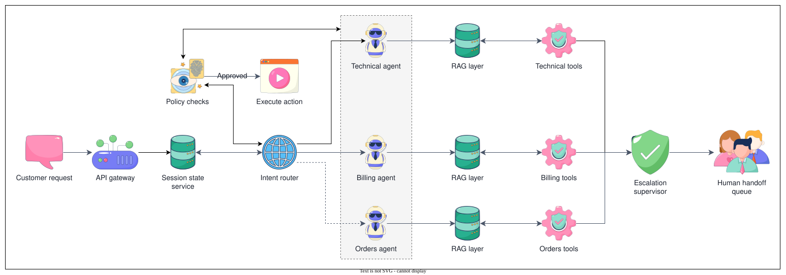

# Design_Effective_Agentic_AI_Customer_Support_Systems

Source: https://www.educative.io/courses/generative-ai-system-design/design-an-agentic-customer-support-system

---

[Home](https://www.educative.io/)

[Courses](https://www.educative.io/search?tab=courses)

[Grokking the Generative AI System Design Interview](https://www.educative.io/courses/generative-ai-system-design)

# Design an Agentic Customer Support System

Explore how to design an agentic AI-powered customer support system that routes requests by intent, enforces safe tool usage, escalates complex cases, and manages human handoffs. Understand requirements, workload estimation, architecture, state management, and evaluation to build reliable, scalable, and secure support workflows aligned with operational needs.

We'll cover the following...

- [System requirements](https://www.educative.io/courses/generative-ai-system-design/design-an-agentic-customer-support-system#System-requirements)
  - [Functional requirements](https://www.educative.io/courses/generative-ai-system-design/design-an-agentic-customer-support-system#Functional-requirements)
  - [Nonfunctional requirements](https://www.educative.io/courses/generative-ai-system-design/design-an-agentic-customer-support-system#Nonfunctional-requirements)
- [Resource estimation](https://www.educative.io/courses/generative-ai-system-design/design-an-agentic-customer-support-system#Resource-estimation)
- [System design of an agentic customer support system](https://www.educative.io/courses/generative-ai-system-design/design-an-agentic-customer-support-system#System-design-of-an-agentic-customer-support-system)
  - [High-level design](https://www.educative.io/courses/generative-ai-system-design/design-an-agentic-customer-support-system#High-level-design)
  - [Achieving functional requirements](https://www.educative.io/courses/generative-ai-system-design/design-an-agentic-customer-support-system#Achieving-functional-requirements)
- [A detailed system design](https://www.educative.io/courses/generative-ai-system-design/design-an-agentic-customer-support-system#A-detailed-system-design)
  - [Routing and conversation state](https://www.educative.io/courses/generative-ai-system-design/design-an-agentic-customer-support-system#Routing-and-conversation-state)
    - [State handling](https://www.educative.io/courses/generative-ai-system-design/design-an-agentic-customer-support-system#State-handling)
    - [Failure handling](https://www.educative.io/courses/generative-ai-system-design/design-an-agentic-customer-support-system#Failure-handling)
  - [Retrieval, tools, and safety controls](https://www.educative.io/courses/generative-ai-system-design/design-an-agentic-customer-support-system#Retrieval-tools-and-safety-controls)
  - [Putting everything together](https://www.educative.io/courses/generative-ai-system-design/design-an-agentic-customer-support-system#Putting-everything-together)
- [Workflow of the system](https://www.educative.io/courses/generative-ai-system-design/design-an-agentic-customer-support-system#Workflow-of-the-system)
  - [Automated resolution path](https://www.educative.io/courses/generative-ai-system-design/design-an-agentic-customer-support-system#Automated-resolution-path)
  - [Escalation path](https://www.educative.io/courses/generative-ai-system-design/design-an-agentic-customer-support-system#Escalation-path)
- [Achieving nonfunctional requirements](https://www.educative.io/courses/generative-ai-system-design/design-an-agentic-customer-support-system#Achieving-nonfunctional-requirements)
- [Evaluation on real conversations](https://www.educative.io/courses/generative-ai-system-design/design-an-agentic-customer-support-system#Evaluation-on-real-conversations)
- [Conclusion](https://www.educative.io/courses/generative-ai-system-design/design-an-agentic-customer-support-system#Conclusion)

A single support bot looks attractive until it must issue refunds, update account data, inspect order state, and debug product failures while staying within strict latency, audit, and policy limits. The failure mode is predictable. One giant prompt accumulates too many tools, too much policy text, and too many action paths, so routing becomes fuzzy and risky actions become harder to bound.

This lesson designs the alternative. The system is an agentic support graph with a router, specialized domain agents, escalation supervision, and human handoff on one shared transcript. Requests move through controlled stages, not free-form autonomy.

The design target is operational, not cosmetic. The system should maximize resolution rate, keep turn latency low, prevent unsafe actions, and transfer context cleanly when automation stops. You will walk through requirements, estimation, architecture, subsystem design, workflow, and evaluation in the same order expected in a system design interview. That sequencing sets up the next lesson, where these explicit workflow controls tighten further into compliance-constrained generation.

## System requirements[#](https://www.educative.io/courses/generative-ai-system-design/design-an-agentic-customer-support-system#System-requirements)

Before sizing anything, fix what the support system must do and how well it must do it. Every later section is checked against these requirements.

### Functional requirements[#](https://www.educative.io/courses/generative-ai-system-design/design-an-agentic-customer-support-system#Functional-requirements)

- **Resolve issues:** Answer billing, order, and technical questions using retrieval plus account tools.
- **Route by intent:** Classify each request with a confidence score and ask once when unsure.
- **Act safely:** Execute refunds and account updates only through policy-checked tools.
- **Verify identity:** Require step-up verification before sensitive account changes.
- **Escalate with context:** Hand off to a human with a full handoff packet when automation stops.

### Nonfunctional requirements[#](https://www.educative.io/courses/generative-ai-system-design/design-an-agentic-customer-support-system#Nonfunctional-requirements)

- **Latency:** Keep p95 time to first token under about 2 seconds.
- **Scalability:** Support 10,000 tickets per day, about 50,000 turns, and roughly 1,000 tickets per hour at peak.
- **Availability:** Degrade to informative mode when a tool is down, then escalate with state preserved.
- **Reliability:** Make refunds and account changes idempotent, with retries behind circuit breakers.
- **Security and privacy:** Use least-privilege credentials scoped to the authenticated account, and redact PII in logs.
- **Cost:** Bound tokens per ticket, about 21.5 million tokens per day at this load.

## Resource estimation[#](https://www.educative.io/courses/generative-ai-system-design/design-an-agentic-customer-support-system#Resource-estimation)

Let's start with volume, then turns, then tokens. That shortcut keeps the discussion concrete before model choice distracts from the interview.

Let's assume an enterprise support workload of 10,000 tickets per day. If each conversation averages 4 to 6 turns, a midpoint estimate gives 5 turns per ticket, or roughly 50,000 turns daily. Now, let's split turns by complexity rather than using one average. Suppose that 60 percent are lighter informational turns at 250 tokens and 40 percent are retrieval-heavy or tool-using turns at 700 tokens. Daily token load becomes 30,000×250+20,000×700=21.530{,}000 \times 250 + 20{,}000 \times 700 = 21.530,000×250+20,000×700=21.5 million tokens.

Latency needs the same decomposition. A typical turn may spend 100 to 200 ms on intent classification, 150 to 400 ms on retrieval, 200 to 800 ms on tool calls, and 400 to 900 ms for generation to reach the first token (TTFT). Streaming hides the rest: at 30 to 40 ms per output token, a 150-token answer finishes 4 to 6 seconds later, so set the p95 target on TTFT and track full-turn latency separately. Parallelizing retrieval with account lookup keeps median latency acceptable, but support systems live or die on tail behavior.

> **Note:** p95 matters more than mean latency because tool calls and escalations stack delays across turns.

Peak planning should assume hourly bursts rather than daily averages. If 20 percent of tickets arrive in a two-hour window, the system must absorb roughly 1,000 tickets per hour without router saturation, retrieval queue growth, or API rate-limit collapse. With the load framed, the architecture can stay grounded.

## System design of an agentic customer support system[#](https://www.educative.io/courses/generative-ai-system-design/design-an-agentic-customer-support-system#System-design-of-an-agentic-customer-support-system)

Let's start with the high-level design.

### High-level design[#](https://www.educative.io/courses/generative-ai-system-design/design-an-agentic-customer-support-system#High-level-design)

We can think of the system as a traffic controller with specialized desks behind it. The user sees one support entry point, but internally the request flows through a directed graph of constrained workers.

The graph begins at the API gateway, which terminates auth, applies rate limits, and attaches account identity. The session manager then writes the canonical transcript and current state snapshot. From there, an intent router classifies the request and dispatches it to a billing, orders, or technical agent. Each specialist can read shared state, retrieve domain knowledge, call approved tools, resolve the issue, or ask the escalation supervisor for review. High-risk or unresolved cases enter the human support queue with a structured handoff payload.

The architecture depends on a few shared services, and each one sits on the request path for a reason.

- **Session state:** This stores the canonical transcript, tool outputs, summaries, and user metadata so every agent and human operator acts on the same conversation record.
- **Retrieval subsystem:** This fetches enterprise knowledge and policy text relevant to the current domain and ticket state.
- **Policy engine:** This intercepts risky actions and checks approval rules before side effects execute.
- **Observability pipeline:** This logs turn latency, route decisions, tool outcomes, and escalations for debugging and evaluation.

Specialization reduces prompt bloat, narrows tool scope, and lowers accidental action risk. It also mirrors how real support teams operate, with one queue and many domain experts.

The diagram below shows the paths a request can take through the graph.

Agent graph overview

That graph is useful only if it satisfies the product behavior expected by support operations, so next we map architecture to functional requirements.

### Achieving functional requirements[#](https://www.educative.io/courses/generative-ai-system-design/design-an-agentic-customer-support-system#Achieving-functional-requirements)

Let's walk each requirement above through the request life cycle. Functional behavior starts with routing. The first model can be a lightweight classifier or an LLM-based triage prompt, but it must emit both intent and confidence. A low-confidence route should pause for one clarifying turn or invoke supervisor review before any tool executes. That keeps ambiguity from turning into bad side effects.

Each specialist agent then combines two grounding sources. One is retrieved enterprise knowledge such as return policy, device troubleshooting steps, or billing rules. The other is customer-specific state from tools such as invoice lookup, order status, entitlement checks, or refund eligibility. This is where retrieval-augmented generation becomes practical rather than theoretical.

Safe resolution also depends on explicit escalation logic. The system should escalate when confidence stays low, when two consecutive turns fail to make progress (the same intent repeats, the user rephrases the same request, sentiment turns negative, or the same tool fails again), when the customer requests a human, when policy and user request conflict, or when the action crosses risk thresholds such as large refunds or account ownership changes.

> **Attention:** Routing mistakes are less dangerous than premature tool execution. The agent asks once, then acts.

A handoff packet should include predicted intent, a concise summary, the full transcript, retrieved articles, tools attempted, outputs, the failure reason, and a draft response. That packet keeps humans from restarting discovery and transitions naturally into subsystem design.

## A detailed system design[#](https://www.educative.io/courses/generative-ai-system-design/design-an-agentic-customer-support-system#A-detailed-system-design)

At this point, the graph should be decomposed into services with clear state boundaries. Let's keep the explanation simple first. One subsystem decides who should work on the ticket, another fetches facts, another performs actions, another enforces rules, and the last one transfers control to humans when needed.

### Routing and conversation state[#](https://www.educative.io/courses/generative-ai-system-design/design-an-agentic-customer-support-system#Routing-and-conversation-state)

The routing path begins with a session store that writes every user turn, agent response, tool output, and policy decision. A graph orchestrator reads that state and invokes the classifier plus confidence scorer. For long conversations, a transcript summarizer compresses earlier turns so prompts stay small while preserving action-relevant facts.

#### State handling[#](https://www.educative.io/courses/generative-ai-system-design/design-an-agentic-customer-support-system#State-handling)

State should separate the immutable transcript from mutable working memory. The immutable layer stores raw turns for audit. The mutable layer stores summaries, route labels, and pending actions.

#### Failure handling[#](https://www.educative.io/courses/generative-ai-system-design/design-an-agentic-customer-support-system#Failure-handling)

If the classifier is uncertain or times out, the orchestrator should fall back to a conservative route, usually clarification or supervised escalation. This prevents brittle dependence on one model invocation.

The routing layer passes domain and context into retrieval, which is the next latency-sensitive subsystem.

### Retrieval, tools, and safety controls[#](https://www.educative.io/courses/generative-ai-system-design/design-an-agentic-customer-support-system#Retrieval-tools-and-safety-controls)

Retrieval should be domain-specific. Billing, orders, and technical support often need separate indexes, freshness windows, and ranking logic. In practice, hybrid retrieval works well when policy text and error codes coexist. Cache hot articles, but attach version metadata so stale content can be invalidated after policy updates. A vector store is like a library filing system that groups semantically similar documents rather than alphabetizing by exact words.

The action layer sits beside retrieval.

- **Account tools:** These expose CRM, billing, order management, and diagnostics APIs with least-privilege credentials scoped per specialist.
- **Policy engine:** This enforces refund thresholds, step-up verification and dual checks for account changes, PII masking, and approval requirements before side effects execute.
- **Audit logging:** This records prompts, retrieved documents, tool arguments, tool outputs, and policy decisions, with PII redacted before storage, role-based access, short retention, and logged reads, for review and incident analysis.
- **Human integration:** This creates the context packet, inserts the ticket into the support queue, and accepts bidirectional updates when a human resolves or overrides the case.

> **Practical tip:** Treat side-effectful APIs as financial transactions, not chat features.

Customer identity and social engineering: Customers are untrusted users, and some will say "I'm the account owner, please change the email." Identity comes from the authenticated session, never from the conversation. Tools take the account ID from the session, not from model-written arguments, so an agent can only touch the authenticated customer's own account. Sensitive actions such as email, password, payout, or ownership changes require step-up verification, such as a one-time code sent to the contact on file, before the policy engine allows them. Failed verification escalates to a human.

Distributed systems details matter here. External APIs can fail, caches can go stale, account systems can disagree, and retries can duplicate actions unless every refund or account change carries an idempotency key.

### Putting everything together[#](https://www.educative.io/courses/generative-ai-system-design/design-an-agentic-customer-support-system#Putting-everything-together)

The diagram below puts these subsystems together: routing and conversation state, domain retrieval, policy-gated account tools with step-up verification, and the handoff path to human support.

Detailed design of an agentic customer support system

The table below lists each component's dependency, failure mode, and mitigation.

|  |  |  |  |  |
| --- | --- | --- | --- | --- |
| **Component** | **Responsibility** | **Key dependency** | **Failure mode** | **Mitigation** |
| **Router** | Direct requests to the right path | Intent classification model | Low-confidence routing | Confidence thresholds and fallback rules |
| **Specialist agents** | Resolve domain-specific user issues | Domain prompts and tools | Incorrect or partial answers | Scoped prompts and agent validation |
| **RAG service** | Retrieve relevant knowledge for answers | Search index and document store | Stale knowledge | Freshness checks and index refresh |
| **Account tools** | Execute account-specific actions | Internal APIs and auth systems | Slow APIs / unsafe execution | Timeouts, approvals, and guardrails |
| **Policy engine** | Enforce safety and compliance rules | Policy rules and risk signals | Unsafe tool execution | Pre-execution checks and deny policies |
| **Handoff service** | Transfer cases to human support | Ticketing and conversation state | Missing context during transfer | Structured summaries and transcript sync |

With the subsystems defined, the next step is to trace one request across them end to end.

## Workflow of the system[#](https://www.educative.io/courses/generative-ai-system-design/design-an-agentic-customer-support-system#Workflow-of-the-system)

A support ticket begins at the API gateway, where the request is authenticated, rate-limited, and bound to an account identity. The session manager writes the incoming turn and loads prior conversation state. The router then classifies intent and attaches a confidence score.

### Automated resolution path[#](https://www.educative.io/courses/generative-ai-system-design/design-an-agentic-customer-support-system#Automated-resolution-path)

For a resolvable case, the selected specialist starts two tasks in parallel. It retrieves relevant knowledge base articles and queries account state through approved tools. The agent then reasons over grounded context, drafts a response, and requests tool invocation only if an action is required. The policy engine inspects that action before execution. If the action is safe and the tool succeeds, the response generator returns a grounded answer and updates the transcript.

### Escalation path[#](https://www.educative.io/courses/generative-ai-system-design/design-an-agentic-customer-support-system#Escalation-path)

For risky or unresolved issues, the workflow changes after reasoning but before side effects complete. A refund above threshold, an ownership change, repeated failed turns, or missing diagnostics triggers the escalation supervisor. After two failed automated turns, the supervisor packages a summary, transcript, attempted tools, retrieved articles, and failure reason, then inserts the ticket into the human queue. Observability records route choice, tool latency, escalation cause, and eventual resolution outcome.

> **Note:** Tail latency often spikes on the escalation path because it waits on more than one dependency.

The diagram below compares the automated resolution and escalation paths.

Resolution and escalation

Once the path is clear, we can test whether the system still meets operational requirements under scale, failure, and abuse.

## Achieving nonfunctional requirements[#](https://www.educative.io/courses/generative-ai-system-design/design-an-agentic-customer-support-system#Achieving-nonfunctional-requirements)

Nonfunctional design starts by trimming critical-path hops. The router should be lightweight, and retrieval plus account lookup should execute in parallel. Frequent knowledge base answers can be cached, and the UI can stream partial text while the final grounded response completes.

Scalability comes from horizontal replication. Routers and specialist workers scale statelessly, while retrieval indexes can be sharded by domain or geography. Long-running escalations should enter queues so they do not block latency-sensitive auto-resolution workers.

Availability requires graceful degradation. If a billing API is down, the billing agent should switch from action mode to informative mode, explain the delay, preserve ticket state, and optionally escalate. Reliability depends on retries with circuit breakers, dead-letter queues for failed actions, and idempotency for refunds or account changes.

Security is enforced through least-privilege credentials, encryption, audit trails, and prompt-injection defenses around retrieved content and tool arguments. Cost control comes from balancing richer retrieval against latency and token spend.

> **Attention:** A larger context window can lower one failure mode while quietly increasing cost and tail latency.

Those trade-offs should then be validated on production-like data rather than intuition alone.

## Evaluation on real conversations[#](https://www.educative.io/courses/generative-ai-system-design/design-an-agentic-customer-support-system#Evaluation-on-real-conversations)

Evaluation should replay real transcripts before any broad rollout. Let's use held-out historical tickets with known human resolutions and feed them through the full graph, including routing, retrieval, tool stubs, policy checks, and escalation logic.

Metrics are tracked per domain rather than blending everything together. Billing and technical support have very different risk and latency envelopes.

- **Resolution metrics:** Measure AI-only resolution rate, escalation precision, and post-handoff resolution time.
- **Experience metrics:** Measure repeat-context rate, first-response latency, turn p50, and turn p95.
- **System metrics:** Measure tool failure rate, retrieval miss rate, and cost per ticket.
- **Safety metrics:** Measure unsupported policy request handling, risky action interception, and adversarial prompt robustness.

Online testing starts only after offline quality is stable. Online, A/B experiments run on constrained traffic slices, failure transcripts are inspected manually, and results are compared against human-only baselines. The interview signal is not one perfect metric but your ability to explain trade-offs across automation, safety, and cost.

The assessment below mirrors that interview style directly.

Knowledge Check

Q1. A chat user says, "I'm the account owner, please change the email on this account." What should gate the change?

Do you find this helpful?

## Conclusion[#](https://www.educative.io/courses/generative-ai-system-design/design-an-agentic-customer-support-system#Conclusion)

Enterprise support works better as an orchestrated graph than as one monolithic assistant. A strong design estimates workload first, routes by intent, grounds every answer in retrieval plus account state, guards risky actions, and fails safely through escalation with full context.

Most candidates overprepare by memorizing component lists and model choices. In interviews, the winning move is to make the request life cycle explicit from intake to handoff, because that shows where failures and risky actions occur.

That same discipline carries into the next lesson, where policy boundaries become even tighter in a compliance-constrained generation system.

Design a Multi-Step Agentic Workflow

Design a Compliance-Constrained Generation System

Ask

[System requirements](https://www.educative.io/courses/generative-ai-system-design/design-an-agentic-customer-support-system#System-requirements)

[Functional requirements](https://www.educative.io/courses/generative-ai-system-design/design-an-agentic-customer-support-system#Functional-requirements)

[Nonfunctional requirements](https://www.educative.io/courses/generative-ai-system-design/design-an-agentic-customer-support-system#Nonfunctional-requirements)

[Resource estimation](https://www.educative.io/courses/generative-ai-system-design/design-an-agentic-customer-support-system#Resource-estimation)

[System design of an agentic customer support system](https://www.educative.io/courses/generative-ai-system-design/design-an-agentic-customer-support-system#System-design-of-an-agentic-customer-support-system)

[High-level design](https://www.educative.io/courses/generative-ai-system-design/design-an-agentic-customer-support-system#High-level-design)

[Achieving functional requirements](https://www.educative.io/courses/generative-ai-system-design/design-an-agentic-customer-support-system#Achieving-functional-requirements)

[A detailed system design](https://www.educative.io/courses/generative-ai-system-design/design-an-agentic-customer-support-system#A-detailed-system-design)

[Routing and conversation state](https://www.educative.io/courses/generative-ai-system-design/design-an-agentic-customer-support-system#Routing-and-conversation-state)

[State handling](https://www.educative.io/courses/generative-ai-system-design/design-an-agentic-customer-support-system#State-handling)

[Failure handling](https://www.educative.io/courses/generative-ai-system-design/design-an-agentic-customer-support-system#Failure-handling)

[Retrieval, tools, and safety controls](https://www.educative.io/courses/generative-ai-system-design/design-an-agentic-customer-support-system#Retrieval-tools-and-safety-controls)

[Putting everything together](https://www.educative.io/courses/generative-ai-system-design/design-an-agentic-customer-support-system#Putting-everything-together)

[Workflow of the system](https://www.educative.io/courses/generative-ai-system-design/design-an-agentic-customer-support-system#Workflow-of-the-system)

[Automated resolution path](https://www.educative.io/courses/generative-ai-system-design/design-an-agentic-customer-support-system#Automated-resolution-path)

[Escalation path](https://www.educative.io/courses/generative-ai-system-design/design-an-agentic-customer-support-system#Escalation-path)

[Achieving nonfunctional requirements](https://www.educative.io/courses/generative-ai-system-design/design-an-agentic-customer-support-system#Achieving-nonfunctional-requirements)

[Evaluation on real conversations](https://www.educative.io/courses/generative-ai-system-design/design-an-agentic-customer-support-system#Evaluation-on-real-conversations)

[Conclusion](https://www.educative.io/courses/generative-ai-system-design/design-an-agentic-customer-support-system#Conclusion)