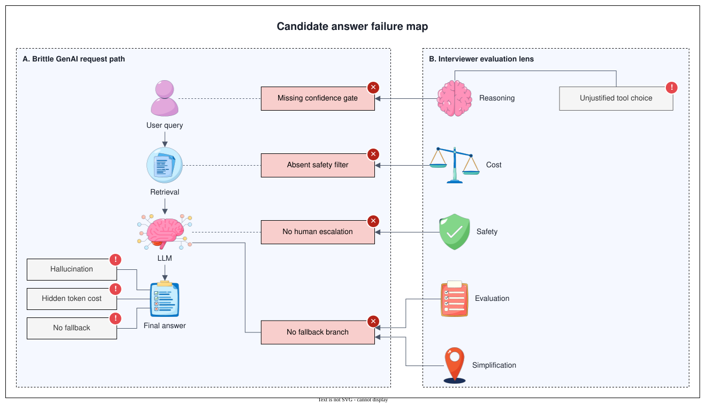

# Common_Failure_Patterns_and_Recovery_in_GenAI_System_Design_Interviews

Source: https://www.educative.io/courses/generative-ai-system-design/common-failure-patterns-and-how-to-recover

---

[Home](https://www.educative.io/)

[Courses](https://www.educative.io/search?tab=courses)

[Grokking the Generative AI System Design Interview](https://www.educative.io/courses/generative-ai-system-design)

# Common Failure Patterns and How to Recover

Explore common failure patterns encountered during generative AI system design interviews and learn a practical four-step recovery script to fix these issues on the spot. Understand how to maintain operational thinking under pressure and apply sound design principles to deliver clear, reliable, and efficient solutions while managing constraints and trade-offs effectively.

We'll cover the following...

- [Failure patterns to recognize early](https://www.educative.io/courses/generative-ai-system-design/common-failure-patterns-and-how-to-recover#Failure-patterns-to-recognize-early)
- [How to recover in the moment](https://www.educative.io/courses/generative-ai-system-design/common-failure-patterns-and-how-to-recover#How-to-recover-in-the-moment)
  - [Use a four-step recovery script](https://www.educative.io/courses/generative-ai-system-design/common-failure-patterns-and-how-to-recover#Use-a-four-step-recovery-script)
    - [Recovery phrases that sound strong](https://www.educative.io/courses/generative-ai-system-design/common-failure-patterns-and-how-to-recover#Recovery-phrases-that-sound-strong)
    - [What the architecture change looks like](https://www.educative.io/courses/generative-ai-system-design/common-failure-patterns-and-how-to-recover#What-the-architecture-change-looks-like)
- [Workflows first and depth second](https://www.educative.io/courses/generative-ai-system-design/common-failure-patterns-and-how-to-recover#Workflows-first-and-depth-second)
  - [Choose the control flow that matches the task](https://www.educative.io/courses/generative-ai-system-design/common-failure-patterns-and-how-to-recover#Choose-the-control-flow-that-matches-the-task)
    - [When a workflow is enough](https://www.educative.io/courses/generative-ai-system-design/common-failure-patterns-and-how-to-recover#When-a-workflow-is-enough)
    - [When agentic behavior is justified](https://www.educative.io/courses/generative-ai-system-design/common-failure-patterns-and-how-to-recover#When-agentic-behavior-is-justified)
  - [Sequence your interview depth](https://www.educative.io/courses/generative-ai-system-design/common-failure-patterns-and-how-to-recover#Sequence-your-interview-depth)
- [Failure patterns at a glance](https://www.educative.io/courses/generative-ai-system-design/common-failure-patterns-and-how-to-recover#Failure-patterns-at-a-glance)
- [Practice recovering under pressure](https://www.educative.io/courses/generative-ai-system-design/common-failure-patterns-and-how-to-recover#Practice-recovering-under-pressure)
- [Conclusion](https://www.educative.io/courses/generative-ai-system-design/common-failure-patterns-and-how-to-recover#Conclusion)

A candidate finishes a clean whiteboard sketch for an enterprise assistant. The request enters a retriever, the model reads the top documents, and an answer appears with citations. It sounds polished for thirty seconds. Then the interviewer asks how the system handles low-confidence answers, prompt injection, token spend, and whether an agent loop is even needed. The design starts to wobble because the answer trusted model output, skipped evaluation, and added complexity before proving the simpler path.

That failure pattern mirrors production incidents. Hallucinations slip past thin verification, inference cost grows quietly with long contexts, and agent loops become hard to trace when tools are selected dynamically. In an interview, those same gaps signal weak operational thinking.

This lesson is a recovery guide. It comes late in the course because the building blocks are already familiar. The challenge now is using them under pressure, in the right order, while keeping constraints visible.

We will walk through five common breakdowns and one recovery script. Name the missing concern, restate the requirement, add the minimum architecture, and explain the trade-off. That one four-step script maps onto the SCALED framework, and once it becomes automatic, the final lesson can focus on consolidating your approach rather than repairing it.

## Failure patterns to recognize early[#](https://www.educative.io/courses/generative-ai-system-design/common-failure-patterns-and-how-to-recover#Failure-patterns-to-recognize-early)

Most interview misses happen because one or two parts of the request life cycle are left undesigned. The architecture diagram may look reasonable, but the control logic around it is incomplete.

Use this checklist when the interviewer gives you a design question.

- **Unverified model output:** The request reaches the model, and the answer is returned as if it were authoritative, without grounding, confidence handling, citation paths, or a fallback branch for uncertainty.
- **Tool naming without architecture:** The candidate says they would use an agent or orchestration framework, but never explains component boundaries, latency impact, vendor lock-in, or what happens when one dependency fails.
- **Missing cost, safety, and evaluation:** The serving path is described, but no one accounts for per-request token spend, abuse prevention, quality metrics, or offline tests using a golden set.
- **Overusing agents:** The candidate reaches for an autonomous agent when a fixed workflow would handle most traffic, which adds unstable behavior and a larger testing surface.
- **Going too deep too early:** The candidate zooms into chunking or prompt templates before scope, load, and risks are set, then runs out of time for operations.

The interviewer reads each of these as a different weakness. The first suggests unreliable product behavior, such as a support assistant inventing policy details. The second suggests shallow design reasoning, such as saying "I would just use an agent framework" instead of defining planner, tool executor, and trace-store responsibilities. The third suggests missing production awareness, such as never discussing PII leakage, safety filters, or token budgets. The last two suggest unnecessary complexity and weak prioritization, which the later sections address.

> **Attention:** Interview failure often comes from omitted reasoning, not a wrong box-and-arrow diagram.

The next visual maps those omissions directly to the interview signals they create.

Interviewer signals from candidate answer failures

With the patterns visible, the next step is learning how to correct them while you are still speaking.

## How to recover in the moment[#](https://www.educative.io/courses/generative-ai-system-design/common-failure-patterns-and-how-to-recover#How-to-recover-in-the-moment)

Recovery works best when it changes the system, not just the wording. A vague apology wastes time. A structured correction shows control.

### Use a four-step recovery script[#](https://www.educative.io/courses/generative-ai-system-design/common-failure-patterns-and-how-to-recover#Use-a-four-step-recovery-script)

When you feel the design drifting, use a short sequence and attach each step to the request path.

1. **Name the missing concern.** Say what is absent in system terms, such as reliability, safety boundary, or cost envelope.
2. **Restate the requirement.** Compress the question into one sentence that includes scale, latency, and risk.
3. **Add the minimum architecture.** Insert only the component needed to cover the gap, such as retrieval verification, a confidence threshold, or an evaluation harness.
4. **Explain the trade-off.** Tie the new component to latency, correctness, predictability, or spend.

This single script maps onto SCALED. Restating the requirement revisits system requirements. Adding the minimum architecture is the step where you leverage the AI model, and explaining the trade-off is the design and evaluate step.

#### Recovery phrases that sound strong[#](https://www.educative.io/courses/generative-ai-system-design/common-failure-patterns-and-how-to-recover#Recovery-phrases-that-sound-strong)

These phrases work because they redirect the answer back to design mechanics.

- **Reliability reset:** "I should not assume model output is authoritative, so I would add grounding plus a low-confidence fallback."
- **Control-flow reset:** "Let me simplify this to a deterministic workflow first, then justify where agentic behavior is actually required."
- **Operational reset:** "I have not covered evaluation yet, so I would define a benchmark set, online feedback loop, and safety-failure metrics before scaling traffic."

#### What the architecture change looks like[#](https://www.educative.io/courses/generative-ai-system-design/common-failure-patterns-and-how-to-recover#What-the-architecture-change-looks-like)

A simple recovery often inserts one confidence threshold. The request first reaches retrieval, then the model drafts an answer, then a verifier or scoring layer decides whether the answer is delivered, reformulated with citations, or sent to a human queue.

That is enough in many interviews. You do not need a second model, three rerankers, and a policy engine unless the question justifies them.

> **Practical tip:** Recover by adding the smallest missing control point. Interviewers usually reward precise correction over architectural inflation.

Before the next section deepens the strategy, keep a few short redirects ready for live use.

Once you can recover individual mistakes, the bigger advantage comes from preventing two common structural errors altogether.

## Workflows first and depth second[#](https://www.educative.io/courses/generative-ai-system-design/common-failure-patterns-and-how-to-recover#Workflows-first-and-depth-second)

Two failures repeatedly consume strong candidates. They choose an agent when a workflow would handle most traffic, or they deep-dive too early and run out of time before discussing risk and operations.

A useful mental model is simple. A workflow is a train on fixed tracks. An agent is a driver choosing roads in real time. If the destination and turns are mostly known, fixed tracks are easier to test and cheaper to operate.

### Choose the control flow that matches the task[#](https://www.educative.io/courses/generative-ai-system-design/common-failure-patterns-and-how-to-recover#Choose-the-control-flow-that-matches-the-task)

The control layer should be selected after requirements, not before them.

#### When a workflow is enough[#](https://www.educative.io/courses/generative-ai-system-design/common-failure-patterns-and-how-to-recover#When-a-workflow-is-enough)

A workflow fits when the path is predictable, the latency target is tight, and mistakes must be bounded. In an internal email triage system, the request first passes through a classifier, then a routing policy assigns a team, and only uncertain cases are escalated. That design keeps traces clean and the testing surface small.

#### When agentic behavior is justified[#](https://www.educative.io/courses/generative-ai-system-design/common-failure-patterns-and-how-to-recover#When-agentic-behavior-is-justified)

An agent becomes reasonable when the request requires runtime tool choice, multistep planning, or iterative search across changing state. Even then, place loop caps and persist trace logs.

### Sequence your interview depth[#](https://www.educative.io/courses/generative-ai-system-design/common-failure-patterns-and-how-to-recover#Sequence-your-interview-depth)

Candidates often zoom into chunking, embeddings, or prompt templates before they have established product goals, load, privacy, and SLA. That reverses the design order.

Follow the SCALED order instead: requirements and constraints first, then model and data choices, then the runtime and resource estimates. Only after that pick one deep dive, and close with evaluation and operations.

> **Note:** Scoped simplicity usually scores better than maximal sophistication.

After those structural choices, one summary table keeps every pattern and its recovery in one place.

## Failure patterns at a glance[#](https://www.educative.io/courses/generative-ai-system-design/common-failure-patterns-and-how-to-recover#Failure-patterns-at-a-glance)

The five patterns above, and the recovery for each, fit in one table.

In production, mature designs often expose citation paths, confidence thresholds, loop caps, trace logs, and monitors for retrieval drift or policy violations. In interview language, those same controls show that the system can be operated, not just sketched.

The next note helps when the interviewer deliberately changes the constraint midstream.

Review this table before practice sessions.

|  |  |  |  |
| --- | --- | --- | --- |
| **Failure pattern** | **Why interviewers worry** | **Fast recovery move** | **Production design implication** |
| Treating LLM output as truth | Suggests no verification path for wrong or fabricated answers | State confidence is provisional and add retrieval, checks, or human review | Build validation layers, grounding, and fallback handling |
| Naming tools instead of reasoning | Sounds like stack listing without decision logic | Explain why each component exists and what failure it addresses | Choose components by measurable need, not trend or brand |
| Ignoring cost or safety evaluation | Implies the system may be unsafe or too expensive to run | Add latency, cost, and safety gates with clear metrics | Instrument token use, routing, moderation, and budget controls |
| Overusing agents | Indicates unnecessary complexity and unstable behavior | Reduce to a simpler workflow unless multi-step delegation is required | Prefer deterministic pipelines before autonomous loops |
| Going too deep too early | Suggests weak prioritization and missed product requirements | Reframe with scope, success metrics, and top risks first | Sequence design from requirements to architecture to optimizations |

Before the assessment, run one short rehearsal where you practice recovery instead of fresh design.

## Practice recovering under pressure[#](https://www.educative.io/courses/generative-ai-system-design/common-failure-patterns-and-how-to-recover#Practice-recovering-under-pressure)

Take this question and start in the middle, not at the beginning. Design an internal document assistant for 1,000 employees with privacy constraints and moderate latency targets. Now assume you already made two mistakes. You proposed an agent too early, and you forgot evaluation.

Recover by restating the requirement in one sentence, replacing the agent with a workflow backbone, and adding cost and safety controls before any deep dive. Then define one evaluation plan with golden queries, low-confidence fallback, and access-aware retrieval. That sequence trains the exact correction pattern interviewers want to see next.

The assessment below rehearses that correction pattern the way a real interviewer would test it.

Knowledge Check

Q1. Midway through your answer you realize you proposed an agent and never discussed evaluation. What is the best recovery?

Do you find this helpful?

## Conclusion[#](https://www.educative.io/courses/generative-ai-system-design/common-failure-patterns-and-how-to-recover#Conclusion)

GenAI system-design interviews are usually won through disciplined reasoning under uncertainty, not through the longest tool list. Strong candidates verify outputs, justify components, account for cost and safety, default to simpler workflows, and preserve time for evaluation and trade-offs.

That makes recovery a design skill, not a rescue move. In the next lesson, we will wrap these patterns into a final interview-ready mental model for the course.

Running a 45-Minute GenAI Design Interview

Wrapping Up GenAI System Design

Ask

[Failure patterns to recognize early](https://www.educative.io/courses/generative-ai-system-design/common-failure-patterns-and-how-to-recover#Failure-patterns-to-recognize-early)

[How to recover in the moment](https://www.educative.io/courses/generative-ai-system-design/common-failure-patterns-and-how-to-recover#How-to-recover-in-the-moment)

[Use a four-step recovery script](https://www.educative.io/courses/generative-ai-system-design/common-failure-patterns-and-how-to-recover#Use-a-four-step-recovery-script)

[Recovery phrases that sound strong](https://www.educative.io/courses/generative-ai-system-design/common-failure-patterns-and-how-to-recover#Recovery-phrases-that-sound-strong)

[What the architecture change looks like](https://www.educative.io/courses/generative-ai-system-design/common-failure-patterns-and-how-to-recover#What-the-architecture-change-looks-like)

[Workflows first and depth second](https://www.educative.io/courses/generative-ai-system-design/common-failure-patterns-and-how-to-recover#Workflows-first-and-depth-second)

[Choose the control flow that matches the task](https://www.educative.io/courses/generative-ai-system-design/common-failure-patterns-and-how-to-recover#Choose-the-control-flow-that-matches-the-task)

[When a workflow is enough](https://www.educative.io/courses/generative-ai-system-design/common-failure-patterns-and-how-to-recover#When-a-workflow-is-enough)

[When agentic behavior is justified](https://www.educative.io/courses/generative-ai-system-design/common-failure-patterns-and-how-to-recover#When-agentic-behavior-is-justified)

[Sequence your interview depth](https://www.educative.io/courses/generative-ai-system-design/common-failure-patterns-and-how-to-recover#Sequence-your-interview-depth)

[Failure patterns at a glance](https://www.educative.io/courses/generative-ai-system-design/common-failure-patterns-and-how-to-recover#Failure-patterns-at-a-glance)

[Practice recovering under pressure](https://www.educative.io/courses/generative-ai-system-design/common-failure-patterns-and-how-to-recover#Practice-recovering-under-pressure)

[Conclusion](https://www.educative.io/courses/generative-ai-system-design/common-failure-patterns-and-how-to-recover#Conclusion)