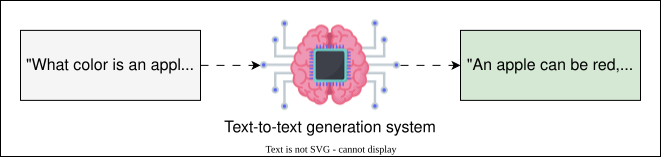

# Final_Overview_of_Generative_AI_System_Design_Essentials

Source: https://www.educative.io/courses/generative-ai-system-design/wrapping-up-genai-system-design

---

[Home](https://www.educative.io/)

[Courses](https://www.educative.io/search?tab=courses)

[Grokking the Generative AI System Design Interview](https://www.educative.io/courses/generative-ai-system-design)

# Wrapping Up GenAI System Design

Explore the comprehensive wrap-up of the Generative AI System Design course, highlighting foundational concepts, reusable components, the SCALED framework, and diverse design cases. Understand how these pieces integrate to solve unseen problems and prepare for practical challenges and interviews in GenAI system design.

We'll cover the following...

- [Key highlights and takeaways](https://www.educative.io/courses/generative-ai-system-design/wrapping-up-genai-system-design#Key-highlights-and-takeaways)
  - [Core GenAI systems](https://www.educative.io/courses/generative-ai-system-design/wrapping-up-genai-system-design#Core-GenAI-systems)
  - [Modern GenAI systems](https://www.educative.io/courses/generative-ai-system-design/wrapping-up-genai-system-design#Modern-GenAI-systems)
  - [Agentic systems](https://www.educative.io/courses/generative-ai-system-design/wrapping-up-genai-system-design#Agentic-systems)
  - [AI platforms and infrastructure](https://www.educative.io/courses/generative-ai-system-design/wrapping-up-genai-system-design#AI-platforms-and-infrastructure)
- [How do we apply this knowledge?](https://www.educative.io/courses/generative-ai-system-design/wrapping-up-genai-system-design#How-do-we-apply-this-knowledge)
- [Thank you](https://www.educative.io/courses/generative-ai-system-design/wrapping-up-genai-system-design#Thank-you)

**Congratulations** on completing this cutting-edge course on generative AI System Design. You’ve journeyed through the complexities of systems that power today’s advanced AI technologies—no small feat—and now you’ve reached the finish line!

Generative AI is reshaping the tech world, and you’re now equipped to be a driving force in that transformation. Whether you’re building innovative solutions from scratch, enhancing existing systems with cutting-edge AI, or confidently stepping into interview and leadership roles, the knowledge you’ve gained here will empower you to excel.

## Key highlights and takeaways[#](https://www.educative.io/courses/generative-ai-system-design/wrapping-up-genai-system-design#Key-highlights-and-takeaways)

Let's recap how the course built up from foundations to complete systems.

- **Foundations and constraints**: GenAI foundations, nonfunctional characteristics such as quality, groundedness, latency, and cost, and back-of-the-envelope estimation turned vague prompts into measurable targets.
- **Building blocks**: Retrieval and context, model serving and optimization, evaluation, observability, and guardrails, and agentic building blocks provided reusable components for every design.
- **The SCALED framework**: A repeatable interview flow for unseen problems, built on four recurring patterns and mapped to RESHADED, tied those pieces together.
- **Design problems**: Four chapters, Core GenAI Systems, Modern GenAI Systems, Agentic Systems, and AI Platforms and Infrastructure, applied these layers to complete systems.
- **Interview practice**: Mock interviews and the final chapter on running a 45-minute interview and recovering from common failure patterns turned knowledge into communication under a clock.

Let's look at the design problems chapter by chapter.

### Core GenAI systems[#](https://www.educative.io/courses/generative-ai-system-design/wrapping-up-genai-system-design#Core-GenAI-systems)

These case studies focused on the model and its serving pipeline for each modality.

- **Text-to-text generation System Design:** We demonstrated how to design a conversational AI, from training a Llama 3.2 3B model focusing on data preprocessing and bias mitigation to deploying it using a scalable System Design that prioritizes personalization and context awareness. We covered key aspects like security and modular subsystems for prompt embedding, long-term memory, and dynamic contextualization, offering a practical guide to developing a robust conversational AI.

The high-level working of our text-to-text generation system

- **Text-to-image generation System Design:** We went through a comprehensive journey designing, training, and deploying a text-to-image generation system using the Stable Diffusion 3.5 Large model. We emphasized data quality and preprocessing and utilized a distributed training approach with a peer-to-peer architecture. The deployment System Design focuses on inference optimization, scalability, and user experience, incorporating techniques like efficient denoising schedulers, resolution scaling, and multi-region deployment. The study offers a practical understanding of the infrastructure and design decisions required for a robust and efficient text-to-image generation system.

The high-level working of our text-to-image generation system

- **Text-to-speech generation System Design:** We designed a text-to-speech system using the efficient and multilingual SOTA Fish-Speech model, trained on the extensive common voice corpus. Our system prioritizes high-quality audio generation and user customization, employing a modular architecture with subsystems for prompt processing, linguistic feature extraction, acoustic representation, and speech generation. We optimized for performance and scalability using techniques like model quantization and horizontal scaling while ensuring high availability through redundancy and fault tolerance mechanisms.

The high-level working of our text-to-speech generation system

- **Text-to-video generation System Design:** We built a text-to-video system using the Mochi 1 model, trained on a diverse dataset of videos and text prompts. Our system emphasizes accurate, prompt interpretation, scene continuity, and asset diversity, employing a modular architecture with subsystems for prompt processing, content planning, asset generation, motion synthesis, rendering, and quality control. This robust design enables our system to generate high-quality, stylized videos that accurately reflect user prompts.

The high-level working of our text-to-video generation system

- **Image captioning and speech recognition**: These designs turn images and audio into text, showing how understanding tasks differ from generation in their data, evaluation metrics, and latency budgets.

The table below summarizes the unique aspects of each core GenAI case study:

|  |  |  |
| --- | --- | --- |
| **Case Study** | **Model Used** | **Unique Aspects** |
| **Text-to-text** | Llama 3.2 (3 B) | - Llama 3.2 3B is chosen for its efficiency and open-source nature, enabling customization for optimal conversational performance. - Vector databases efficiently store and retrieve embeddings, facilitating real-time context retrieval for relevant and personalized responses. - A modular design ensures the system is futureproofed and readily hackable. |
| **Text-to-image** | Stable Diffusion 3.5 Large (8.1 B) | - CLIP text encoder for detailed, prompt understanding and accurate image matching. - Peer-to-peer distributed training is used to efficiently train the computationally intensive model. - Various techniques, such as efficient denoising schedulers (DDIM or DPM-Solver), half-precision floating-point format (FP16), and attention layer optimization, are employed to enhance performance and user experience by reducing inference time and memory consumption. |
| **Text-to-speech** | Fish-Speech (2 B) | - Dual-AR structure for efficient handling of complex linguistic features, polyphonic words, and multilingual inputs. - Emphasis on prosody and intonation for emotionally resonant speech output. - Inference optimizations like quantization to achieve minimal latency |
| **Text-to-video** | Mochi 1 (14.7 B) | - Diffusion-based model for high-quality stylized video generation. - Modular system with specialized subsystems for prompt processing, content planning, asset generation, motion synthesis, rendering, and quality control. - Specialized evaluation metrics that work with video generation. |
| **Image captioning** | BLIP-2-style VLM (about 4 B total, 1 B trainable) | - A ViT image encoder and a query transformer bridge visual features into a frozen language decoder, so only about 1 B parameters need training. - Captions are personalized with user context and feedback before delivery. - A moderation step filters generated captions before they reach users. |
| **Automatic speech recognition** | Whisper-style model (1 B) | - Audio is converted into log-mel spectrograms, and a sequence-to-sequence transformer transcribes it on GPUs. - Post-processing applies confidence-based quality control to the transcript. - Word error rate (WER) is the primary metric, with attention to noisy audio and diverse accents. |

### Modern GenAI systems[#](https://www.educative.io/courses/generative-ai-system-design/wrapping-up-genai-system-design#Modern-GenAI-systems)

These designs moved from a single model to complete applications: cross-conversation memory, a document Q&A assistant, an AI code assistant, an LLM-powered search engine, a unified query engine across data sources, and a real-time voice assistant. The recurring themes were retrieval quality, permission-aware context, grounded answers with citations, and tight latency budgets for streaming experiences.

### Agentic systems[#](https://www.educative.io/courses/generative-ai-system-design/wrapping-up-genai-system-design#Agentic-systems)

The deep research agent, multi-step agentic workflow, agentic customer support system, and compliance-constrained generation system showed how planning loops, tool use, budgets, termination rules, human approval, and durable state keep autonomous systems safe and bounded.

### AI platforms and infrastructure[#](https://www.educative.io/courses/generative-ai-system-design/wrapping-up-genai-system-design#AI-platforms-and-infrastructure)

The GenAI gateway, GPU training job scheduler, AI content moderation system, document extraction and decision pipeline, and the design for cost at 1M queries a day shifted the focus to shared infrastructure: routing and quotas, scheduling scarce accelerators, cascaded decisions with human review, and unit economics at scale.

Across all four design chapters, the same building blocks and the same SCALED flow kept reappearing, which is exactly what makes them useful for unseen interview problems.

## How do we apply this knowledge?[#](https://www.educative.io/courses/generative-ai-system-design/wrapping-up-genai-system-design#How-do-we-apply-this-knowledge)

Our journey doesn’t end here. Now, we’ll shift our focus to applying the knowledge gained in this course to real-world challenges:

- **Innovate new use cases:** Your knowledge can power next-generation AI solutions that redefine user experiences and solve complex problems.
- **Excel in career:** From software development to management or leadership, the knowledge you’ve gained here is applicable across roles to help you address real-world challenges and confidently lead the adoption of AI solutions.
- **Adapt to the future:** In the ever-evolving tech landscape, staying ahead is key—and mastering GenAI System Design is your edge to thrive in it.
- **Interviews:** AI is becoming a key topic in System Design interviews lately, emphasizing GenAI. Understanding how to integrate these technologies is crucial to showcasing adaptability and innovation.

Beyond the five mock interviews in this course (RAG and Finetuning, ChatGPT, DALL·E, ElevenLabs, and Sora), it helps to keep practicing GenAI System Design with [Educative’s Mock Interviewer](https://www.educative.io/mock-interview).

## Thank you[#](https://www.educative.io/courses/generative-ai-system-design/wrapping-up-genai-system-design#Thank-you)

We finally want to thank you for taking the time to complete this course. We are delighted to have you as a valuable learning community member at Educative. Feel free to provide valuable feedback, comments, questions, or concerns.

Happy learning!

Common Failure Patterns and How to Recover

Sora

Ask

[Key highlights and takeaways](https://www.educative.io/courses/generative-ai-system-design/wrapping-up-genai-system-design#Key-highlights-and-takeaways)

[Core GenAI systems](https://www.educative.io/courses/generative-ai-system-design/wrapping-up-genai-system-design#Core-GenAI-systems)

[Modern GenAI systems](https://www.educative.io/courses/generative-ai-system-design/wrapping-up-genai-system-design#Modern-GenAI-systems)

[Agentic systems](https://www.educative.io/courses/generative-ai-system-design/wrapping-up-genai-system-design#Agentic-systems)

[AI platforms and infrastructure](https://www.educative.io/courses/generative-ai-system-design/wrapping-up-genai-system-design#AI-platforms-and-infrastructure)

[How do we apply this knowledge?](https://www.educative.io/courses/generative-ai-system-design/wrapping-up-genai-system-design#How-do-we-apply-this-knowledge)

[Thank you](https://www.educative.io/courses/generative-ai-system-design/wrapping-up-genai-system-design#Thank-you)