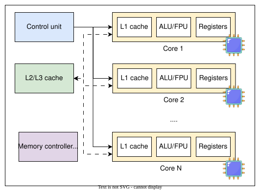

# Understanding_CPU_GPU_and_TPU_Differences_in_AI_Systems

Source: https://www.educative.io/courses/generative-ai-system-design/cpu-vs-gpu-vs-tpu-for-ai-and-machine-learning

---

[Home](https://www.educative.io/)

[Courses](https://www.educative.io/search?tab=courses)

[Grokking the Generative AI System Design Interview](https://www.educative.io/courses/generative-ai-system-design)

# CPU vs. GPU vs. TPU for AI and Machine Learning

Explore the key differences between CPUs, GPUs, and TPUs, including their architectures and roles in AI and machine learning. Learn how to choose the right hardware for training and inference, balancing flexibility, performance, and cost considerations.

We'll cover the following...

- [How CPUs, GPUs, and TPUs work internally](https://www.educative.io/courses/generative-ai-system-design/cpu-vs-gpu-vs-tpu-for-ai-and-machine-learning#How-CPUs-GPUs-and-TPUs-work-internally)
  - [CPU](https://www.educative.io/courses/generative-ai-system-design/cpu-vs-gpu-vs-tpu-for-ai-and-machine-learning#CPU)
- [GPU](https://www.educative.io/courses/generative-ai-system-design/cpu-vs-gpu-vs-tpu-for-ai-and-machine-learning#GPU)
- [TPU](https://www.educative.io/courses/generative-ai-system-design/cpu-vs-gpu-vs-tpu-for-ai-and-machine-learning#TPU)
- [From architecture to real-world AI](https://www.educative.io/courses/generative-ai-system-design/cpu-vs-gpu-vs-tpu-for-ai-and-machine-learning#From-architecture-to-real-world-AI)
- [Real-world AI and ML use cases](https://www.educative.io/courses/generative-ai-system-design/cpu-vs-gpu-vs-tpu-for-ai-and-machine-learning#Real-world-AI-and-ML-use-cases)
- [Trade-offs: Flexibility, performance, cost, and scalability](https://www.educative.io/courses/generative-ai-system-design/cpu-vs-gpu-vs-tpu-for-ai-and-machine-learning#Trade-offs-Flexibility-performance-cost-and-scalability)
- [Conclusion](https://www.educative.io/courses/generative-ai-system-design/cpu-vs-gpu-vs-tpu-for-ai-and-machine-learning#Conclusion)

## 

If you’ve ever wondered why training a large language model can feel painfully slow, unless you’re using the right hardware, you’re not alone. The world of AI and machine learning is powered by three main types of hardware: CPUs, GPUs, and TPUs. Each has its own origin story, strengths, and quirks.

**Central Processing Units (CPUs)** are the classic all-rounders, born in the early days of computing to handle everything from spreadsheets to operating systems. **Graphics Processing Units (GPUs)** were originally specialized in rendering graphics, such as those used in video games and visual effects, but quickly found a second life in AI due to their parallel processing capabilities. **Tensor Processing Units (TPUs)**, by contrast, are a more recent development, custom-designed by Google specifically to accelerate machine learning workloads, particularly those dominated by large-scale matrix computations.

In this lesson, we’ll break down how CPUs, GPUs, and TPUs work under the hood, and why to pick one over the others for specific tasks.

### How CPUs, GPUs, and TPUs work internally[#](https://www.educative.io/courses/generative-ai-system-design/cpu-vs-gpu-vs-tpu-for-ai-and-machine-learning#How-CPUs-GPUs-and-TPUs-work-internally)

Let’s understand the different between a typical CPU, GPU, and TPU based on their internal architecture and working mechanism.

#### CPU[#](https://www.educative.io/courses/generative-ai-system-design/cpu-vs-gpu-vs-tpu-for-ai-and-machine-learning#CPU)

A multi-core CPU is built around a small number of powerful, independent cores, each designed to excel at control flow, decision-making, and rapid task switching. Each core contains its own execution units, registers, and a fast L1 cache, enabling it to efficiently process complex instruction streams. Larger shared caches (such as L2 or L3) sit between the cores and main memory, keeping frequently used data close and reducing latency when coordinating work across tasks. An on-chip memory controller and interconnect manage communication among cores, as well as with external memory and devices. This architecture prioritizes flexibility and low-latency access over massive parallelism, making CPUs ideal for running operating systems, managing program logic, and orchestrating complex AI workflows rather than performing large-scale numerical computation.

CPU’s internal architecture

### GPU[#](https://www.educative.io/courses/generative-ai-system-design/cpu-vs-gpu-vs-tpu-for-ai-and-machine-learning#GPU)

A GPU is organized around a large number of lightweight compute units (such as streaming multiprocessors), each containing many simple arithmetic logic units designed to execute the same instruction across large batches of data simultaneously. Instead of a few powerful cores, GPUs rely on massive parallelism, utilizing SIMD-style execution to perform thousands of identical operations simultaneously. Each compute unit has its own registers and small shared memory to efficiently coordinate parallel threads, while a large global memory (VRAM) provides high-bandwidth data access to all units. This architecture sacrifices fine-grained control flow and task switching in favor of throughput, making GPUs exceptionally well-suited for repetitive, data-parallel workloads, such as matrix multiplications in neural networks, where the same mathematical operation is applied across vast amounts of data.

GPU’s internal architecture

### TPU[#](https://www.educative.io/courses/generative-ai-system-design/cpu-vs-gpu-vs-tpu-for-ai-and-machine-learning#TPU)

A TPU is organized as a collection of specialized TPU cores, each centered on a matrix-multiply unit implemented as a systolic array. Within each core, vector and scalar units handle supporting computations such as activations, reductions, and control operations, feeding data to and from the systolic array. High-bandwidth memory (HBM) supplies data to the chip via a dedicated memory controller and a high-speed interconnect, ensuring the compute units remain continuously fed without becoming memory-bound. The TPU cores are interconnected to enable efficient data sharing and parallel execution across the chip. This tightly coupled, purpose-built design minimizes control overhead and maximizes data flow, making TPUs exceptionally efficient for training and inference of large neural networks while sacrificing the flexibility required for general-purpose computing.

TPU’s internal architecture

At a high level, each hardware type brings something different to the AI table: CPUs provide flexibility and control, GPUs deliver raw parallel computing power, and TPUs represent the cutting edge of specialized AI acceleration. Understanding both their conceptual roles and their internal working mechanisms clarifies why hardware choice is such a critical factor in modern, scalable AI systems.

**Educative byte:** The more specialized the hardware, the more it relies on software and frameworks that can “speak its language.” That’s why TPUs shine brightest in environments designed for them.

### From architecture to real-world AI[#](https://www.educative.io/courses/generative-ai-system-design/cpu-vs-gpu-vs-tpu-for-ai-and-machine-learning#From-architecture-to-real-world-AI)

So, we’ve dissected the hardware. However, how does this translate to actual AI and ML projects? The answer lies in matching the right tool to the right job.

When we’re building or deploying AI systems, we’ll see these chips working together: CPUs orchestrate, GPUs train, and TPUs push the limits of scale. Let’s break down their strengths and weaknesses side by side in the following table.

|  |  |  |  |
| --- | --- | --- | --- |
| **Hardware** | **Strenghts** | **Weaknesses** | **Typical AI Use Cases** |
| **CPU** | - Flexible, general-purpose - Strong at complex logic and control flow - Easy to program | - Limited parallelism - Slower for large-scale matrix operations | - Data preprocessing - Orchestration - Small ML workloads |
| **GPU** | - Massive parallelism - Excels at matrix/vector operations - High throughput | - Higher power use - Less efficient for branching/control-heavy tasks | - Deep learning training - Large-scale inference |
| **TPU** | - Specialized for AI workloads - Ultra-fast matrix multiplication - Energy efficient | - Limited flexibility - Supports fewer model types - Less general-purpose | - Large-scale neural network training and inference |

### Real-world AI and ML use cases[#](https://www.educative.io/courses/generative-ai-system-design/cpu-vs-gpu-vs-tpu-for-ai-and-machine-learning#Real-world-AI-and-ML-use-cases)

Let’s ground this in some practical scenarios:

- **CPU:** These are the backbone of orchestration. They handle data loading, preprocessing, and light inference, particularly on edge devices where power and flexibility are crucial.
- **GPUs:** These are the workhorses of deep learning. Training large neural networks, running massive batches of inference, or powering real-time computer vision? That’s GPU territory. Their parallelism makes them ideal for workloads that can be divided into many small, identical operations, such as the matrix multiplications at the heart of neural networks.
- **TPUs:** These are the specialists for scale. If we’re training a giant language model or deploying production inference at Google scale, TPUs are built for that. Their hardware-accelerated tensor math enables them to handle workloads that would take GPUs significantly longer to complete. However, they’re most accessible in cloud environments and often require code tailored to their architecture.

**Educative byte:** If you’re prototyping or experimenting, CPUs and GPUs are usually more accessible. When you need to scale up, TPUs can offer a serious performance boost, especially if you’re using frameworks that support them natively.

### Trade-offs: Flexibility, performance, cost, and scalability[#](https://www.educative.io/courses/generative-ai-system-design/cpu-vs-gpu-vs-tpu-for-ai-and-machine-learning#Trade-offs-Flexibility-performance-cost-and-scalability)

Choosing the right hardware isn’t just about raw speed. It’s a balancing act.

- **Flexibility:** CPUs win here. They can run almost any code, handle branching logic, and adapt to changing workloads. GPUs are less flexible but still general enough for many tasks. TPUs are the least flexible; they’re laser-focused on deep learning.
- **Performance:** For AI workloads, TPUs and GPUs outperform CPUs. Their parallelism and hardware acceleration make them the go-to for training and large-scale inference.
- **Cost and scalability:** This depends on our setup. CPUs are ubiquitous and affordable for small tasks. GPUs cost more but deliver huge speedups for the right tasks. TPUs can be cost-effective at scale, especially in the cloud, but may require more upfront work to integrate.

Test Your Knowledge

1.

You are tasked with training a large-scale deep learning model that involves extensive matrix multiplications and requires high throughput. Which hardware would be the most efficient choice?

A.

TPU

B.

GPU

C.

CPU

---

1 / 1

### Conclusion[#](https://www.educative.io/courses/generative-ai-system-design/cpu-vs-gpu-vs-tpu-for-ai-and-machine-learning#Conclusion)

Modern artificial intelligence is powered not just by clever algorithms, but by the hardware that executes vast amounts of mathematical computation. CPUs, GPUs, and TPUs each play a distinct and complementary role: CPUs provide flexibility and control, GPUs deliver massive parallelism for repetitive calculations, and TPUs push machine learning performance to its limits through deep specialization. Rather than competing, these processors collaborate in real-world AI systems, delegating tasks to the stages where each excels. Understanding these differences clarifies what makes modern AI fast, scalable, and practical, and why selecting the right hardware can significantly impact an AI system’s capabilities.

Sora

How LLMs Learn (The Training Loop)

Ask

[How CPUs, GPUs, and TPUs work internally](https://www.educative.io/courses/generative-ai-system-design/cpu-vs-gpu-vs-tpu-for-ai-and-machine-learning#How-CPUs-GPUs-and-TPUs-work-internally)

[CPU](https://www.educative.io/courses/generative-ai-system-design/cpu-vs-gpu-vs-tpu-for-ai-and-machine-learning#CPU)

[GPU](https://www.educative.io/courses/generative-ai-system-design/cpu-vs-gpu-vs-tpu-for-ai-and-machine-learning#GPU)

[TPU](https://www.educative.io/courses/generative-ai-system-design/cpu-vs-gpu-vs-tpu-for-ai-and-machine-learning#TPU)

[From architecture to real-world AI](https://www.educative.io/courses/generative-ai-system-design/cpu-vs-gpu-vs-tpu-for-ai-and-machine-learning#From-architecture-to-real-world-AI)

[Real-world AI and ML use cases](https://www.educative.io/courses/generative-ai-system-design/cpu-vs-gpu-vs-tpu-for-ai-and-machine-learning#Real-world-AI-and-ML-use-cases)

[Trade-offs: Flexibility, performance, cost, and scalability](https://www.educative.io/courses/generative-ai-system-design/cpu-vs-gpu-vs-tpu-for-ai-and-machine-learning#Trade-offs-Flexibility-performance-cost-and-scalability)

[Conclusion](https://www.educative.io/courses/generative-ai-system-design/cpu-vs-gpu-vs-tpu-for-ai-and-machine-learning#Conclusion)