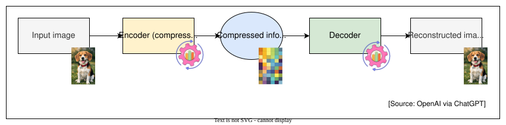

# Understanding_Variational_Autoencoders_for_Generative_AI_Systems

Source: https://www.educative.io/courses/generative-ai-system-design/basics-of-variational-autoencoders-vaes

---

[Home](https://www.educative.io/)

[Courses](https://www.educative.io/search?tab=courses)

[Grokking the Generative AI System Design Interview](https://www.educative.io/courses/generative-ai-system-design)

# Basics of Variational Autoencoders (VAEs)

Explore how Variational Autoencoders (VAEs) enhance classic autoencoders by creating smooth, continuous latent spaces for data compression and generation. Understand the encoder-latent-decoder pipeline, why VAEs use distributions, and how interpolation in latent space allows for creative, realistic output variations.

We'll cover the following...

- [Autoencoder compression and reconstruction](https://www.educative.io/courses/generative-ai-system-design/basics-of-variational-autoencoders-vaes#Autoencoder-compression-and-reconstruction)
- [Autoencoder limitations](https://www.educative.io/courses/generative-ai-system-design/basics-of-variational-autoencoders-vaes#Autoencoder-limitations)
- [VAE latent space as a smooth landscape](https://www.educative.io/courses/generative-ai-system-design/basics-of-variational-autoencoders-vaes#VAE-latent-space-as-a-smooth-landscape)
- [Why VAEs use distributions](https://www.educative.io/courses/generative-ai-system-design/basics-of-variational-autoencoders-vaes#Why-VAEs-use-distributions)
- [Encoder-latent-decoder pipeline](https://www.educative.io/courses/generative-ai-system-design/basics-of-variational-autoencoders-vaes#Encoder-latent-decoder-pipeline)
- [Interpolation in latent space (blending images)](https://www.educative.io/courses/generative-ai-system-design/basics-of-variational-autoencoders-vaes#Interpolation-in-latent-space-blending-images)
- [Conclusion](https://www.educative.io/courses/generative-ai-system-design/basics-of-variational-autoencoders-vaes#Conclusion)

## 

If you’ve ever tried to pack a suitcase for a long trip, you know the challenge: how do you squeeze everything you need into a tiny space, and still find what you want later? That’s the core idea behind autoencoders. They are neural networks designed to compress information into a smaller, more manageable form, then unpack it again as faithfully as possible.

Autoencoders matter because they teach machines to identify the essence of data, what’s truly important, and what can be discarded. This is crucial for tasks such as image compression, denoising, and, as we’ll see, generating new data that appears and feels realistic.

In this lesson, we’ll build upon the classic autoencoder, explore its limitations, and then see how Variational Autoencoders (VAEs) take things to the next level by using a key modification that enables them not only to reconstruct but also to generate new, meaningful data.

### Autoencoder compression and reconstruction[#](https://www.educative.io/courses/generative-ai-system-design/basics-of-variational-autoencoders-vaes#Autoencoder-compression-and-reconstruction)

An autoencoder is primarily a two-part system consisting of an encoder and a decoder. The encoder’s job is to take the input, say, a photo, and squeeze it down into a compact “code” or latent representation. The decoder then tries to unpack this code and reconstruct the original photo as closely as possible.

The encoder compresses an input image, and the decoder uses the compressed information to reconstruct the image

In the illustration above, the encoder transforms the input data into a compressed form, known as the latent space, before expanding it to reconstruct the output. The compressed information forces the network to focus on the most important features, discarding noise and redundancy.

The “**latent space**” is simply a term for the compressed, abstract space where essential information resides. It’s like the suitcase itself: small, but (hopefully) containing everything we need.

This compression-reconstruction cycle is powerful, but it comes with a catch. Let’s dig into that next.

### Autoencoder limitations[#](https://www.educative.io/courses/generative-ai-system-design/basics-of-variational-autoencoders-vaes#Autoencoder-limitations)

Autoencoders are great at learning to copy their inputs. The encoder compresses each input into a short code, and the decoder learns to reconstruct the original from that code. If you train an autoencoder on thousands of handwritten digits, it becomes very good at compressing each digit into a tight spot in the latent space and then decompressing it again.

But here’s the problem: classic autoencoders can easily fall into the trap of *memorization*. They might learn to store each input in its own private corner of the suitcase, with no reason to know how the codes are organized. This means the latent space can become a cluttered attic, full of disorganized items, but with no clear structure or smoothness.

Why does this matter? If we want to generate new data, such as inventing a new kind of digit or blending two faces together, we need a latent space that’s smooth and continuous. We want nearby points in the latent space to correspond to similar outputs, like blending colors on a palette. Classic autoencoders don’t guarantee this. Their latent spaces can be full of gaps, sharp edges, and dead zones where the decoder produces nonsense.

**Educative byte:** For generative models, it’s not enough to just reconstruct. We need a structured, well-behaved latent space. A landscape where every point means something, and moving around produces smooth, meaningful changes in the output.

This is where **Variational Autoencoders (VAEs)** come in, introducing a key change that turns the latent space from a storage room into a creative playground. Let’s see how that works.

With that foundation in place, it’s time to explore how VAEs transform the concept of a compressed code into a vibrant, navigable landscape.

### VAE latent space as a smooth landscape[#](https://www.educative.io/courses/generative-ai-system-design/basics-of-variational-autoencoders-vaes#VAE-latent-space-as-a-smooth-landscape)

Imagine the latent space of a VAE as a vast, rolling landscape, think of a map with hills, valleys, and gentle slopes. Each region on this map represents a different type of data the model has encountered. For example, if you’re working with handwritten digits, one hill might be “4s,” a valley could be “7s,” and the gentle slopes in between are mixtures, digits that blend features of both.

What makes this landscape special is its smoothness. Similar data points (like two different “3s”) cluster together, forming neighborhoods. As we move across the map, the changes are gradual: a “3” slowly morphs into an “8,” not with a jarring leap, but with a smooth transition. This is only possible because VAEs don’t just drop a pin for each input; they color in regions, allowing for exploration and blending.

A VAE latent space showing smooth transitions between clustered data

### Why VAEs use distributions[#](https://www.educative.io/courses/generative-ai-system-design/basics-of-variational-autoencoders-vaes#Why-VAEs-use-distributions)

So, why do VAEs map each input to a distribution instead of a single point? Here’s the intuition: if we only ever mark a dot for each input, we end up with a patchy, disconnected map. There’s no guarantee that moving a little to the left or right lands us somewhere meaningful. That’s a recipe for a model that memorizes, not one that creates.

Mapping of a single input into a distribution of multiple points in the latent space

By assigning each input to a region, a little cloud of possible locations, the VAE encourages overlap and exploration. This randomness isn’t just noise; it’s what gives the model its creative spark. When we sample from these distributions, we’re picking a spot within a colored area, not just revisiting the same old dot.

This approach ensures that points in the latent space that are close to each other produce similar outputs. It’s like coloring in areas on a map instead of just sticking pins: we can wander, blend, and discover new combinations. The result? A model that can generate new, smooth, and realistic data by exploring its own landscape.

Now that we’ve seen why distributions matter, let’s walk through how a VAE actually works, step by step. We’ll follow the journey from input, through the landscape, to output, seeing how each part of the pipeline contributes to the magic.

### Encoder-latent-decoder pipeline[#](https://www.educative.io/courses/generative-ai-system-design/basics-of-variational-autoencoders-vaes#Encoder-latent-decoder-pipeline)

The VAE pipeline consists of three stages: the encoder, the latent space, and the decoder. Here’s how information flows through each step:

1. **Encoder:** The encoder takes the input (say, a picture of a handwritten “2”) and maps it to a region in the latent space. But instead of a single spot, it defines a whole area, a distribution, where this “2” might live. Think of it as drawing a circle on the map, not just a dot.
2. **Latent space (sampling):** Next, the model picks a random point from within the latent space. Each time we run the process, we might land in a slightly different spot, but always within the “2” neighborhood.
3. **Decoder:** The decoder takes this sampled point from the latent space and tries to reconstruct the original input. It’s like standing at a chosen spot on the map and painting what we see. If we’re near the center of the “2” region, we’ll paint a classic “2.” If we’re near the edge, maybe our “2” has a little flair, borrowing a curve from a “3” next door.

**Educative byte:** This encoding, sampling, and decoding process is what gives VAEs their generative power. By sampling from different regions, we can create endless variations, some familiar, some entirely new.

To see this continuity in action, let’s look at how VAEs interpolate in latent space.

### Interpolation in latent space (blending images)[#](https://www.educative.io/courses/generative-ai-system-design/basics-of-variational-autoencoders-vaes#Interpolation-in-latent-space-blending-images)

One of the most impressive tricks in the VAE playbook is *interpolation,*which allows for a smooth transition from one point in the latent space to another. Imagine we have two points: one in the “cat” region, one in the “dog” region. By traveling along the path between them, we can generate images that gradually morph from cat to dog, blending features along the way.

A smooth transition from a pink square to a blue square using blended intermediate colors

Think of the VAE’s latent space as a creative playground. Every point is a potential new creation. By sampling from different regions, we can generate data that’s familiar (like a textbook “7”) or entirely novel (a “7” with a twist).

When we interpolate, move between two points, we’re blending features, creating hybrids. This is how VAEs can invent new faces, digits, or even music, all by exploring their landscape.

**Educative byte:** Interpolation is a great way to test if the VAE has learned a meaningful, continuous latent space. If the transitions are smooth and realistic, the VAE model is on the right track.

To wrap things up, let’s test your understanding of VAEs with a quick quiz.

Test Your Knowledge

1.

What is a key difference between a traditional autoencoder and a Variational Autoencoder (VAE) in terms of how they handle the latent space?

A.

Traditional autoencoders represent latent variables as probability distributions, while VAEs map inputs to fixed points.

B.

Both traditional autoencoders and VAEs encode inputs as fixed points but differ in reconstruction methods.

C.

Traditional autoencoders use probabilistic latent spaces, while VAEs use deterministic compression.

D.

VAEs encode inputs as distributions in latent space, enabling sampling and smooth generation, whereas traditional autoencoders encode to fixed points.

---

1 / 2

### Conclusion[#](https://www.educative.io/courses/generative-ai-system-design/basics-of-variational-autoencoders-vaes#Conclusion)

In conclusion, this lesson shows how moving from classic autoencoders to Variational Autoencoders transforms simple compression into true generative modeling. While traditional autoencoders excel at reconstruction, their unstructured latent spaces limit creativity and exploration. VAEs overcome this limitation by learning smooth, continuous latent spaces through probabilistic encoding, which enables meaningful interpolation, variation, and the generation of new data. By treating the latent space as a navigable landscape rather than a collection of isolated points, VAEs unlock the ability to create realistic and diverse outputs, laying the foundation for many modern generative models.

How LLMs Learn (The Training Loop)

Digital Audio 101 for AI Engineers

Ask

[Autoencoder compression and reconstruction](https://www.educative.io/courses/generative-ai-system-design/basics-of-variational-autoencoders-vaes#Autoencoder-compression-and-reconstruction)

[Autoencoder limitations](https://www.educative.io/courses/generative-ai-system-design/basics-of-variational-autoencoders-vaes#Autoencoder-limitations)

[VAE latent space as a smooth landscape](https://www.educative.io/courses/generative-ai-system-design/basics-of-variational-autoencoders-vaes#VAE-latent-space-as-a-smooth-landscape)

[Why VAEs use distributions](https://www.educative.io/courses/generative-ai-system-design/basics-of-variational-autoencoders-vaes#Why-VAEs-use-distributions)

[Encoder-latent-decoder pipeline](https://www.educative.io/courses/generative-ai-system-design/basics-of-variational-autoencoders-vaes#Encoder-latent-decoder-pipeline)

[Interpolation in latent space (blending images)](https://www.educative.io/courses/generative-ai-system-design/basics-of-variational-autoencoders-vaes#Interpolation-in-latent-space-blending-images)

[Conclusion](https://www.educative.io/courses/generative-ai-system-design/basics-of-variational-autoencoders-vaes#Conclusion)