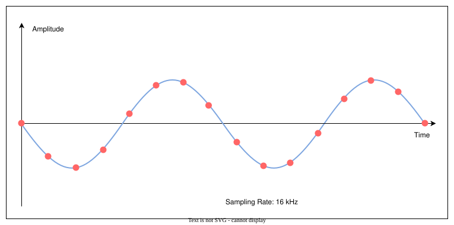

# Digital_Audio_Fundamentals_for_AI_Engineers

Source: https://www.educative.io/courses/generative-ai-system-design/digital-audio-101-for-ai-engineers

---

[Home](https://www.educative.io/)

[Courses](https://www.educative.io/search?tab=courses)

[Grokking the Generative AI System Design Interview](https://www.educative.io/courses/generative-ai-system-design)

# Digital Audio 101 for AI Engineers

Explore the fundamentals of digital audio essential for AI engineers, including how sound is captured through sampling rate and bit depth. Learn about spectrograms and their importance as structured audio representations used in AI models. Understand the processing pipeline from raw audio to spectrograms and neural vocoders, plus the role of phonemes in speech systems. This lesson prepares you to design and reason about audio generation in generative AI systems.

We'll cover the following...

- [Sampling rate](https://www.educative.io/courses/generative-ai-system-design/digital-audio-101-for-ai-engineers#Sampling-rate)
- [Bit depth: Discretizing amplitude](https://www.educative.io/courses/generative-ai-system-design/digital-audio-101-for-ai-engineers#Bit-depth-Discretizing-amplitude)
- [Why raw audio quickly becomes expensive](https://www.educative.io/courses/generative-ai-system-design/digital-audio-101-for-ai-engineers#Why-raw-audio-quickly-becomes-expensive)
- [The spectrogram](https://www.educative.io/courses/generative-ai-system-design/digital-audio-101-for-ai-engineers#The-spectrogram)
  - [Spectrograms for AI models](https://www.educative.io/courses/generative-ai-system-design/digital-audio-101-for-ai-engineers#Spectrograms-for-AI-models)
  - [The learning process](https://www.educative.io/courses/generative-ai-system-design/digital-audio-101-for-ai-engineers#The-learning-process)
  - [Waveform-based models](https://www.educative.io/courses/generative-ai-system-design/digital-audio-101-for-ai-engineers#Waveform-based-models)
- [From spectrograms back to sound](https://www.educative.io/courses/generative-ai-system-design/digital-audio-101-for-ai-engineers#From-spectrograms-back-to-sound)
  - [Spectrogram-to-waveform conversion](https://www.educative.io/courses/generative-ai-system-design/digital-audio-101-for-ai-engineers#Spectrogram-to-waveform-conversion)
  - [Neural vocoders in modern systems](https://www.educative.io/courses/generative-ai-system-design/digital-audio-101-for-ai-engineers#Neural-vocoders-in-modern-systems)
  - [Separating generation from conversion](https://www.educative.io/courses/generative-ai-system-design/digital-audio-101-for-ai-engineers#Separating-generation-from-conversion)
- [Phonemes and neural mapping](https://www.educative.io/courses/generative-ai-system-design/digital-audio-101-for-ai-engineers#Phonemes-and-neural-mapping)
  - [Neural mapping from phonemes to sound](https://www.educative.io/courses/generative-ai-system-design/digital-audio-101-for-ai-engineers#Neural-mapping-from-phonemes-to-sound)
  - [When to use phonemes](https://www.educative.io/courses/generative-ai-system-design/digital-audio-101-for-ai-engineers#When-to-use-phonemes)
- [Conclusion](https://www.educative.io/courses/generative-ai-system-design/digital-audio-101-for-ai-engineers#Conclusion)

Sound in the real world is a continuous physical phenomenon. When someone speaks, or a musical instrument is played, vibrations in the air create pressure waves that vary smoothly over time. These waves have no natural breaks and no fixed resolution. However, computers cannot work with continuous signals. To process sound using digital systems, we must first convert it into a discrete numerical representation.

This conversion process, known as **digital audio representation**, relies on two fundamental concepts: sampling rate and bit depth. Together, they define how accurately a digital system captures sound.

## Sampling rate[#](https://www.educative.io/courses/generative-ai-system-design/digital-audio-101-for-ai-engineers#Sampling-rate)

The **sampling rate** determines how frequently the audio signal is measured over time. It is defined as the number of samples taken per second and is typically expressed in hertz (Hz).

For example, a sampling rate of 16 kHz means that the system records 16,000 amplitude values every second. Each of these values represents the strength of the sound wave at a specific moment in time. By collecting samples at regular intervals, a continuous waveform is approximated as a sequence of discrete points.

A continuous sine wave is overlaid with discrete points, showing how an analog signal is sampled over time

Higher sampling rates capture more detail from the original signal, especially for high-frequency sounds. However, they also produce more data. In practice, different applications use different sampling rates depending on their requirements. Speech-focused systems often use 16 kHz, which is sufficient to capture the frequency range of human speech. Music applications commonly use higher rates, such as 44.1 kHz, to preserve richer audio detail.

This introduces an important trade-off. Increasing the sampling rate improves audio fidelity but also increases storage, bandwidth, and computational cost. For AI systems that process large volumes of audio data, this trade-off directly affects model size and training time.

## Bit depth: Discretizing amplitude[#](https://www.educative.io/courses/generative-ai-system-design/digital-audio-101-for-ai-engineers#Bit-depth-Discretizing-amplitude)

While the sampling rate determines *when* the signal is measured, **bit depth** determines *how precisely* each measurement is stored. Bit depth specifies the number of bits used to represent the amplitude of each audio sample.

For example, a 16-bit audio system can represent 65,536 distinct amplitude levels, while a 24-bit system can represent over 16 million levels. Higher bit depth allows for finer distinctions between quiet and loud sounds, resulting in greater dynamic range and reduced quantization noise.

Side-by-side comparison of a waveform with 3-bit quantization (stepped) vs. 16-bit approximate resolution

As with sampling rate, increasing bit depth improves audio quality but increases data size. Each additional bit doubles the number of possible amplitude values, directly affecting memory usage and processing costs. For many speech and AI applications, 16-bit audio provides a practical balance between quality and efficiency.

## Why raw audio quickly becomes expensive[#](https://www.educative.io/courses/generative-ai-system-design/digital-audio-101-for-ai-engineers#Why-raw-audio-quickly-becomes-expensive)

When sampling rate and bit depth are combined, the data requirements of raw audio become clear. A few seconds of audio can yield hundreds of thousands, or even millions, of numerical values. For example, a 10-second speech clip sampled at 16 kHz contains 160,000 data points. For AI models, especially those trained on large datasets, this creates a significant challenge.

High-resolution raw waveforms contain a large amount of information, much of which is redundant or irrelevant for learning higher-level patterns such as phonemes, words, or musical structure. Processing this data directly makes learning more difficult and computationally expensive.

This is why most audio-based AI systems do not operate directly on raw waveforms. Instead, they transform audio into representations that are more compact and more aligned with how humans perceive sound. One of the most important of these representations is the spectrogram, which we will explore next.

## The spectrogram[#](https://www.educative.io/courses/generative-ai-system-design/digital-audio-101-for-ai-engineers#The-spectrogram)

A time-domain waveform answers a single question: *how strong is the sound at each moment in time?* While this is useful for playback, it hides many of the properties that humans associate with sound, such as pitch and timbre.

Two very different sounds can produce waveforms that look similar at a glance, especially over short time intervals. Extracting meaningful frequency patterns directly from waveforms requires models to learn complex relationships across many samples, which increases training difficulty and computational cost.

Varying amplitude over time in a waveform

Human perception of sound is strongly tied to frequency. Pitch corresponds to the dominant frequency of a signal, while timbre is influenced by the combination of multiple frequencies and their relative strengths. Speech sounds, for example, can be distinguished largely by their frequency patterns rather than by raw amplitude changes.

To make this information explicit, audio signals are commonly transformed from the time domain into the *frequency domain*. This transformation reveals which frequencies are present in a sound and how strongly they contribute to the signal.

A **spectrogram** is a time–frequency representation of sound. It shows how the frequency content of an audio signal evolves over time.

A typical spectrogram has:

- Time on the horizontal axis.
- Frequency on the vertical axis.
- Amplitude or energy represented by color intensity.

Each vertical slice of a spectrogram corresponds to a short segment of audio. For that segment, the signal is decomposed into its constituent frequencies, and the strength of each frequency component is recorded. By stacking these slices over time, the spectrogram forms a two-dimensional representation of sound.

This representation is usually computed using the **Short-Time Fourier Transform (STFT)**. While the underlying mathematics can be complex, the key idea is simple: analyze small chunks of audio independently to track how frequencies change over time.

The spectrogram generation process using STFT

### Spectrograms for AI models[#](https://www.educative.io/courses/generative-ai-system-design/digital-audio-101-for-ai-engineers#Spectrograms-for-AI-models)

Spectrograms convert audio into a structured, image-like format. Local patterns in speech, such as phonemes, appear as distinct shapes and textures. Rhythmic and harmonic structures in music become visually apparent as repeating patterns.

This structure makes spectrograms well-suited for neural networks. Convolutional and transformer-based models can more easily learn meaningful features from spectrograms than from raw waveforms, because relevant information is explicitly organized along time and frequency dimensions.

By making frequency content more visible and compact, spectrograms reduce the burden on the model and improve learning efficiency. This is why spectrogram-based representations are widely used in speech recognition, text-to-speech, and audio generation systems.

The table below summarizes both representations:

|  |  |  |
| --- | --- | --- |
| **Aspect** | **Waveform-Based Representation** | **Spectrogram-Based Representation** |
| **Representation** | Amplitude over time | Frequency content over time |
| **Data Structure** | One-dimensional time series | Two-dimensional, image-like matrix |
| **Frequency Information** | Implicit and spread across many samples | Explicit and localized |
| **Local Patterns** | Hard to identify visually or computationally | Appear as distinct shapes and textures |
| **Learning Difficulty** | Requires learning long-range dependencies | Enables easier local feature learning |
| **Data Efficiency** | Very high temporal resolution, large data size | More compact and information-dense |
| **Model Suitability** | Requires specialized architectures | Well-suited for CNNs and transformers |
| **Common Use Cases** | Low-level audio synthesis, vocoders | Speech recognition, TTS, audio generation |

### The learning process[#](https://www.educative.io/courses/generative-ai-system-design/digital-audio-101-for-ai-engineers#The-learning-process)

From a model’s perspective, spectrograms are easier to learn from because they exhibit clear, structured patterns. Speech sounds form consistent shapes corresponding to phonemes. Musical notes appear as horizontal bands at specific frequencies. Transitions between sounds become smooth and predictable.

This structure allows models to focus on higher-level patterns rather than spending capacity on extracting basic frequency information. As a result, models trained to predict spectrograms often converge faster and generalize better than models trained directly on waveforms.

In generative systems, this leads to a common design pattern: the model first predicts a spectrogram, and a separate component converts that spectrogram into audible sound. This separation simplifies training and improves output quality.

### Waveform-based models[#](https://www.educative.io/courses/generative-ai-system-design/digital-audio-101-for-ai-engineers#Waveform-based-models)

Although spectrograms are the dominant representation, waveform-based models do exist. Some neural vocoders and end-to-end audio generators operate directly on raw audio to achieve high-fidelity results. However, these models typically appear later in the pipeline and are optimized specifically for waveform synthesis.

In System Design terms, spectrograms serve as a practical intermediate representation. They balance fidelity, efficiency, and learnability, making them a natural choice for most audio-focused AI systems.

In the next section, we will briefly examine how predicted spectrograms are converted back into audio waveforms and where neural vocoders fit into this process.

## From spectrograms back to sound[#](https://www.educative.io/courses/generative-ai-system-design/digital-audio-101-for-ai-engineers#From-spectrograms-back-to-sound)

While spectrograms are well-suited for learning and prediction, they are not directly audible. To produce sound that humans can hear, a predicted spectrogram must be converted back into a time-domain waveform. This step is an essential part of most audio generation pipelines, particularly in text-to-speech and music generation systems.

The component responsible for this conversion is commonly called a **vocoder**.

### Spectrogram-to-waveform conversion[#](https://www.educative.io/courses/generative-ai-system-design/digital-audio-101-for-ai-engineers#Spectrogram-to-waveform-conversion)

A spectrogram shows how energy is distributed across frequencies over time, but it does not explicitly encode the phase information needed to perfectly reconstruct the original waveform. As a result, converting a spectrogram back into audio is a non-trivial problem.

Early approaches relied on classical signal processing techniques, such as the Griffin–Lim algorithm, which iteratively estimates phase information to reconstruct a waveform. While effective, these methods often produce artifacts and lower-quality audio.

Spectrogram-to-waveform conversion via Griffin–Lim and neural vocoders

Modern systems increasingly rely on *neural vocoders*, which learn to map spectrograms directly to waveforms. These models are trained on paired data consisting of spectrograms and corresponding audio signals, allowing them to generate realistic waveforms that closely match the intended sound.

### Neural vocoders in modern systems[#](https://www.educative.io/courses/generative-ai-system-design/digital-audio-101-for-ai-engineers#Neural-vocoders-in-modern-systems)

Neural vocoders are specialized neural networks designed specifically for waveform synthesis. Examples include WaveNet, HiFi-GAN, and similar architectures. Unlike general-purpose language models, vocoders focus on generating high-frequency, fine-grained audio details.

In System Design, this separation of responsibilities is intentional. One model focuses on generating a meaningful, structured representation of sound (the spectrogram), while another model specializes in converting that representation into high-quality audio. This modular approach simplifies training and allows each component to be optimized independently.

### Separating generation from conversion[#](https://www.educative.io/courses/generative-ai-system-design/digital-audio-101-for-ai-engineers#Separating-generation-from-conversion)

Separating spectrogram prediction from waveform generation provides several benefits. It reduces the complexity of the main generative model, improves training stability, and allows different vocoders to be swapped in without retraining the entire system. This is particularly useful in production systems, where audio quality, latency, and compute cost must be carefully balanced.

By treating audio generation as a two-stage process, AI systems can achieve both efficiency and high perceptual quality.

In the next section, we will briefly discuss an intermediate representation used in many speech systems: phonemes and their role in neural audio pipelines.

## Phonemes and neural mapping[#](https://www.educative.io/courses/generative-ai-system-design/digital-audio-101-for-ai-engineers#Phonemes-and-neural-mapping)

**Phonemes** are the smallest units of sound that distinguish meaning in a spoken language. For example, the words *“bat”* and *“pat”* differ by a single phoneme, even though the written characters differ by only one letter.

Text alone is an imperfect guide to pronunciation. The same letters can produce different sounds depending on context, language, or accent. By converting text into phonemes, systems can represent pronunciation more explicitly and consistently.

This conversion step is commonly handled by a grapheme-to-phoneme (G2P) model or rule-based phoneme converter.

### Neural mapping from phonemes to sound[#](https://www.educative.io/courses/generative-ai-system-design/digital-audio-101-for-ai-engineers#Neural-mapping-from-phonemes-to-sound)

Once text has been converted into phonemes, a neural model can map these phoneme sequences to acoustic representations, typically spectrograms. This model learns how phonemes unfold over time and how they are expressed acoustically, capturing properties such as stress, intonation, and duration.

Separating linguistic processing from acoustic generation has important System Design benefits. The model responsible for phoneme-to-spectrogram mapping can focus entirely on sound structure, while language-specific complexity is handled earlier in the pipeline. This separation improves generalization and makes it easier to adapt systems across languages or voices.

Using phonemes to generate audio

### When to use phonemes[#](https://www.educative.io/courses/generative-ai-system-design/digital-audio-101-for-ai-engineers#When-to-use-phonemes)

Phoneme-based pipelines are common in high-quality text-to-speech systems, where pronunciation accuracy and natural prosody are critical. However, not all audio models use phonemes. Some end-to-end systems learn to map text directly to spectrograms or waveforms, trading explicit linguistic structure for architectural simplicity.

From a System Design perspective, phonemes represent a useful abstraction rather than a requirement. Whether they are included depends on the application, the quality requirements, and the complexity the system is willing to manage.

## Conclusion[#](https://www.educative.io/courses/generative-ai-system-design/digital-audio-101-for-ai-engineers#Conclusion)

Digital audio must be transformed before it becomes suitable for machine learning. Sampling rate and bit depth define how sound is captured, while spectrograms provide a compact, structured representation that aligns with human perception. By predicting spectrograms instead of raw waveforms, AI models reduce data complexity and improve learning efficiency.

Additional abstractions, such as phonemes, further separate linguistic structure from acoustic realization, enabling modular and scalable system designs. Understanding these representations is essential for building and reasoning about modern speech and audio generation systems.

Basics of Variational Autoencoders (VAEs)

The CLIP Encoder and Multimodal Bridges

Ask

[Sampling rate](https://www.educative.io/courses/generative-ai-system-design/digital-audio-101-for-ai-engineers#Sampling-rate)

[Bit depth: Discretizing amplitude](https://www.educative.io/courses/generative-ai-system-design/digital-audio-101-for-ai-engineers#Bit-depth-Discretizing-amplitude)

[Why raw audio quickly becomes expensive](https://www.educative.io/courses/generative-ai-system-design/digital-audio-101-for-ai-engineers#Why-raw-audio-quickly-becomes-expensive)

[The spectrogram](https://www.educative.io/courses/generative-ai-system-design/digital-audio-101-for-ai-engineers#The-spectrogram)

[Spectrograms for AI models](https://www.educative.io/courses/generative-ai-system-design/digital-audio-101-for-ai-engineers#Spectrograms-for-AI-models)

[The learning process](https://www.educative.io/courses/generative-ai-system-design/digital-audio-101-for-ai-engineers#The-learning-process)

[Waveform-based models](https://www.educative.io/courses/generative-ai-system-design/digital-audio-101-for-ai-engineers#Waveform-based-models)

[From spectrograms back to sound](https://www.educative.io/courses/generative-ai-system-design/digital-audio-101-for-ai-engineers#From-spectrograms-back-to-sound)

[Spectrogram-to-waveform conversion](https://www.educative.io/courses/generative-ai-system-design/digital-audio-101-for-ai-engineers#Spectrogram-to-waveform-conversion)

[Neural vocoders in modern systems](https://www.educative.io/courses/generative-ai-system-design/digital-audio-101-for-ai-engineers#Neural-vocoders-in-modern-systems)

[Separating generation from conversion](https://www.educative.io/courses/generative-ai-system-design/digital-audio-101-for-ai-engineers#Separating-generation-from-conversion)

[Phonemes and neural mapping](https://www.educative.io/courses/generative-ai-system-design/digital-audio-101-for-ai-engineers#Phonemes-and-neural-mapping)

[Neural mapping from phonemes to sound](https://www.educative.io/courses/generative-ai-system-design/digital-audio-101-for-ai-engineers#Neural-mapping-from-phonemes-to-sound)

[When to use phonemes](https://www.educative.io/courses/generative-ai-system-design/digital-audio-101-for-ai-engineers#When-to-use-phonemes)

[Conclusion](https://www.educative.io/courses/generative-ai-system-design/digital-audio-101-for-ai-engineers#Conclusion)