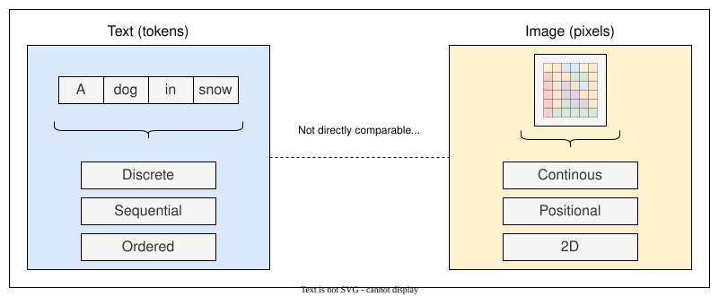

# Understanding_the_CLIP_Encoder_and_Multimodal_Embedding_Bridges

Source: https://www.educative.io/courses/generative-ai-system-design/the-clip-encoder-and-multimodal-bridges

---

[Home](https://www.educative.io/)

[Courses](https://www.educative.io/search?tab=courses)

[Grokking the Generative AI System Design Interview](https://www.educative.io/courses/generative-ai-system-design)

# The CLIP Encoder and Multimodal Bridges

Learn how the CLIP model connects text and image modalities by encoding them into a shared vector embedding space. Understand the architecture of its separate text and image encoders, the training process aligning embeddings semantically, and how this enables zero-shot learning for diverse tasks including classification and retrieval.

We'll cover the following...

- [Multimodal learning](https://www.educative.io/courses/generative-ai-system-design/the-clip-encoder-and-multimodal-bridges#Multimodal-learning)
- [The need for a common representation](https://www.educative.io/courses/generative-ai-system-design/the-clip-encoder-and-multimodal-bridges#The-need-for-a-common-representation)
- [Joint embedding space](https://www.educative.io/courses/generative-ai-system-design/the-clip-encoder-and-multimodal-bridges#Joint-embedding-space)
  - [What the joint space looks like](https://www.educative.io/courses/generative-ai-system-design/the-clip-encoder-and-multimodal-bridges#What-the-joint-space-looks-like)
- [Matching vectors](https://www.educative.io/courses/generative-ai-system-design/the-clip-encoder-and-multimodal-bridges#Matching-vectors)
- [Zero-shot capabilities](https://www.educative.io/courses/generative-ai-system-design/the-clip-encoder-and-multimodal-bridges#Zero-shot-capabilities)
  - [Why this works](https://www.educative.io/courses/generative-ai-system-design/the-clip-encoder-and-multimodal-bridges#Why-this-works)
- [Conclusion](https://www.educative.io/courses/generative-ai-system-design/the-clip-encoder-and-multimodal-bridges#Conclusion)

Modern GenAI systems increasingly work with more than one type of data. Text, images, audio, and video all carry information in different forms, yet many real-world tasks require models to reason across these modalities. For example, a system might need to determine whether an image matches a caption, retrieve images based on a text query, or decide whether an image violates a content policy described in words.

To make this possible, models need a way to *connect different modalities at the semantic level*. One of the most influential approaches to doing this is CLIP (Contrastive Language–Image Pretraining). Rather than merging text and images directly, CLIP learns how to represent both in a shared space where they can be meaningfully compared.

Let’s learn how that bridge is built.

## Multimodal learning[#](https://www.educative.io/courses/generative-ai-system-design/the-clip-encoder-and-multimodal-bridges#Multimodal-learning)

Text and images are fundamentally different kinds of data. Text is discrete and sequential, composed of tokens arranged in a specific order. Images, on the other hand, are continuous and spatial, represented as grids of pixel values. Because of these differences, the techniques used to process text and images are usually very different as well.

Text is processed as ordered tokens, while images are processed as spatial pixel grids, making them not directly comparable

A language model processes sequences of tokens and learns relationships between words, phrases, and sentences. A vision model processes pixels and learns visual patterns such as edges, textures, objects, and scenes. These representations are not directly compatible. A sentence and an image cannot be compared in their raw forms.

This creates a core challenge for multimodal learning: “*how can a model tell that a piece of text and an image refer to the same concept?”*

## The need for a common representation[#](https://www.educative.io/courses/generative-ai-system-design/the-clip-encoder-and-multimodal-bridges#The-need-for-a-common-representation)

To compare text and images, both must first be transformed into a format that supports comparison. In practice, this format is a vector embedding, which is a fixed-length numerical representation that captures semantic meaning.

The key idea behind CLIP-style models is simple but powerful: instead of directly merging text and image data, each modality is encoded separately into a vector, which is then placed in the same (shared) embedding space.

In this shared space:

- Text descriptions and images that describe the same concept are close together.
- Unrelated text and images are far apart.

Once both modalities live in the same space, matching becomes a geometric problem rather than a symbolic one. CLIP uses *two separate encoders*, one for text and one for images. Each encoder is specialized for its input modality and produces a vector embedding as output.

Text and images are encoded separately into vectors and compared in a shared embedding space

The text encoder takes tokenized text as input and processes it using a transformer-based architecture. Its output is a single vector that represents the semantic meaning of the entire text prompt, not individual words.

The image encoder takes image pixels as input and processes them using a vision model, such as a convolutional neural network (CNN) or a Vision Transformer (ViT). Its output is a single vector that captures the image’s semantic content.

Although the encoders are different internally, they are designed so that their outputs have the same dimensionality. This allows both text and image embeddings to exist in the same vector space.

Importantly, the encoders do not interact directly. They are only connected through the training objective, which encourages their outputs to align semantically.

## Joint embedding space[#](https://www.educative.io/courses/generative-ai-system-design/the-clip-encoder-and-multimodal-bridges#Joint-embedding-space)

The central idea behind CLIP is the **joint embedding space**. This is a vector space in which both text and images are represented as numerical vectors of the same size. What makes this space useful is its structure through training, rather than its dimensionality.

To understand this, consider the following image–text pair from the training data:

- **Image:** A photograph of a dog playing in the snow.
- **Text:** “A dog in the snow.”

During training, the image is passed through the image encoder, producing an image embedding. The text is passed through the text encoder, producing a text embedding. At this point, the model does not yet know whether these two embeddings should be close or far apart.

During training, matching image–text pairs are pulled closer in the joint embedding space, while mismatched pairs are pushed farther apart

The training objective tells the model that this image and this text belong together. As a result, the model adjusts both encoders so that:

- The image embedding moves closer to the text embedding, or
- The text embedding moves closer to the image embedding.

At the same time, the model is shown many *non-matching* examples. For instance:

- The same image paired with “A cat sleeping on a couch,” or

- The same text paired with an image of a snowy mountain with no dog.

For these mismatched pairs, the training objective pushes the corresponding embeddings farther apart. Over time, this process shapes the embedding space so that semantic similarity corresponds to *geometric proximity*.

### What the joint space looks like[#](https://www.educative.io/courses/generative-ai-system-design/the-clip-encoder-and-multimodal-bridges#What-the-joint-space-looks-like)

After training, the joint embedding space develops structure. Images and text describing similar concepts cluster together, even when they come from different modalities.

The joint embedding space contains vectorized representations of both text and images

For example:

- Images of dogs, sketches of dogs, and the text “a dog” all occupy nearby regions.
- Text like “a red sports car” ends up close to images of red cars, even if that exact pairing was never seen during training.
- Unrelated concepts, such as “a bowl of soup” and images of airplanes, end up far apart.

The model does not store explicit labels such as “*dog”* or “*car*.” Instead, these concepts emerge as regions in the embedding space shaped by large-scale alignment.

## Matching vectors[#](https://www.educative.io/courses/generative-ai-system-design/the-clip-encoder-and-multimodal-bridges#Matching-vectors)

Once text and images live in the same embedding space, matching becomes straightforward. The system computes a **similarity score** between vectors, most commonly using *cosine similarity*.

To see how this works in practice, consider a simple scenario. Suppose we have:

- One image embedding (an image of a dog in snow)
- Three text captions:

  - “A dog playing in the snow.”
  - “A cat sitting indoors.”
  - “A red sports car.”

Assume the image encoder produces the following embedding for an image of a dog playing in the snow:

Ace Editor

1

Image embedding = [0.8, 0.6]

הההההההההההההההההההההההההההההההההההההההההההההההההההההההההההההההההההההההההההההההההההההההההההההההההההההההההההההההההההההההההההההההההההההההההההההההההההההההההההההההההההההההההההההההההההההההההההההההההההההההההההההההההההההההההההההההההההההההההההההההההההההההההההההההההההההההההההההההההההההההההההההההההההההההההההההההההההההההההההההההההההההההההההההההההההההההההההההההההההההההההההההההההההההההההההההההההההההההההההההההההההההההההההההההההההההההההההההההההההההההההההההההההההההההההההההההההההההההההההההההההההההההההההההההההההההההההההההההה

XXXXXXXXXXXXXXXXXXXXXXXXXXXXXXXXXXXXXXXXXXXXXXXXXXXXXXXXXXXXXXXXXXXXXXXXXXXXXXXXXXXXXXXXXXXXXXXXXXXXXXXXXXXXXXXXXXXXXXXXXXXXXXXXXXXXXXXXXXXXXXXXXXXXXXXXXXXXXXXXXXXXXXXXXXXXXXXXXXXXXXXXXXXXXXXXXXXXXXXXXXXXXXXXXXXXXXXXXXXXXXXXXXXXXXXXXXXXXXXXXXXXXXXXXXXXXXXXXXXXXXXXXXXXXXXXXXXXXXXXXXXXXXXXXXXXXXXXXXXXXXXXXXXXXXXXXXXXXXXXXXXXXXXXXXXXXXXXXXXXXXXXXXXXXXXXXXXXXXXXXXXXXXXXXXXXXXXXXXXXXXXXXXXXXXXXXXXXXXXXXXXXXXXXXXXXXXXXXXXXXXXXXXXXXXXXXXXXXXXXXXXXXXXXXXXXXXXXXXXXXXXXXXXXXXXXXXXXXXXXXXXXXXXXXXXXXXXXXXXXXXXXXXXXXXXX

Now consider three text embeddings produced by the text encoder:

Ace Editor

1

2

3

"A dog playing in the snow" = [0.82, 0.58]

"A cat sitting indoors" = [0.2, 0.9]

"A red sports car" = [-0.6, 0.1]

הההההההההההההההההההההההההההההההההההההההההההההההההההההההההההההההההההההההההההההההההההההההההההההההההההההההההההההההההההההההההההההההההההההההההההההההההההההההההההההההההההההההההההההההההההההההההההההההההההההההההההההההההההההההההההההההההההההההההההההההההההההההההההההההההההההההההההההההההההההההההההההההההההההההההההההההההההההההההההההההההההההההההההההההההההההההההההההההההההההההההההההההההההההההההההההההההההההההההההההההההההההההההההההההההההההההההההההההההההההההההההההההההההההההההההההההההההההההההההההההההההההההההההההההההההההההההההההההה

XXXXXXXXXXXXXXXXXXXXXXXXXXXXXXXXXXXXXXXXXXXXXXXXXXXXXXXXXXXXXXXXXXXXXXXXXXXXXXXXXXXXXXXXXXXXXXXXXXXXXXXXXXXXXXXXXXXXXXXXXXXXXXXXXXXXXXXXXXXXXXXXXXXXXXXXXXXXXXXXXXXXXXXXXXXXXXXXXXXXXXXXXXXXXXXXXXXXXXXXXXXXXXXXXXXXXXXXXXXXXXXXXXXXXXXXXXXXXXXXXXXXXXXXXXXXXXXXXXXXXXXXXXXXXXXXXXXXXXXXXXXXXXXXXXXXXXXXXXXXXXXXXXXXXXXXXXXXXXXXXXXXXXXXXXXXXXXXXXXXXXXXXXXXXXXXXXXXXXXXXXXXXXXXXXXXXXXXXXXXXXXXXXXXXXXXXXXXXXXXXXXXXXXXXXXXXXXXXXXXXXXXXXXXXXXXXXXXXXXXXXXXXXXXXXXXXXXXXXXXXXXXXXXXXXXXXXXXXXXXXXXXXXXXXXXXXXXXXXXXXXXXXXXXXXXX

Cosine similarity measures how closely two vectors point in the same direction. Assuming the two vectors are called AAA and BBB, cosine similarity is defined as:

Cosine similarity(A,B)=A⋅B∥A∥  ∥B∥\text{Cosine similarity}(A, B) = \frac{A \cdot B}{\|A\| \; \|B\|}Cosine similarity(A,B)=∥A∥∥B∥A⋅B​

Where:

- A⋅BA \cdot BA⋅Bis the dot product of the two vectors.
- ∥A∥\|A\| ∥A∥and ∥B∥\|B\|∥B∥are their magnitudes.

This formula measures the angle between two vectors, not their absolute size.

- A value close to 1 means the vectors point in the same direction (high semantic similarity).
- A value close to 0 means the vectors are largely unrelated.
- A negative value means the vectors point in opposite directions.

When we calculate the cosine similarities in the above example, we get:

|  |  |  |
| --- | --- | --- |
| **Text Caption** | **Cosine Similarity** | **Interpretation** |
| A dog playing in the snow | 0.9996 | Very strong match |
| A cat sitting indoors | 0.76 | Weak/partial match |
| A red sports car | -0.69 | No match |

This same comparison is repeated at scale across thousands or millions of image–text pairs, enabling retrieval, ranking, and zero-shot classification using a single unified mechanism.

This same mechanism works in reverse. Given a text query, the system can retrieve the most relevant images by ranking image embeddings based on their similarity to the query.

## Zero-shot capabilities[#](https://www.educative.io/courses/generative-ai-system-design/the-clip-encoder-and-multimodal-bridges#Zero-shot-capabilities)

One of the most powerful consequences of this setup is zero-shot learning. The model can perform tasks it was never explicitly trained for, simply by relying on similarity in the joint embedding space.

Assume we want to classify an image, but we have no task-specific classifier. Instead, we define class labels as text:

- “a photo of a dog”
- “a photo of a cat”
- “a photo of a car”

Each label is passed through the text encoder to produce a text embedding. The image is passed through the image encoder to produce an image embedding. The image is then assigned the label whose text embedding is most similar to the image embedding.

Zero-shot classification using CLIP

No retraining is required. Adding a new class is as simple as adding a new text description.

### Why this works[#](https://www.educative.io/courses/generative-ai-system-design/the-clip-encoder-and-multimodal-bridges#Why-this-works)

This works because CLIP does not learn *tasks*. It learns *relationships between modalities*. Classification, retrieval, filtering, and moderation all reduce to the same operation: comparing vectors in a shared space.

This is why CLIP-style models are widely used as foundational components in multimodal systems. They provide a flexible semantic bridge between text and images without requiring task-specific supervision.

## Conclusion[#](https://www.educative.io/courses/generative-ai-system-design/the-clip-encoder-and-multimodal-bridges#Conclusion)

CLIP connects text and images by encoding each into vectors and placing them in a shared embedding space. During training, matching image–text pairs are pulled closer together, while unrelated pairs are pushed apart. At inference time, matching reduces to computing cosine similarity between vectors.

This alignment enables zero-shot capabilities: images can be classified, retrieved, or filtered using only text descriptions, without task-specific training. By learning relationships rather than tasks, CLIP serves as a general-purpose bridge between language and vision.

Digital Audio 101 for AI Engineers

The Diffusion Loop (How GenAI Creates Content)

Ask

[Multimodal learning](https://www.educative.io/courses/generative-ai-system-design/the-clip-encoder-and-multimodal-bridges#Multimodal-learning)

[The need for a common representation](https://www.educative.io/courses/generative-ai-system-design/the-clip-encoder-and-multimodal-bridges#The-need-for-a-common-representation)

[Joint embedding space](https://www.educative.io/courses/generative-ai-system-design/the-clip-encoder-and-multimodal-bridges#Joint-embedding-space)

[What the joint space looks like](https://www.educative.io/courses/generative-ai-system-design/the-clip-encoder-and-multimodal-bridges#What-the-joint-space-looks-like)

[Matching vectors](https://www.educative.io/courses/generative-ai-system-design/the-clip-encoder-and-multimodal-bridges#Matching-vectors)

[Zero-shot capabilities](https://www.educative.io/courses/generative-ai-system-design/the-clip-encoder-and-multimodal-bridges#Zero-shot-capabilities)

[Why this works](https://www.educative.io/courses/generative-ai-system-design/the-clip-encoder-and-multimodal-bridges#Why-this-works)

[Conclusion](https://www.educative.io/courses/generative-ai-system-design/the-clip-encoder-and-multimodal-bridges#Conclusion)