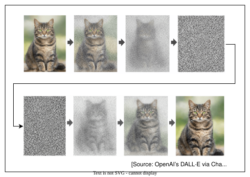
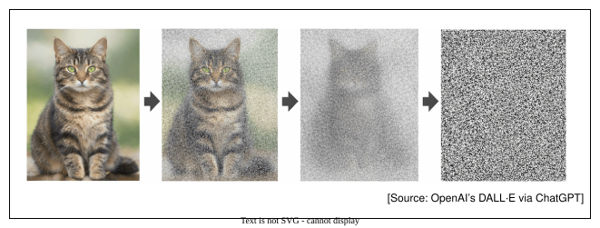

# How_Diffusion_Models_Generate_Realistic_Content_in_Generative_AI

Source: https://www.educative.io/courses/generative-ai-system-design/the-diffusion-loop-how-genai-creates-content

---

[Home](https://www.educative.io/)

[Courses](https://www.educative.io/search?tab=courses)

[Grokking the Generative AI System Design Interview](https://www.educative.io/courses/generative-ai-system-design)

# The Diffusion Loop (How GenAI Creates Content)

Explore how diffusion models create content by gradually reversing noise through iterative denoising steps. Learn why these models start with noise and how they reveal detailed, realistic images over time. This lesson helps you grasp the diffusion loop concept and its advantages over other generative methods.

We'll cover the following...

- [What are diffusion models?](https://www.educative.io/courses/generative-ai-system-design/the-diffusion-loop-how-genai-creates-content#What-are-diffusion-models)
  - [Working of the diffusion models](https://www.educative.io/courses/generative-ai-system-design/the-diffusion-loop-how-genai-creates-content#Working-of-the-diffusion-models)
  - [Why start with noise?](https://www.educative.io/courses/generative-ai-system-design/the-diffusion-loop-how-genai-creates-content#Why-start-with-noise)
- [The diffusion process](https://www.educative.io/courses/generative-ai-system-design/the-diffusion-loop-how-genai-creates-content#The-diffusion-process)
  - [The image generation process](https://www.educative.io/courses/generative-ai-system-design/the-diffusion-loop-how-genai-creates-content#The-image-generation-process)
- [Popular image diffusion models](https://www.educative.io/courses/generative-ai-system-design/the-diffusion-loop-how-genai-creates-content#Popular-image-diffusion-models)
  - [Conclusion](https://www.educative.io/courses/generative-ai-system-design/the-diffusion-loop-how-genai-creates-content#Conclusion)

## What are diffusion models?[#](https://www.educative.io/courses/generative-ai-system-design/the-diffusion-loop-how-genai-creates-content#What-are-diffusion-models)

If you’ve ever wondered how AI can create realistic images from nothing (noise), you’re not alone. The core idea behind many of today’s most impressive generative systems is a concept known as **diffusion models.** These models have taken the AI world by storm, powering everything from art generators to video upscalers. But what’s actually happening under the hood?

At its core, diffusion is about two things: adding noise to data (think: making an image fuzzier and fuzzier) and then learning how to reverse that process, step by step, to recover the original content. It’s a bit like learning to unscramble an egg, except, in this case, the AI gets really good at putting the pieces back together.

The diffusion process: adding noise to data and then learning how to reverse the process

This lesson uses visuals and analogies to explain how diffusion models create content. By the end, we’ll have a complete picture of how diffusion models work, why they start with noise, and what makes them so powerful (and different) compared to other generative AI approaches.

### Working of the diffusion models[#](https://www.educative.io/courses/generative-ai-system-design/the-diffusion-loop-how-genai-creates-content#Working-of-the-diffusion-models)

Imagine starting with a crisp, clear image, such as a cat, a landscape, or any other subject. Now, picture adding a little bit of static noise to it, like tuning an old TV. Add more noise, and the image gets blurrier. Keep going, and eventually, we’re left with pure, random noise, no trace of the original picture. This process is shown in the following illustration.

The forward process of the diffusion model: adding noise to the image

Here’s where the key process happens: diffusion models learn how to reverse this process. They take that noisy mess and, step by step, “denoise” it, gradually revealing the underlying structure until a new, coherent image emerges. Each step is like wiping away a thin layer of fog, revealing more detail, as shown below.

The reverse process of the diffusion model: the generation of an image from noise

**Note:** During generation, diffusion models do not recreate a specific input image. Instead, they start from pure noise and generate a new image that follows the patterns learned from the training data, producing results that are different yet still realistic and relevant.

This stepwise transformation is what distinguishes diffusion models. Instead of generating an image all at once, they build it up gradually, allowing for fine control and often stunning realism.

### Why start with noise?[#](https://www.educative.io/courses/generative-ai-system-design/the-diffusion-loop-how-genai-creates-content#Why-start-with-noise)

So why is noise so important? Why don’t models just generate images directly, pixel by pixel? This is where a simple analogy makes the idea click.

Think of a sculptor starting with a rough block of marble. The final statue is hidden inside, but the sculptor must carefully chip away at the excess, bit by bit, to reveal the form within. In diffusion models, the “block” is pure noise, and the model learns to “sculpt” meaningful content by removing noise in small, deliberate steps. Alternatively, imagine we’re handed a blurry, static-filled photo and asked to restore it. We’d start by identifying vague shapes, then gradually refine the details, unblurring as we go. That’s exactly what the diffusion model does: it learns to spot structure in chaos and reconstructs it, one step at a time.

**Educative byte:** The purpose of adding noise during training is to teach the model how to reverse the process. By practicing on many examples, it gets better at “seeing through” the noise and reconstructing the original data.

The real trick is that the model doesn’t just memorize how to denoise one image; it learns the general rules of how structure emerges from randomness. That’s why, when we give it pure noise at generation time, it can invent entirely new content that still looks realistic. This stepwise denoising is the heart of the diffusion loop. Each iteration brings the model closer to a coherent output, discovering structure and meaning as it goes. And because the process is gradual, the model can generate images (or other data) with remarkable detail and diversity.

We’ve seen why noise serves as the creative starting point for diffusion models. Now, let’s step back and view the full process as a loop, where noise is added and removed in a smooth, step-by-step cycle.

## The diffusion process[#](https://www.educative.io/courses/generative-ai-system-design/the-diffusion-loop-how-genai-creates-content#The-diffusion-process)

Think of the diffusion process as a loop with two main phases: first, we gradually add noise to an image (the forward process), and then, step by step, we train the model to reverse that process (the backward or reverse process). This isn’t a one-and-done operation; it’s an iterative cycle, where each step builds on the last.

The following diagram captures the essence of diffusion, illustrating both the forward and reverse diffusion processes.

Stepwise noise addition and removal in the diffusion loop

The transformation from noise to content isn’t instantaneous. Each intermediate step matters. The visuals reinforce that diffusion models don’t create a finished image in a single leap; they reveal it gradually, step by step.

This looping, stepwise approach is what sets diffusion apart from other generative models. Let’s break down exactly how this loop works, one step at a time.

### The image generation process[#](https://www.educative.io/courses/generative-ai-system-design/the-diffusion-loop-how-genai-creates-content#The-image-generation-process)

During the image generation process, the magic begins when the model takes the noisy input and tries to predict what a slightly less noisy version should look like. At each step, the model “cleans up” a little bit of noise, nudging the image closer to something recognizable. This isn’t guesswork; during training, the model has learned to recognize real images at every stage of noise. So, it knows how to reverse the mess, one layer at a time.

Consider the process as a loop:

- **Start:** Pure noise.
- **Step 1:** The model predicts and removes a small amount of noise, revealing faint hints of structure.
- **Step 2:** It repeats, using the new, slightly clearer image as input.
- **Step 3+:** Each loop brings more detail, sharper edges, and richer color.
- **Finish:** After many steps, the noise is gone, and a crisp, realistic image emerges.

**Note:** This stepwise reveal is what gives diffusion models their edge over older approaches, such as GANs. Instead of relying on a perfect guess, diffusion models iterate and refine, resulting in more stable and controllable outcomes.

## Popular image diffusion models[#](https://www.educative.io/courses/generative-ai-system-design/the-diffusion-loop-how-genai-creates-content#Popular-image-diffusion-models)

Several modern image-generation systems are built on diffusion models, each with its own strengths and focus. Some of the most commonly used image diffusion models include:

- **DALL·E 2/DALL·E 3:** These are the diffusion-based models known for strong text understanding and coherent, creative image generation.
- **DDPM (Denoising Diffusion Probabilistic Models):** It is a foundational diffusion model that introduced the core idea of gradually adding and removing noise during training and generation.
- **Stable Diffusion:** It is a widely used latent diffusion model that enables efficient and high-quality text-to-image generation.
- **Imagen:** It’s Google’s diffusion model, recognized for its high level of photorealism and image quality.

Let’s see how well we’ve internalized the diffusion loop with a quick quiz.

Test Your Knowledge

1.

What is the core idea behind diffusion models in generative AI?

A.

They generate content by directly mapping random noise to images without intermediate steps

B.

They use reinforcement learning to optimize image generation

C.

They cluster similar images to generate new content

D.

They gradually add noise to data and then learn to reverse this process to create content from noise

---

1 / 3

### Conclusion[#](https://www.educative.io/courses/generative-ai-system-design/the-diffusion-loop-how-genai-creates-content#Conclusion)

In this lesson, we developed an intuitive, visual understanding of how diffusion models transform random patterns into meaningful ones. By starting with noise and learning to reverse it step by step, diffusion models generate content and reveal it, gradually uncovering structure, detail, and coherence through an iterative loop. This slow, deliberate denoising process is what gives diffusion models their stability, flexibility, and remarkable realism, setting them apart from earlier generative approaches. With the mental images of unblurring photos, sculpting marble, and solving puzzles, we can now clearly picture how diffusion works under the hood: a rhythmic journey from chaos to creativity, where noise isn’t a limitation, but the very foundation of generative power.

The CLIP Encoder and Multimodal Bridges

How Vision-Language Models (VLMs) Work

Ask

[What are diffusion models?](https://www.educative.io/courses/generative-ai-system-design/the-diffusion-loop-how-genai-creates-content#What-are-diffusion-models)

[Working of the diffusion models](https://www.educative.io/courses/generative-ai-system-design/the-diffusion-loop-how-genai-creates-content#Working-of-the-diffusion-models)

[Why start with noise?](https://www.educative.io/courses/generative-ai-system-design/the-diffusion-loop-how-genai-creates-content#Why-start-with-noise)

[The diffusion process](https://www.educative.io/courses/generative-ai-system-design/the-diffusion-loop-how-genai-creates-content#The-diffusion-process)

[The image generation process](https://www.educative.io/courses/generative-ai-system-design/the-diffusion-loop-how-genai-creates-content#The-image-generation-process)

[Popular image diffusion models](https://www.educative.io/courses/generative-ai-system-design/the-diffusion-loop-how-genai-creates-content#Popular-image-diffusion-models)

[Conclusion](https://www.educative.io/courses/generative-ai-system-design/the-diffusion-loop-how-genai-creates-content#Conclusion)