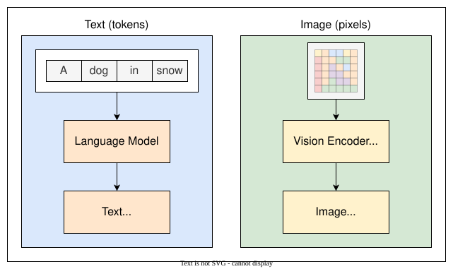
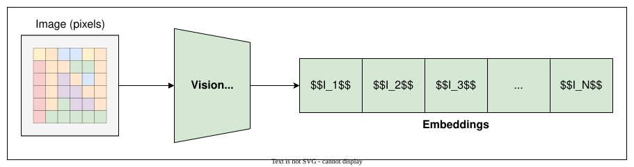

# How_Vision-Language_Models_Combine_Images_and_Text_for_Multimodal_AI

Source: https://www.educative.io/courses/generative-ai-system-design/how-vision-language-models-vlms-work

---

[Home](https://www.educative.io/)

[Courses](https://www.educative.io/search?tab=courses)

[Grokking the Generative AI System Design Interview](https://www.educative.io/courses/generative-ai-system-design)

# How Vision-Language Models (VLMs) Work

Explore how vision-language models (VLMs) bridge visual perception and linguistic reasoning by converting images into token-like embeddings processed by language models. Understand the roles of vision encoders and language models, and how joint attention over visual and text tokens enables capabilities such as image captioning, visual question answering, and multimodal chat within a single unified system.

We'll cover the following...

- [Combining vision and language](https://www.educative.io/courses/generative-ai-system-design/how-vision-language-models-vlms-work#Combining-vision-and-language)
  - [The role of the vision encoder](https://www.educative.io/courses/generative-ai-system-design/how-vision-language-models-vlms-work#The-role-of-the-vision-encoder)
  - [The role of the language model](https://www.educative.io/courses/generative-ai-system-design/how-vision-language-models-vlms-work#The-role-of-the-language-model)
  - [Why this separation works](https://www.educative.io/courses/generative-ai-system-design/how-vision-language-models-vlms-work#Why-this-separation-works)
- [From pixels to tokens](https://www.educative.io/courses/generative-ai-system-design/how-vision-language-models-vlms-work#From-pixels-to-tokens)
  - [Breaking images into patches](https://www.educative.io/courses/generative-ai-system-design/how-vision-language-models-vlms-work#Breaking-images-into-patches)
  - [Encoding patches into visual embeddings](https://www.educative.io/courses/generative-ai-system-design/how-vision-language-models-vlms-work#Encoding-patches-into-visual-embeddings)
  - [Projecting visual embeddings into the language space](https://www.educative.io/courses/generative-ai-system-design/how-vision-language-models-vlms-work#Projecting-visual-embeddings-into-the-language-space)
  - [Visual tokens inside the language model](https://www.educative.io/courses/generative-ai-system-design/how-vision-language-models-vlms-work#Visual-tokens-inside-the-language-model)
- [Multimodal reasoning](https://www.educative.io/courses/generative-ai-system-design/how-vision-language-models-vlms-work#Multimodal-reasoning)
  - [Joint attention over vision and text](https://www.educative.io/courses/generative-ai-system-design/how-vision-language-models-vlms-work#Joint-attention-over-vision-and-text)
  - [Reasoning grounded in visual features](https://www.educative.io/courses/generative-ai-system-design/how-vision-language-models-vlms-work#Reasoning-grounded-in-visual-features)
  - [Why language models are effective reasoners](https://www.educative.io/courses/generative-ai-system-design/how-vision-language-models-vlms-work#Why-language-models-are-effective-reasoners)
- [What vision-language models enable](https://www.educative.io/courses/generative-ai-system-design/how-vision-language-models-vlms-work#What-vision-language-models-enable)
  - [Image captioning](https://www.educative.io/courses/generative-ai-system-design/how-vision-language-models-vlms-work#Image-captioning)
  - [Visual question answering (VQA)](https://www.educative.io/courses/generative-ai-system-design/how-vision-language-models-vlms-work#Visual-question-answering-VQA)
  - [Multimodal chat](https://www.educative.io/courses/generative-ai-system-design/how-vision-language-models-vlms-work#Multimodal-chat)
  - [Why these capabilities matter](https://www.educative.io/courses/generative-ai-system-design/how-vision-language-models-vlms-work#Why-these-capabilities-matter)
- [Conclusion](https://www.educative.io/courses/generative-ai-system-design/how-vision-language-models-vlms-work#Conclusion)

Vision-language models (VLMs) extend the capabilities of language models beyond text by allowing them to understand and reason about images. Instead of treating vision and language as separate problems, VLMs combine visual perception with linguistic reasoning inside a single model. This enables systems that can describe images, answer questions about visual content, and engage in multimodal conversations.

Traditional language models operate on sequences of text tokens, while vision models operate on pixel grids. These representations are fundamentally different, which raises an important question: *how can a model reason about images using the same mechanisms it uses for language?* Vision-language models address this by transforming visual information into a form that language models can process.

In this lesson, we will explore how vision-language models combine vision and language, how visual data is converted into representations compatible with language models, and the capabilities that emerge from this integration.

## Combining vision and language[#](https://www.educative.io/courses/generative-ai-system-design/how-vision-language-models-vlms-work#Combining-vision-and-language)

At the core of a vision-language model is a simple idea: images and text must be combined within the same model in a compatible form. However, this does not mean that images and text are treated the same way from the start. Instead, each modality is first processed using techniques suited to its structure, and only then are they combined.

Images are rich, high-dimensional signals composed of pixels arranged in two-dimensional space. Text, by contrast, is discrete and sequential. Because of this mismatch, VLMs do not feed raw images directly into language models. Doing so would overwhelm the model and violate the assumptions on which language models rely.

Images and text are processed by specialized encoders before being combined

Instead, VLMs use a vision encoder to process images and a language model to handle text. These components play different roles but work together to enable multimodal understanding.

### The role of the vision encoder[#](https://www.educative.io/courses/generative-ai-system-design/how-vision-language-models-vlms-work#The-role-of-the-vision-encoder)

The vision encoder extracts meaningful visual features from an image. This encoder might be a convolutional neural network (CNN) or a Vision Transformer (ViT), but its goal is the same: convert pixels into a set of numerical representations that capture objects, textures, spatial relationships, and other visual cues.

The vision encoder transforms an image into numeric embeddings

Rather than producing a single label or description, the vision encoder outputs a collection of embeddings that represent different parts or aspects of the image. These embeddings summarize *what* is present in the image and *where* it appears, without committing to words yet.

At this stage, the model has visual understanding, but it does not yet reason or generate language.

### The role of the language model[#](https://www.educative.io/courses/generative-ai-system-design/how-vision-language-models-vlms-work#The-role-of-the-language-model)

The language model acts as the reasoning and generation engine. It operates over sequences of embeddings using attention mechanisms, allowing it to combine information across tokens and produce coherent outputs.

Once visual information has been encoded into embeddings with the language model's expected dimensionality, these visual embeddings can be fed into the language model alongside text tokens. From the language model’s perspective, visual embeddings behave much like additional tokens in the input sequence.

This is a key design choice: the language model is reused as-is, without creating a separate reasoning module for vision. The same mechanisms that allow an LLM to reason over text are now applied to visual information as well.

### Why this separation works[#](https://www.educative.io/courses/generative-ai-system-design/how-vision-language-models-vlms-work#Why-this-separation-works)

By separating visual perception from linguistic reasoning, VLMs leverage the strengths of both components. The vision encoder focuses on understanding images, while the language model focuses on reasoning, context integration, and generation.

Once visual features are expressed in a form the language model can process, the distinction between “image information” and “text information” largely disappears. The model jointly reasons over both, enabling it to answer questions, describe scenes, and engage in multimodal dialogue.

Images and text are processed by specialized encoders before being combined

In the next section, we will look more closely at how visual information is transformed from pixels into representations that a language model can treat as tokens.

## From pixels to tokens[#](https://www.educative.io/courses/generative-ai-system-design/how-vision-language-models-vlms-work#From-pixels-to-tokens)

Language models are designed to operate on sequences of tokens. Each token corresponds to a discrete symbol, such as a word or subword, represented internally as a vector. Images, however, are not composed of tokens. They are continuous signals represented as two-dimensional grids of pixel values. For a language model to reason about images, this mismatch must be resolved.

Vision-language models address this by transforming images into token-like representations that the language model can process.

### Breaking images into patches[#](https://www.educative.io/courses/generative-ai-system-design/how-vision-language-models-vlms-work#Breaking-images-into-patches)

The first step is to divide the image into small, fixed-size regions, often called **patches**. This approach is commonly used in vision transformers. Each patch contains pixel values from a localized region of the image and serves as the basic unit of visual information.

The vision encoder transforms pixel regions into compact visual embeddings

By working with patches rather than individual pixels, the model reduces input size while capturing local spatial structure. Each patch represents a small part of the image, such as an edge, a texture, or part of an object.

### Encoding patches into visual embeddings[#](https://www.educative.io/courses/generative-ai-system-design/how-vision-language-models-vlms-work#Encoding-patches-into-visual-embeddings)

Each image patch is passed through a vision encoder, which converts it into a vector embedding. These embeddings summarize the visual content of the patch, capturing both appearance and spatial context.

The result is a sequence of visual embeddings, one per patch. At this point, the image has been transformed from a two-dimensional grid of pixels into a one-dimensional sequence of vectors. Structurally, this sequence now resembles a sequence of text token embeddings.

This transformation is critical. It allows visual information to be processed in a manner compatible with the transformer architecture used by language models.

### Projecting visual embeddings into the language space[#](https://www.educative.io/courses/generative-ai-system-design/how-vision-language-models-vlms-work#Projecting-visual-embeddings-into-the-language-space)

Although visual embeddings and text embeddings are both vectors, they may not initially live in the same representation space. To resolve this, VLMs use a learned projection layer that maps visual embeddings into the same dimensional space used by the language model.

The image embeddings have the same dimensions as the text embeddings

After this projection, visual embeddings have the same size and format as text token embeddings. From the language model’s perspective, there is no fundamental distinction between a visual token and a word token—both are just vectors in a sequence.

### Visual tokens inside the language model[#](https://www.educative.io/courses/generative-ai-system-design/how-vision-language-models-vlms-work#Visual-tokens-inside-the-language-model)

Once projected, visual embeddings are inserted into the input sequence alongside text tokens. They may be placed at the beginning of the sequence, interleaved with text tokens, or marked using special delimiter tokens, depending on the model design.

From this point onward, the language model processes the combined sequence using its standard self-attention mechanism. Text tokens can attend to visual tokens, visual tokens can influence text generation, and the model can reason over both simultaneously.

This is the point at which multimodal reasoning truly begins.

## Multimodal reasoning[#](https://www.educative.io/courses/generative-ai-system-design/how-vision-language-models-vlms-work#Multimodal-reasoning)

Once visual information has been converted into token-like embeddings and combined with text tokens, the language model can reason over both modalities together. At this stage, the model is no longer “looking at an image” or “reading text” separately. Instead, it processes a single sequence of representations using the same attention mechanisms it uses for language-only tasks.

This joint processing enables multimodal reasoning.

### Joint attention over vision and text[#](https://www.educative.io/courses/generative-ai-system-design/how-vision-language-models-vlms-work#Joint-attention-over-vision-and-text)

Transformers rely on self-attention to determine which parts of the input sequence are relevant to each other. In a vision-language model, this mechanism operates across both visual tokens and text tokens.

For example, when answering a question like *“What color is the dog?”*, the text token *“color”* can attend to visual tokens corresponding to the dog’s fur color. Similarly, visual tokens of an object can influence word choice during generation.

Attention mechanism between text and an image

This cross-modal attention allows the model to connect linguistic concepts with visual evidence.

### Reasoning grounded in visual features[#](https://www.educative.io/courses/generative-ai-system-design/how-vision-language-models-vlms-work#Reasoning-grounded-in-visual-features)

Multimodal reasoning is grounded in the visual features extracted by the vision encoder. The language model does not infer visual details on its own; it relies on the visual tokens provided as input.

As a result, the model’s responses are constrained by what is actually present in the image. If an object is not visible, the corresponding visual features will not be available, and the model’s ability to reason about that object will be limited.

This grounding is what differentiates vision-language models from purely text-based models that rely on prior knowledge or assumptions.

Consider an image showing a dog playing with a red ball in a park, and the question:

> “What color is the object the dog is holding?”

To answer this, the model must:

1. Identify the visual tokens associated with the dog.
2. Attend to nearby visual tokens that represent the object being held.
3. Extract color-related features from those tokens.
4. Map those features to the word “red” during text generation.

Each of these steps is handled implicitly through attention and representation learning, without explicit rules or symbolic reasoning.

### Why language models are effective reasoners[#](https://www.educative.io/courses/generative-ai-system-design/how-vision-language-models-vlms-work#Why-language-models-are-effective-reasoners)

Language models are already trained to combine information across long sequences and generate coherent outputs. By expressing visual information in a compatible format, vision-language models reuse this capability for multimodal tasks.

Rather than designing a new reasoning system for images, VLMs extend existing language models to operate over richer inputs. This reuse is a key reason why VLMs scale effectively and support complex multimodal interactions.

## What vision-language models enable[#](https://www.educative.io/courses/generative-ai-system-design/how-vision-language-models-vlms-work#What-vision-language-models-enable)

By allowing a language model to reason over both visual and textual inputs, vision-language models unlock capabilities that were not possible with unimodal systems. These capabilities emerge naturally from joint attention over visual and text tokens, rather than from task-specific architectures. Here are some of its applications:

### Image captioning[#](https://www.educative.io/courses/generative-ai-system-design/how-vision-language-models-vlms-work#Image-captioning)

One of the most direct applications of vision-language models is image captioning. Given an image as input, the model generates a natural-language description that summarizes its visual content.

> **For example:**
>
> **Input:** An image of a dog running through snow.
>
> **Output:** *“A dog running through a snowy field.”*

In this case, the model relies entirely on visual tokens to ground its description. The language model’s role is to organize the extracted visual information into fluent, coherent text.

### Visual question answering (VQA)[#](https://www.educative.io/courses/generative-ai-system-design/how-vision-language-models-vlms-work#Visual-question-answering-VQA)

Vision-language models can answer questions that require understanding both the image and the text query. These questions often depend on specific visual details, such as objects, colors, counts, or spatial relationships.

> **For example:**
>
> **Image:** A table with three cups.
>
> **Question:** *“How many cups are on the table?”*
>
> **Answer:** *“Three.”*

The model must attend to the correct visual regions, extract relevant features, and map them to a precise linguistic response. This grounding prevents the model from relying solely on language priors.

### Multimodal chat[#](https://www.educative.io/courses/generative-ai-system-design/how-vision-language-models-vlms-work#Multimodal-chat)

Beyond single-turn tasks, vision-language models support multimodal chat, where users can interact with the model over multiple turns while referring to the same image.

> **For example:**
>
> **User:** *“What is in this image?”*
>
> **Model:** *“A dog playing with a ball.”*
>
> **User:** *“What color is the ball?”*
>
> **Model:** *“Red.”*

Here, the model maintains context across turns and continues to ground its responses in the visual input. This capability is essential for interactive assistants and exploratory analysis of visual data.

### Why these capabilities matter[#](https://www.educative.io/courses/generative-ai-system-design/how-vision-language-models-vlms-work#Why-these-capabilities-matter)

What makes these applications powerful is not any single task, but the generality of the approach. The same model architecture and reasoning mechanism support captioning, question answering, and dialogue without being redesigned for each task.

By treating visual information as part of the token sequence, vision-language models extend the strengths of language models to new domains. This unified reasoning framework is what enables flexible, scalable multimodal systems.

## Conclusion[#](https://www.educative.io/courses/generative-ai-system-design/how-vision-language-models-vlms-work#Conclusion)

Vision-language models combine visual perception and language reasoning by converting images into token-like embeddings that can be processed by a language model. A vision encoder extracts visual features from pixels, which are then projected into the same representation space as text tokens.

Once combined, the language model applies its standard attention mechanisms to reason jointly over visual and textual information. This enables grounded understanding, where responses are tied to what is actually present in the image.

As a result, vision-language models support a range of capabilities, including image captioning, visual question answering, and multimodal chat, all within a unified framework.

The Diffusion Loop (How GenAI Creates Content)

Sampling Strategies

Ask

[Combining vision and language](https://www.educative.io/courses/generative-ai-system-design/how-vision-language-models-vlms-work#Combining-vision-and-language)

[The role of the vision encoder](https://www.educative.io/courses/generative-ai-system-design/how-vision-language-models-vlms-work#The-role-of-the-vision-encoder)

[The role of the language model](https://www.educative.io/courses/generative-ai-system-design/how-vision-language-models-vlms-work#The-role-of-the-language-model)

[Why this separation works](https://www.educative.io/courses/generative-ai-system-design/how-vision-language-models-vlms-work#Why-this-separation-works)

[From pixels to tokens](https://www.educative.io/courses/generative-ai-system-design/how-vision-language-models-vlms-work#From-pixels-to-tokens)

[Breaking images into patches](https://www.educative.io/courses/generative-ai-system-design/how-vision-language-models-vlms-work#Breaking-images-into-patches)

[Encoding patches into visual embeddings](https://www.educative.io/courses/generative-ai-system-design/how-vision-language-models-vlms-work#Encoding-patches-into-visual-embeddings)

[Projecting visual embeddings into the language space](https://www.educative.io/courses/generative-ai-system-design/how-vision-language-models-vlms-work#Projecting-visual-embeddings-into-the-language-space)

[Visual tokens inside the language model](https://www.educative.io/courses/generative-ai-system-design/how-vision-language-models-vlms-work#Visual-tokens-inside-the-language-model)

[Multimodal reasoning](https://www.educative.io/courses/generative-ai-system-design/how-vision-language-models-vlms-work#Multimodal-reasoning)

[Joint attention over vision and text](https://www.educative.io/courses/generative-ai-system-design/how-vision-language-models-vlms-work#Joint-attention-over-vision-and-text)

[Reasoning grounded in visual features](https://www.educative.io/courses/generative-ai-system-design/how-vision-language-models-vlms-work#Reasoning-grounded-in-visual-features)

[Why language models are effective reasoners](https://www.educative.io/courses/generative-ai-system-design/how-vision-language-models-vlms-work#Why-language-models-are-effective-reasoners)

[What vision-language models enable](https://www.educative.io/courses/generative-ai-system-design/how-vision-language-models-vlms-work#What-vision-language-models-enable)

[Image captioning](https://www.educative.io/courses/generative-ai-system-design/how-vision-language-models-vlms-work#Image-captioning)

[Visual question answering (VQA)](https://www.educative.io/courses/generative-ai-system-design/how-vision-language-models-vlms-work#Visual-question-answering-VQA)

[Multimodal chat](https://www.educative.io/courses/generative-ai-system-design/how-vision-language-models-vlms-work#Multimodal-chat)

[Why these capabilities matter](https://www.educative.io/courses/generative-ai-system-design/how-vision-language-models-vlms-work#Why-these-capabilities-matter)

[Conclusion](https://www.educative.io/courses/generative-ai-system-design/how-vision-language-models-vlms-work#Conclusion)