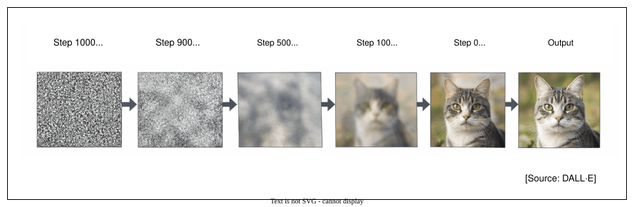

# Efficient_Inference_Strategies_for_Diffusion_Models_in_AI

Source: https://www.educative.io/courses/generative-ai-system-design/inference-strategies-for-diffusion-models

---

[Home](https://www.educative.io/)

[Courses](https://www.educative.io/search?tab=courses)

[Grokking the Generative AI System Design Interview](https://www.educative.io/courses/generative-ai-system-design)

# Inference Strategies for Diffusion Models

Explore inference strategies that accelerate image generation in diffusion models by reducing denoising steps. Learn how DDIM uses deterministic paths to skip steps, while DPM-Solver applies numerical methods for faster, high-quality output. Understand the speed-quality trade-offs to choose the best approach for your AI application.

We'll cover the following...

- [What happens during diffusion inference](https://www.educative.io/courses/generative-ai-system-design/inference-strategies-for-diffusion-models#What-happens-during-diffusion-inference)
  - [The key observation](https://www.educative.io/courses/generative-ai-system-design/inference-strategies-for-diffusion-models#The-key-observation)
- [Denoising diffusion implicit models (DDIM)](https://www.educative.io/courses/generative-ai-system-design/inference-strategies-for-diffusion-models#Denoising-diffusion-implicit-models-DDIM)
  - [What DDIM changes](https://www.educative.io/courses/generative-ai-system-design/inference-strategies-for-diffusion-models#What-DDIM-changes)
  - [How it works](https://www.educative.io/courses/generative-ai-system-design/inference-strategies-for-diffusion-models#How-it-works)
  - [What you gain with DDIM](https://www.educative.io/courses/generative-ai-system-design/inference-strategies-for-diffusion-models#What-you-gain-with-DDIM)
  - [When DDIM is a good fit](https://www.educative.io/courses/generative-ai-system-design/inference-strategies-for-diffusion-models#When-DDIM-is-a-good-fit)
- [Diffusion probabilistic models solver (DPM-Solver)](https://www.educative.io/courses/generative-ai-system-design/inference-strategies-for-diffusion-models#Diffusion-probabilistic-models-solver-DPM-Solver)
  - [How it works](https://www.educative.io/courses/generative-ai-system-design/inference-strategies-for-diffusion-models#How-it-works-1)
  - [Benefits and limitations](https://www.educative.io/courses/generative-ai-system-design/inference-strategies-for-diffusion-models#Benefits-and-limitations)
- [Speed vs. quality trade-off](https://www.educative.io/courses/generative-ai-system-design/inference-strategies-for-diffusion-models#Speed-vs-quality-trade-off)
- [Conclusion](https://www.educative.io/courses/generative-ai-system-design/inference-strategies-for-diffusion-models#Conclusion)

Diffusion models generate images by gradually transforming noise into structure. At inference time, the model starts with a completely noisy image and repeatedly applies a denoising network to remove noise step by step. Each step produces a slightly cleaner image than the previous one.

This process works well, but it is *inherently slow*.

## What happens during diffusion inference[#](https://www.educative.io/courses/generative-ai-system-design/inference-strategies-for-diffusion-models#What-happens-during-diffusion-inference)

Consider a diffusion model trained with 1,000 time steps. During training, the model learns how to reverse each small noise addition. At inference time, the simplest approach is to reverse this process one step at a time:

The diffusion inference process

Each of these steps requires a forward pass through a large neural network. If a single forward pass takes, for example, 20 milliseconds, then 1,000 steps would take about **20 seconds** to generate a single image. This is far too slow for most real-world applications.

Without optimized inference strategies, diffusion models face several challenges:

- **High latency**: Generating an image can take seconds or longer.
- **High compute cost**: Each step consumes GPU resources.
- **Poor user experience**: Interactive applications become unusable.

For example, in a text-to-image system where users expect results in a few seconds, running hundreds of denoising steps per image is not feasible. Even batch generation becomes expensive at scale.

### The key observation[#](https://www.educative.io/courses/generative-ai-system-design/inference-strategies-for-diffusion-models#The-key-observation)

The most important insight behind inference strategies is this:

The model does not need to visit *every* intermediate noise level to produce a good result.

Many of the intermediate steps contribute only marginal improvements. If we can move through the denoising process more efficiently, by skipping steps or taking larger jumps, we can generate images much faster without retraining the model.

This is exactly what inference strategies such as denoising diffusion implicit models (DDIM) and diffusion probabilistic models solver (DPM-Solver) are designed to do. You can think of standard diffusion inference as walking down a long staircase one step at a time. Inference strategies act like shortcuts:

- DDIM allows you to skip steps while following a deterministic path.
- DPM-Solver uses mathematical solvers to take larger, more informed steps.

Both approaches aim to reduce the number of denoising iterations while preserving image quality.

Let’s look at DDIM and see how it achieves faster inference by altering the denoising path.

## Denoising diffusion implicit models (DDIM)[#](https://www.educative.io/courses/generative-ai-system-design/inference-strategies-for-diffusion-models#Denoising-diffusion-implicit-models-DDIM)

**Denoising diffusion implicit models (DDIM)** is an inference strategy that speeds up diffusion models by changing *how* the denoising process is traversed. Importantly, DDIM does not require retraining the model. It uses the same network learned during standard diffusion training but follows a different path at inference time.

The key idea behind DDIM is *determinism*.

### What DDIM changes[#](https://www.educative.io/courses/generative-ai-system-design/inference-strategies-for-diffusion-models#What-DDIM-changes)

In standard diffusion inference, each denoising step includes a random component. Even if the model predicts the same mean noise estimate, randomness is injected at every step. This stochasticity is useful during training and sampling, but it forces the model to take many small steps to remain stable.

As a result, standard diffusion typically needs hundreds of steps to produce high-quality images.

DDIM removes the randomness from the denoising process during inference. Instead of sampling from a distribution at each step, DDIM follows a *deterministic mapping* from one noise level to the next.

This has two important consequences:

1. The same starting noise always produces the same output.
2. The model can safely skip intermediate time steps.

Because the path is deterministic, the model does not need to visit every noise level. It can jump directly between selected time steps while still producing a coherent image.

### How it works[#](https://www.educative.io/courses/generative-ai-system-design/inference-strategies-for-diffusion-models#How-it-works)

Assume a diffusion model trained with 1,000 time steps.

**Standard inference:**

- Visits all 1,000 steps
- Step size = 1

**DDIM inference:**

- Chooses, for example, 50 steps
- Step size ≈ 20

Instead of denoising at steps: 1000 → 999 → 998 → ... → 0 = 1,000 steps.

DDIM might denoise at: 1000 → 980 → 960 → ... → 0 = 50 steps.

At each jump, the model uses its learned noise prediction to move deterministically toward a cleaner image.

### What you gain with DDIM[#](https://www.educative.io/courses/generative-ai-system-design/inference-strategies-for-diffusion-models#What-you-gain-with-DDIM)

DDIM provides several practical benefits:

- **Faster inference**: Fewer denoising steps mean fewer network evaluations.
- **More predictable outputs**: The same input noise yields the same image.
- **Easy deployment**: Works with existing diffusion models.

In many cases, DDIM can reduce inference from hundreds or thousands of steps to 20–50 steps with only a modest drop in image quality.

DDIM is not free of trade-offs. Because the process is deterministic, sample diversity decreases. At very low step counts, images may lose fine details or exhibit smoothing artifacts. For applications where diversity and exploration matter, this can be a limitation. However, for use cases where speed and consistency are more important, DDIM is often a strong choice.

### When DDIM is a good fit[#](https://www.educative.io/courses/generative-ai-system-design/inference-strategies-for-diffusion-models#When-DDIM-is-a-good-fit)

DDIM is commonly used when fast inference is required, when reproducible outputs are needed, or when moderate-quality loss is acceptable. It is often the first optimization applied to diffusion inference before moving to more advanced solvers.

Next, we will look at DPM-Solver, which further improves inference speed by using numerical methods to approximate the denoising trajectory more efficiently.

## Diffusion probabilistic models solver (DPM-Solver)[#](https://www.educative.io/courses/generative-ai-system-design/inference-strategies-for-diffusion-models#Diffusion-probabilistic-models-solver-DPM-Solver)

While DDIM reduces inference time by skipping steps deterministically, the **diffusion probabilistic models solver (DPM-Solver)** takes this idea further. Instead of treating denoising as a sequence of discrete steps, DPM-Solver treats the diffusion process as a *continuous trajectory* that can be approximated using numerical solvers.

The result is significantly faster inference with high output quality.

Diffusion models can be interpreted as solving a differential equation that describes how noise is removed over time. Standard diffusion and DDIM approximate this process using many small, fixed steps. DPM-Solver recognizes that if we model this process as a differential equation, we can apply well-known numerical methods to move along the denoising path more efficiently.

Rather than stepping cautiously through the trajectory, DPM-Solver takes larger, informed steps.

### How it works[#](https://www.educative.io/courses/generative-ai-system-design/inference-strategies-for-diffusion-models#How-it-works-1)

Assume again a diffusion model trained with 1,000 time steps.

- Standard diffusion inference: ~1,000 steps
- DDIM inference: ~20–50 steps
- DPM-Solver inference: ~10–20 steps

Instead of jumping by fixed intervals, DPM-Solver estimates where the denoising trajectory is heading and moves directly toward that point using a solver-based update. This means fewer evaluations of the denoising network while still staying close to the ideal denoising path.

The strength of DPM-Solver lies in how it uses the model’s noise predictions. Rather than relying on a single prediction per step, the solver combines information across steps to better approximate the underlying dynamics.

As a result:

- Fine details are better preserved than with aggressive step skipping.
- Artifacts are reduced compared to naive fast sampling.

This makes DPM-Solver especially effective for high-resolution image generation.

### Benefits and limitations[#](https://www.educative.io/courses/generative-ai-system-design/inference-strategies-for-diffusion-models#Benefits-and-limitations)

In practice, DPM-Solver offers:

- **Very fast inference**: Often 5–10× faster than standard diffusion.
- **High perceptual quality**: Comparable to much slower methods.
- **Broad adoption**: Common in modern text-to-image systems.

For many production systems, DPM-Solver is the default inference strategy because it offers an excellent balance between speed and quality.

Difference in the number of steps of the inference strategies

DPM-Solver still involves trade-offs. Extremely low step counts can introduce artifacts, solver choice and configuration matter, and a slight loss of stochasticity can reduce output diversity. Nevertheless, for most practical settings, these downsides are outweighed by the performance gains.

## Speed vs. quality trade-off[#](https://www.educative.io/courses/generative-ai-system-design/inference-strategies-for-diffusion-models#Speed-vs-quality-trade-off)

All diffusion inference strategies navigate the same fundamental trade-off: how fast an image can be generated vs. how much visual quality is preserved. Reducing the number of denoising steps speeds up inference, but each skipped step forfeits the opportunity to refine the image.

Understanding this trade-off is essential when choosing an inference strategy.

Standard diffusion vs. DDIM vs. DPM-Solver

There is no universally “best” inference strategy. The right choice depends on the application. In many cases, systems expose the number of steps as a tunable parameter, allowing users or developers to dynamically balance speed and quality.

## Conclusion[#](https://www.educative.io/courses/generative-ai-system-design/inference-strategies-for-diffusion-models#Conclusion)

Diffusion models generate data via an iterative denoising process, but naive inference can be slow due to the large number of steps required. Inference strategies exist to reduce this cost without retraining the model.

DDIM speeds up inference by making the denoising process deterministic and skipping intermediate steps. DPM-Solver goes further by using numerical solvers to approximate the denoising trajectory, enabling high-quality generation in even fewer steps. Both approaches trade some flexibility for speed.

Choosing an inference strategy is a practical decision that balances inference speed and output quality, depending on the application’s needs.

Sampling Strategies

Agentic AI Architecture (System Design)

Ask

[What happens during diffusion inference](https://www.educative.io/courses/generative-ai-system-design/inference-strategies-for-diffusion-models#What-happens-during-diffusion-inference)

[The key observation](https://www.educative.io/courses/generative-ai-system-design/inference-strategies-for-diffusion-models#The-key-observation)

[Denoising diffusion implicit models (DDIM)](https://www.educative.io/courses/generative-ai-system-design/inference-strategies-for-diffusion-models#Denoising-diffusion-implicit-models-DDIM)

[What DDIM changes](https://www.educative.io/courses/generative-ai-system-design/inference-strategies-for-diffusion-models#What-DDIM-changes)

[How it works](https://www.educative.io/courses/generative-ai-system-design/inference-strategies-for-diffusion-models#How-it-works)

[What you gain with DDIM](https://www.educative.io/courses/generative-ai-system-design/inference-strategies-for-diffusion-models#What-you-gain-with-DDIM)

[When DDIM is a good fit](https://www.educative.io/courses/generative-ai-system-design/inference-strategies-for-diffusion-models#When-DDIM-is-a-good-fit)

[Diffusion probabilistic models solver (DPM-Solver)](https://www.educative.io/courses/generative-ai-system-design/inference-strategies-for-diffusion-models#Diffusion-probabilistic-models-solver-DPM-Solver)

[How it works](https://www.educative.io/courses/generative-ai-system-design/inference-strategies-for-diffusion-models#How-it-works-1)

[Benefits and limitations](https://www.educative.io/courses/generative-ai-system-design/inference-strategies-for-diffusion-models#Benefits-and-limitations)

[Speed vs. quality trade-off](https://www.educative.io/courses/generative-ai-system-design/inference-strategies-for-diffusion-models#Speed-vs-quality-trade-off)

[Conclusion](https://www.educative.io/courses/generative-ai-system-design/inference-strategies-for-diffusion-models#Conclusion)