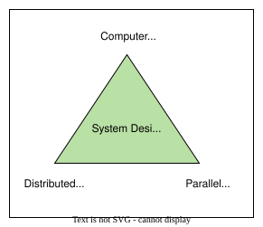
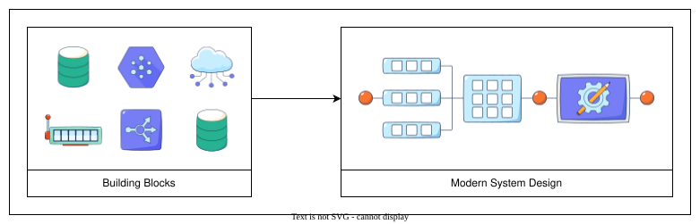

# Introduction_to_Modern_System_Design

Source: https://www.educative.io/courses/grokking-the-system-design-interview/introduction-to-modern-system-design

---

[Home](https://www.educative.io/)

[Courses](https://www.educative.io/search?tab=courses)

[Grokking Modern System Design Interview](https://www.educative.io/courses/grokking-the-system-design-interview)

# Introduction to Modern System Design

Define modern System Design by focusing on building reliable, scalable, and maintainable distributed systems. Explore the course’s methodology, which uses fundamental building blocks and an iterative process. This approach develops the architectural thinking needed to excel in System Design Interviews.

We'll cover the following...

- [Understanding System Design](https://www.educative.io/courses/grokking-the-system-design-interview/introduction-to-modern-system-design#Understanding-System-Design)
- [Modern System Design using building blocks](https://www.educative.io/courses/grokking-the-system-design-interview/introduction-to-modern-system-design#Modern-System-Design-using-building-blocks)
- [Why Modern System Design?](https://www.educative.io/courses/grokking-the-system-design-interview/introduction-to-modern-system-design#Why-Modern-System-Design)
- [About this System Design course](https://www.educative.io/courses/grokking-the-system-design-interview/introduction-to-modern-system-design#About-this-System-Design-course)
- [Who should take this System Design course?](https://www.educative.io/courses/grokking-the-system-design-interview/introduction-to-modern-system-design#Who-should-take-this-System-Design-course)
- [Prerequisites for this System Design course](https://www.educative.io/courses/grokking-the-system-design-interview/introduction-to-modern-system-design#Prerequisites-for-this-System-Design-course)

## Understanding System Design[#](https://www.educative.io/courses/grokking-the-system-design-interview/introduction-to-modern-system-design#Understanding-System-Design)

**System Design** is the process of defining components and their integration, APIs, and data models to build large-scale systems that meet a specified set of functional and non-functional requirements.

System design uses concepts from computer networking, parallel computing, and distributed systems to craft scalable, high-performance systems. Distributed systems scale well by nature. However, they are inherently complex. The discipline of system design helps us manage this complexity and get the work done.

System design aims to build systems that are reliable, effective, and maintainable.

- **Reliable systems** handle faults, failures, and errors gracefully.
- **Effective systems** meet user needs and business requirements.
- **Maintainable systems** are flexible, scalable, and easy to extend with new features.

## Modern System Design using building blocks[#](https://www.educative.io/courses/grokking-the-system-design-interview/introduction-to-modern-system-design#Modern-System-Design-using-building-blocks)

We use common design elements, such as load balancers, as basic building blocks. This approach introduces modularity and allows us to:

- Discuss the specific design challenges of each building block in detail.
- Focus on problem-specific logic by referencing these blocks rather than redesigning them from scratch.

We have identified 16 building blocks crucial for designing modern systems.

Modern systems are designed using fundamental building blocks

## Why Modern System Design?[#](https://www.educative.io/courses/grokking-the-system-design-interview/introduction-to-modern-system-design#Why-Modern-System-Design)

System Design content is only useful if it keeps pace with how the industry actually builds. The previous generation of material (Grokking System Design Interview) the approach most engineers learned from in the late 2010s, already covered distributed systems and was, in its own way, reasonably modular. But two things held it back. It wasn't kept up to date, so it steadily went stale. And it taught each system as a self-contained case study, without breaking design down into reusable components you could carry from one problem to the next.

Closing that gap is exactly what the building-block approach you've just seen was built for: instead of memorizing one-off designs, you learn each reusable component once, then compose those blocks to design almost any system. Pair that with regular updates, and you have what makes this course *modern*, and what has kept it relevant as systems have grown more complex.

We intend to keep it that way. The next major shift is already here: AI is reshaping both how systems are designed and how System Design Interviews (SDI) are conducted. Inference, semantic retrieval, agents, and GPU-bound compute are entering the request path, and interviewers are adjusting what they ask and how they score it. So we continue to evolve this course to reflect both.

**Disclaimer:** We update this course periodically to keep it aligned with the latest industry changes. *Last updated: October 2026.*

## About this System Design course[#](https://www.educative.io/courses/grokking-the-system-design-interview/introduction-to-modern-system-design#About-this-System-Design-course)

This course teaches you to design systems that scale with user growth, remain available during faults, and meet performance goals. Real-world system building is an iterative process: you start with a baseline design, measure performance, and refine it.

We focus on core concepts rather than boilerplate solutions. By analyzing carefully selected design problems, you will learn to tackle novel challenges in interviews and real-world applications.

**A fresh look at System Design:** Many System Design courses offer formulaic solutions to specific problems. While attractive for high-stress interviews, this approach encourages memorization over understanding. If System Design were purely formulaic, human designers would be obsolete. Instead, we treat System Design as both an art and a science, tackling problems from first principles for a fresh perspective.

**Going deep and broad:** We explore traditional problems with in-depth discussions, explaining the rationale behind component choices despite their tradeoffs. For instance, we clarify why a specific database, caching system, or load balancing technique is selected.

We also address new design problems that focus on scalability, availability, maintainability, consistency, and fault tolerance. By covering both traditional and modern challenges, we prepare learners to handle any new design problem effectively. Real systems are complex, so we make appropriate assumptions to scope problems correctly and grasp real-world nuances.

An overview of iteratively evolving System Design

**Iterative process:** Real systems improve through iteration. We often start simple, identify bottlenecks, and refine the design. While time constraints can limit this process, we recommend two iterations:

- **First iteration:** Dedicate about 80 percent of the time to creating the initial design.
- **Second iteration:** Focus on improvements and refinements.

Alternatively, you can adjust the design as new insights emerge. Discovering new details is inevitable as you spend more time on a problem.

**Interactive learning:** We provide ample opportunities to gain hands-on experience. Some problems guide learners through step-by-step design, while others require your input to reach a final stage. We also leverage AI to reinforce key concepts through questions and quizzes.

Let’s test your understanding with the help of the following AI assessment.

AI Powered

Saved

No attempts left

Reset

Iterate help us to make system better

Ahan, you’re on the right track! Iteration does help make the system better. It’s worth adding that the first design might have bottlenecks or issues we don’t see initially. By iterating, we can observe how the system performs in real-world conditions and improve scalability, maintainability, and overall effectiveness. Keep exploring!

You've used all your attempts

## Who should take this System Design course?[#](https://www.educative.io/courses/grokking-the-system-design-interview/introduction-to-modern-system-design#Who-should-take-this-System-Design-course)

System design is essential for any software engineer advancing their career.

- **Interview preparation:** System design is a critical component of technical interviews. This course helps software engineers prepare for interviews. We also provide a comprehensive [guide on preparation for a system design interview](https://www.educative.io/courses/grokking-the-system-design-interview/getting-ready-for-the-system-design-interview).
- **Software developers:** This course is primarily for back-end developers, principal engineers, and solution architects who handle user data. However, full-stack and front-end developers will also benefit from understanding the broader architecture. Additionally, *Site Reliability Engineers (SREs)* will learn to identify the root causes of complex production issues.
- **Managers:** Product and engineering managers must understand System Design to steer the development of scalable, performant systems.
- **Learners:** Anyone interested in how tech giants build and evolve successful applications will find this course valuable. Especially in the AI era, where vibe coding is the norm, upskilling in System Design is paramount.

## Prerequisites for this System Design course[#](https://www.educative.io/courses/grokking-the-system-design-interview/introduction-to-modern-system-design#Prerequisites-for-this-System-Design-course)

We assume familiarity with fundamental [distributed system concepts](https://www.educative.io/courses/distributed-systems-practitioners). If you are completely new to System Design, please consider taking the [System Design Fundamentals](https://www.educative.io/courses/grokking-system-design-fundamentals) course. Basic knowledge of [computer networking](https://www.educative.io/courses/grokking-computer-networking) and [operating systems](https://www.educative.io/courses/operating-systems-virtualization-concurrency-persistence) is also helpful.

Why Every Developer Should Learn System Design

Ask

[Understanding System Design](https://www.educative.io/courses/grokking-the-system-design-interview/introduction-to-modern-system-design#Understanding-System-Design)

[Modern System Design using building blocks](https://www.educative.io/courses/grokking-the-system-design-interview/introduction-to-modern-system-design#Modern-System-Design-using-building-blocks)

[Why Modern System Design?](https://www.educative.io/courses/grokking-the-system-design-interview/introduction-to-modern-system-design#Why-Modern-System-Design)

[About this System Design course](https://www.educative.io/courses/grokking-the-system-design-interview/introduction-to-modern-system-design#About-this-System-Design-course)

[Who should take this System Design course?](https://www.educative.io/courses/grokking-the-system-design-interview/introduction-to-modern-system-design#Who-should-take-this-System-Design-course)

[Prerequisites for this System Design course](https://www.educative.io/courses/grokking-the-system-design-interview/introduction-to-modern-system-design#Prerequisites-for-this-System-Design-course)