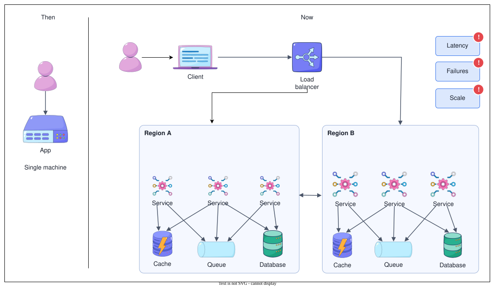

# Why_Every_Developer_Should_Learn_System_Design

Source: https://www.educative.io/courses/grokking-the-system-design-interview/why-every-developer-should-learn-system-design

---

[Home](https://www.educative.io/)

[Courses](https://www.educative.io/search?tab=courses)

[Grokking Modern System Design Interview](https://www.educative.io/courses/grokking-the-system-design-interview)

# Why Every Developer Should Learn System Design

Discover why System Design is indispensable for building reliable, scalable, and maintainable software in a distributed environment. Understand how this core skill elevates technical judgment, improves cross-team collaboration, and accelerates career growth into senior engineering roles.

We'll cover the following...

- [Why do we need System Design?](https://www.educative.io/courses/grokking-the-system-design-interview/why-every-developer-should-learn-system-design#Why-do-we-need-System-Design)
- [Why every developer should learn System Design](https://www.educative.io/courses/grokking-the-system-design-interview/why-every-developer-should-learn-system-design#Why-every-developer-should-learn-System-Design)
- [Why System Design matters in real-world systems](https://www.educative.io/courses/grokking-the-system-design-interview/why-every-developer-should-learn-system-design#Why-System-Design-matters-in-real-world-systems)
- [What System Design covers in day-to-day engineering](https://www.educative.io/courses/grokking-the-system-design-interview/why-every-developer-should-learn-system-design#What-System-Design-covers-in-day-to-day-engineering)
- [Career benefits of learning System Design](https://www.educative.io/courses/grokking-the-system-design-interview/why-every-developer-should-learn-system-design#Career-benefits-of-learning-System-Design)
- [A practical roadmap to learning System Design](https://www.educative.io/courses/grokking-the-system-design-interview/why-every-developer-should-learn-system-design#A-practical-roadmap-to-learning-System-Design)
- [Conclusion](https://www.educative.io/courses/grokking-the-system-design-interview/why-every-developer-should-learn-system-design#Conclusion)

Modern software runs on distributed systems, interconnected services, and strict expectations around latency and availability. Understanding these systems is critical if you want to build applications that remain reliable under load. This lesson explains why system design matters for developers and why learning it early will make you more effective.

Modern applications are distributed systems, so every developer faces latency, failure, and scale decisions

## Why do we need System Design?[#](https://www.educative.io/courses/grokking-the-system-design-interview/why-every-developer-should-learn-system-design#Why-do-we-need-System-Design)

Software development has evolved from standalone applications to complex, distributed ecosystems. What was once the domain of large tech companies is now the baseline for modern systems.

**Note:** System Design bridges the gap between writing features and engineering systems. It provides the tools to manage complexity, make informed trade-offs, and ensure applications remain resilient under real-world demands.

Mastering System Design enables developers to reason about architecture, anticipate bottlenecks, and design systems that meet core objectives like performance and availability.

## Why every developer should learn System Design[#](https://www.educative.io/courses/grokking-the-system-design-interview/why-every-developer-should-learn-system-design#Why-every-developer-should-learn-System-Design)

Most developers interact with distributed systems, either directly or through APIs and managed cloud services. System design helps you build and integrate these components more effectively across roles:

- **Mobile developers:** Connect to services for authentication, payment, messaging, and storage. System Design helps handle network latency and build fault-tolerant apps.
- **Backend developers:** Manage concurrency, caching, and scaling. System Design is critical for balancing trade-offs like latency vs. consistency.
- **Game developers:** Build real-time multiplayer systems. Understanding replication and state synchronization is essential for low-latency experiences.
- **Frontend developers:** Consume distributed APIs. Design knowledge helps optimize data fetching and handle backend errors gracefully.
- **Data engineers:** Manage pipelines and streaming systems. System Design ensures platforms remain reliable under skewed workloads.
- **Support and operations:** Troubleshoot incidents and plan capacity. Design concepts align technical decisions with business priorities.

Ultimately, System Design strengthens collaboration by giving everyone a shared understanding of how the system functions end-to-end.

System Design enabling developers and engineers across roles

Understanding system design helps you see how individual components fit into the overall architecture. That context improves cross-team collaboration and leads to systems that are more reliable and easier to operate.

AI Powered

Saved

No attempts left

Reset

don't know

No worries! Here’s a little hint to get you thinking: Imagine how understanding the whole system might help you avoid problems before they happen or make your work fit better with what others are doing. Give it a try! Keep exploring.

You've used all your attempts

## Why System Design matters in real-world systems[#](https://www.educative.io/courses/grokking-the-system-design-interview/why-every-developer-should-learn-system-design#Why-System-Design-matters-in-real-world-systems)

Real applications rely on distributed components that require careful coordination. Consider these practical scenarios where System Design is essential:

- **Ride share applications:** Integrate messaging, payments, and location tracking. Developers must use load balancers and caching to handle high traffic while maintaining responsiveness.
- **Cloud-based gaming:** Supports thousands of concurrent users. This demands thoughtful design of real-time communication and data replication to minimize latency.
- **Search engines:** Coordinate indexing, ranking, and ad delivery. Strong design principles allow developers to optimize performance and manage distributed data.
- **Dynamic web applications:** Depend on multiple backends and databases. Understanding data flow ensures user interactions are processed securely and efficiently.

**Note:** Real-world systems underscore the importance of System Design. Applying core design principles ensures software remains scalable and maintainable even under complex conditions.

Regardless of domain or scale, System Design is foundational to building software that stands the test of real-world demands.

## What System Design covers in day-to-day engineering[#](https://www.educative.io/courses/grokking-the-system-design-interview/why-every-developer-should-learn-system-design#What-System-Design-covers-in-day-to-day-engineering)

System Design connects everyday engineering tasks to broader architectural principles. Practical day-to-day work includes:

- **Monitoring and observability:** Tracking latency, error rates, and throughput to ensure operational goals are met.
- **Incident response:** Diagnosing root causes and implementing fixes to minimize user impact.
- **Capacity management:** Evaluating traffic patterns and storage growth to prevent bottlenecks.
- **Performance tuning:** Adjusting caching, load balancing, and database queries to maintain efficiency.
- **System evolution:** Iteratively improving services and updating dependencies without disrupting functionality.
- **Operational automation:** Maintaining alerts and runbooks to reduce manual overhead.

Mastering these practices ensures systems operate smoothly and evolve safely as requirements change.

## Career benefits of learning System Design[#](https://www.educative.io/courses/grokking-the-system-design-interview/why-every-developer-should-learn-system-design#Career-benefits-of-learning-System-Design)

Learning System Design early improves your technical decision-making and helps you grow into higher-scope roles:

- **Accelerated learning:** Grasping system-level principles builds intuition for solving complex problems.
- **Informed decision-making:** Developers can evaluate trade-offs and anticipate issues such as latency, throughput, and failure modes before deployment.
- **Improved collaboration:** Creates a shared understanding of architecture, facilitating better communication with teams and leadership.
- **Career progression:** Proficiency in System Design is a prerequisite for senior engineering and leadership roles.

Early engagement strengthens problem-solving skills and equips developers to contribute effectively to complex projects.

## A practical roadmap to learning System Design[#](https://www.educative.io/courses/grokking-the-system-design-interview/why-every-developer-should-learn-system-design#A-practical-roadmap-to-learning-System-Design)

Developing expertise requires a clear, step-by-step approach. Use this roadmap to build intuition and proficiency:

- **Review foundations:** Study networking protocols, consistency models, and latency/throughput trade-offs.
- **Data modeling:** Define schemas and access patterns to guide storage decisions.
- **Core patterns:** Implement caching, replication, sharding, and queuing strategies.
- **Estimate requirements:** Calculate expected user load, storage needs, and network demands.
- **Visualize workflows:** Create sequence diagrams for critical paths.
- **Document designs:** Outline requirements, alternatives, trade-offs, and risk mitigation strategies.
- **Iterate and test:** Start with small systems and validate designs through monitoring and failure testing.
- **Operationalize:** Implement dashboards, runbooks, and simulated failure exercises.

System Design proficiency grows through deliberate practice. Consistently applying these principles helps you recognize patterns, anticipate challenges, and make informed decisions.

**Note:** A checklist that covers requirements, data modeling, and failure scenarios helps teams build systems that are reliable and operable. Getting into the habit of thinking through edge cases and failure modes reduces operational risk.

## Conclusion[#](https://www.educative.io/courses/grokking-the-system-design-interview/why-every-developer-should-learn-system-design#Conclusion)

System design gives developers the context they need to work effectively on modern software systems. It improves how you make tradeoffs and helps you build systems that scale without falling over in production. This lesson sets up the rest of the course, where we’ll cover specific design techniques and real-world examples in detail.

Introduction to Modern System Design

Course Structure for Modern System Design

Ask

[Why do we need System Design?](https://www.educative.io/courses/grokking-the-system-design-interview/why-every-developer-should-learn-system-design#Why-do-we-need-System-Design)

[Why every developer should learn System Design](https://www.educative.io/courses/grokking-the-system-design-interview/why-every-developer-should-learn-system-design#Why-every-developer-should-learn-System-Design)

[Why System Design matters in real-world systems](https://www.educative.io/courses/grokking-the-system-design-interview/why-every-developer-should-learn-system-design#Why-System-Design-matters-in-real-world-systems)

[What System Design covers in day-to-day engineering](https://www.educative.io/courses/grokking-the-system-design-interview/why-every-developer-should-learn-system-design#What-System-Design-covers-in-day-to-day-engineering)

[Career benefits of learning System Design](https://www.educative.io/courses/grokking-the-system-design-interview/why-every-developer-should-learn-system-design#Career-benefits-of-learning-System-Design)

[A practical roadmap to learning System Design](https://www.educative.io/courses/grokking-the-system-design-interview/why-every-developer-should-learn-system-design#A-practical-roadmap-to-learning-System-Design)

[Conclusion](https://www.educative.io/courses/grokking-the-system-design-interview/why-every-developer-should-learn-system-design#Conclusion)