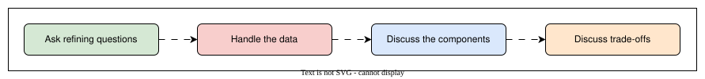
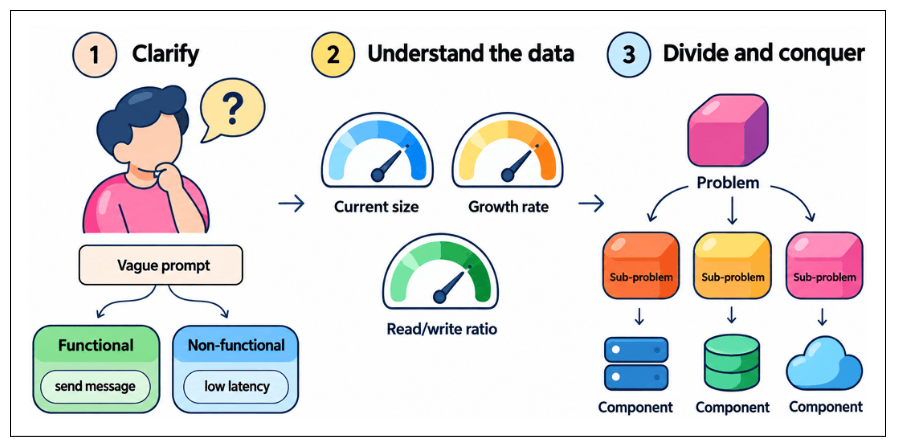

# The_Do’s_and_Don’ts_of_the_System_Design_Interview

Source: https://www.educative.io/courses/grokking-the-system-design-interview/the-dos-and-donts-of-the-system-design-interview

---

[Home](https://www.educative.io/)

[Courses](https://www.educative.io/search?tab=courses)

[Grokking Modern System Design Interview](https://www.educative.io/courses/grokking-the-system-design-interview)

# The Do’s and Don’ts of the System Design Interview

Explore the structured method for tackling System Design Interview questions, moving from requirement gathering to component selection. Define data characteristics and functional needs, then justify architectural choices by openly discussing trade-offs and design weaknesses. Avoid critical interview pitfalls.

We'll cover the following...

- [What to do during the interview](https://www.educative.io/courses/grokking-the-system-design-interview/the-dos-and-donts-of-the-system-design-interview#What-to-do-during-the-interview)
- [Strategize, then divide and conquer](https://www.educative.io/courses/grokking-the-system-design-interview/the-dos-and-donts-of-the-system-design-interview#Strategize-then-divide-and-conquer)
  - [Ask refining questions](https://www.educative.io/courses/grokking-the-system-design-interview/the-dos-and-donts-of-the-system-design-interview#Ask-refining-questions)
  - [Handle data](https://www.educative.io/courses/grokking-the-system-design-interview/the-dos-and-donts-of-the-system-design-interview#Handle-data)
  - [Discuss the components](https://www.educative.io/courses/grokking-the-system-design-interview/the-dos-and-donts-of-the-system-design-interview#Discuss-the-components)
  - [Discuss trade-offs](https://www.educative.io/courses/grokking-the-system-design-interview/the-dos-and-donts-of-the-system-design-interview#Discuss-trade-offs)
- [What not to do in an interview](https://www.educative.io/courses/grokking-the-system-design-interview/the-dos-and-donts-of-the-system-design-interview#What-not-to-do-in-an-interview)

## What to do during the interview[#](https://www.educative.io/courses/grokking-the-system-design-interview/the-dos-and-donts-of-the-system-design-interview#What-to-do-during-the-interview)

Candidates should strive to be original. Interviewers often ask the same questions repeatedly, so reproducing a generic design is unlikely to impress them.  
Since interviews can be stressful, having a structured plan is a valuable strategy. While there are many ways to approach a System Design problem, we recommend the following technique.

## Strategize, then divide and conquer[#](https://www.educative.io/courses/grokking-the-system-design-interview/the-dos-and-donts-of-the-system-design-interview#Strategize-then-divide-and-conquer)

We recommend including the following activities somewhere in the interview:

Activities to include in the interview

### Ask refining questions[#](https://www.educative.io/courses/grokking-the-system-design-interview/the-dos-and-donts-of-the-system-design-interview#Ask-refining-questions)

We must understand the design problem and its requirements. To do this, we can adopt a product manager's mindset and prioritize main features by asking the interviewer refining questions. The goal is to guide the interviewer through our thought process and demonstrate why our design is effective. These interviews gauge our ability to logically derive a system from vague requirements.  
  
We need to ensure we are solving the right problem. It is helpful to divide requirements into two groups:

- **Functional requirements:** Features the clients need directly, such as sending messages to friends in near real-time.
- **Non-functional requirements:** Indirect needs, such as ensuring the messaging service performance does not degrade as user load increases.

> **Note:** Professionals call these functional and nonfunctional requirements.

### Handle data[#](https://www.educative.io/courses/grokking-the-system-design-interview/the-dos-and-donts-of-the-system-design-interview#Handle-data)

We need to identify and understand data and its characteristics in order to look for appropriate data storage systems and data processing components for the System Design.

Start by clarifying requirements and understanding the data, then divide the problem

Some important questions to ask ourselves when searching for the right systems and components include the following:

- What’s the size of the data right now?
- At what rate is the data expected to grow over time?
- How will the data be consumed by other subsystems or end users?
- Is the data read-heavy or write-heavy?
- Do we need strict consistency of data, or will eventual consistency work?
- What’s the durability target of the data?
- What privacy and regulatory requirements do we require for storing or transmitting user data?

### Discuss the components[#](https://www.educative.io/courses/grokking-the-system-design-interview/the-dos-and-donts-of-the-system-design-interview#Discuss-the-components)

At a high level, our job involves selecting components, determining their placement, and defining their interactions.

For instance, we must decide on the appropriate database type, such as choosing between a conventional SQL database or a NoSQL alternative.

There might be cases where we have strong arguments to use NoSQL databases, but our interviewer may insist that we use a traditional database. What should we do in such a case?

> **Note:** We often abstract component details into boxes and use arrows to illustrate interactions. Defining high-level user-facing APIs can further clarify system data and interaction requirements.

Common System Design components include front-end interfaces, load balancers, caches, databases, firewalls, and CDNs.

### Discuss trade-offs[#](https://www.educative.io/courses/grokking-the-system-design-interview/the-dos-and-donts-of-the-system-design-interview#Discuss-trade-offs)

Remember that there’s no one correct answer to a design problem. If we give the same problem to two different groups, they might come up with different designs.

There is no single correct design; each option trades one benefit for another

Here are the primary reasons for diversity in System Design solutions:

- **Trade-offs:** Components have distinct advantages and disadvantages. We must carefully weigh which options best suit our needs.
- **Resource Management:** Choices vary in financial cost and technical complexity. We need to utilize resources efficiently.
- **Weaknesses:** Every design has limitations. We must identify these flaws and have a plan to address them.

We should proactively highlight design weaknesses to the interviewer and explain our reasoning. For example, our current design might not handle a tenfold increase in load, but we do not anticipate reaching that scale soon. By implementing a monitoring system to track growth, we can upgrade the design when necessary. This demonstrates an intentional trade-off to reduce immediate system costs.

Failures are inevitable in large systems. Therefore, we must integrate fault tolerance and security directly into our design.

## What not to do in an interview[#](https://www.educative.io/courses/grokking-the-system-design-interview/the-dos-and-donts-of-the-system-design-interview#What-not-to-do-in-an-interview)

Here are a few things that we should avoid doing in a System Design interview:

- Don’t write code in a System Design interview.
- Don’t start building without a plan.
- Don’t work in silence.
- Don’t describe numbers without reason. We have to frame it.
- If we don’t know something, we don’t paper over it, and we don’t pretend to know it.

Avoid the common interview mistakes and replace each one with a better habit

> **Note:** If an interviewer asks us to design a system we haven’t heard of, we should just be honest and tell them so. The interviewer will either explain it to us or they might change the question.

We have covered the tactical Do's and Don'ts, which serve as essential ground rules for System Design Interviews. However, following these rules perfectly does not guarantee success.

Checklists can create rigidity. Candidates may ask refining questions robotically without listening or defend trade-offs solely to protect their initial ideas. Interviewers recognize this script and often set traps to see if you can adapt.

The next lesson moves beyond mechanics. We will examine why blindly following a process can backfire and how to identify the *trap*. These scenarios test your technical knowledge, collaboration skills, and ability to iterate under pressure.

Getting Ready for the System Design Interview

System Design Interview Trap: Why Engineers Fail and Succeed

Ask

[What to do during the interview](https://www.educative.io/courses/grokking-the-system-design-interview/the-dos-and-donts-of-the-system-design-interview#What-to-do-during-the-interview)

[Strategize, then divide and conquer](https://www.educative.io/courses/grokking-the-system-design-interview/the-dos-and-donts-of-the-system-design-interview#Strategize-then-divide-and-conquer)

[Ask refining questions](https://www.educative.io/courses/grokking-the-system-design-interview/the-dos-and-donts-of-the-system-design-interview#Ask-refining-questions)

[Handle data](https://www.educative.io/courses/grokking-the-system-design-interview/the-dos-and-donts-of-the-system-design-interview#Handle-data)

[Discuss the components](https://www.educative.io/courses/grokking-the-system-design-interview/the-dos-and-donts-of-the-system-design-interview#Discuss-the-components)

[Discuss trade-offs](https://www.educative.io/courses/grokking-the-system-design-interview/the-dos-and-donts-of-the-system-design-interview#Discuss-trade-offs)

[What not to do in an interview](https://www.educative.io/courses/grokking-the-system-design-interview/the-dos-and-donts-of-the-system-design-interview#What-not-to-do-in-an-interview)