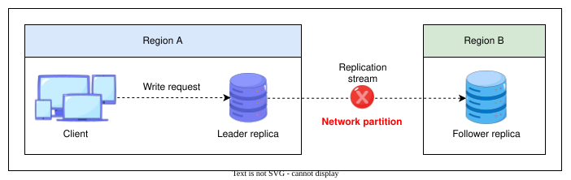

# System_Design_Interview_Trap_Why_Engineers_Fail_and_Succeed

Source: https://www.educative.io/courses/grokking-the-system-design-interview/system-design-interview-trap-why-engineers-fail-and-succeed

---

[Home](https://www.educative.io/)

[Courses](https://www.educative.io/search?tab=courses)

[Grokking Modern System Design Interview](https://www.educative.io/courses/grokking-the-system-design-interview)

# System Design Interview Trap: Why Engineers Fail and Succeed

Understand how interviewers use ambiguous prompts as deliberate traps to test architectural judgment rather than just technical knowledge. Learn to navigate these pitfalls by treating the session as a collaborative dialogue, where you iterate on your design rather than defensively sticking to a static solution.

We'll cover the following...

- [1. Inadequate understanding of distributed system fundamentals](https://www.educative.io/courses/grokking-the-system-design-interview/system-design-interview-trap-why-engineers-fail-and-succeed#1-Inadequate-understanding-of-distributed-system-fundamentals)
- [2. Treating building blocks as opaque primitives](https://www.educative.io/courses/grokking-the-system-design-interview/system-design-interview-trap-why-engineers-fail-and-succeed#2-Treating-building-blocks-as-opaque-primitives)
- [3. Rushing to design without clarifying requirements](https://www.educative.io/courses/grokking-the-system-design-interview/system-design-interview-trap-why-engineers-fail-and-succeed#3-Rushing-to-design-without-clarifying-requirements)
- [4. Weak trade-off articulation](https://www.educative.io/courses/grokking-the-system-design-interview/system-design-interview-trap-why-engineers-fail-and-succeed#4-Weak-trade-off-articulation)
- [5. No sense of scale or numbers](https://www.educative.io/courses/grokking-the-system-design-interview/system-design-interview-trap-why-engineers-fail-and-succeed#5-No-sense-of-scale-or-numbers)
- [6. Ignoring failure modes and degradation](https://www.educative.io/courses/grokking-the-system-design-interview/system-design-interview-trap-why-engineers-fail-and-succeed#6-Ignoring-failure-modes-and-degradation)
- [7. Over-indexing on the “Correct” architecture instead of reasoning](https://www.educative.io/courses/grokking-the-system-design-interview/system-design-interview-trap-why-engineers-fail-and-succeed#7-Over-indexing-on-the-Correct-architecture-instead-of-reasoning)
- [8. Weak API and data-model thinking](https://www.educative.io/courses/grokking-the-system-design-interview/system-design-interview-trap-why-engineers-fail-and-succeed#8-Weak-API-and-data-model-thinking)
- [9. Treating the interview as a presentation instead of a collaboration](https://www.educative.io/courses/grokking-the-system-design-interview/system-design-interview-trap-why-engineers-fail-and-succeed#9-Treating-the-interview-as-a-presentation-instead-of-a-collaboration)
- [10. Inability to course-correct when constraints change](https://www.educative.io/courses/grokking-the-system-design-interview/system-design-interview-trap-why-engineers-fail-and-succeed#10-Inability-to-course-correct-when-constraints-change)
- [What success actually looks like in a System Design interview](https://www.educative.io/courses/grokking-the-system-design-interview/system-design-interview-trap-why-engineers-fail-and-succeed#What-success-actually-looks-like-in-a-System-Design-interview)
- [System Design interview self-assessment checklist](https://www.educative.io/courses/grokking-the-system-design-interview/system-design-interview-trap-why-engineers-fail-and-succeed#System-Design-interview-self-assessment-checklist)
- [Conclusion](https://www.educative.io/courses/grokking-the-system-design-interview/system-design-interview-trap-why-engineers-fail-and-succeed#Conclusion)

I would like to begin this lesson on a personal note, drawing on my observations from repeatedly interviewing candidates at MAANG-level companies such as Meta, Apple, Amazon, Netflix, and Google.

System Design interviews contain a counterintuitive trap: the more you rely on memorized architectures and patterns, the more likely you are to fail.

Strong engineers often get rejected not because their design was wrong, but because they optimized for the wrong signals. Candidates who propose "ideal" solutions from tutorials often leave confused when those solutions don't land. They fail to explain the reasoning behind the architecture.

Candidates rarely fail because they cannot design systems. They fail because they misunderstand the evaluation criteria. Unlike coding interviews, System Design failure modes are subtle and often invisible until the final decision.

In this lesson, I’ll break down the most common reasons engineers fail System Design interviews, drawn directly from my experience as an interviewer. I’ll also explain what interviewers look for and how to avoid these traps without falling back on memorized templates.

**A quick heads-up:** I’m going to reference a few concepts that might feel unfamiliar or difficult to fully absorb on the first read. That reaction is expected. For now, treat these as signposts. Keep them in mind as you progress, and follow the course’s structure. We’ll break each one down in detail over the course.

## 1. Inadequate understanding of distributed system fundamentals[#](https://www.educative.io/courses/grokking-the-system-design-interview/system-design-interview-trap-why-engineers-fail-and-succeed#1-Inadequate-understanding-of-distributed-system-fundamentals)

This is the most common and difficult failure mode. While the core problem is simple, it carries hidden risks that the interview will expose.

Many candidates feel confident after answering every question, yet fail because they lack a deep understanding of [distributed systems](https://www.educative.io/courses/distributed-systems-practitioners). This intuition cannot be taught during onboarding.

**Note:** If a small follow-up question completely stalls your design, it usually means the solution originated from pattern recall rather than genuine understanding.

This gap appears during minor design changes. For example, if you choose leader-follower replication, an interviewer might ask how the system handles consistency during a network partition.

Leader–follower replication under a network partition highlights consistency and availability trade-offs

There are two primary outcomes:

- **Consistency first:** Reject writes when quorum is unavailable or fail fast with an error.
- **Availability first:** Accept writes locally and reconcile later using conflict resolution or single-writer guarantees.

Candidates relying on memorization struggle here. Strong candidates immediately identify the trade-off: explaining whether the system rejects writes to preserve invariants or allows divergence for availability.

Interviewers weigh this heavily. [Distributed systems fundamentals](https://www.educative.io/courses/grokking-system-design-fundamentals?eid=5082902844932096&utm_campaign=informational&utm_medium=email&_hsenc=p2ANqtz---fyvjEJjQ7MUNxZ__NedSsF-ctvSWt5bzVZMFv8YVQL5D01fbGmrrN4y_uwDFAgDo97nlhGYKrSihUzEQ1d8pba0X8w&_hsmi=394784251&utm_content=grokking_fundamentals_system_design&utm_source=newsletter) require deliberate study. Without them, engineers cannot reason about trade-offs, making every decision a guess.

**Tip:** When you study any System Design case study, always ask what changes if latency increases, if a region is lost, or if consistency guarantees become stricter.

Interviewers assume you know common case studies. They challenge reasonable solutions to test if you understand *why* the design works, not just *that* it works.

**Key takeaway:** Invest time in the fundamentals of distributed systems. Build intuition around the following points:

- Consistency, availability, and partition tolerance (CAP)
- Replication, quorum choices, and sharding strategies with their failure modes
- Strong vs. eventual consistency
- SQL vs. NoSQL trade-offs

Do not memorize architectures; learn the forces that shape them.

## 2. Treating building blocks as opaque primitives[#](https://www.educative.io/courses/grokking-the-system-design-interview/system-design-interview-trap-why-engineers-fail-and-succeed#2-Treating-building-blocks-as-opaque-primitives)

Using components without understanding their internal mechanics is a major error. You must understand how primitives like databases, caches, and queues behave under real-world pressure.

Casually mentioning a component to "solve" a bottleneck is insufficient. The design collapses when asked why a specific tool was chosen or how it handles traffic spikes.

**Tip:** When adding a new component, don’t just list its benefits; also consider its drawbacks. Explicitly ask yourself: What new risks does this introduce? How will I monitor it when it is under stress?

This gap becomes visible during stress scenarios. For example, if traffic spikes and cache hit rates drop, which component do you investigate first?

Stress events can propagate from cache to database to queue, amplifying load if not managed correctly

Strong candidates reason through pressure points. They explain how cache eviction storms, aggressive retries, or misconfigured health checks can amplify load.

**Note:** If your only justification for a component is that it is “industry standard,” you are borrowing someone else’s context instead of applying your own reasoning.

Move beyond abstractions and demonstrate understanding of specific trade-offs:

- **Load balancers:** Explain Layer 4 vs. Layer 7 balancing and how health checks can accidentally DDoS a recovering service.
- **Caching:** Match eviction policies to access patterns and explain when write-through is safer than write-back.
- **Message queues:** Describe delivery guarantees (at-least-once vs. exactly-once) and duplicate handling.

**Key takeaway:** Master the core building blocks and how they behave under failure.

- **Databases:** Indexing strategies, replication lag, and connection pooling.
- **Caches:** Eviction policies, cache penetration, and the thundering herd problem.
- **Load balancing:** Traffic shaping algorithms and sticky sessions.
- **Queues:** Backpressure, dead-letter queues, and async processing.

Learn how each component behaves under stress, not just how to name it.

## 3. Rushing to design without clarifying requirements[#](https://www.educative.io/courses/grokking-the-system-design-interview/system-design-interview-trap-why-engineers-fail-and-succeed#3-Rushing-to-design-without-clarifying-requirements)

Candidates often abandon the discipline of clarifying requirements in System Design interviews. Rushing to a solution suggests rote memorization.

Instead of identifying the problem, these candidates attempt to apply a familiar solution to the prompt.

Vague prompts must be refined into concrete constraints before design begins

Interviewers test this by introducing curveballs. If load doubles, many candidates freeze or suggest generic fixes like "add more servers" without diagnosing the bottleneck.

They might suggest sharding the database when the bottleneck is actually in the compute layer.

**Note:** I am not currently seeking a solution. I am looking for the kind of diagnostic conversation you would have with a teammate during a production incident.

Strong candidates ask diagnostic questions: Did user count increase? Are database latencies rising? Is the cache hit rate dropping?

Responding quickly often signals impatience. Real engineering requires narrowing down the problem before concluding.

**Key takeaway:** Never design without explicitly defining three categories of requirements:

- **Functional requirements:** What the system does (e.g., posting content, viewing feeds).
- **Non-functional constraints:** The numbers that shape the design (DAU, QPS, P99 latency targets).
- **Out of scope:** What is intentionally excluded to keep the design focused.

## 4. Weak trade-off articulation[#](https://www.educative.io/courses/grokking-the-system-design-interview/system-design-interview-trap-why-engineers-fail-and-succeed#4-Weak-trade-off-articulation)

Solid engineers often fail to justify choices. "Design by name-dropping" involves listing technologies (e.g., Kafka, DynamoDB) without context or alternatives.

**Note:** Listing tools without explaining their trade-offs is a signal that you are repeating patterns instead of designing a system.

Every decision represents a trade-off. You must balance latency against throughput or consistency against availability. Merely stating a tool "scales" is not a justification.

Every major design choice must be analyzed: what it solves, what it worsens, and when to abandon it

Follow-up questions seek clarification, not trivia. Interviewers test reasoning under constraints, asking why you chose specific tools or consistency models.

**Tip:** After every major design choice, write down one thing it improves and one thing it makes harder. If you cannot do that, you do not yet own the decision.

Strong candidates analyze tools rather than just naming them. They connect workload characteristics to system behavior and acknowledge downsides, such as increased operational complexity.

Engineers who cannot articulate trade-offs are guessing. If you do not understand the cost of a tool, you cannot effectively architect a system.

**Key takeaway:** For every major component you introduce, practice answering the following three questions:

- What problem does this solve?
- What does it make worse?
- What would make you change this decision?

If you cannot answer all three, the decision is not grounded yet.

## 5. No sense of scale or numbers[#](https://www.educative.io/courses/grokking-the-system-design-interview/system-design-interview-trap-why-engineers-fail-and-succeed#5-No-sense-of-scale-or-numbers)

Designing without numbers leads to arbitrary choices. Terms like "high traffic" are meaningless without quantification.

A design for *1k QPS* differs fundamentally from one for *1M QPS*. Similarly, *10 GB* of data fits in memory, while *10 TB* requires distributed storage.

**Tip:** Whenever you hear yourself say “high scale” or “heavy traffic,” stop. Convert that phrase into a few concrete numbers before proceeding.

Estimates dictate design. A 95% read ratio suggests caching, while 10x write spikes require ingestion queues.

Start with back-of-the-envelope estimates. For example, 100M DAU with 50 reads each equals 5B daily reads. This implies ~300k QPS at peak. We’ll cover the details behind these estimates later in the course during the [back-of-the-envelope calculation](https://www.educative.io/courses/grokking-the-system-design-interview/put-back-of-the-envelope-numbers-in-perspective) section.

Back-of-the-envelope estimates turn vague load into concrete design constraints

Calculations signal necessary architectural shifts, such as moving to read replicas or sharding. Precision is less important than directional correctness.

Operating without numbers is guessing. Numbers ground engineering decisions and prove your architecture can handle the load.

**Key takeaway:** Practice quick, rough estimates before committing to an architecture. For example:

- **QPS:** Estimate the average and peak load to size load balancers and compute resources accordingly.
- **Data growth:** Calculate storage needs on both a daily and yearly basis to effectively plan sharding, compaction, and archival strategies.

## 6. Ignoring failure modes and degradation[#](https://www.educative.io/courses/grokking-the-system-design-interview/system-design-interview-trap-why-engineers-fail-and-succeed#6-Ignoring-failure-modes-and-degradation)

Real-world components fail. Designs assuming infinite uptime are incomplete. You must account for node crashes, network partitions, and dependency failures.

Dependencies slow down and caches evict hot keys. If you do not account for these scenarios, the design is fragile.

What happens if a core service fails? Weak candidates suggest indefinite retries, which exacerbates outages.

**Note:** If your only response to a failure is “more retries,” you are very likely amplifying the outage instead of containing it.

Strong candidates use patterns like circuit breakers to ensure graceful degradation. For example, falling back to a cached list if the recommendation engine fails.

When the recommendation service fails, the system falls back to a cache

Availability often trumps correctness. It is better to serve stale data than return an error. Real systems are defined by their behavior during failure.

Designing for failure is mandatory. Assume every component will break and plan the user experience for that moment.

**Key takeaway:** Run a resilience checklist on your design, such as:

- **Single points of failure (SPOF):** If this box disappears, does the whole system stop?
- **Degradation strategy:** If this dependency is slow, do we fall back to cache, show partial results, or hide the feature?
- **Recovery:** When the service comes back online, how do we prevent it from being overwhelmed by pending requests?

## 7. Over-indexing on the “Correct” architecture instead of reasoning[#](https://www.educative.io/courses/grokking-the-system-design-interview/system-design-interview-trap-why-engineers-fail-and-succeed#7-Over-indexing-on-the-Correct-architecture-instead-of-reasoning)

Many candidates hunt for the "right answer" based on canonical architectures. This leads to optimizing for an expected diagram rather than sound reasoning.

Candidates who struggle here tend to rush to the final architecture, skipping intermediate steps. They treat complex decisions as defaults, assuming specific technologies, such as Kafka or sharding, are always the answer, regardless of the prompt.

**Note:** If a small change in constraints makes your entire design fall apart, it is a sign that you memorized a diagram instead of reasoning from the problem.

Memorized designs unravel when constraints change. Strong candidates adapt, treating the architecture as a hypothesis rather than a destination.

They treat the architecture as a hypothesis rather than a destination. Each component exists to satisfy a current constraint, not to match a known tutorial diagram.

Strong candidates move through a reasoning loop instead of locking onto a single diagram

Adaptability is a primary signal. Engineers who reason from constraints can redesign calmly when assumptions change.

Narrating your thinking invites the interviewer to collaborate. This turns the interview into a working session.

**Key takeaway:** Stop optimizing for the final diagram. Narrate your thinking loop instead.

- **State the problem:** What specific constraint are we solving right now?
- **Justify the design:** Why does this choice work under the current assumptions?
- **Define the breaking point:** What change in constraints would necessitate a redesign of this part?

Reasoning beats correctness every time.

## 8. Weak API and data-model thinking[#](https://www.educative.io/courses/grokking-the-system-design-interview/system-design-interview-trap-why-engineers-fail-and-succeed#8-Weak-API-and-data-model-thinking)

Vague APIs and data models are a common failure mode. Candidates often focus on infrastructure boxes while ignoring the details that make the system work.

Constraints become real at the interface level. A "NoSQL" box solves nothing if you cannot define the primary key and access patterns.

**Note:** If you cannot write down a concrete request, response, and primary key, the rest of your diagram is just guesswork.

Weak designs fail under concrete questions about API responses or pagination strategies. Strong candidates define specific request shapes and access paths.

Weak candidates answer in abstractions, stating they will “fetch the feed” or “store posts.” Strong candidates answer with structure. They define specific request shapes, explicit keys, and explain how data is accessed rather than just where it lives.

Concrete APIs and schemas turn vague boxes into real contracts

Design decisions converge at the interface. Poor schema design creates scaling ceilings. If you cannot describe data flow, the design is just empty boxes.

Explicit APIs and schemas make performance limits and trade-offs visible.

**Key takeaway:** Practice defining concrete interfaces and schemas.

- **Request and response shapes:** Write clear JSON structures for your core APIs.
- **Schema definition:** Define primary and sort keys with specific access patterns in mind.
- **Mechanics:** Be explicit about pagination strategies, versioning, and idempotency keys.

## 9. Treating the interview as a presentation instead of a collaboration[#](https://www.educative.io/courses/grokking-the-system-design-interview/system-design-interview-trap-why-engineers-fail-and-succeed#9-Treating-the-interview-as-a-presentation-instead-of-a-collaboration)

System Design interviews are collaborative dialogues, not lectures. Candidates who monologue or resist interruption misunderstand the evaluation.

Interviewers evaluate whether they could work with you on a messy problem. Real design work is iterative and conversational.

Strong candidates invite feedback and adjust in real time. They treat hints as collaboration, not correction.

**Note:** If you treat every question as an attack on your design, you miss the chance to use the interviewer as a partner in the conversation.

Weak candidates defend their initial design rigidly. This rigidity is more concerning than a flawed idea.

Interview interaction patterns

When interrupted, strong candidates pause, ask clarifying questions, and adjust reasoning. The conversation should feel like a design review.

Interviewers seek perspective on collaborative problem solving. Treating the interview as a presentation causes mistakes to compound.

**Key takeaway:** Treat the interviewer like a teammate.

- Pause when you are challenged.
- Ask clarifying questions.
- Think out loud and adapt.

Design reviews are collaborative. Your interview should be, too.

## 10. Inability to course-correct when constraints change[#](https://www.educative.io/courses/grokking-the-system-design-interview/system-design-interview-trap-why-engineers-fail-and-succeed#10-Inability-to-course-correct-when-constraints-change)

Inability to pivot often results in rejection. Interviewers intentionally change constraints (e.g., scale, latency) to test if you can let go of your original idea.

Candidates often fall into a sunk cost mindset, defending outdated assumptions. Strong candidates reset calmly, understanding that design is a function of constraints.

**Note:** A change in constraints is not a trick. It is an invitation to show that your design is driven by reasoning instead of attachment to the first diagram you drew.

Explicitly state when new constraints invalidate earlier assumptions. Propose a redesign, such as switching from [polling](https://www.educative.io/answers/what-is-http-long-polling) to a push-based model.

Constraint changes expose whether you defend assumptions or revisit them

Constraint changes test active reasoning versus rigid memorization. Pivoting shows you optimize for correctness.

Flexibility signals experience. Senior engineers discard solutions when the problem changes; junior engineers force them to work.

**Key takeaway:** Practice redesigning systems mid-stream.

- **Audit assumptions:** Ask yourself what the most fragile assumption is in this design.
- **Force a redesign:** Mid-stream, ask, “What if read traffic doubled?” or “What if we lost this data center?”
- **Let go of your initial design:** Be willing to erase a component you’ve just drawn if a better option emerges.

## What success actually looks like in a System Design interview[#](https://www.educative.io/courses/grokking-the-system-design-interview/system-design-interview-trap-why-engineers-fail-and-succeed#What-success-actually-looks-like-in-a-System-Design-interview)

Success feels distinctly different from failure. Strong candidates do not rush, hunt for a perfect diagram, or try to impress with buzzwords. Instead, they consistently demonstrate a structured, iterative process.

**Note:** In a strong interview, the conversation feels like two engineers working through a problem, not one person defending a slide.

This process is a loop. Strong candidates move through specific phases of reasoning to build a grounded solution.

Success comes from iterating through clarification, estimation, and trade-offs

This loop manifests in six specific behaviors:

- **Start with the problem:** Clarify requirements, traffic patterns, and failure tolerance goals before drawing.
- **Think in trade-offs:** Reason through choices and surface downsides (e.g., why async processing suits a workflow better than synchronous calls).
- **Use building blocks intentionally:** Justify components. Explain eviction policies for caches or delivery guarantees for queues.
- **Anchor designs with numbers:** Use rough estimates for QPS and data size to guide decisions.
- **Design for failure:** Plan for partial outages, degraded modes, and timeouts.
- **Collaborate:** Think out loud, treat hints as signals, and adjust when challenged.

When a candidate succeeds, the interview feels like a collaborative working session between colleagues.

## System Design interview self-assessment checklist[#](https://www.educative.io/courses/grokking-the-system-design-interview/system-design-interview-trap-why-engineers-fail-and-succeed#System-Design-interview-self-assessment-checklist)

Use this checklist to spot gaps in your preparation.

**Note:** This checklist is a reflection tool. It helps you see patterns over time rather than grade a single interview.

Focus on these signals to assess your readiness

Consistently checking these boxes indicates you are operating at a senior level.

- **Fundamentals:** Can I explain consistency models, replication, sharding, and trade-offs without relying on buzzwords?
- **Building blocks:** Do I understand how the components I choose behave under load and failure, not just what they are called?
- **Requirements:** Did I clarify functional scope, [non-functional constraints](https://www.educative.io/courses/grokking-the-system-design-interview/non-functional-requirements-for-system-design-interviews), and what is out of scope *before* designing?
- **Trade-offs:** For every major decision, can I explain what it solves, what it makes worse, and when I would change it?
- **Scale and numbers:** Did I anchor the design with rough estimates for traffic, data size, and growth?
- **Failure and resilience:** Did I discuss what breaks, how the system degrades, and what the user experiences during failure?
- **Collaboration:** Did I treat the interview like a design review and adapt my thinking based on feedback?

## Conclusion[#](https://www.educative.io/courses/grokking-the-system-design-interview/system-design-interview-trap-why-engineers-fail-and-succeed#Conclusion)

System Design interviews reward depth, curiosity, and judgment. Engineers fail when they optimize for speed and memorization rather than reasoning.

Slow down. Ask better questions. Make reasoning explicit. Embrace trade-offs. Design for failure. Stay adaptable. This is how strong system designers operate.

The Do’s and Don’ts of the System Design Interview

How Long Does It Take to Prepare for a System Design Interview?

Ask

[1. Inadequate understanding of distributed system fundamentals](https://www.educative.io/courses/grokking-the-system-design-interview/system-design-interview-trap-why-engineers-fail-and-succeed#1-Inadequate-understanding-of-distributed-system-fundamentals)

[2. Treating building blocks as opaque primitives](https://www.educative.io/courses/grokking-the-system-design-interview/system-design-interview-trap-why-engineers-fail-and-succeed#2-Treating-building-blocks-as-opaque-primitives)

[3. Rushing to design without clarifying requirements](https://www.educative.io/courses/grokking-the-system-design-interview/system-design-interview-trap-why-engineers-fail-and-succeed#3-Rushing-to-design-without-clarifying-requirements)

[4. Weak trade-off articulation](https://www.educative.io/courses/grokking-the-system-design-interview/system-design-interview-trap-why-engineers-fail-and-succeed#4-Weak-trade-off-articulation)

[5. No sense of scale or numbers](https://www.educative.io/courses/grokking-the-system-design-interview/system-design-interview-trap-why-engineers-fail-and-succeed#5-No-sense-of-scale-or-numbers)

[6. Ignoring failure modes and degradation](https://www.educative.io/courses/grokking-the-system-design-interview/system-design-interview-trap-why-engineers-fail-and-succeed#6-Ignoring-failure-modes-and-degradation)

[7. Over-indexing on the “Correct” architecture instead of reasoning](https://www.educative.io/courses/grokking-the-system-design-interview/system-design-interview-trap-why-engineers-fail-and-succeed#7-Over-indexing-on-the-Correct-architecture-instead-of-reasoning)

[8. Weak API and data-model thinking](https://www.educative.io/courses/grokking-the-system-design-interview/system-design-interview-trap-why-engineers-fail-and-succeed#8-Weak-API-and-data-model-thinking)

[9. Treating the interview as a presentation instead of a collaboration](https://www.educative.io/courses/grokking-the-system-design-interview/system-design-interview-trap-why-engineers-fail-and-succeed#9-Treating-the-interview-as-a-presentation-instead-of-a-collaboration)

[10. Inability to course-correct when constraints change](https://www.educative.io/courses/grokking-the-system-design-interview/system-design-interview-trap-why-engineers-fail-and-succeed#10-Inability-to-course-correct-when-constraints-change)

[What success actually looks like in a System Design interview](https://www.educative.io/courses/grokking-the-system-design-interview/system-design-interview-trap-why-engineers-fail-and-succeed#What-success-actually-looks-like-in-a-System-Design-interview)

[System Design interview self-assessment checklist](https://www.educative.io/courses/grokking-the-system-design-interview/system-design-interview-trap-why-engineers-fail-and-succeed#System-Design-interview-self-assessment-checklist)

[Conclusion](https://www.educative.io/courses/grokking-the-system-design-interview/system-design-interview-trap-why-engineers-fail-and-succeed#Conclusion)