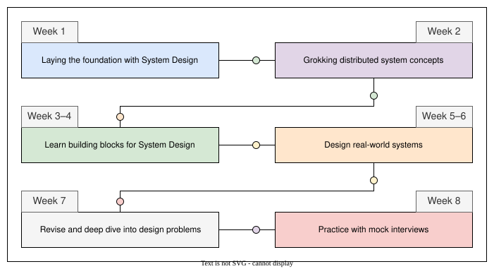

# How_Long_Does_It_Take_to_Prepare_for_a_System_Design_Interview

Source: https://www.educative.io/courses/grokking-the-system-design-interview/how-long-does-it-take-to-prepare-for-a-system-design-interview

---

[Home](https://www.educative.io/)

[Courses](https://www.educative.io/search?tab=courses)

[Grokking Modern System Design Interview](https://www.educative.io/courses/grokking-the-system-design-interview)

# How Long Does It Take to Prepare for a System Design Interview?

Plan your System Design interview preparation with a clear timeline. Allocate 3 to 16 weeks depending on your experience level and the role you’re targeting. Divide that time between core system design fundamentals and practice explaining trade-offs and decisions.

We'll cover the following...

- [The format of a System Design interview](https://www.educative.io/courses/grokking-the-system-design-interview/how-long-does-it-take-to-prepare-for-a-system-design-interview#The-format-of-a-System-Design-interview)
- [What to prepare for](https://www.educative.io/courses/grokking-the-system-design-interview/how-long-does-it-take-to-prepare-for-a-system-design-interview#What-to-prepare-for)
- [How long to prepare](https://www.educative.io/courses/grokking-the-system-design-interview/how-long-does-it-take-to-prepare-for-a-system-design-interview#How-long-to-prepare)
  - [Individual circumstances](https://www.educative.io/courses/grokking-the-system-design-interview/how-long-does-it-take-to-prepare-for-a-system-design-interview#Individual-circumstances)
  - [Skill level](https://www.educative.io/courses/grokking-the-system-design-interview/how-long-does-it-take-to-prepare-for-a-system-design-interview#Skill-level)
  - [The role or level being pursued](https://www.educative.io/courses/grokking-the-system-design-interview/how-long-does-it-take-to-prepare-for-a-system-design-interview#The-role-or-level-being-pursued)
- [Conclusion](https://www.educative.io/courses/grokking-the-system-design-interview/how-long-does-it-take-to-prepare-for-a-system-design-interview#Conclusion)

System Design interviews evaluate your ability to design and reason about large-scale distributed systems. Most production systems today run on distributed architectures, so companies expect candidates to understand system design fundamentals. System Design prep is a core part of most technical interview study plans. This lesson shows how to structure your preparation timeline and break down your study time.

## The format of a System Design interview[#](https://www.educative.io/courses/grokking-the-system-design-interview/how-long-does-it-take-to-prepare-for-a-system-design-interview#The-format-of-a-System-Design-interview)

Unlike coding interviews, System Design problems have no single correct answer. Interviewers prioritize your thought process over the final design. Success depends on your ability to communicate reasoning clearly and structure the discussion.

You’ll typically use a whiteboard (physical or virtual) to sketch your system architecture and explain your reasoning. A typical System Design interview follows these stages:

- Open-ended problem statement (e.g., “Design Instagram”).
- Requirement gathering (clarifying load, response times, and constraints).
- Design discussion (progressing from high-level to detailed components).
- Evaluation (justifying trade-offs).

> **Note:** While technical fundamentals are essential, you also need soft skills to demonstrate collaboration and clear communication.

## What to prepare for[#](https://www.educative.io/courses/grokking-the-system-design-interview/how-long-does-it-take-to-prepare-for-a-system-design-interview#What-to-prepare-for)

Effective preparation addresses both technical and interpersonal skills:

- Distributed systems concepts and design patterns.
- Components like load balancers, caches, and databases.
- Common questions (e.g., Design YouTube, URL Shortener, or Twitter).
- Mock interviews to build fluency.
- Company research (tech stacks and engineering culture).

> **Tip:** System Design rounds also assess culture fit. Study the company’s values; organizations like Amazon, Apple, and Netflix openly share their cultural principles.

## How long to prepare[#](https://www.educative.io/courses/grokking-the-system-design-interview/how-long-does-it-take-to-prepare-for-a-system-design-interview#How-long-to-prepare)

With a commitment of 2–3 hours per day (5 days a week), typical timelines are:

- **4–10 weeks** for beginners or those needing extra study time.
- **3–6 weeks** for those with prior System Design experience.

An 8-week example plan is shown below:

A roadmap for System Design interview preparation

Preparation duration varies based on individual factors. Some candidates may need up to 16 weeks depending on experience and pace.

Three major factors influence total preparation time:

1. Individual circumstances
2. Current skill level
3. Target role or level

### Individual circumstances[#](https://www.educative.io/courses/grokking-the-system-design-interview/how-long-does-it-take-to-prepare-for-a-system-design-interview#Individual-circumstances)

Non-technical factors often dictate your schedule, including:

- Learning speed
- Available study time

If System Design concepts are new to you, allocate extra time for internalization. Candidates with full schedules may need extended timelines.

> **Note:** The goal is internalization, not memorization. You must apply concepts to novel problems and justify design decisions under constraints.

### Skill level[#](https://www.educative.io/courses/grokking-the-system-design-interview/how-long-does-it-take-to-prepare-for-a-system-design-interview#Skill-level)

Your timeline depends on your familiarity with distributed systems:

- **Prior experience:** If you have designed large-scale systems, you may require less preparation.
- **Tech stack familiarity:** If you are new to specific technologies, budget extra time to understand their architecture.

Building a solid understanding of topics like scalability and fault tolerance takes time. Studying at a steady pace leads to better retention than cramming. You don’t need hands-on experience with a company’s exact tech stack. Interviewers prioritize how you reason about trade-offs and adapt to constraints over knowledge of specific tools or frameworks. Focus on core system design principles such as scalability, reliability, consistency, and performance.

### The role or level being pursued[#](https://www.educative.io/courses/grokking-the-system-design-interview/how-long-does-it-take-to-prepare-for-a-system-design-interview#The-role-or-level-being-pursued)

Expectations vary by position. The table below outlines typical requirements for each level:

|  |  |
| --- | --- |
| **Role/Level** | **Key Focus Areas** |
| **Junior/Mid-level Software Engineer** | - Understand basic System Design components. - Identify trade-offs (e.g., between requirements such as latency and availability). |
| **Senior Software Engineer** | - Explain how system components interact, describe the complete life cycle of a request (from client to server to backend), and align trade-offs with user and product goals. |
| **Staff Software Engineer** | - Identify potential bottlenecks, anticipate scaling issues and possible solutions, describe failover and recovery mechanisms, and assess how failures affect user experience and SLAs. |
| **Principal/Distinguished Engineer** | - Design for regional backups and disaster recovery, analyze query and usage patterns, and evaluate how outages or security breaches affect company reputation and SLA commitments. |
| **Technical Product or Project Manager** | - Understand scalable system behavior at a conceptual level, recognize distributed system components, and assess how budget and stakeholder constraints influence technology decisions. |

> **Note:** Each level builds on the skills and concepts from the previous one. Senior engineers are expected to demonstrate strong command of all foundational topics covered at earlier levels.

Candidates balancing professional responsibilities or learning System Design for the first time may benefit from an extended study period.

## Conclusion[#](https://www.educative.io/courses/grokking-the-system-design-interview/how-long-does-it-take-to-prepare-for-a-system-design-interview#Conclusion)

System Design interviews are critical for technical hiring. Effective preparation requires consistent study, conceptual understanding, and communication practice.

Estimated preparation timelines:

- **3–6 weeks** for experienced candidates
- **4–10 weeks** for beginners
- **Up to 16 weeks** for extended preparation

Strong System Design skills develop over time. Focus on understanding core concepts and trade-offs instead of memorizing patterns or templates. Solving practice problems on your own is not enough. You need to explain your decisions clearly, justify trade-offs, and engage the interviewer as if you’re discussing a real design with a teammate. Your preparation should also reflect how the interview itself is changing. In the next lesson, we look at how AI has reshaped the systems you design and what interviewers now expect.

System Design Interview Trap: Why Engineers Fail and Succeed

How AI Reshaped System Design and Interviews

Ask

[The format of a System Design interview](https://www.educative.io/courses/grokking-the-system-design-interview/how-long-does-it-take-to-prepare-for-a-system-design-interview#The-format-of-a-System-Design-interview)

[What to prepare for](https://www.educative.io/courses/grokking-the-system-design-interview/how-long-does-it-take-to-prepare-for-a-system-design-interview#What-to-prepare-for)

[How long to prepare](https://www.educative.io/courses/grokking-the-system-design-interview/how-long-does-it-take-to-prepare-for-a-system-design-interview#How-long-to-prepare)

[Individual circumstances](https://www.educative.io/courses/grokking-the-system-design-interview/how-long-does-it-take-to-prepare-for-a-system-design-interview#Individual-circumstances)

[Skill level](https://www.educative.io/courses/grokking-the-system-design-interview/how-long-does-it-take-to-prepare-for-a-system-design-interview#Skill-level)

[The role or level being pursued](https://www.educative.io/courses/grokking-the-system-design-interview/how-long-does-it-take-to-prepare-for-a-system-design-interview#The-role-or-level-being-pursued)

[Conclusion](https://www.educative.io/courses/grokking-the-system-design-interview/how-long-does-it-take-to-prepare-for-a-system-design-interview#Conclusion)