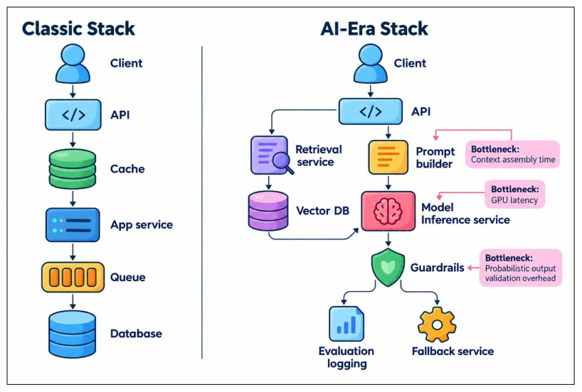

# How_AI_Reshaped_System_Design_and_Interviews

Source: https://www.educative.io/courses/grokking-the-system-design-interview/how-ai-reshaped-system-design-and-interviews

---

[Home](https://www.educative.io/)

[Courses](https://www.educative.io/search?tab=courses)

[Grokking Modern System Design Interview](https://www.educative.io/courses/grokking-the-system-design-interview)

# How AI Reshaped System Design and Interviews

Explore how AI changes traditional System Design assumptions. Learn to balance cost, latency, and quality when integrating large models. Manage request budgets, scaling metrics, and grounding mechanisms. Distinguish deterministic from probabilistic components while addressing safety, relevance, and other nonfunctional requirements in System Design interviews.

We'll cover the following...

- [The new boxes in modern architectures](https://www.educative.io/courses/grokking-the-system-design-interview/how-ai-reshaped-system-design-and-interviews#The-new-boxes-in-modern-architectures)
- [Where classic assumptions break](https://www.educative.io/courses/grokking-the-system-design-interview/how-ai-reshaped-system-design-and-interviews#Where-classic-assumptions-break)
- [The new design levers](https://www.educative.io/courses/grokking-the-system-design-interview/how-ai-reshaped-system-design-and-interviews#The-new-design-levers)
- [How the interview changed](https://www.educative.io/courses/grokking-the-system-design-interview/how-ai-reshaped-system-design-and-interviews#How-the-interview-changed)
- [Conclusion](https://www.educative.io/courses/grokking-the-system-design-interview/how-ai-reshaped-system-design-and-interviews#Conclusion)

In a System Design interview, you’re asked to design a customer support chat system. You propose a client, an API gateway, a cache, stateless application servers, a message queue, and a sharded database. The interviewer then asks how the system finds the right policy documents, how a model call fits within the response-time budget, and how you know a generated answer is supported by evidence. None of the boxes on the board answers those questions.

Classical components still carry the load, but the request path now includes model inference: a dependency that is slow, expensive per call, and nondeterministic. This lesson covers the components AI adds, the assumptions it breaks, the levers that keep it under control, and what interviewers now expect.

**Key idea:** AI design decisions trade among cost, latency, and output quality. In an interview, say which one you’re spending and why.

## The new boxes in modern architectures[#](https://www.educative.io/courses/grokking-the-system-design-interview/how-ai-reshaped-system-design-and-interviews#The-new-boxes-in-modern-architectures)

AI features add components to the critical request path. Each brings its own scaling and failure behavior:

- **Model inference service:** Runs the model or calls a hosted provider. Its latency, reliability, and cost vary with prompt and output length.
- **Embedding pipeline:** Converts text into vectors offline or nearline so retrieval can match meaning, not just keywords.
- **Vector database:** Indexes embeddings for nearest-neighbor search. It complements transactional stores rather than replacing them.
- **Retrieval and RAG layer:** Fetches relevant proprietary context and assembles it into the prompt before inference.
- **GPU or accelerator fleet:** Scarce, expensive capacity whose throughput depends on batching and memory, not just replica count.
- **Context and memory manager:** Selects, trims, and summarizes conversation history to fit the model’s context window.
- **Agent orchestration:** Runs multistep tool calls with retries, branching, and stop conditions.
- **Guardrails and evaluation:** Check safety, policy, and quality inline or shortly after generation.

The diagram below compares a classic request path with an AI request path.

Typical System Design request path vs. AI-oriented System Design request path

**Note:** Each new box adds its own scaling and failure modes, so naming the component is never enough in an interview.

## Where classic assumptions break[#](https://www.educative.io/courses/grokking-the-system-design-interview/how-ai-reshaped-system-design-and-interviews#Where-classic-assumptions-break)

Each assumption below held for classic services and breaks once inference sits on the request path.

- **Compute is no longer cheap:** Hosted model cost scales with tokens and model choice, so one endpoint can spend most of its budget on inference. Model routing, caching, and context trimming become architectural concerns.
- **Latency is no longer tight:** A database read takes milliseconds; inference takes hundreds of milliseconds to seconds. Designs stream output and budget time to first token separately from full-response latency.
- **Outputs are no longer deterministic:** Retrieved context, history, and sampling change the output for the same query. Exact-match response caching weakens, so systems cache stable intermediates such as embeddings, retrieval results, and prompt templates.
- **Up no longer means correct:** A healthy system can still return wrong, stale, or unsafe answers. Nonfunctional requirements now include relevance, groundedness, and safety alongside latency and uptime.
- **Data is increasingly unstructured:** Many queries hit document corpora through semantic similarity, with reranking between retrieval and prompting.

**Note:** Adding a larger model can improve answer quality and still fail the design if the latency budget or daily cost ceiling collapses.

The table below summarizes these shifts for quick recall.

## AI System Design Shifts

|  |  |  |  |
| --- | --- | --- | --- |
| **Area** | **Old Assumption** | **AI Change** | **System Design Consequence** |
| Compute | Capacity is mostly fixed per request | Cost varies by model, context length, and tool use | Use model routing and budget-aware orchestration |
| Latency | Response waits for full processing to finish | Users can benefit from partial output as it is generated | Stream tokens/results and design for progressive rendering |
| Determinism | Same input should produce the same output | Outputs may vary across runs and model versions | Add guardrails, versioning, and retry/verification paths |
| Quality metrics | Correctness is measured by exact rules or test cases | Quality is often probabilistic and task-dependent | Use eval harnesses, human review, and task-specific benchmarks |
| Data model | Structured records are the primary source of truth | Useful context may be unstructured, embedded, or retrieved dynamically | Support hybrid retrieval across SQL, vector, and document stores |
| Failure modes | Errors are usually explicit and easy to detect | Models can be wrong but confident and fluent | Add safe fallback responses, confidence checks, and escalation paths |

## The new design levers[#](https://www.educative.io/courses/grokking-the-system-design-interview/how-ai-reshaped-system-design-and-interviews#The-new-design-levers)

AI systems don’t replace deterministic components with model calls. The design work is deciding where model behavior is allowed, constrained, validated, or bypassed, while keeping each request within its latency, token, and cost budget.

- **Cost control:** Check a semantic cache first, route simple prompts to a small model, reserve a larger model for hard cases, and trim context before inference.
- **Capacity planning:** Track tokens per second, concurrency per GPU, batch size, and KV cache memory. Admission control sheds low-priority traffic before queues turn into timeouts.
- **Grounding and policy:** Retrieve trusted context, attach citations, filter prompts and outputs, and gate rollouts on evaluation results the way CI gates on tests.
- **State management:** Keep recent turns in the context window, summarize or store long-term memory externally, and checkpoint multistep agent workflows so they resume after a failure.

**Practical tip:** In an interview, say which part must remain deterministic. Access control, pricing rules, and final side effects rarely belong inside generation.

Every lever is a trade-off. A larger context window can improve grounding but raises latency and cost, while aggressive trimming saves tokens but can drop the facts the model needs. Strong candidates quantify these trade-offs rather than describe them.

## How the interview changed[#](https://www.educative.io/courses/grokking-the-system-design-interview/how-ai-reshaped-system-design-and-interviews#How-the-interview-changed)

AI shows up in interviews in two ways. New problem types, such as code assistants, grounded knowledge assistants, and shared inference platforms, are AI systems from the start. Classic problems gain AI components: search adds semantic retrieval and reranking, support systems generate answers from ticket history and policy documents, and recommendation systems run model inference online.

A strong answer separates deterministic responsibilities from probabilistic ones. It defines where retrieval happens, what the model may generate, and what happens when evidence is weak or inference exceeds its budget. It also volunteers the expanded nonfunctional requirements: cost ceilings, token budgets, quality metrics such as hallucination rate, privacy, safety, and a degraded mode, such as returning cited search results when generation is disabled.

**Note:** Drawing more boxes is not the signal. Defending why those boxes exist, how they fail, and what fallback path activates is the signal.

The map below summarizes what interviewers now probe.

The categories interviews now probe

## Conclusion[#](https://www.educative.io/courses/grokking-the-system-design-interview/how-ai-reshaped-system-design-and-interviews#Conclusion)

Classical System Design is still the base layer: load balancers, queues, partitioning, retries, and fault isolation. AI adds probabilistic inference, semantic retrieval, GPU-bound capacity, and quality controls on top. Compute is more expensive, latency is less predictable, outputs vary, and failure can mean confidently wrong rather than down. Strong candidates surface these trade-offs early and quantify them with latency, token, cost, and quality budgets.

The next lesson looks at how this shift changed the roles that hire for it and how interviewers evaluate each level.

How Long Does It Take to Prepare for a System Design Interview?

How Roles and Tools Reshaped the System Design Interview

Ask

[The new boxes in modern architectures](https://www.educative.io/courses/grokking-the-system-design-interview/how-ai-reshaped-system-design-and-interviews#The-new-boxes-in-modern-architectures)

[Where classic assumptions break](https://www.educative.io/courses/grokking-the-system-design-interview/how-ai-reshaped-system-design-and-interviews#Where-classic-assumptions-break)

[The new design levers](https://www.educative.io/courses/grokking-the-system-design-interview/how-ai-reshaped-system-design-and-interviews#The-new-design-levers)

[How the interview changed](https://www.educative.io/courses/grokking-the-system-design-interview/how-ai-reshaped-system-design-and-interviews#How-the-interview-changed)

[Conclusion](https://www.educative.io/courses/grokking-the-system-design-interview/how-ai-reshaped-system-design-and-interviews#Conclusion)