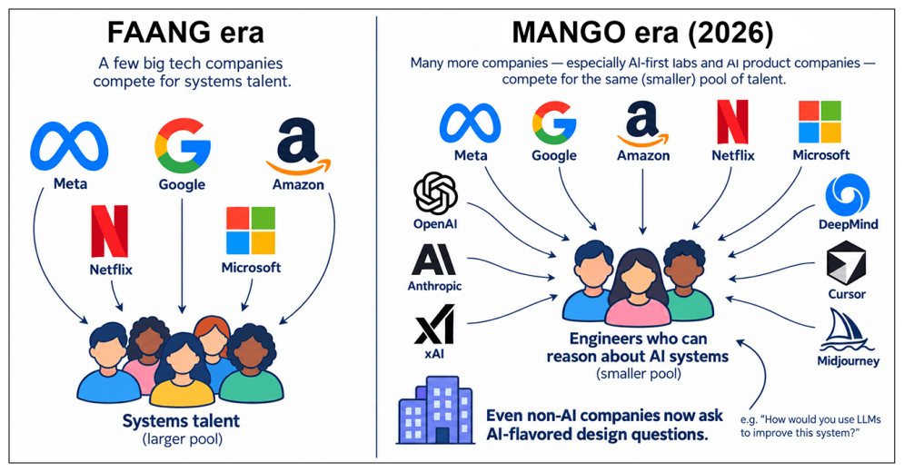

# How_Roles_and_Tools_Reshaped_the_System_Design_Interview

Source: https://www.educative.io/courses/grokking-the-system-design-interview/how-roles-and-tools-reshaped-the-system-design-interview

---

[Home](https://www.educative.io/)

[Courses](https://www.educative.io/search?tab=courses)

[Grokking Modern System Design Interview](https://www.educative.io/courses/grokking-the-system-design-interview)

# How Roles and Tools Reshaped the System Design Interview

Explore how AI tools are reshaping System Design and shifting the focus from coding to engineering judgment. Learn to frame problems, make architectural decisions, integrate systems, and evaluate AI-generated outputs. Prepare for evolving system design interviews that emphasize reasoning, decision-making, and effective use of AI tools.

We'll cover the following...

- [The employer map redrew itself](https://www.educative.io/courses/grokking-the-system-design-interview/how-roles-and-tools-reshaped-the-system-design-interview#The-employer-map-redrew-itself)
- [AI tools changed the job itself](https://www.educative.io/courses/grokking-the-system-design-interview/how-roles-and-tools-reshaped-the-system-design-interview#AI-tools-changed-the-job-itself)
- [New engineering roles that emerged](https://www.educative.io/courses/grokking-the-system-design-interview/how-roles-and-tools-reshaped-the-system-design-interview#New-engineering-roles-that-emerged)
- [What “good” looks like at each level](https://www.educative.io/courses/grokking-the-system-design-interview/how-roles-and-tools-reshaped-the-system-design-interview#What-good-looks-like-at-each-level)
- [The interview itself is adapting](https://www.educative.io/courses/grokking-the-system-design-interview/how-roles-and-tools-reshaped-the-system-design-interview#The-interview-itself-is-adapting)
- [Conclusion](https://www.educative.io/courses/grokking-the-system-design-interview/how-roles-and-tools-reshaped-the-system-design-interview#Conclusion)

Two engineers use the same AI coding tool to build a customer support assistant. The first generates a chat feature without defining requirements or reviewing the code. It answers without sufficient evidence, struggles under production load, and costs more than expected to run.

The second engineer first defines the retrieval and generation workflows, sets inference cost limits, and specifies fallback behavior when evidence is insufficient. Then they use the same tool to implement the design and validate the result.

The difference is the design work before and after using the tool, not the tool itself. The previous lesson covered how AI changed the systems you design; this lesson covers how it changed the job market around them. The shift happened along two axes:

- **Demand:** New companies emerged and existing ones created AI-focused roles, increasing demand for engineers who can design, evaluate, and operate AI systems.
- **Skill threshold:** AI tools automated much of routine implementation, shifting weight toward problem framing, architecture, review, and technical judgment.

Both axes point to the skill a System Design interview measures: judgment.

## The employer map redrew itself[#](https://www.educative.io/courses/grokking-the-system-design-interview/how-roles-and-tools-reshaped-the-system-design-interview#The-employer-map-redrew-itself)

For years, FAANG was the tier engineers optimized for. That map is out of date. **MANGO** is the new FAANG: a broader field where AI-first companies compete with big tech for the same systems talent.

Interview expectations shifted in two ways. AI-focused companies emphasize AI infrastructure: model inference, retrieval, agent architectures, and inference cost at scale. Companies outside AI are adding AI features to their products, so AI-related design questions now appear across industries and roles.

Comparison of FAANG only vs. the broad hiring market in AI era

**Note:** AI literacy is becoming part of the baseline for System Design interviews across a growing range of companies and roles.

## AI tools changed the job itself[#](https://www.educative.io/courses/grokking-the-system-design-interview/how-roles-and-tools-reshaped-the-system-design-interview#AI-tools-changed-the-job-itself)

Agentic coding assistants now handle much of what used to fill an engineer’s day: boilerplate, first drafts, glue code, test scaffolding, and migrations. A week of typing becomes an afternoon of directing.

That doesn’t lower the value of engineering skill; it moves it. When code is cheap, the bottleneck becomes the decisions a tool can’t own: what to build, how the pieces fit, which trade-offs to accept, and whether the output is correct at scale. That is System Design.

**Note:** An AI assistant can produce an architecture that looks sound but ignores inference cost, grounding, and failure handling, the concerns from the previous lesson. Generating a design doesn’t replace evaluating it.

With implementation accelerated, more of the job is work that still needs judgment: framing the problem, designing interfaces and data flow, reviewing generated code and designs for correctness, security, performance, and cost, and integrating components into a reliable system.

System Design role reshaped: Before vs. after AI assistant tools

## New engineering roles that emerged[#](https://www.educative.io/courses/grokking-the-system-design-interview/how-roles-and-tools-reshaped-the-system-design-interview#New-engineering-roles-that-emerged)

Growing demand and AI tooling created or expanded the roles below. You don’t need to target all of them, but know how they differ: most emphasize systems judgment, integration, and production trade-offs, while a few require deeper model expertise.

A role map for modern AI System Design responsibilities

These roles are already established. The **Forward Deployed Engineer**, historically associated with Palantir, has been adopted by OpenAI, Anthropic, and Google Cloud. [OpenAI](https://openai.com/careers/search/) describes its FDEs as leading customer deployments from technical scoping and System Design through production rollout. [Anthropic](https://www.anthropic.com/careers/jobs?from_blog=true) has a dedicated Applied AI organization with roles such as Applied AI Engineer, Applied AI Architect, and Forward Deployed Engineer.

**Note:** You don’t need to become an ML researcher. These roles expect you to understand serving, retrieval, agents, and cost, not to train models from scratch.

## What “good” looks like at each level[#](https://www.educative.io/courses/grokking-the-system-design-interview/how-roles-and-tools-reshaped-the-system-design-interview#What-good-looks-like-at-each-level)

The same AI design problem is scored differently by level, because interviewers listen for a specific altitude of thinking.

|  |  |  |  |
| --- | --- | --- | --- |
| **Level** | **What Interviewer Expects** | **Typical Strong Signal** | **Common Weak Answer** |
| Entry/L4 | Places the AI components correctly, explains what each does, and understands that inference is expensive and slow. | Places retrieval before generation, explains why context is fetched first, and notes token/model costs matter | Treats RAG as an add-on after generation or ignores inference cost |
| Senior/L5 | Reasons through the cost/latency/quality trade-off, chooses retrieval and serving strategies deliberately and justifies them, and volunteers the new NFRs. | Explicitly weighs retrieval against bigger context windows or stronger models, with rationale for when each is better | Recommends one approach without comparing trade-offs or operational impact |
| Staff/L6+ | Architects for scale and defends trade-offs under pushback; owns the eval/quality strategy, cost envelope, and failure/degradation story across the whole system; frames decisions in terms of operating at scale, not just building. | Defines metrics and evaluation cycles, fallback behavior under failure, spend limits, safe rollout stages, and shared reliability processes | Focuses only on model quality and skips rollout, failure handling, or organizational ownership |

The verbs climb with level: place, reason through, then architect and defend. At L4 you show you know the components; at L6 you show why they exist and what happens when they fail.

## The interview itself is adapting[#](https://www.educative.io/courses/grokking-the-system-design-interview/how-roles-and-tools-reshaped-the-system-design-interview#The-interview-itself-is-adapting)

As the valued skill moved from producing to deciding, interview formats followed:

- **Some companies allow AI tools in the interview:** That makes the test harder, not easier. When the assistant can write the code, interviewers grade how you frame the problem, direct the tool, and verify its output.
- **Evaluation and iteration are in scope:** Expect to explain how you’d measure quality and improve the system after launch, not just draw the first architecture.

**Note:** If you're allowed AI tools in an interview, narrate your judgment out loud, why this approach, what you’re checking in the output, where you'd distrust it. Silently pasting a generated answer reads as *junior*, not efficient.

## Conclusion[#](https://www.educative.io/courses/grokking-the-system-design-interview/how-roles-and-tools-reshaped-the-system-design-interview#Conclusion)

The market moved on two axes that meet at one point. New companies and roles widened who hires for AI systems, and AI tools that absorb mechanical work raised what those employers expect. Both reward judgment: deciding what to build, defending the trade-offs, and knowing the limits of both the model and the tools that write your code. Specific frameworks will age; the ability to reason about cost, latency, quality, and failure across a system will not.

Judgment grows with practice under realistic conditions. The next lesson shows how mock interviews, including AI-driven ones, let you rehearse these decisions and get feedback before the real interview.

How AI Reshaped System Design and Interviews

System Design Mock Interviews

Ask

[The employer map redrew itself](https://www.educative.io/courses/grokking-the-system-design-interview/how-roles-and-tools-reshaped-the-system-design-interview#The-employer-map-redrew-itself)

[AI tools changed the job itself](https://www.educative.io/courses/grokking-the-system-design-interview/how-roles-and-tools-reshaped-the-system-design-interview#AI-tools-changed-the-job-itself)

[New engineering roles that emerged](https://www.educative.io/courses/grokking-the-system-design-interview/how-roles-and-tools-reshaped-the-system-design-interview#New-engineering-roles-that-emerged)

[What “good” looks like at each level](https://www.educative.io/courses/grokking-the-system-design-interview/how-roles-and-tools-reshaped-the-system-design-interview#What-good-looks-like-at-each-level)

[The interview itself is adapting](https://www.educative.io/courses/grokking-the-system-design-interview/how-roles-and-tools-reshaped-the-system-design-interview#The-interview-itself-is-adapting)

[Conclusion](https://www.educative.io/courses/grokking-the-system-design-interview/how-roles-and-tools-reshaped-the-system-design-interview#Conclusion)