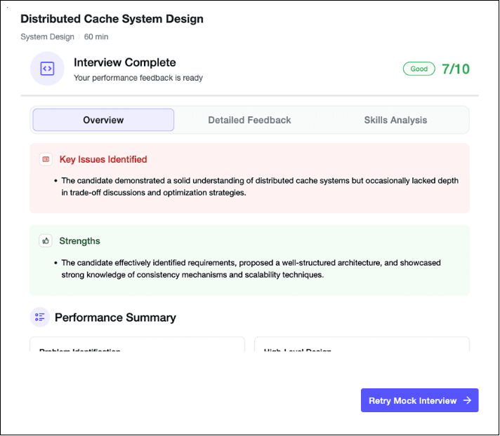
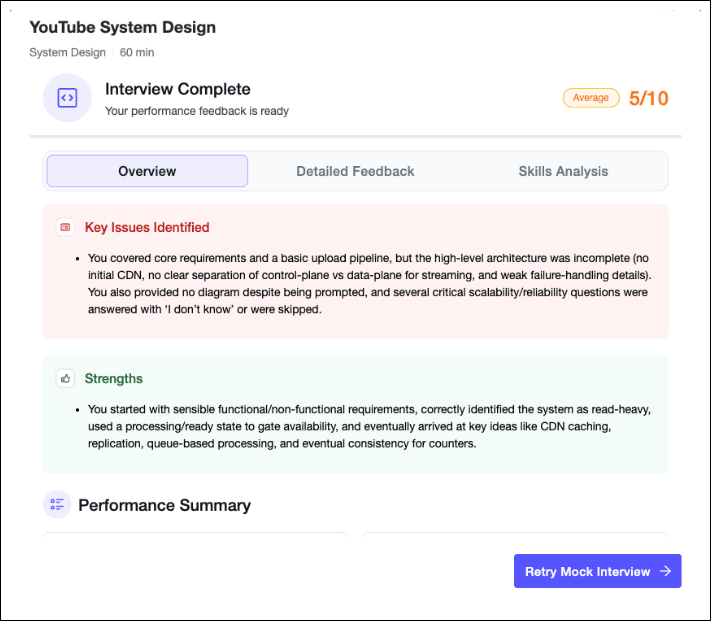

# System_Design_Mock_Interviews

Source: https://www.educative.io/courses/grokking-the-system-design-interview/system-design-mock-interviews

---

[Home](https://www.educative.io/)

[Courses](https://www.educative.io/search?tab=courses)

[Grokking Modern System Design Interview](https://www.educative.io/courses/grokking-the-system-design-interview)

# System Design Mock Interviews

Learn why mock interviews are a critical part of System Design preparation, how to use AI-driven mock interviewers, including Educative’s, effectively, and how to practice the AI features that interviews now include.

We'll cover the following...

- [The role of mock interviews](https://www.educative.io/courses/grokking-the-system-design-interview/system-design-mock-interviews#The-role-of-mock-interviews)
  - [Benefits of mock interviews](https://www.educative.io/courses/grokking-the-system-design-interview/system-design-mock-interviews#Benefits-of-mock-interviews)
- [The AI mock interviewer](https://www.educative.io/courses/grokking-the-system-design-interview/system-design-mock-interviews#The-AI-mock-interviewer)
  - [Educative’s mock interviews for System Design](https://www.educative.io/courses/grokking-the-system-design-interview/system-design-mock-interviews#Educatives-mock-interviews-for-System-Design)
  - [Mock interview process](https://www.educative.io/courses/grokking-the-system-design-interview/system-design-mock-interviews#Mock-interview-process)
  - [How to make the most of AI mock interviews](https://www.educative.io/courses/grokking-the-system-design-interview/system-design-mock-interviews#How-to-make-the-most-of-AI-mock-interviews)
  - [An effective strategy for mock interviews](https://www.educative.io/courses/grokking-the-system-design-interview/system-design-mock-interviews#An-effective-strategy-for-mock-interviews)
  - [Practicing AI-era interviews](https://www.educative.io/courses/grokking-the-system-design-interview/system-design-mock-interviews#Practicing-AI-era-interviews)
  - [Common pitfalls to avoid in AI mock interviews](https://www.educative.io/courses/grokking-the-system-design-interview/system-design-mock-interviews#Common-pitfalls-to-avoid-in-AI-mock-interviews)
- [Conclusion](https://www.educative.io/courses/grokking-the-system-design-interview/system-design-mock-interviews#Conclusion)

Even experienced engineers feel pressure during System Design interviews. The challenge is not just the high expectations of top companies like Meta or Google, but also the need to translate complex requirements into scalable, distributed systems under tight time constraints.

These interviews test technical skills and the ability to independently balance trade-offs. Theory alone is insufficient; you need a deep grasp of real-world systems to solve problems in real-time. Mock interviews are the most practical way to prepare, offering hands-on practice to refine strategies.

## The role of mock interviews[#](https://www.educative.io/courses/grokking-the-system-design-interview/system-design-mock-interviews#The-role-of-mock-interviews)

**Mock interviews** recreate the pressure of a real interview. They force you to think quickly, handle unexpected questions, and defend your design choices.

To get the most out of a mock interview, review core concepts and practice a few design problems in advance. A mock interview usually begins with a design prompt, followed by requirement scoping and a step-by-step walkthrough of your proposed architecture. After the discussion, the interviewer gives targeted feedback on what you handled well and where your design or communication could improve. This process helps you get comfortable thinking out loud, structuring your answers, and defending trade-offs under time constraints.

### Benefits of mock interviews[#](https://www.educative.io/courses/grokking-the-system-design-interview/system-design-mock-interviews#Benefits-of-mock-interviews)

- **Practice under pressure:** Helps simulate high-stress scenarios and time limits in a low-risk setting.
- **Feedback:** Helps identify weaknesses and target specific areas for improvement.
- **Confidence:** Repeated practice makes real interviews easier to manage.
- **Adaptability:** Exposure to different questioning styles and system types improves problem-solving agility.

## The AI mock interviewer[#](https://www.educative.io/courses/grokking-the-system-design-interview/system-design-mock-interviews#The-AI-mock-interviewer)

Educative uses generative AI to create [AI-driven mock interviewers](https://www.educative.io/mock-interview). These tools simulate real interviews, allowing you to practice articulating thoughts and solving problems.

While AI cannot fully replace human interviewers, it offers distinct advantages:

- **Accessibility:** Available 24/7 for flexible preparation.
- **Instant feedback:** Provides objective, real-time evaluations.
- **Cost-effective:** Less expensive than traditional coaching, allowing for frequent practice.
- **Adaptability:** Adjusts question difficulty based on performance.
- **Current:** Constantly updated with recruitment trends and user feedback.
- **Expert-designed:** Built with input from FAANG engineers to ensure realism.
- **Integrated:** Connects with System Design courses for a unified learning cycle.

### Educative’s mock interviews for System Design[#](https://www.educative.io/courses/grokking-the-system-design-interview/system-design-mock-interviews#Educatives-mock-interviews-for-System-Design)

Educative provides AI interviewers for specific companies (such as Meta, Google, and Amazon) and individual design problems.

- TikTok System Design
- Distributed Cache System Design
- Pub-Sub System Design
- Web Crawler System Design
- Uber Eats System Design
- Zoom System Design
- YouTube System Design
- X (Twitter) System Design
- WhatsApp System Design
- Uber System Design
- Typeahead System Design
- TinyURL System Design
- Ticketmaster System Design
- Spotify System Design
- Reddit System Design
- Payment System Design

- NewsFeed System Design
- Netflix System Design
- Linkedin System Design
- LeetCode System Design
- Instagram System Design
- Google Maps System Design
- Google Docs System Design
- Facebook Messenger System Design
- E-Commerce Store System Design
- Discord System Design
- Deployment System Design
- Content Delivery Network (CDN) System Design
- ChatGPT System Design
- Blob Store System Design
- Apple App Store System Design
- Airbnb System Design

The illustration below displays examples of System Design interviewers on the platform:

Educative’s System Design mock interviews

> **Note:** Mock interviews are also available for domains like API design, coding, generative AI, machine learning, and low-level design.

### Mock interview process[#](https://www.educative.io/courses/grokking-the-system-design-interview/system-design-mock-interviews#Mock-interview-process)

A **mock interviewer** follows a structured process to simulate a real System Design interview:

1. **Clarifying requirements:** The interviewer identifies functional and non-functional requirements.
2. **High-level design:** You outline the architecture and component interactions.
3. **API and data model:** The interviewer assesses your API design and data structures.
4. **Workflow and detailed design:** You explain the system workflow and justify design decisions.

The difficulty increases as the interview progresses. Sample questions include:

- How would you design the upload process to support high volumes of concurrent video uploads?
- How would you design a system to recommend personalized video content? What data would you collect and how would you process it in real time?
- How would you ensure the system scales to handle millions of concurrent users while maintaining fault tolerance?
- How would you handle age-restricted content on YouTube? What mechanisms ensure access only for the appropriate audience?

5. **Balancing trade-offs:** The interviewer evaluates your ability to weigh trade-offs, such as scalability vs. performance.
6. **Feedback:** You receive a qualitative evaluation ranging from Unsatisfactory to Excellent.

The illustration below compares a good performance against an average one:

1 / 2

“Good” feedback provided by the mock interviewer

1 / 2

“Average” feedback provided by the mock interviewer

> **Note:** The interview lasts about 45 minutes. Feedback helps you address weaknesses and prepare for future interviews.

### How to make the most of AI mock interviews[#](https://www.educative.io/courses/grokking-the-system-design-interview/system-design-mock-interviews#How-to-make-the-most-of-AI-mock-interviews)

To maximize the benefits of AI mock interviews:

- **Treat it as real:** Approach every session with the focus and preparation of a live interview.
- **Focus on feedback:** Review feedback carefully to identify recurring issues.
- **Repeat and refine:** Practice regularly to build fluency and confidence.
- **Use integrated platforms:** Combine mock interviews with related courses for continuous learning.

### An effective strategy for mock interviews[#](https://www.educative.io/courses/grokking-the-system-design-interview/system-design-mock-interviews#An-effective-strategy-for-mock-interviews)

Beyond practice, strengthen your understanding of core distributed system components:

- DNS
- Load balancers
- Databases
- Key-value stores
- Content delivery networks (CDNs)
- Sequencers
- Service monitoring
- Distributed logging systems

- Distributed caches
- Messaging queues
- Pub/sub systems
- Blob storage
- Distributed search
- Task schedulers
- Sharded counters
- Rate limiters

Mastering these elements enables you to design scalable and fault-tolerant systems. You can further improve preparation by categorizing systems by functionality:

- Video streaming systems (YouTube, Netflix)
- Real-time communication systems (WhatsApp, Facebook Messenger)
- Ride-hailing systems (Uber, Lyft)
- Feed-based social networks (Instagram, TikTok)
- Cloud-based collaboration or file systems (Dropbox, Google Drive)

Categorization of System Designs based on their functionalities

Tailor your practice sessions to these categories to address relevant design challenges.

### Practicing AI-era interviews[#](https://www.educative.io/courses/grokking-the-system-design-interview/system-design-mock-interviews#Practicing-AI-era-interviews)

As the previous two lessons showed, many interviews now include AI features. Practice them explicitly:

- **Review the AI building blocks:** Models as components, ranking pipelines, tokens and context windows, embeddings and retrieval, RAG and agents, model serving, and evaluation, all covered in the AI building blocks chapter.
- **Practice an AI-native problem:** Run a mock interview where AI is the core of the product, such as ChatGPT System Design.
- **Expect AI extensions to classic problems:** In a classic prompt such as YouTube, be ready when the interviewer adds an AI feature, and explain its latency budget, cost, quality metrics, and fallback.

In each session, say which parts of the design are deterministic and which depend on the model, and how you would measure answer quality. Interviewers treat this as a seniority signal.

### Common pitfalls to avoid in AI mock interviews[#](https://www.educative.io/courses/grokking-the-system-design-interview/system-design-mock-interviews#Common-pitfalls-to-avoid-in-AI-mock-interviews)

Avoid these common mistakes to ensure steady progress:

- **Ignoring feedback:** Reviewing and acting on insights is essential for growth.
- **Skipping real conditions:** Adhere to time limits and focused environments to ensure readiness for actual interviews.

## Conclusion[#](https://www.educative.io/courses/grokking-the-system-design-interview/system-design-mock-interviews#Conclusion)

Strong System Design interview performance is often required for senior engineering roles. AI-driven mock interviews replicate real interview conditions and provide structured feedback so you can refine your design process and communication. Next, an AI evaluator reviews your current preparation and points out the areas to focus on before your first mock interview.

How Roles and Tools Reshaped the System Design Interview

Let AI Evaluate Your System Design Interview Preparation

Ask

[The role of mock interviews](https://www.educative.io/courses/grokking-the-system-design-interview/system-design-mock-interviews#The-role-of-mock-interviews)

[Benefits of mock interviews](https://www.educative.io/courses/grokking-the-system-design-interview/system-design-mock-interviews#Benefits-of-mock-interviews)

[The AI mock interviewer](https://www.educative.io/courses/grokking-the-system-design-interview/system-design-mock-interviews#The-AI-mock-interviewer)

[Educative’s mock interviews for System Design](https://www.educative.io/courses/grokking-the-system-design-interview/system-design-mock-interviews#Educatives-mock-interviews-for-System-Design)

[Mock interview process](https://www.educative.io/courses/grokking-the-system-design-interview/system-design-mock-interviews#Mock-interview-process)

[How to make the most of AI mock interviews](https://www.educative.io/courses/grokking-the-system-design-interview/system-design-mock-interviews#How-to-make-the-most-of-AI-mock-interviews)

[An effective strategy for mock interviews](https://www.educative.io/courses/grokking-the-system-design-interview/system-design-mock-interviews#An-effective-strategy-for-mock-interviews)

[Practicing AI-era interviews](https://www.educative.io/courses/grokking-the-system-design-interview/system-design-mock-interviews#Practicing-AI-era-interviews)

[Common pitfalls to avoid in AI mock interviews](https://www.educative.io/courses/grokking-the-system-design-interview/system-design-mock-interviews#Common-pitfalls-to-avoid-in-AI-mock-interviews)

[Conclusion](https://www.educative.io/courses/grokking-the-system-design-interview/system-design-mock-interviews#Conclusion)