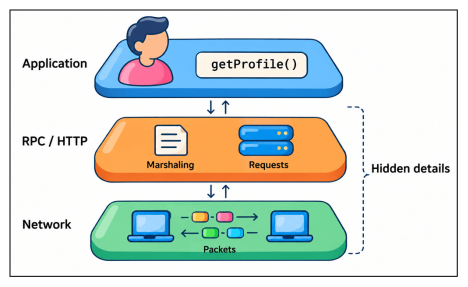

# Abstractions_in_System_Design

Source: https://www.educative.io/courses/grokking-the-system-design-interview/abstractions-in-system-design

---

[Home](https://www.educative.io/)

[Courses](https://www.educative.io/search?tab=courses)

[Grokking Modern System Design Interview](https://www.educative.io/courses/grokking-the-system-design-interview)

# Abstractions in System Design

Define abstraction as the technique of hiding complex details to focus on core goals in System Design. Understand how abstraction helps manage the complexity of distributed systems by separating high-level design decisions from infrastructure concerns, enabling teams to build and scale applications without dealing with low-level details at every step.

We'll cover the following...

- [What is abstraction?](https://www.educative.io/courses/grokking-the-system-design-interview/abstractions-in-system-design#What-is-abstraction)
- [Database abstraction](https://www.educative.io/courses/grokking-the-system-design-interview/abstractions-in-system-design#Database-abstraction)
- [Abstractions in distributed systems](https://www.educative.io/courses/grokking-the-system-design-interview/abstractions-in-system-design#Abstractions-in-distributed-systems)

## What is abstraction?[#](https://www.educative.io/courses/grokking-the-system-design-interview/abstractions-in-system-design#What-is-abstraction)

**Abstraction** hides unnecessary details to focus on the big picture. It manages complexity by obscuring its inner workings, allowing us to understand broader goals without getting lost in implementation details. The following illustration demonstrates this concept.

Abstraction lets each layer use the one below it without knowing its internal details

This abstraction allows us to discuss birds as a general category without analyzing specific details.

> **Note:** If we focused on a specific bird or its unique features, we would fail to recognize the general concept.

In software engineering, we rely on existing tools instead of rebuilding everything from scratch. We don’t manufacture hardware or implement an operating system just to run an application. Instead, developers use libraries and frameworks to build complex systems. Libraries expose well-defined interfaces that abstract away implementation details, which allows teams to reuse tested functionality across projects.

## Database abstraction[#](https://www.educative.io/courses/grokking-the-system-design-interview/abstractions-in-system-design#Database-abstraction)

**Transactions** are a database abstraction that hides the complexity of concurrent data access. They provide a simple interface: commit on success or abort on failure. This ensures data moves between consistent states, allowing developers to focus on business logic rather than concurrency issues.

## Abstractions in distributed systems[#](https://www.educative.io/courses/grokking-the-system-design-interview/abstractions-in-system-design#Abstractions-in-distributed-systems)

Abstractions in distributed systems simplify development by hiding low-level implementation details.

Cloud providers like AWS, Google Cloud, and Microsoft Azure offer distributed services with varying levels of abstraction. These services hide implementation details, enabling developers to focus on application logic rather than complex infrastructure.

Modern applications require distributed architectures to handle growing user bases. Abstractions allow engineers to scale applications quickly without being limited by single-node constraints.

> **Note:** This chapter covers abstractions in communications, data consistency, and failures. We focus on core concepts rather than exhaustive details.

Let AI Evaluate Your System Design Interview Preparation

Network Abstractions: Remote Procedure Calls

Ask

[What is abstraction?](https://www.educative.io/courses/grokking-the-system-design-interview/abstractions-in-system-design#What-is-abstraction)

[Database abstraction](https://www.educative.io/courses/grokking-the-system-design-interview/abstractions-in-system-design#Database-abstraction)

[Abstractions in distributed systems](https://www.educative.io/courses/grokking-the-system-design-interview/abstractions-in-system-design#Abstractions-in-distributed-systems)