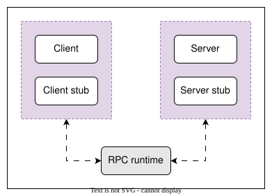

# Network_Abstractions_Remote_Procedure_Calls

Source: https://www.educative.io/courses/grokking-the-system-design-interview/network-abstractions-remote-procedure-calls

---

[Home](https://www.educative.io/)

[Courses](https://www.educative.io/search?tab=courses)

[Grokking Modern System Design Interview](https://www.educative.io/courses/grokking-the-system-design-interview)

# Network Abstractions: Remote Procedure Calls

Discover how Remote Procedure Calls (RPCs) function as a critical network abstraction for distributed systems. Learn the roles of client stubs and the RPC runtime in hiding complex network details, such as parameter packing and transport.

We'll cover the following...

- [What is an RPC?](https://www.educative.io/courses/grokking-the-system-design-interview/network-abstractions-remote-procedure-calls#What-is-an-RPC)
- [How does RPC work?](https://www.educative.io/courses/grokking-the-system-design-interview/network-abstractions-remote-procedure-calls#How-does-RPC-work)
  - [Real-world usage](https://www.educative.io/courses/grokking-the-system-design-interview/network-abstractions-remote-procedure-calls#Real-world-usage)
- [Summary](https://www.educative.io/courses/grokking-the-system-design-interview/network-abstractions-remote-procedure-calls#Summary)

RPCs abstract network communication, letting developers call functions on a remote server as if they were local method calls. This abstraction hides details such as argument serialization, network transmission, and retry logic.

## What is an RPC?[#](https://www.educative.io/courses/grokking-the-system-design-interview/network-abstractions-remote-procedure-calls#What-is-an-RPC)

**Remote Procedure Call (RPC)** is a widely used interprocess communication protocol in distributed systems. In the OSI model, it spans the transport and application layers. RPCs enable a program to execute a subroutine in a separate address space, typically on a different machine.

> **Note:** Programmers write the code as a standard local procedure call, ignoring the underlying details of remote interaction.

## How does RPC work?[#](https://www.educative.io/courses/grokking-the-system-design-interview/network-abstractions-remote-procedure-calls#How-does-RPC-work)

When a client makes a synchronous RPC call, the calling thread blocks until a response is received. The procedure arguments are serialized and transmitted to the remote server over the network. After the server completes execution, the response is sent back to the client, and the blocked thread resumes as if it had returned from a local function call. Consider a client-server setup with five main components:

The components of an RPC system

The **client machine** hosts the client, client stub, and an instance of the RPC runtime. The **server machine** hosts the server, server stub, and its own RPC runtime instance.

The RPC process follows these steps:

1. The client initiates the client stub process, passing parameters as usual. The client stub resides in the client’s address space.
2. The client stub converts the parameters into a standardized format, a process known as `marshaling`, and packs them into a message. It then requests the local RPC runtime to deliver the message to the server.
3. The client’s RPC runtime transmits the message across the network to the server and waits for a response.
4. The server's RPC runtime receives the message and passes it to the server stub.

> **Note:** The RPC runtime handles message transmission, retransmission, acknowledgment, and encryption.

5. The server stub unpacks the message (`unmarshaling`) to extract the parameters. It then calls the target server routine using a local procedure call.

The workflow of an RPC

6. The server routine executes with the given parameters and returns the result to the server stub.
7. The server stub packs the result into a message and passes it to the server’s RPC runtime.
8. The server’s RPC runtime sends the packed result back to the client’s RPC runtime over the network.
9. The client’s RPC runtime receives the result and passes it to the client stub.
10. The client stub unpacks the result, and execution returns to the caller.

> **Note:** Back-end services prefer RPC for its high performance and the simplicity of treating remote code as local functions.

AI Powered

Saved

No attempts left

Reset

don't knoe

No worries! Here’s a little hint: Think about why an application might want to control what happens when a network call takes too long or fails, instead of just relying on the default behavior hidden inside RPC. Give it another shot! Keep exploring.

You've used all your attempts

### Real-world usage[#](https://www.educative.io/courses/grokking-the-system-design-interview/network-abstractions-remote-procedure-calls#Real-world-usage)

RPCs are fundamental to many modern services:

- **Google:** Google uses *gRPC*, an open-source framework for building high-performance distributed systems. It facilitates efficient communication between components in services like Google Search and YouTube.
- **Uber:** Uber relies on *RPC* for real-time operations, including location tracking, ride matching, and data exchange between driver/rider apps and servers.
- **Facebook:** Facebook uses *Thrift* for RPC and data serialization. This enables interoperability between different languages, allowing, for example, a Python client to communicate seamlessly with a C++ server.

## Summary[#](https://www.educative.io/courses/grokking-the-system-design-interview/network-abstractions-remote-procedure-calls#Summary)

RPCs let programs call functions in another process or on another machine as if they were local calls. This abstraction lets developers build distributed systems without handling socket management, serialization, or retry logic directly. By isolating these concerns, engineers can focus on higher-level architecture and service interactions instead of transport-level details.

Abstractions in System Design

Spectrum of Consistency Models

Ask

[What is an RPC?](https://www.educative.io/courses/grokking-the-system-design-interview/network-abstractions-remote-procedure-calls#What-is-an-RPC)

[How does RPC work?](https://www.educative.io/courses/grokking-the-system-design-interview/network-abstractions-remote-procedure-calls#How-does-RPC-work)

[Real-world usage](https://www.educative.io/courses/grokking-the-system-design-interview/network-abstractions-remote-procedure-calls#Real-world-usage)

[Summary](https://www.educative.io/courses/grokking-the-system-design-interview/network-abstractions-remote-procedure-calls#Summary)