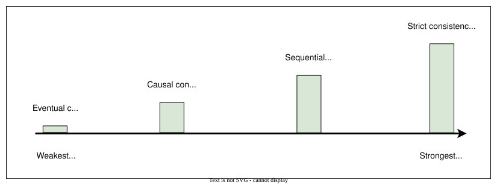
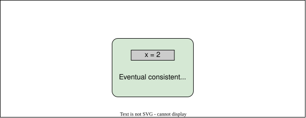
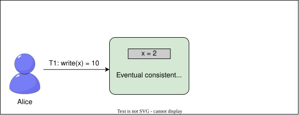
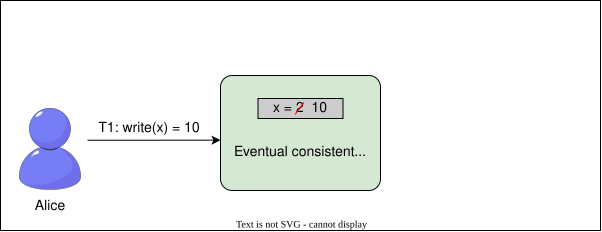
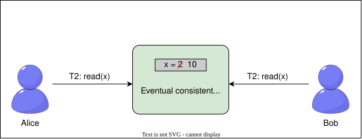
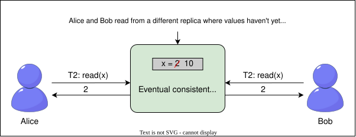
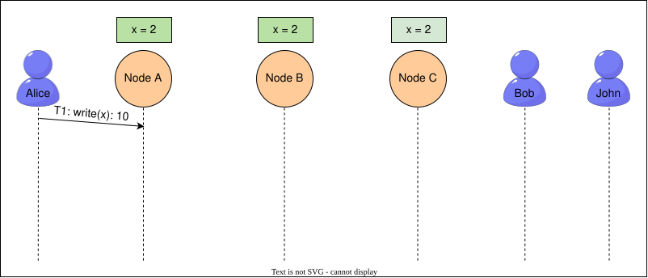
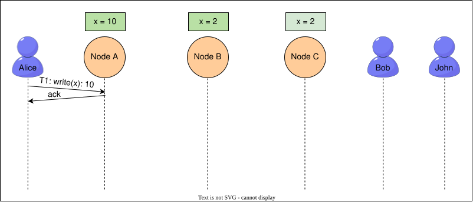
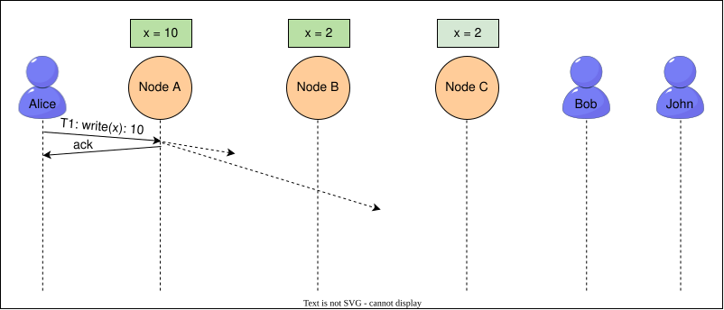
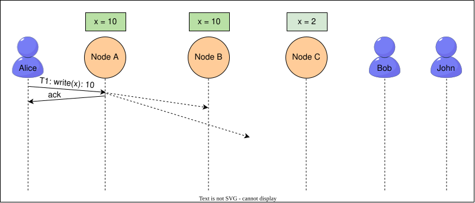

# Spectrum_of_Consistency_Models

Source: https://www.educative.io/courses/grokking-the-system-design-interview/spectrum-of-consistency-models

---

[Home](https://www.educative.io/)

[Courses](https://www.educative.io/search?tab=courses)

[Grokking Modern System Design Interview](https://www.educative.io/courses/grokking-the-system-design-interview)

# Spectrum of Consistency Models

Understand the range of consistency models, from eventual consistency to strict linearizability, and how they apply to distributed System Design. Evaluate how each model affects correctness guarantees, latency, and availability. Choose consistency guarantees based on application requirements.

We'll cover the following...

- [What is consistency?](https://www.educative.io/courses/grokking-the-system-design-interview/spectrum-of-consistency-models#What-is-consistency)
- [Eventual consistency](https://www.educative.io/courses/grokking-the-system-design-interview/spectrum-of-consistency-models#Eventual-consistency)
- [Causal consistency](https://www.educative.io/courses/grokking-the-system-design-interview/spectrum-of-consistency-models#Causal-consistency)
- [Sequential consistency](https://www.educative.io/courses/grokking-the-system-design-interview/spectrum-of-consistency-models#Sequential-consistency)
- [Strict consistency aka linearizability](https://www.educative.io/courses/grokking-the-system-design-interview/spectrum-of-consistency-models#Strict-consistency-aka-linearizability)
- [Summary](https://www.educative.io/courses/grokking-the-system-design-interview/spectrum-of-consistency-models#Summary)

## What is consistency?[#](https://www.educative.io/courses/grokking-the-system-design-interview/spectrum-of-consistency-models#What-is-consistency)

In distributed systems, consistency has multiple definitions. It can refer to all replicas sharing the same view of data, or read requests returning the most recent write. **Consistency models** provide abstractions to reason about data correctness during concurrent reads, writes, and mutations.

When integrating storage systems such as S3 or Cassandra, engineers need to understand the consistency guarantees those systems provide. Consistency models fall along a spectrum with two extremes:

- Strongest consistency
- Weakest consistency

Various consistency models lie between these two ends, as shown in the illustration below:

Spectrum of consistency models, consistency guarantees get stronger as we move to the right

There is a distinction between consistency in ACID properties and consistency in the [CAP theorem](https://www.educative.io/answers/what-is-the-cap-theorem).

**ACID consistency** enforces database rules. If a schema requires unique values, the system ensures no duplicates exist. If a foreign key links rows, the system prevents inconsistent states, such as deleting a base row while related rows remain.

**CAP consistency** guarantees that every replica in a distributed system holds the same logical value at any given time. While physical replication across a cluster takes time due to latency, the system ensures clients do not see divergent values.

## Eventual consistency[#](https://www.educative.io/courses/grokking-the-system-design-interview/spectrum-of-consistency-models#Eventual-consistency)

**Eventual consistency** is the weakest model. It guarantees that all replicas will converge to the same final value once writes stop. This model suits applications that do not require strict ordering or immediate access to the latest write. Until convergence, replicas may return stale or differing data.

1 / 6

Initially, the value of x is 2

1 / 6

At time T1, Alice sends a write request to update the value of x to 10

1 / 6

The system saves the updated value of x

1 / 6

At time T2, Alice and Bob read the value of x

1 / 6

The system returns the same value to both read requests, but the value is old

Eventual consistency enables *high availability*.

> **Note:** Cassandra is a highly available NoSQL database that provides eventual consistency.

**Example:**

The **Domain Name System (DNS)** is a highly available system that serves millions of devices. It uses an eventual consistency model; updates to domain records may not reflect immediately across the entire internet.

## Causal consistency[#](https://www.educative.io/courses/grokking-the-system-design-interview/spectrum-of-consistency-models#Causal-consistency)

**Causal consistency** preserves the order of *causally related* (dependent) operations. Independent operations have no guaranteed order.

In the illustration below, process P1 writes value *a* at location x. Process P2 reads *x* to calculate b (where b = x + 5). Because the write to *y* depends on the read of *x*, these operations are causally related.

Causal consistency

Causal consistency does not order unrelated operations; different clients may see them in different sequences. This model is weaker than sequential consistency but stronger than eventual consistency. It prevents non-intuitive behaviors in dependent data.

**Example:**

A commenting system benefits from causal consistency. Replies to a comment must appear after the original comment to preserve the cause-and-effect relationship.

> **Note:** Researchers continue to develop new consistency models. For example, Wyatt Lloyd, et al., proposed the causal+ consistency model to optimize specific transactions.

## Sequential consistency[#](https://www.educative.io/courses/grokking-the-system-design-interview/spectrum-of-consistency-models#Sequential-consistency)

**Sequential consistency** is stronger than causal consistency. It preserves the order of operations specified by each client’s program. However, it does not guarantee that writes are visible instantaneously (real-time consistency).

**Example:**

In a social network, users expect a single friend’s posts to appear in the order they were created. However, the relative order of posts from different friends is less critical. Sequential consistency satisfies these requirements.

## Strict consistency aka linearizability[#](https://www.educative.io/courses/grokking-the-system-design-interview/spectrum-of-consistency-models#Strict-consistency-aka-linearizability)

**Strict consistency** (or **linearizability**) is the strongest model. It ensures that a read request returns the most recent write. Once a write is acknowledged, all subsequent reads by any client reflect that value immediately.

Achieving linearizability in distributed systems is difficult due to variable network delays and failures.

, and each node initially has a value of x that equals 2")

1 / 9

There are three users of a system consisting of three nodes (replicas), and each node initially has a value of x that equals 2

1 / 9

Alice requests a write operation to change the value of x to 10

1 / 9

Node A performs the write operation on x and returns an acknowledgment back to Alice

1 / 9

Node A forwards the write operation to the other nodes in the system

1 / 9

Node B receives the write operation and changes the value of x to 10

Strong consistency often relies on synchronous replication and consensus algorithms like Paxos and Raft. Because linearizability impacts availability, systems often use quorum-based replication to balance consistency and uptime.

**Example:**

Password updates require strict consistency. If a user changes their password due to suspicious activity, the system must immediately invalidate the old password to prevent unauthorized access.

> **Note:** Google’s Spanner database claims to be linearizable for many of its operations.

AI Powered

Saved

No attempts left

Reset

Because causal consistency require dependent operation updated and commenting need the original post

Ahan, you’re on the right track mentioning dependent operations and the need for the original post. It’s worth adding that causal consistency ensures comments and their replies appear in the correct order, preventing confusing or out-of-order threads. This is crucial in social media to maintain a coherent conversation flow. Eventual consistency might cause replies to show up before the original comment, which can be confusing. Keep exploring!

You've used all your attempts

## Summary[#](https://www.educative.io/courses/grokking-the-system-design-interview/spectrum-of-consistency-models#Summary)

- **Linearizable services** execute operations in a sequential, real-time order. This simplifies application development but limits scalability and availability.
- **Strong consistency models** often result in lower performance. For example, ensuring a read returns the absolute latest write requires coordination that adds latency.
- **Weaker consistency models** offer higher performance and availability but require engineers to handle potential data staleness or out-of-order updates in the application logic.

Network Abstractions: Remote Procedure Calls

The Spectrum of Failure Models

Ask

[What is consistency?](https://www.educative.io/courses/grokking-the-system-design-interview/spectrum-of-consistency-models#What-is-consistency)

[Eventual consistency](https://www.educative.io/courses/grokking-the-system-design-interview/spectrum-of-consistency-models#Eventual-consistency)

[Causal consistency](https://www.educative.io/courses/grokking-the-system-design-interview/spectrum-of-consistency-models#Causal-consistency)

[Sequential consistency](https://www.educative.io/courses/grokking-the-system-design-interview/spectrum-of-consistency-models#Sequential-consistency)

[Strict consistency aka linearizability](https://www.educative.io/courses/grokking-the-system-design-interview/spectrum-of-consistency-models#Strict-consistency-aka-linearizability)

[Summary](https://www.educative.io/courses/grokking-the-system-design-interview/spectrum-of-consistency-models#Summary)