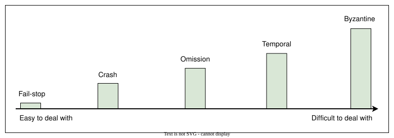

# The_Spectrum_of_Failure_Models

Source: https://www.educative.io/courses/grokking-the-system-design-interview/the-spectrum-of-failure-models

---

[Home](https://www.educative.io/)

[Courses](https://www.educative.io/search?tab=courses)

[Grokking Modern System Design Interview](https://www.educative.io/courses/grokking-the-system-design-interview)

# The Spectrum of Failure Models

Explore the spectrum of failure models crucial for building reliable distributed systems, ranging from fail-stop to challenging Byzantine failures. Define how crashes, omissions, and temporal failures impact system behavior. Learn to apply these models to accurately assess trade-offs in System Design and ensure high availability.

We'll cover the following...

- [Fail-stop](https://www.educative.io/courses/grokking-the-system-design-interview/the-spectrum-of-failure-models#Fail-stop)
- [Crash](https://www.educative.io/courses/grokking-the-system-design-interview/the-spectrum-of-failure-models#Crash)
- [Omission failures](https://www.educative.io/courses/grokking-the-system-design-interview/the-spectrum-of-failure-models#Omission-failures)
- [Temporal failures](https://www.educative.io/courses/grokking-the-system-design-interview/the-spectrum-of-failure-models#Temporal-failures)
- [Byzantine failures](https://www.educative.io/courses/grokking-the-system-design-interview/the-spectrum-of-failure-models#Byzantine-failures)

Failures are inevitable in distributed systems. They may be transient or permanent. Failure models provide a framework for reasoning about the impact of failures and for determining appropriate mitigation strategies.

The following illustration presents the spectrum of failure models:

Spectrum of failure models, the difficulty level when dealing with a failure increases as we move to the right

## Fail-stop[#](https://www.educative.io/courses/grokking-the-system-design-interview/the-spectrum-of-failure-models#Fail-stop)

In a **fail-stop failure**, a node halts permanently. Other nodes can reliably detect this termination by communicating with the failed node. Because the failure is detectable, fail-stop models are the simplest to manage.

## Crash[#](https://www.educative.io/courses/grokking-the-system-design-interview/the-spectrum-of-failure-models#Crash)

In a **crash failure**, a node halts silently. Unlike fail-stop scenarios, other nodes cannot readily detect that the node has stopped working.

## Omission failures[#](https://www.educative.io/courses/grokking-the-system-design-interview/the-spectrum-of-failure-models#Omission-failures)

**Omission failures** occur when a node fails to send or receive messages. These are categorized as:

- **Send omission:** The node fails to respond to an incoming request.
- **Receive omission:** The node fails to receive a request and cannot acknowledge it.

## Temporal failures[#](https://www.educative.io/courses/grokking-the-system-design-interview/the-spectrum-of-failure-models#Temporal-failures)

In **temporal failures**, a node generates correct results but delivers them too late to be useful. This can result from inefficient algorithms, poor design strategies, or a loss of synchronization between processor clocks.

## Byzantine failures[#](https://www.educative.io/courses/grokking-the-system-design-interview/the-spectrum-of-failure-models#Byzantine-failures)

In **Byzantine failures**, a node exhibits arbitrary behavior. It may transmit random messages, produce incorrect results, or stop unexpectedly. These failures often stem from malicious attacks or software bugs and are the most difficult to mitigate.

AI Powered

Saved

No attempts left

Reset

late reply is basically latency and it fall under tempral

Ahan, you’re right that late replies relate to temporal issues like latency. It’s worth adding that treating late responses as simple crash failures overlooks the fact that crash failures mean the node stops responding entirely, hiding its state, while temporal failures still produce correct results but just too late to be useful. This distinction matters because timing affects system behavior differently than outright unreachability. Keep exploring!

You've used all your attempts

Spectrum of Consistency Models

Availability

Ask

[Fail-stop](https://www.educative.io/courses/grokking-the-system-design-interview/the-spectrum-of-failure-models#Fail-stop)

[Crash](https://www.educative.io/courses/grokking-the-system-design-interview/the-spectrum-of-failure-models#Crash)

[Omission failures](https://www.educative.io/courses/grokking-the-system-design-interview/the-spectrum-of-failure-models#Omission-failures)

[Temporal failures](https://www.educative.io/courses/grokking-the-system-design-interview/the-spectrum-of-failure-models#Temporal-failures)

[Byzantine failures](https://www.educative.io/courses/grokking-the-system-design-interview/the-spectrum-of-failure-models#Byzantine-failures)