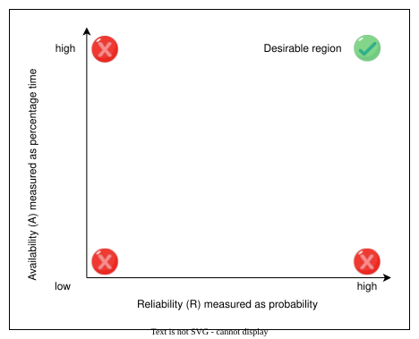

# Reliability

Source: https://www.educative.io/courses/grokking-the-system-design-interview/reliability

---

[Home](https://www.educative.io/)

[Courses](https://www.educative.io/search?tab=courses)

[Grokking Modern System Design Interview](https://www.educative.io/courses/grokking-the-system-design-interview)

# Reliability

Define reliability as a core non-functional characteristic in System Design, measuring consistent performance over time. Learn to quantify system reliability using key metrics like MTBF and MTTR. Understand the critical distinction between reliability and availability in meeting service level objectives.

We'll cover the following...

- [What is reliability?](https://www.educative.io/courses/grokking-the-system-design-interview/reliability#What-is-reliability)
  - [Reliability and availability](https://www.educative.io/courses/grokking-the-system-design-interview/reliability#Reliability-and-availability)

## What is reliability?[#](https://www.educative.io/courses/grokking-the-system-design-interview/reliability#What-is-reliability)

**Reliability** is the probability that a service will perform its intended functions for a specified period. It measures performance consistency under varying operating conditions.

We typically use **mean time between failures (MTBF)** and **mean time to repair (MTTR)** to measure reliability.

MTBF=Total Elapsed Time - Sum of DowntimeTotal Number of Failures\text{MTBF} = \frac{\text{Total Elapsed Time - Sum of Downtime}}{\text{Total Number of Failures}}
MTBF=Total Number of FailuresTotal Elapsed Time - Sum of Downtime​

MTTR=Total Maintenance TimeTotal Number of Repairs\text{MTTR} = \frac{\text{Total Maintenance Time}}{\text{Total Number of Repairs}}
MTTR=Total Number of RepairsTotal Maintenance Time​

System designers strive for a *high MTBF* and a *low MTTR*.

Reliability and availability are often confused, but they measure different aspects of system performance. *Reliability* focuses on how consistently a service operates without failure, while *availability* measures how often it is accessible when needed. Understanding both is crucial because even a highly reliable system can have low availability if downtime or repairs take too long.

### Reliability and availability[#](https://www.educative.io/courses/grokking-the-system-design-interview/reliability#Reliability-and-availability)

Reliability and availability are key metrics for measuring compliance with agreed-upon service level objectives (SLO).

Availability is driven by time loss, whereas reliability is driven by the frequency and impact of failures. These metrics enable stakeholders to assess the overall health of the service.

Reliability (`R`) and availability (`A`) are distinct but related. Mathematically, `A` depends on `R` as one of several factors. Since `R` can change independently, we can encounter four scenarios:

- Low `A`, low `R` (Frequent failures, slow recovery)
- Low `A`, high `R` (Rare failures, slow recovery)
- High `A`, low `R` (Frequent failures, fast recovery)
- High `A`, high `R` (Desirable)

Availability as a function of reliability

> **Note:** There are variations of the MTBF metric, such as mean time to failure (MTTF). We use MTTF for non-repairable components that require replacement, such as a failed hard disk or light bulb.

1.

What is the difference between reliability and availability?

Show Answer

Did you find this helpful?

Availability

Scalability

Ask

[What is reliability?](https://www.educative.io/courses/grokking-the-system-design-interview/reliability#What-is-reliability)

[Reliability and availability](https://www.educative.io/courses/grokking-the-system-design-interview/reliability#Reliability-and-availability)