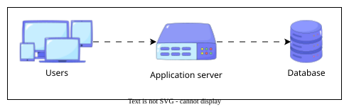
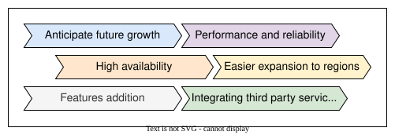

# Scalability_in_System_Design

Source: https://www.educative.io/courses/grokking-the-system-design-interview/scalability

---

[Home](https://www.educative.io/)

[Courses](https://www.educative.io/search?tab=courses)

[Grokking Modern System Design Interview](https://www.educative.io/courses/grokking-the-system-design-interview)

# Scalability

Discover how to achieve system scalability to handle increasing workloads without performance degradation. Compare vertical and horizontal scaling strategies, and apply techniques such as load balancing, caching, and sharding. Learn to make informed System Design decisions that balance cost, complexity, and growth.

We'll cover the following...

- [What is scalability?](https://www.educative.io/courses/grokking-the-system-design-interview/scalability#What-is-scalability)
- [Dimensions of scalability](https://www.educative.io/courses/grokking-the-system-design-interview/scalability#Dimensions-of-scalability)
- [Why scalability matters](https://www.educative.io/courses/grokking-the-system-design-interview/scalability#Why-scalability-matters)
  - [When do we need to scale?](https://www.educative.io/courses/grokking-the-system-design-interview/scalability#When-do-we-need-to-scale)
- [Approaches to scalability](https://www.educative.io/courses/grokking-the-system-design-interview/scalability#Approaches-to-scalability)
  - [Vertical scalability (scaling up)](https://www.educative.io/courses/grokking-the-system-design-interview/scalability#Vertical-scalability-scaling-up)
  - [Horizontal scalability (scaling out)](https://www.educative.io/courses/grokking-the-system-design-interview/scalability#Horizontal-scalability-scaling-out)
- [Scalability techniques](https://www.educative.io/courses/grokking-the-system-design-interview/scalability#Scalability-techniques)
- [Best practices for System Design scalability](https://www.educative.io/courses/grokking-the-system-design-interview/scalability#Best-practices-for-System-Design-scalability)
- [Scalability challenges and trade-offs](https://www.educative.io/courses/grokking-the-system-design-interview/scalability#Scalability-challenges-and-trade-offs)
- [Real-world examples](https://www.educative.io/courses/grokking-the-system-design-interview/scalability#Real-world-examples)
- [Conclusion](https://www.educative.io/courses/grokking-the-system-design-interview/scalability#Conclusion)

## What is scalability?[#](https://www.educative.io/courses/grokking-the-system-design-interview/scalability#What-is-scalability)

**Scalability** is a system’s ability to handle increasing workload without degrading latency, throughput, or reliability. For example, a search engine must support more concurrent users and larger indexes while keeping query latency low. A scalable system can increase capacity to meet demand without a noticeable drop in responsiveness or availability.

Consider another example where early Twitter often crashed, displaying the “fail whale.” This was primarily a scalability issue. The system could not handle rapid user growth and write-heavy traffic. Scalability allows a system to absorb traffic spikes without excessive latency or downtime. Without it, response times increase, and outages become more likely.

A simple system handling users’ requests

System workloads vary by type:

- **Request workload:** The number of requests served by the system.
- **Data workload:** The amount of data stored, processed, or retrieved.

## Dimensions of scalability[#](https://www.educative.io/courses/grokking-the-system-design-interview/scalability#Dimensions-of-scalability)

Scalability operates along three dimensions:

- **Size scalability:** Adding users or resources without redesigning the system.
- **Administrative scalability:** Managing a growing number of organizations or users sharing a distributed system.
- **Geographical scalability:** Maintaining performance as the system expands to new regions.

## Why scalability matters[#](https://www.educative.io/courses/grokking-the-system-design-interview/scalability#Why-scalability-matters)

Scalability ensures resilience and adaptability. Without it, systems suffer downtime, high latency, or reduced performance during high activity.

### When do we need to scale?[#](https://www.educative.io/courses/grokking-the-system-design-interview/scalability#When-do-we-need-to-scale)

Systems must scale to address:

- **Future growth:** Anticipating increases in users and data.
- **Performance:** Distributing workloads to improve response times.
- **Availability:** Ensuring uptime during traffic spikes.
- **Geographic expansion:** Supporting global growth.
- **Feature expansion:** Supporting resource-intensive new functionality.
- **Third-party integrations:** Handling load from external APIs or gateways.

An important factor to consider to scale a system

Scalability is essential in System Design, ensuring the system remains available and grows to meet business requirements.

1.

What happens if a system isn’t scaled properly?

Show Answer

Did you find this helpful?

## Approaches to scalability[#](https://www.educative.io/courses/grokking-the-system-design-interview/scalability#Approaches-to-scalability)

There are two primary methods for scaling a system.

### Vertical scalability (scaling up)[#](https://www.educative.io/courses/grokking-the-system-design-interview/scalability#Vertical-scalability-scaling-up)

**Vertical scaling** upgrades the hardware resources (CPU, RAM, storage) of an existing server to handle increased load. This approach is simple to implement and manage but is limited by the maximum capacity of a single machine. It improves performance for single-node systems without architectural changes. However, vertical scaling has a hard ceiling, and upgrades may require downtime. High-performance hardware is also expensive.

> **Note:** Vertical scaling works best for predictable workloads needing an immediate boost.

### Horizontal scalability (scaling out)[#](https://www.educative.io/courses/grokking-the-system-design-interview/scalability#Horizontal-scalability-scaling-out)

**Horizontal scaling** adds more machines to the network to distribute the workload.

Instead of scaling up a single machine, you add more servers to distribute the workload. This approach improves scalability and fault tolerance. If one machine fails, others can continue serving requests. It is typically more cost-effective because it relies on commodity hardware instead of specialized high-end machines. However, horizontal scaling adds operational and architectural complexity. The system must handle data partitioning, replication, and coordination across nodes, and network communication between servers can introduce additional latency.

> **Note:** Horizontal scaling is ideal for systems expecting rapid growth or fluctuating workloads.

Vertical scaling vs. horizontal scaling

Modern systems often use *autoscaling* rather than static scaling strategies.

**Autoscaling** automatically adjusts resources based on real-time demand. It monitors metrics like CPU usage or network traffic to dynamically add or remove resources. This maintains responsiveness during traffic surges while conserving resources during low activity.

## Scalability techniques[#](https://www.educative.io/courses/grokking-the-system-design-interview/scalability#Scalability-techniques)

Specific architectural techniques are fundamental to building scalable systems:

- **Load balancing:** Distributes user traffic evenly across servers, preventing overload and failure on any single node.

Load balancing between available servers

- **Caching and content delivery networks (CDNs):** Caching stores frequently accessed data in fast temporary storage, reducing database load. CDNs distribute static content (videos, images) via servers geographically closer to users.

Caching frequently accessed data in cache and CDN

- **Data replication and sharding:** Replication duplicates data across servers for fault tolerance. Sharding partitions data across multiple databases to improve performance.

Data replication and sharding

- **Microservices architecture:** Decomposes applications into independent services. Each service can scale independently based on specific demand.

Microservices architecture

> **Note:** Implementing the right scalability techniques creates future-proof systems that handle increasing demand and new challenges.

1.

How do you think companies like Netflix or Amazon handle millions of users at once?

Show Answer

Did you find this helpful?

## Best practices for System Design scalability[#](https://www.educative.io/courses/grokking-the-system-design-interview/scalability#Best-practices-for-System-Design-scalability)

Follow these best practices to build resilient, scalable systems:

- **Mitigate performance bottlenecks:** Identify and resolve factors like inefficient database queries or algorithms that limit scalability.
- **Efficient resource utilization:** Use queuing mechanisms for incoming requests and worker servers for background tasks. Implement caching to reduce redundant processing.

1.

What are worker servers, and what types of tasks can be assigned to these workers?

Show Answer

Did you find this helpful?

- **Minimize network latency:** Reduce latency by minimizing network hops, utilizing caching, and optimizing data transfer protocols.
- **Optimize data storage:** Use scalable storage patterns, efficient indexing, replication, and partitioning to ensure fast access.
- **Select appropriate technologies:** Choose efficient algorithms, optimize queries, and select hardware (e.g., SSDs) suited to the workload.

1.

How does cloud computing make scalability easier?

Show Answer

1 / 2

## Scalability challenges and trade-offs[#](https://www.educative.io/courses/grokking-the-system-design-interview/scalability#Scalability-challenges-and-trade-offs)

Scaling a system introduces several challenges:

- **Cost:** Adding resources increases operational expenses.
- **Consistency:** Maintaining data consistency across distributed nodes becomes difficult.
- **Security:** Enforcing consistent security policies across a growing number of services is complex.
- **Complexity:** Distributed systems are harder to manage, debug, and troubleshoot.

1.

How can we efficiently distribute and balance traffic across multiple servers to handle increasing loads?

Show Answer

Did you find this helpful?

## Real-world examples[#](https://www.educative.io/courses/grokking-the-system-design-interview/scalability#Real-world-examples)

The following systems demonstrate effective scalability:

- **Google Search:** Uses a massively scalable architecture to process billions of daily queries.
- **Netflix:** Leverages cloud infrastructure (AWS) to handle millions of concurrent streams.
- **Facebook:** Manages requests and data from billions of global users.
- **Uber:** Handles millions of ride requests globally in real-time.

## Conclusion[#](https://www.educative.io/courses/grokking-the-system-design-interview/scalability#Conclusion)

Scalability measures how well a system handles increasing workload without degrading performance. Whether expanding to new regions or adding new features, the system must maintain consistent latency and availability. Techniques such as load balancing, sharding, and replication help systems remain resilient under load. Engineers need to understand the trade-offs of these patterns when designing distributed systems. Modern infrastructure often uses automation and machine learning to manage resource allocation and forecast traffic patterns.

Reliability

Maintainability

Ask

[What is scalability?](https://www.educative.io/courses/grokking-the-system-design-interview/scalability#What-is-scalability)

[Dimensions of scalability](https://www.educative.io/courses/grokking-the-system-design-interview/scalability#Dimensions-of-scalability)

[Why scalability matters](https://www.educative.io/courses/grokking-the-system-design-interview/scalability#Why-scalability-matters)

[When do we need to scale?](https://www.educative.io/courses/grokking-the-system-design-interview/scalability#When-do-we-need-to-scale)

[Approaches to scalability](https://www.educative.io/courses/grokking-the-system-design-interview/scalability#Approaches-to-scalability)

[Vertical scalability (scaling up)](https://www.educative.io/courses/grokking-the-system-design-interview/scalability#Vertical-scalability-scaling-up)

[Horizontal scalability (scaling out)](https://www.educative.io/courses/grokking-the-system-design-interview/scalability#Horizontal-scalability-scaling-out)

[Scalability techniques](https://www.educative.io/courses/grokking-the-system-design-interview/scalability#Scalability-techniques)

[Best practices for System Design scalability](https://www.educative.io/courses/grokking-the-system-design-interview/scalability#Best-practices-for-System-Design-scalability)

[Scalability challenges and trade-offs](https://www.educative.io/courses/grokking-the-system-design-interview/scalability#Scalability-challenges-and-trade-offs)

[Real-world examples](https://www.educative.io/courses/grokking-the-system-design-interview/scalability#Real-world-examples)

[Conclusion](https://www.educative.io/courses/grokking-the-system-design-interview/scalability#Conclusion)