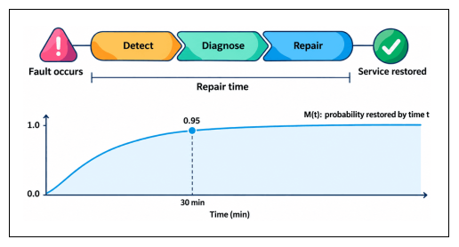

# Maintainability

Source: https://www.educative.io/courses/grokking-the-system-design-interview/maintainability

---

[Home](https://www.educative.io/)

[Courses](https://www.educative.io/search?tab=courses)

[Grokking Modern System Design Interview](https://www.educative.io/courses/grokking-the-system-design-interview)

# Maintainability

Define maintainability as the system’s ability to be easily operated, understood, and modified. Explore how engineers measure this crucial non-functional requirement using the MTTR metric. Understand the relationship between maintainability and reliability for achieving high availability in System Design.

We'll cover the following...

- [What is maintainability?](https://www.educative.io/courses/grokking-the-system-design-interview/maintainability#What-is-maintainability)
  - [Measuring maintainability](https://www.educative.io/courses/grokking-the-system-design-interview/maintainability#Measuring-maintainability)
  - [Maintainability and reliability](https://www.educative.io/courses/grokking-the-system-design-interview/maintainability#Maintainability-and-reliability)

## What is maintainability?[#](https://www.educative.io/courses/grokking-the-system-design-interview/maintainability#What-is-maintainability)

After building a system, engineers must keep it operational. This involves fixing bugs, adding features, updating platforms, and ensuring smooth operations. **Maintainability** measures how easily a system supports these tasks. We can divide maintainability into three aspects:

1. **Operability:** The ease of ensuring smooth operations and recovering from faults.
2. **Lucidity:** The simplicity of the codebase. A simpler codebase is easier to understand and maintain.
3. **Modifiability:** The ability to integrate changes and new features without difficulty.

### Measuring maintainability[#](https://www.educative.io/courses/grokking-the-system-design-interview/maintainability#Measuring-maintainability)

**Maintainability** (`M`) is the probability that a service will restore its functions within a specified time after a fault. It measures how quickly the service returns to normal operating conditions. For example, if a component has a maintainability value of 95% for 30 minutes, the probability of restoring the component within that time is 0.95.

An overview of MTTR in maintainability

> **Note:** Maintainability provides insight into a system’s ability to undergo repairs and modifications while in operation.

We use MTTR to measure `M`.

MTTR=Total Maintenance TimeTotal Number of Repairs\text{MTTR} = \frac{\text{Total Maintenance Time}}{\text{Total Number of Repairs}}
MTTR=Total Number of RepairsTotal Maintenance Time​

MTTR is the average time required to repair and restore a failed component. The goal is to keep MTTR as low as possible.

### Maintainability and reliability[#](https://www.educative.io/courses/grokking-the-system-design-interview/maintainability#Maintainability-and-reliability)

Maintainability is closely related to reliability. The primary difference is the variable of interest: maintainability refers to `time-to-repair`, whereas reliability refers to `time-to-failure`. Combining maintainability and reliability analysis helps us understand availability, downtime, and uptime.

Scalability

Fault Tolerance

Ask

[What is maintainability?](https://www.educative.io/courses/grokking-the-system-design-interview/maintainability#What-is-maintainability)

[Measuring maintainability](https://www.educative.io/courses/grokking-the-system-design-interview/maintainability#Measuring-maintainability)

[Maintainability and reliability](https://www.educative.io/courses/grokking-the-system-design-interview/maintainability#Maintainability-and-reliability)