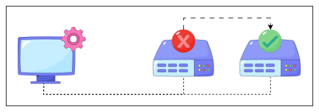
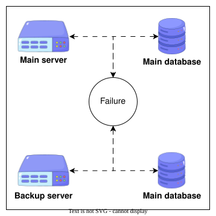

# Fault_Tolerance

Source: https://www.educative.io/courses/grokking-the-system-design-interview/fault-tolerance

---

[Home](https://www.educative.io/)

[Courses](https://www.educative.io/search?tab=courses)

[Grokking Modern System Design Interview](https://www.educative.io/courses/grokking-the-system-design-interview)

# Fault Tolerance

Explore fault tolerance, a critical characteristic for building reliable distributed systems. Learn how techniques such as replication, forward and backward error recovery, and consistent checkpointing prevent system failures. Understand the trade-offs between consistency and availability when implementing fault-tolerant architectures.

We'll cover the following...

- [What is fault tolerance?](https://www.educative.io/courses/grokking-the-system-design-interview/fault-tolerance#What-is-fault-tolerance)
- [Advantages of fault-tolerant systems](https://www.educative.io/courses/grokking-the-system-design-interview/fault-tolerance#Advantages-of-fault-tolerant-systems)
- [Fault tolerance techniques](https://www.educative.io/courses/grokking-the-system-design-interview/fault-tolerance#Fault-tolerance-techniques)
  - [Forward and Backward error recovery](https://www.educative.io/courses/grokking-the-system-design-interview/fault-tolerance#Forward-and-Backward-error-recovery)
    - [Replication](https://www.educative.io/courses/grokking-the-system-design-interview/fault-tolerance#Replication)
    - [Checkpointing](https://www.educative.io/courses/grokking-the-system-design-interview/fault-tolerance#Checkpointing)

## What is fault tolerance?[#](https://www.educative.io/courses/grokking-the-system-design-interview/fault-tolerance#What-is-fault-tolerance)

Large-scale applications utilize hundreds of servers and databases to serve billions of users. To ensure data safety and avoid redoing computationally intensive tasks, these systems must eliminate single points of failure.

**Fault tolerance** is a system’s ability to continue operating even if one or more components (software or hardware) fail. While achieving 100% fault tolerance is practically impossible, systems aim to maximize persistence and minimize disruption.

Fault tolerance in action: When one server fails, another seamlessly takes over

Fault tolerance relies on two key qualities:

- **Availability:** The system remains accessible and receives client requests at any time.
- **Reliability:** The system consistently processes requests and performs the correct actions.

To prevent disruptions from a single point of failure, systems use two main approaches:

- **Fault-removal:** Uses forward or backward error recovery.
- **Fault-masking:** Using redundancy to prevent a fault from affecting the system’s output.

Systems also implement failover strategies to manage downtime:

- **Hot failover:** Instantly transfers workloads to a functioning backup (zero downtime).
- **Warm or cold failover:** Loads and starts the backup only when needed. This causes a delay but consumes fewer resources.

Note that fault tolerance offers limited protection against software failures, which remain a major cause of outages.

Let’s explore common techniques used to achieve fault tolerance.

## Advantages of fault-tolerant systems[#](https://www.educative.io/courses/grokking-the-system-design-interview/fault-tolerance#Advantages-of-fault-tolerant-systems)

The primary purpose of fault tolerance is to prevent system unavailability. This is critical for safety-critical systems (like air traffic control) and platforms requiring high data integrity. However, these systems are expensive to implement because they require redundant hardware and complex synchronization logic.

## Fault tolerance techniques[#](https://www.educative.io/courses/grokking-the-system-design-interview/fault-tolerance#Fault-tolerance-techniques)

Failures occur at hardware or software levels. Common techniques to address these include:

### Forward and Backward error recovery[#](https://www.educative.io/courses/grokking-the-system-design-interview/fault-tolerance#Forward-and-Backward-error-recovery)

**Forward error recovery** identifies and corrects the error state (e.g., exception handling in Ada or PL/1).

**Backward error recovery** restores the system to the stable state that existed before the fault.

#### Replication[#](https://www.educative.io/courses/grokking-the-system-design-interview/fault-tolerance#Replication)

**Replication-based fault tolerance** involves duplicating services and data. If a node fails, the system transparently swaps it with a healthy replica.

Updating data across replicas presents a trade-off between consistency and availability:

- **Synchronous updates:** Ensure strong consistency but reduce availability.
- **Asynchronous updates:** Improve availability but result in eventual consistency (stale reads).

This trade-off is central to the [CAP theorem](https://www.educative.io/answers/what-is-the-cap-theorem).

Replication-based fault tolerance

#### Checkpointing[#](https://www.educative.io/courses/grokking-the-system-design-interview/fault-tolerance#Checkpointing)

**Checkpointing** periodically saves the system’s state to stable storage. If a failure occurs, the system recovers by reloading the last saved state.

Checkpoints are classified based on the consistency of the global state:

- **Consistent state:** All processes share a coherent view of events: every message recorded as received in a checkpoint is also recorded as sent by its sender. Completed updates are saved, and in-progress updates are rolled back.
- **Inconsistent state:** Checkpoints across processes are uncoordinated, so a process may record receiving a message that its sender has not recorded sending. Such a message is called an orphan message.

Consider three processes (iii, jjj, kkk) exchanging messages (m1m\_1m1​, m2m\_2m2​). Each process saves a snapshot (C1,iC\_{1,i}C1,i​, C1,jC\_{1,j}C1,j​, C1,kC\_{1,k}C1,k​).

Checkpointing in a consistent and inconsistent state.

In the left illustration (consistent state), message m1m\_1m1​ is sent and received after the checkpoints are taken, so neither the sender nor the receiver records it. The other message is sent and received before the checkpoints, so both the sender and the receiver record it. Every message recorded as received is also recorded as sent, so the timeline is coherent.

In the right illustration (inconsistent state), process iii records receiving m1m\_1m1​, but process jjj has not recorded sending it. This makes it an orphan message. The same happens with the second message: the receiver records it before taking its checkpoint, but the sender sends it after taking its own checkpoint. These orphan messages make the global state inconsistent.

The difference between the two illustrations isn't whether messages are exchanged around checkpoints, but whether any message is recorded as received without being recorded as sent. If the system rolls back to the inconsistent set of checkpoints on the right, a receiving process would hold the effects of a message that, according to the sender's restored state, was never sent. This is why recovery must roll back to a consistent set of checkpoints.

Maintainability

Non-Functional Requirements for System Design Interviews

Ask

[What is fault tolerance?](https://www.educative.io/courses/grokking-the-system-design-interview/fault-tolerance#What-is-fault-tolerance)

[Advantages of fault-tolerant systems](https://www.educative.io/courses/grokking-the-system-design-interview/fault-tolerance#Advantages-of-fault-tolerant-systems)

[Fault tolerance techniques](https://www.educative.io/courses/grokking-the-system-design-interview/fault-tolerance#Fault-tolerance-techniques)

[Forward and Backward error recovery](https://www.educative.io/courses/grokking-the-system-design-interview/fault-tolerance#Forward-and-Backward-error-recovery)

[Replication](https://www.educative.io/courses/grokking-the-system-design-interview/fault-tolerance#Replication)

[Checkpointing](https://www.educative.io/courses/grokking-the-system-design-interview/fault-tolerance#Checkpointing)