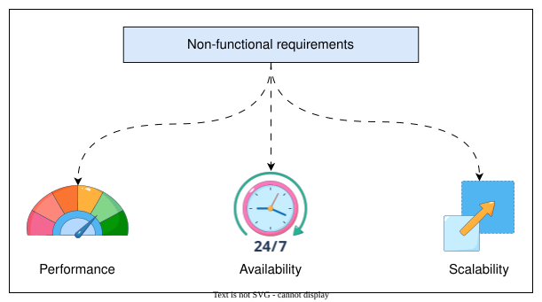
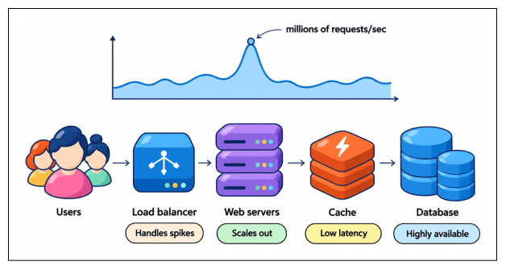

# Non-Functional_Requirements_for_System_Design_Interviews

Source: https://www.educative.io/courses/grokking-the-system-design-interview/non-functional-requirements-for-system-design-interviews

---

[Home](https://www.educative.io/)

[Courses](https://www.educative.io/search?tab=courses)

[Grokking Modern System Design Interview](https://www.educative.io/courses/grokking-the-system-design-interview)

# Non-Functional Requirements for System Design Interviews

Learn why non-functional requirements matter in System Design interviews, and discover a few often-overlooked best practices for designing systems that scale well.

We'll cover the following...

- [Common non-functional requirements](https://www.educative.io/courses/grokking-the-system-design-interview/non-functional-requirements-for-system-design-interviews#Common-non-functional-requirements)
  - [1) Performance](https://www.educative.io/courses/grokking-the-system-design-interview/non-functional-requirements-for-system-design-interviews#1-Performance)
    - [Approaches to achieve performance](https://www.educative.io/courses/grokking-the-system-design-interview/non-functional-requirements-for-system-design-interviews#Approaches-to-achieve-performance)
  - [2) Availability](https://www.educative.io/courses/grokking-the-system-design-interview/non-functional-requirements-for-system-design-interviews#2-Availability)
    - [Approaches to achieve availability](https://www.educative.io/courses/grokking-the-system-design-interview/non-functional-requirements-for-system-design-interviews#Approaches-to-achieve-availability)
  - [3) Scalability](https://www.educative.io/courses/grokking-the-system-design-interview/non-functional-requirements-for-system-design-interviews#3-Scalability)
    - [Approaches to achieve scalability](https://www.educative.io/courses/grokking-the-system-design-interview/non-functional-requirements-for-system-design-interviews#Approaches-to-achieve-scalability)
- [Acing NFRs: Google Maps and YouTube](https://www.educative.io/courses/grokking-the-system-design-interview/non-functional-requirements-for-system-design-interviews#Acing-NFRs-Google-Maps-and-YouTube)
  - [Design Google Maps](https://www.educative.io/courses/grokking-the-system-design-interview/non-functional-requirements-for-system-design-interviews#Design-Google-Maps)
  - [Design YouTube](https://www.educative.io/courses/grokking-the-system-design-interview/non-functional-requirements-for-system-design-interviews#Design-YouTube)
- [Quick tips for NFR interview questions](https://www.educative.io/courses/grokking-the-system-design-interview/non-functional-requirements-for-system-design-interviews#Quick-tips-for-NFR-interview-questions)
- [Conclusion](https://www.educative.io/courses/grokking-the-system-design-interview/non-functional-requirements-for-system-design-interviews#Conclusion)

Designing systems to meet non-functional requirements (NFRs) is challenging. You must manage trade-offs among competing goals such as scalability, availability, performance, and security.

Non-functional requirements

Consider this common System Design interview question:

- How can you design a scalable and performant e-commerce website that can handle millions of requests per second?

NFRs i.e., scalability and low latency shaping the architecture

Engineers often meet functional requirements easily but struggle to achieve scalability and low latency simultaneously. This lesson covers essential strategies for meeting NFRs in your designs.

**Note:** This lesson focuses on achieving them.

## Common non-functional requirements[#](https://www.educative.io/courses/grokking-the-system-design-interview/non-functional-requirements-for-system-design-interviews#Common-non-functional-requirements)

Interviewers focus on specific NFRs. We will address:

1. Performance
2. Availability
3. Scalability

### 1) Performance[#](https://www.educative.io/courses/grokking-the-system-design-interview/non-functional-requirements-for-system-design-interviews#1-Performance)

**Performance** measures a system’s ability to respond to requests and process data efficiently. For example, in a messaging service, an interviewer might ask: How do you deliver messages with low latency? To achieve this, you might select an efficient two-way protocol like WebSocket.

#### Approaches to achieve performance[#](https://www.educative.io/courses/grokking-the-system-design-interview/non-functional-requirements-for-system-design-interviews#Approaches-to-achieve-performance)

**Caching:** Caching stores frequently accessed data, reducing repeated computations and user-perceived latency.

Web service uses service cache to access frequently accessed data to ensure low latency

Consider an X (formerly Twitter)-like system with a service dedicated to generating the timeline.

Does the service generate a timeline for every follower when a celebrity posts? With millions of followers, this would severely degrade performance.

To address this, first divide followers into active users and inactive users. Generate timelines for inactive users on demand. For active users, introduce a feed cache. This cache prepopulates the timeline. When active users request their feed, the service retrieves it immediately from the cache, ensuring minimal latency.

Fetching a timeline for active users from the feed cache

Caching at multiple system layers also ensures decoupling and low latency.

**Algorithm/Data structure selection:** Efficient algorithms minimize processing time. For example, consider a ride-hailing system that updates driver positions every four seconds. You must choose a data structure that handles frequent spatial updates efficiently.

A [Quadtree](https://www.educative.io/answers/what-is-a-quadtree-how-is-it-used-in-location-based-services) is a strong candidate for spatial indexing. However, updating a Quadtree every 4 seconds introduces computational overhead that increases latency. You must evaluate if a Quadtree is optimal here or if a hybrid approach better balances performance and scalability.

**Load balancing:** Distributing traffic evenly across servers prevents bottlenecks. For an e-commerce site handling millions of concurrent requests, load balancers ensure no single server is overwhelmed.

Distributing user requests across multiple web servers

### 2) Availability[#](https://www.educative.io/courses/grokking-the-system-design-interview/non-functional-requirements-for-system-design-interviews#2-Availability)

Availability measures system uptime and accessibility. 99.999% uptime (less than 6 minutes of downtime per year) is the gold standard but difficult to achieve. High availability is critical for retention; for example, downtime on an e-commerce site directly loses sales.

#### Approaches to achieve availability[#](https://www.educative.io/courses/grokking-the-system-design-interview/non-functional-requirements-for-system-design-interviews#Approaches-to-achieve-availability)

**Redundancy:** Replicate key components and data across multiple servers and data centers. If one server fails, a load balancer reroutes requests to a backup, eliminating single points of failure.

Replicating key components to eliminate single point of failure

**Fault tolerance:** Systems must function even when components fail. For instance, if a database node fails during a sale, the system should automatically switch to a backup node using failover mechanisms.

**Rate limiting:** Rate limiters restrict the number of requests a service handles to prevent overload. On social media, this prevents sudden spikes in activity (e.g., likes, follows) from crashing the system.

Rate limiting to prevent web server overload

**CDNs:** Content delivery networks (CDNs) distribute cache servers geographically. They improve availability by reducing load on origin servers and mitigating regional outages. They also reduce latency by serving content from locations closer to the user.

**Stress testing and monitoring:** Stress testing identifies breaking points under peak loads. Monitoring tracks performance in real-time, allowing you to detect anomalies before they cause downtime.

### 3) Scalability[#](https://www.educative.io/courses/grokking-the-system-design-interview/non-functional-requirements-for-system-design-interviews#3-Scalability)

Scalability is the ability to handle growing numbers of users while maintaining performance. Interviewers may ask you to design a video platform like YouTube or a URL shortener handling billions of queries.

#### Approaches to achieve scalability[#](https://www.educative.io/courses/grokking-the-system-design-interview/non-functional-requirements-for-system-design-interviews#Approaches-to-achieve-scalability)

**Manual scaling:** You can upgrade hardware (vertical) or add machines (horizontal):

- **Vertical scaling (hardware upgrades):** Adding resources (RAM, CPU) to existing machines. It is simple to manage but has a hard limit.
- **Horizontal scaling (adding machines):** Adding more machines to distribute workload. This is preferred for large-scale applications as it supports load balancing and eliminates single points of failure.

Vertical scaling has a hardware ceiling; horizontal scaling adds machines as demand grows

**Automatic scaling:** Dynamically adjusts resources based on traffic spikes using cloud techniques like [auto scaling](https://www.educative.io/answers/what-is-aws-auto-scaling).

**Sharding:** Splits a database into smaller shards to distribute data load across servers. Common techniques include key-range and hash-based sharding.

**Modular design:** Decomposes the system into independent services. Each service scales independently based on demand.

Monolithic vs. modular designs

**Caches and CDNs:** Caching reduces database load, while CDNs offload static content delivery from origin servers. Together, they allow the system to handle high request volumes efficiently.

Let's apply these concepts to Google Maps and YouTube.

## Acing NFRs: Google Maps and YouTube[#](https://www.educative.io/courses/grokking-the-system-design-interview/non-functional-requirements-for-system-design-interviews#Acing-NFRs-Google-Maps-and-YouTube)

Let’s explore non-functional requirements for Google Maps and YouTube System Design problems.

### Design Google Maps[#](https://www.educative.io/courses/grokking-the-system-design-interview/non-functional-requirements-for-system-design-interviews#Design-Google-Maps)

A navigation system must identify locations, find optimal routes, and provide turn-by-turn directions.

How Google Maps meet non-functional requirements

Strategies to meet Google Maps NFRs:

- **High availability:** The road network graph is too large for a single server. To ensure availability, split the graph into segments hosted on separate, replicated servers. A load balancer distributes requests across these segment servers to eliminate single points of failure.
- **Scalability:** A distributed architecture allows segment servers to handle requests for specific routes independently. This modular design scales easily by adding segments for new data.

|  |  |
| --- | --- |
| **Nonfunctional requirements** | **Strategies** |
| Availability | - Divide the road network graph into small graphs (segments) to process user queries. - Replicate the small segment servers. - Request load balancing across different segment servers. |
| Scalability | - Partition the large graphs into smaller graphs to ease segment addition. - Host the graphs on different servers to handle increased number of queries per second. |

### Design YouTube[#](https://www.educative.io/courses/grokking-the-system-design-interview/non-functional-requirements-for-system-design-interviews#Design-YouTube)

A video streaming platform enables users to upload, search, stream, and rate videos.

How YouTube meets non-functional requirements

Strategies to meet YouTube NFRs:

- **Minimal response times:** Popular videos are frequently requested by users across different geographical locations. Caching them at ISP and CDN levels brings content closer to users, reducing network hops, startup delays, and load on origin servers. Thumbnails are small files that are frequently retrieved using video IDs as keys. Bigtable is suitable for this access pattern because it supports fast, high-throughput key-based lookups. Videos, on the other hand, are large binary files that are typically written once and read many times. Blob storage provides a scalable and cost-effective way to store and deliver such files.  
  Video streaming also involves many concurrent connections that can remain open for extended periods. An event-driven web server like Lighttpd can handle thousands of concurrent connections with relatively low memory overhead.
- **Reliability:** Sharding the data means a failed node affects only part of the users. Replicating critical components removes single points of failure. Heartbeat messages detect unresponsive servers so they can be taken out of rotation.

|  |  |
| --- | --- |
| **Nonfunctional Requirements** | **Strategies** |
| Minimum response time | - Cache at different layers - CDNs - Choose appropriate storage systems (e.g., blob storage to store videos, Bigtable to store thumbnails) - Serve videos and static content with Lighttpd |
| Reliability | - Data sharding - Replicate critical components - Heartbeat protocol |

## Quick tips for NFR interview questions[#](https://www.educative.io/courses/grokking-the-system-design-interview/non-functional-requirements-for-system-design-interviews#Quick-tips-for-NFR-interview-questions)

- Proactively clarify NFRs during the interview. Ask about:

  - Expected user traffic
  - Expected data load
  - Expected downtime tolerance
- Evaluate trade-offs between techniques, considering complexity, cost, and maintainability.
- Prepare solutions for common patterns:

  - **Transactions:** Choose ACID-compliant relational databases.
  - **Large-scale data:** Use NoSQL databases (MongoDB, Cassandra) for scalability.
  - **Real-time data:** Use streaming platforms like Apache Kafka or Amazon Kinesis.

There is no one-size-fits-all solution. Success depends on asking clarifying questions, prioritizing NFRs, and justifying your trade-offs.

## Conclusion[#](https://www.educative.io/courses/grokking-the-system-design-interview/non-functional-requirements-for-system-design-interviews#Conclusion)

This lesson covered the role of non-functional requirements in System Design. Understanding common NFRs and how to address them helps you answer System Design interview questions more effectively.

Fault Tolerance

Let AI Evaluate Your Understanding of Non-Functional Requirements

Ask

[Common non-functional requirements](https://www.educative.io/courses/grokking-the-system-design-interview/non-functional-requirements-for-system-design-interviews#Common-non-functional-requirements)

[1) Performance](https://www.educative.io/courses/grokking-the-system-design-interview/non-functional-requirements-for-system-design-interviews#1-Performance)

[Approaches to achieve performance](https://www.educative.io/courses/grokking-the-system-design-interview/non-functional-requirements-for-system-design-interviews#Approaches-to-achieve-performance)

[2) Availability](https://www.educative.io/courses/grokking-the-system-design-interview/non-functional-requirements-for-system-design-interviews#2-Availability)

[Approaches to achieve availability](https://www.educative.io/courses/grokking-the-system-design-interview/non-functional-requirements-for-system-design-interviews#Approaches-to-achieve-availability)

[3) Scalability](https://www.educative.io/courses/grokking-the-system-design-interview/non-functional-requirements-for-system-design-interviews#3-Scalability)

[Approaches to achieve scalability](https://www.educative.io/courses/grokking-the-system-design-interview/non-functional-requirements-for-system-design-interviews#Approaches-to-achieve-scalability)

[Acing NFRs: Google Maps and YouTube](https://www.educative.io/courses/grokking-the-system-design-interview/non-functional-requirements-for-system-design-interviews#Acing-NFRs-Google-Maps-and-YouTube)

[Design Google Maps](https://www.educative.io/courses/grokking-the-system-design-interview/non-functional-requirements-for-system-design-interviews#Design-Google-Maps)

[Design YouTube](https://www.educative.io/courses/grokking-the-system-design-interview/non-functional-requirements-for-system-design-interviews#Design-YouTube)

[Quick tips for NFR interview questions](https://www.educative.io/courses/grokking-the-system-design-interview/non-functional-requirements-for-system-design-interviews#Quick-tips-for-NFR-interview-questions)

[Conclusion](https://www.educative.io/courses/grokking-the-system-design-interview/non-functional-requirements-for-system-design-interviews#Conclusion)