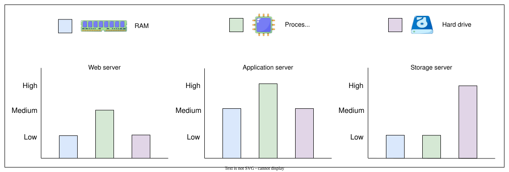

# Put_Back-of-the-Envelope_Numbers_in_Perspective

Source: https://www.educative.io/courses/grokking-the-system-design-interview/put-back-of-the-envelope-numbers-in-perspective

---

[Home](https://www.educative.io/)

[Courses](https://www.educative.io/search?tab=courses)

[Grokking Modern System Design Interview](https://www.educative.io/courses/grokking-the-system-design-interview)

# Put Back-of-the-Envelope Numbers in Perspective

Define BOTECs and their role in simplifying complex System Design problems. Explore foundational numbers, including server types, latencies, and request classifications (CPU, memory, IO-bound). Learn to abstract real-world complexity to quickly estimate critical metrics, such as requests per second (RPS).

We'll cover the following...

- [BOTECs in system design](https://www.educative.io/courses/grokking-the-system-design-interview/put-back-of-the-envelope-numbers-in-perspective#BOTECs-in-system-design)
  - [Types of data center servers](https://www.educative.io/courses/grokking-the-system-design-interview/put-back-of-the-envelope-numbers-in-perspective#Types-of-data-center-servers)
    - [Web servers](https://www.educative.io/courses/grokking-the-system-design-interview/put-back-of-the-envelope-numbers-in-perspective#Web-servers)
    - [Application servers](https://www.educative.io/courses/grokking-the-system-design-interview/put-back-of-the-envelope-numbers-in-perspective#Application-servers)
    - [Storage servers](https://www.educative.io/courses/grokking-the-system-design-interview/put-back-of-the-envelope-numbers-in-perspective#Storage-servers)
  - [Standard numbers to remember](https://www.educative.io/courses/grokking-the-system-design-interview/put-back-of-the-envelope-numbers-in-perspective#Standard-numbers-to-remember)
  - [Request types](https://www.educative.io/courses/grokking-the-system-design-interview/put-back-of-the-envelope-numbers-in-perspective#Request-types)
- [Abstracting away real system complexities](https://www.educative.io/courses/grokking-the-system-design-interview/put-back-of-the-envelope-numbers-in-perspective#Abstracting-away-real-system-complexities)
  - [Request estimation in system design](https://www.educative.io/courses/grokking-the-system-design-interview/put-back-of-the-envelope-numbers-in-perspective#Request-estimation-in-system-design)

**Back-of-the-envelope calculations (BOTECs)** are quick, approximate estimations typically performed on paper. While not intended to yield precise results, they provide a preliminary evaluation of a system’s feasibility and critical parameters.

For example, to estimate a neighborhood’s population, you might count houses in a sample area and multiply by the average household size. This is faster than conducting a full census. Similar calculations can validate data or test assumptions.

## BOTECs in system design[#](https://www.educative.io/courses/grokking-the-system-design-interview/put-back-of-the-envelope-numbers-in-perspective#BOTECs-in-system-design)

Modern systems consist of many interconnected computational components. Although architectures vary, such as monolithic and microservice architectures, accounting for every node type, load balancers, caches, and databases is impractical in a design interview. Back-of-the-envelope calculations (BOTECs) help estimate capacity and resource requirements without modeling every infrastructure component.

Common estimations include:

- Concurrent TCP connections a server can support.
- Requests per second (RPS) a web, database, or cache server can handle.
- Storage requirements for a service.

We use BOTECs to abstract hardware specifics, latencies, and throughput rates. We will first examine server types and latencies to understand the system’s reality. Then, we will simplify these details to estimate RPS, bandwidth, and storage capacity.

### Types of data center servers[#](https://www.educative.io/courses/grokking-the-system-design-interview/put-back-of-the-envelope-numbers-in-perspective#Types-of-data-center-servers)

Data centers use commodity hardware to scale cost-effectively. Below, we discuss common server types used to handle different workloads:

An approximation of the resources required on the web, application, and storage layer of the server, where the y-axis is a categorical axis with data points indicating levels of low, medium, and high resource requirements

#### Web servers[#](https://www.educative.io/courses/grokking-the-system-design-interview/put-back-of-the-envelope-numbers-in-perspective#Web-servers)

**Web servers** are the first point of contact after load balancers and typically handle API calls. They are decoupled from application servers for scalability. While memory and storage requirements are often moderate, web servers need strong processing power. For example, Facebook has used web servers with 32 GB RAM and 500 GB storage.

#### Application servers[#](https://www.educative.io/courses/grokking-the-system-design-interview/put-back-of-the-envelope-numbers-in-perspective#Application-servers)

**Application servers** execute business logic and generate dynamic content. They often require significant computational and storage resources. Facebook has deployed application servers with 256 GB RAM and 6.5 TB of hybrid storage (flash and rotating disk).

#### Storage servers[#](https://www.educative.io/courses/grokking-the-system-design-interview/put-back-of-the-envelope-numbers-in-perspective#Storage-servers)

As data grows, services use specialized storage units. YouTube, for example, uses:

1. **Blob storage:** For encoded videos
2. **Temporary processing queue storage:** Holds daily video uploads pending processing
3. **Bigtable:** Specialized storage for video thumbnails
4. **RDBMS:** For metadata (comments, likes, user channels)

Other systems, like Hadoop’s HDFS, are used for analytics. Storage servers manage both structured (SQL) and unstructured (NoSQL) data.

Returning to the example of Facebook, they’ve used servers with a storage capacity of up to 120 TB. With the number of servers in use, Facebook can store exabytes of data. (Note: One exabyte is 101810^{18}1018 bytes. Storage and bandwidth are conventionally measured in base 10.) However, the RAM of these storage servers is often only 32 GB.

> **Note:** Data centers also require servers for configuration, monitoring, load balancing, analytics, accounting, and caching.

We need a reference point to ground our calculations. In the table below, we depict the capabilities of a typical server that can be used in the data centers of today:

## Typical Server Specifications

|  |  |
| --- | --- |
| **Component** | **Count** |
| Processor | Intel Xeon (Sapphire Rapids 8488C) |
| Number of cores | 64 cores |
| RAM | 256 GB |
| Cache (L3) | 112.5 MB |
| Storage capacity | 16 TB |

### Standard numbers to remember[#](https://www.educative.io/courses/grokking-the-system-design-interview/put-back-of-the-envelope-numbers-in-perspective#Standard-numbers-to-remember)

Effective planning requires understanding the workloads machines can handle. Latency is a key factor in resource estimation. The table below outlines important numbers for system designers.

## Important Latencies

|  |  |
| --- | --- |
| **Component** | **Time (nanoseconds)** |
| L1 cache reference | 0.9 |
| L2 cache reference | 2.8 |
| L3 cache reference | 12.9 |
| Main memory reference | 100 |
| Compress 1KB with Snzip | 3,000 (3 microseconds) |
| Read 1 MB sequentially from memory | 9,000 (9 microseconds) |
| Read 1 MB sequentially from SSD | 200,000 (200 microseconds) |
| Round trip within same datacenter | 500,000 (500 microseconds) |
| Read 1 MB sequentially from SSD with speed ~1GB/sec SSD | 1,000,000 (1 milliseconds) |
| Disk seek | 4,000,000 (4 milliseconds) |
| Read 1 MB sequentially from disk | 2,000,000 (2 milliseconds) |
| Send packet SF ⇄ NYC (round trip) | 71,000,000 (71 milliseconds) |

Focus on the order of magnitude difference between components rather than exact numbers. For example, IO-bound work (e.g., reading 1 MB sequentially from SSD) is roughly two orders of magnitude slower than CPU-bound work (e.g., compressing 1 KB of data).

Compression time is relatively consistent because the data usually fits within the processor’s L1, L2, or L3 caches. For instance, a typical server has an L3 cache of around 45 MB. Data fitting within this limit avoids the latency of fetching from slower memory or storage.

In addition to latency, throughput is measured as the number of queries per second (QPS) that a single server can handle.

## Important Rates

|  |  |
| --- | --- |
| **Queries** | **Time** |
| QPS handled by MySQL | 1000 |
| QPS handled by key-value store | 10,000 |
| QPS handled by cache server | 100,000–1 M |

The numbers above are approximations. Real performance varies based on query type (e.g., `point query` vs. `range query`), machine specifications, database design, indexing, and server load.

> **Note:** Initial designs rely on BOTECs. As designs evolve, we use reference numbers from synthetic workloads (e.g., TPC-C for database transactions) to validate assumptions. Finally, built-in monitoring helps identify bottlenecks and plan capacity.

1.

With reference to the throughput numbers given above, what will be your reply if an interviewer says that they think that for a MySQL database, the average count of queries per second handled is 2000?

Show Answer

1 / 2

### Request types[#](https://www.educative.io/courses/grokking-the-system-design-interview/put-back-of-the-envelope-numbers-in-perspective#Request-types)

While we often estimate generic “requests,” real workloads fall into three categories: CPU-bound, memory-bound, and IO-bound.

- **CPU-bound requests:** Limited by processing speed. Example: Compressing 1 KB of data. In our table, this takes 3 microseconds.
- **Memory-bound requests:** Limited by the memory subsystem. For example, reading 1 MB from RAM sequentially. In our table, this takes 9 microseconds (3x slower than CPU-bound).
- **IO-bound requests:** Limited by the IO subsystem (disk or network). For example, reading 1 MB sequentially from disk. In our table, this takes 200 microseconds (~66x slower than CPU-bound).

To simplify calculations, we often approximate these differences as orders of magnitude: if a CPU task takes X\text{X}X time, a memory task takes 10X10 \text{X}10X, and an IO task takes 100X100\text{X}100X.

AI Powered

Saved

1 attempt left

Reset

Resource planning shift

Suppose a service transitions from being mostly CPU-bound to mostly IO-bound. Using the latency table as a guide, how would this shift influence your high-level resource planning when applying BOTECs?

This is your last attempt.

## Abstracting away real system complexities[#](https://www.educative.io/courses/grokking-the-system-design-interview/put-back-of-the-envelope-numbers-in-perspective#Abstracting-away-real-system-complexities)

We have seen that real systems are complex. Considering every variable during a time-limited interview is impractical.

BOTECs are valuable for making high-level estimates and decisions early in the design process. Moving forward, we will focus on performing these calculations efficiently.

")

A real service is complex, where requests flow through many microservices, as shown on the left side of the image (which is an abstraction of the right side)

### Request estimation in system design[#](https://www.educative.io/courses/grokking-the-system-design-interview/put-back-of-the-envelope-numbers-in-perspective#Request-estimation-in-system-design)

We can estimate the number of requests a typical server can handle by calculating the CPU time required per request. A real request touches many nodes, but we will accumulate the work for estimation.

The following equation calculates the CPU time to execute a program (request). For simplicity, we assume:

- CPI\text{CPI}CPI (clock cycles per instruction) is 1.
- The processor clock rate is 3.5 GHz3.5\ \text{GHz}3.5 GHz (3.5 billion cycles per second).
- An average request requires 3.5 million3.5\ \text{million}3.5 million instructions.

CPUtime per program=Instructionper program×CPI×CPUtime per clock cycle\text{CPU}\_{\text{time per program}} = \text{Instruction}\_{\text{per program}} \times \text{CPI} \times \text{CPU}\_{\text{time per clock cycle}}
CPUtime per program​=Instructionper program​×CPI×CPUtime per clock cycle​

Dimensional analysis confirms the result is in seconds:

- Instructionper program\text{Instruction}\_{\text{per program}}Instructionper program​: Instruction count (unitless).
- CPI\text{CPI}CPI: Cycles per instruction (unitless).
- CPUtime per clock cycle\text{CPU}\_{\text{time per clock cycle}}CPUtime per clock cycle​: Time per clock cycle (seconds).

Multiplying these values gives the CPU time per program (request) in seconds.

First, we calculate the CPU time per clock cycle using the frequency 3.5 GHz3.5\ \text{GHz}3.5 GHz.

Clock cycles per second for a CPU with a 3.5 GHz clock rate=3.5×109
\text{Clock cycles per second for a CPU with a 3.5 GHz clock rate} = 3.5 \times 10^{9}
Clock cycles per second for a CPU with a 3.5 GHz clock rate=3.5×109

CPUtime per clock cycle=13.5×109\text{CPU}\_{\text{time per clock cycle}} = \frac{1}{3.5 \times 10^{9}}CPUtime per clock cycle​=3.5×1091​

Putting all the values together, we get:

CPUtime per program=(3.5×106)×1×13.5×109=0.001 second
\text{CPU}\_{\text{time per program}} = (3.5 \times 10^{6}) \times 1 \times \frac{1}{3.5 \times 10^{9}} = 0.001 \ \text{second}
CPUtime per program​=(3.5×106)×1×3.5×1091​=0.001 second

Total requests a CPU executes in 1 second=110−3=1000 requests\text{Total requests a CPU executes in 1 second} = \frac{1}{10^{-3}} = 1000 \ \text{requests}
Total requests a CPU executes in 1 second=10−31​=1000 requests

Total requests a 64 core server executes in 1 second=64000 requests\text{Total requests a 64 core server executes in 1 second} = 64000 \ \text{requests}
Total requests a 64 core server executes in 1 second=64000 requests

Changing assumptions, such as the number of instructions per request, will change the final estimate. Without precise measurements, these approximations are typically sufficient for high-level capacity planning. This approach avoids modeling detailed CPU, memory, and I/O constraints. This level of abstraction is central to BOTECs.

In the next lesson, we’ll use requests per second (RPS) to estimate related resources, including storage and network bandwidth.

Let AI Evaluate Your Understanding of Non-Functional Requirements

Examples of Resource Estimation

Ask

[BOTECs in system design](https://www.educative.io/courses/grokking-the-system-design-interview/put-back-of-the-envelope-numbers-in-perspective#BOTECs-in-system-design)

[Types of data center servers](https://www.educative.io/courses/grokking-the-system-design-interview/put-back-of-the-envelope-numbers-in-perspective#Types-of-data-center-servers)

[Web servers](https://www.educative.io/courses/grokking-the-system-design-interview/put-back-of-the-envelope-numbers-in-perspective#Web-servers)

[Application servers](https://www.educative.io/courses/grokking-the-system-design-interview/put-back-of-the-envelope-numbers-in-perspective#Application-servers)

[Storage servers](https://www.educative.io/courses/grokking-the-system-design-interview/put-back-of-the-envelope-numbers-in-perspective#Storage-servers)

[Standard numbers to remember](https://www.educative.io/courses/grokking-the-system-design-interview/put-back-of-the-envelope-numbers-in-perspective#Standard-numbers-to-remember)

[Request types](https://www.educative.io/courses/grokking-the-system-design-interview/put-back-of-the-envelope-numbers-in-perspective#Request-types)

[Abstracting away real system complexities](https://www.educative.io/courses/grokking-the-system-design-interview/put-back-of-the-envelope-numbers-in-perspective#Abstracting-away-real-system-complexities)

[Request estimation in system design](https://www.educative.io/courses/grokking-the-system-design-interview/put-back-of-the-envelope-numbers-in-perspective#Request-estimation-in-system-design)