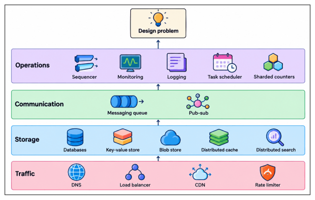

# Introduction_to_Building_Blocks_for_Modern_System_Design

Source: https://www.educative.io/courses/grokking-the-system-design-interview/introduction-to-building-blocks-for-modern-system-design

---

[Home](https://www.educative.io/)

[Courses](https://www.educative.io/search?tab=courses)

[Grokking Modern System Design Interview](https://www.educative.io/courses/grokking-the-system-design-interview)

# Introduction to Building Blocks for Modern System Design

Discover the core building blocks, like load balancers, databases, and messaging queues, that underpin scalable System Design. Learn this bottom-up approach to efficiently reuse components and build complex, reliable distributed systems.

We'll cover the following...

- [The bottom-up approach for modern system design](https://www.educative.io/courses/grokking-the-system-design-interview/introduction-to-building-blocks-for-modern-system-design#The-bottom-up-approach-for-modern-system-design)
- [Conventions](https://www.educative.io/courses/grokking-the-system-design-interview/introduction-to-building-blocks-for-modern-system-design#Conventions)

## The bottom-up approach for modern system design[#](https://www.educative.io/courses/grokking-the-system-design-interview/introduction-to-building-blocks-for-modern-system-design#The-bottom-up-approach-for-modern-system-design)

Most system design problems share common patterns, even though their requirements differ. We group these recurring patterns into core building blocks that we’ll cover in this section. For example, a load balancer is a common building block and appears in most distributed system designs.

The purpose of separating the building blocks is to thoroughly discuss their design in a single discussion. This means we can use them later without having to go over them in detail again. We can think of building blocks as bricks for constructing more effective, capable systems.

Many of the building blocks we discuss are also available for actual use in the public clouds, such as Amazon Web Services (AWS), Azure, and Google Cloud Platform (GCP). We can use such constructs to build a system to further cement our understanding. (We won’t construct the system in this course, but we’ve left it as an exercise for interested learners.)

Design problems are assembled bottom-up from reusable building blocks

We’ll discuss the following building blocks in detail:

1. [**Domain Name System**](https://www.educative.io/courses/grokking-the-system-design-interview/introduction-to-domain-name-system-dns)**:** This building block focuses on how to design hierarchical and distributed naming systems for computers connected to the internet via different internet protocols.

2. [**Load balancers**](https://www.educative.io/courses/grokking-the-system-design-interview/introduction-to-load-balancers)**:**  
   In this section, we’ll examine how a load balancer distributes incoming client requests across a pool of servers. It helps prevent individual servers from becoming overloaded and can route traffic away from failed instances.

3. [**Databases**](https://www.educative.io/courses/grokking-the-system-design-interview/introduction-to-databases)**:** This building block enables us to store, retrieve, modify, and delete data in connection with different data-processing procedures. Here, we’ll discuss database types, replication, partitioning, and analysis of distributed databases.

4. [**Key-value store**](https://www.educative.io/courses/grokking-the-system-design-interview/system-design-the-key-value-store)**:** It is a non-relational database that stores data in the form of a key-value pair. Here, we’ll explain the design of a key-value store, including key concepts such as scalability, durability, and configurability.

5. [**Content delivery network**](https://www.educative.io/courses/grokking-the-system-design-interview/system-design-the-content-delivery-network-cdn)**:** In this chapter, we’ll design a CDN that’s used to keep viral content such as videos, images, audio, and webpages. It efficiently delivers content to end users while reducing latency and burden on the data centers.

6. [**Sequencer**](https://www.educative.io/courses/grokking-the-system-design-interview/system-design-sequencer)**:** In this building block, we’ll focus on the design of a unique IDs generator with a major focus on maintaining causality. It also explains three different methods for generating unique IDs.

7. [**Distributed monitoring**](https://www.educative.io/courses/grokking-the-system-design-interview/system-design-distributed-monitoring)**:** Monitoring systems are critical in distributed systems because they help analyze the system and alert the stakeholders if a problem occurs. Monitoring is often useful for providing early warning systems so that system administrators can act before an impending problem becomes a major issue. Here, we’ll build two monitoring systems: one for server-side errors and the other for client-side errors.

8. [**Distributed caching**](https://www.educative.io/courses/grokking-the-system-design-interview/system-design-the-distributed-cache)**:** In this building block, we’ll design a distributed caching system where multiple cache servers coordinate to store frequently accessed data.

9. [**Distributed messaging queue**](https://www.educative.io/courses/grokking-the-system-design-interview/system-design-the-distributed-messaging-queue)**:** We’ll focus on the design of a queue consisting of multiple servers, which is used between interacting entities called producers and consumers. It helps decouple producers and consumers, results in independent scalability, and enhances reliability.

10. [**Publish/Subscribe system**](https://www.educative.io/courses/grokking-the-system-design-interview/system-design-the-pub-sub-abstraction)**:** We’ll focus on the design of an asynchronous service-to-service communication method called a pub-sub system. It is popular in serverless, microservices architectures and data processing systems.

11. [**Rate limiter**](https://www.educative.io/courses/grokking-the-system-design-interview/system-design-the-rate-limiter)**:** Here, we’ll design a system that throttles incoming requests for a service based on the predefined limit. It is generally used as a defensive layer to prevent services from being used excessively, whether intended or unintended.

12. [**Blob store**](https://www.educative.io/courses/grokking-the-system-design-interview/system-design-a-blob-store)**:** This building block focuses on a storage solution for unstructured data—for example, multimedia files and binary executables.

13. [**Distributed search**](https://www.educative.io/courses/grokking-the-system-design-interview/system-design-the-distributed-search)**:** A search system takes a query from a user and returns relevant content in a few seconds or less. This building block focuses on the three integral components: crawl, index, and search.

14. [**Distributed logging**](https://www.educative.io/courses/grokking-the-system-design-interview/system-design-distributed-logging)**:** Logging is an I/O intensive operation that is time-consuming and slow. Here, we’ll design a system that allows services in a distributed system to log their events efficiently. The system will be made scalable and reliable.

15. [**Distributed task scheduling**](https://www.educative.io/courses/grokking-the-system-design-interview/system-design-the-distributed-task-scheduler)**:** We’ll design a distributed task scheduler system that mediates between tasks and resources. It intelligently allocates resources to tasks to meet task-level and system-level goals. It’s often used to offload background processing for asynchronous completion.

16. [**Sharded counters**](https://www.educative.io/courses/grokking-the-system-design-interview/system-design-the-sharded-counters)**:** This building block demonstrates an efficient distributed counting system to deal with millions of concurrent read/write requests, such as likes on a celebrity’s tweet.

We arranged the building blocks topologically. This ensures that components relying on others appear later in the sequence.

## Conventions[#](https://www.educative.io/courses/grokking-the-system-design-interview/introduction-to-building-blocks-for-modern-system-design#Conventions)

For elaboration, we’ll use a “Requirements” section whenever we design a building block (and a design problem). The section will highlight the deliverables we expect from the developed design. “Requirements” will have two sub-categories:

1. **Functional requirements:** These represent the features a user of the designed system will be able to use. For example, the system will allow a user to search for content using the search bar.
2. **Non-functional requirements (NFRs):** The non-functional requirements are criteria based on which the user of a system will consider the system usable. NFR may include requirements like high availability, low latency, scalability, and so on.

Let’s start with our building blocks.

Examples of Resource Estimation

Introduction to Domain Name System (DNS)

Ask

[The bottom-up approach for modern system design](https://www.educative.io/courses/grokking-the-system-design-interview/introduction-to-building-blocks-for-modern-system-design#The-bottom-up-approach-for-modern-system-design)

[Conventions](https://www.educative.io/courses/grokking-the-system-design-interview/introduction-to-building-blocks-for-modern-system-design#Conventions)