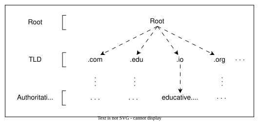
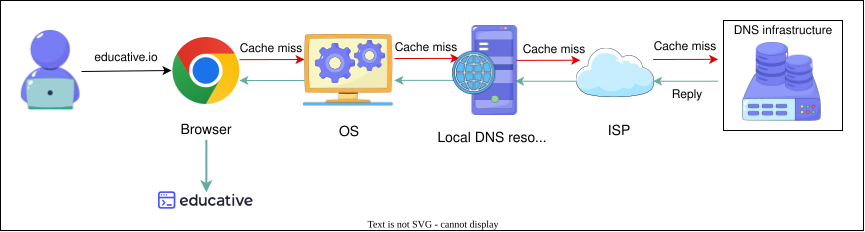
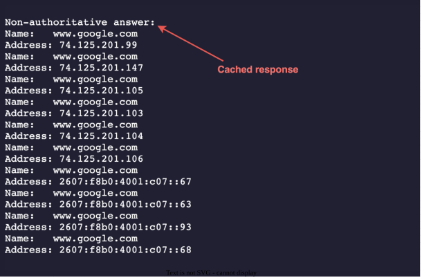
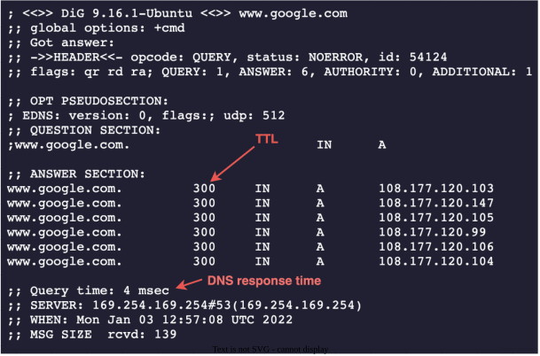

# How_the_Domain_Name_System_Works

Source: https://www.educative.io/courses/grokking-the-system-design-interview/how-the-domain-name-system-works

---

[Home](https://www.educative.io/)

[Courses](https://www.educative.io/search?tab=courses)

[Grokking Modern System Design Interview](https://www.educative.io/courses/grokking-the-system-design-interview)

# How the Domain Name System Works

Learn how the Domain Name System hierarchy works, detailing the roles of resolvers, root, TLD, and authoritative servers. Explore iterative and recursive methods for query resolution. Understand how caching and distributed architecture ensure DNS scalability, reliability, and eventual consistency.

We'll cover the following...

- [DNS hierarchy](https://www.educative.io/courses/grokking-the-system-design-interview/how-the-domain-name-system-works#DNS-hierarchy)
  - [Iterative versus recursive query resolution](https://www.educative.io/courses/grokking-the-system-design-interview/how-the-domain-name-system-works#Iterative-versus-recursive-query-resolution)
    - [How a real lookup works](https://www.educative.io/courses/grokking-the-system-design-interview/how-the-domain-name-system-works#How-a-real-lookup-works)
- [Caching](https://www.educative.io/courses/grokking-the-system-design-interview/how-the-domain-name-system-works#Caching)
- [DNS as a distributed system](https://www.educative.io/courses/grokking-the-system-design-interview/how-the-domain-name-system-works#DNS-as-a-distributed-system)
  - [Highly scalable](https://www.educative.io/courses/grokking-the-system-design-interview/how-the-domain-name-system-works#Highly-scalable)
  - [Reliable](https://www.educative.io/courses/grokking-the-system-design-interview/how-the-domain-name-system-works#Reliable)
  - [Consistent](https://www.educative.io/courses/grokking-the-system-design-interview/how-the-domain-name-system-works#Consistent)
- [Test it out](https://www.educative.io/courses/grokking-the-system-design-interview/how-the-domain-name-system-works#Test-it-out)
  - [The nslookup output](https://www.educative.io/courses/grokking-the-system-design-interview/how-the-domain-name-system-works#The-nslookup-output)
  - [The dig output](https://www.educative.io/courses/grokking-the-system-design-interview/how-the-domain-name-system-works#The-dig-output)

This lesson addresses the following questions:

- How is the DNS hierarchy structured?
- How does caching reduce the load on the DNS infrastructure?
- How does the distributed nature of DNS improve robustness?

## DNS hierarchy[#](https://www.educative.io/courses/grokking-the-system-design-interview/how-the-domain-name-system-works#DNS-hierarchy)

DNS is not a single server. It is a vast infrastructure comprising name servers organized in a hierarchy.

There are four main types of servers in this hierarchy:

1. **DNS resolver:** Initiates the query sequence. Resolvers are typically located within the user’s network (e.g., ISP or local network). They often cache results locally to answer future queries, serving as the default server for users.
2. **Root-level name servers:** The entry point of the hierarchy. These servers direct requests to the appropriate top-level domain (TLD) servers (e.g., `.com`, `.edu`). For example, a request for [educative.io](https://www.educative.io/courses/grokking-the-system-design-interview/how-the-domain-name-system-works) prompts the root server to return a list of `.io` TLD servers.
3. **Top-level domain (TLD) name servers:** These servers maintain the IP addresses of authoritative name servers. They provide the querying party with the location of the organization’s specific servers.
4. **Authoritative name servers:** The final destination. These servers belong to the organization and provide the actual IP addresses for the requested web or application servers.

DNS hierarchy for the resolution of domain/host names

DNS names are processed from right to left, unlike UNIX file paths that go from left to right. For example, when resolving `educative.io`, the resolver first looks up `.io`, then `educative`. Visually, the DNS hierarchy forms a tree structure, starting from the root domain at the top and branching out to subdomains.

### Iterative versus recursive query resolution[#](https://www.educative.io/courses/grokking-the-system-design-interview/how-the-domain-name-system-works#Iterative-versus-recursive-query-resolution)

There are two primary methods for performing a DNS query:

1. **Iterative:** The queried server returns the best answer it has and doesn’t pursue the lookup further. If it isn’t authoritative, it returns a referral (NS records in the authority section, glue A/AAAA in additional), and the querier must send the next query itself.
2. **Recursive:** The queried server takes on full resolution, performs the follow-up queries itself, and returns only the final IP address or an error; never a referral.

The illustration below depicts an iterative resolution from the perspective of the local/ISP server:

Iterative vs. recursive query

#### How a real lookup works[#](https://www.educative.io/courses/grokking-the-system-design-interview/how-the-domain-name-system-works#How-a-real-lookup-works)

The client sends one recursive query to its local resolver. The resolver then performs a series of iterative queries — root → TLD → authoritative, following each referral until the authoritative server returns the answer. The resolver is the only party moving through the hierarchy; servers never forward to one another. Root and TLD only refer because they aren’t authoritative for the target name; the authoritative server returns the actual record.

> **Note:** Iterative queries are typically preferred to reduce the processing load on the central DNS infrastructure.

## Caching[#](https://www.educative.io/courses/grokking-the-system-design-interview/how-the-domain-name-system-works#Caching)

**Caching** is the temporary storage of frequently requested [resource records](https://www.educative.io/answers/what-is-the-difference-between-dns-a-record-and-cname). A **record** maps a name to a value (like an IP address). Caching significantly reduces response latency and network traffic. It is implemented at various levels, including the browser, operating system, local network, and ISP resolvers.

The slideshow below demonstrates the impact of caching on DNS performance:

1 / 7

The user requests to visit a URL, and the browser has cached the domain name to IP address mapping

1 / 7

Here’s what happens if the browser hasn't cached the domain to IP address mapping. The next hierarchy that can have the mapping is the OS

1 / 7

If the OS doesn't have the mapping, the local DNS resolver can have the cached response

1 / 7

If the local DNS resolver doesn't have the mapping, the ISP can have a cached response

1 / 7

Finally, the DNS infrastructure will respond with the IP

> **Note:** Even if a specific domain is not cached, the resolver may still have cached the IP addresses of the TLD or authoritative servers. This allows the resolver to skip the root-level query, speeding up the process.

AI Powered

Saved

1 attempt left

Reset

DNS

Imagine two users enter the same domain name at the exact same time. How does DNS ensure both reach the correct server?

This is your last attempt.

## DNS as a distributed system[#](https://www.educative.io/courses/grokking-the-system-design-interview/how-the-domain-name-system-works#DNS-as-a-distributed-system)

DNS is a distributed system that provides several key advantages:

- **Resilience:** It avoids a single point of failure (SPOF).
- **Low latency:** Users can receive responses from geographically nearby servers.
- **Flexibility:** Traffic can be rerouted during maintenance or server failures, ensuring high availability.

There are 13 logical root name servers (labeled A through M), implemented by many physical instances globally and managed by 12 different organizations.

Let’s examine how DNS achieves scalability, reliability, and consistency.

### Highly scalable[#](https://www.educative.io/courses/grokking-the-system-design-interview/how-the-domain-name-system-works#Highly-scalable)

The hierarchical structure of DNS makes it highly scalable. Roughly 1,000 replicated instances of the 13 root servers are strategically distributed to handle global traffic. The workload is divided: root servers direct traffic, TLD servers filter by domain type, and authoritative servers manage specific records. This division of labor enables the system to efficiently manage immense traffic volumes.

### Reliable[#](https://www.educative.io/courses/grokking-the-system-design-interview/how-the-domain-name-system-works#Reliable)

Three main factors contribute to DNS reliability:

1. **Caching:** Browsers, operating systems, and ISP resolvers maintain caches of frequently visited sites. If a DNS server goes down, cached records can still resolve queries.
2. **Server replication:** DNS servers are replicated globally. This redundancy ensures that if one instance fails, others can handle the load.
3. **Protocol:** DNS primarily uses UDP. UDP is connectionless and fast, reducing latency compared to TCP’s three-way handshake. If a query fails, the client simply retransmits the request, often to a different server, ensuring resilience.

**Note:** DNS relies on UDP for speed and efficiency. However, it switches to TCP when responses exceed 512 bytes or for tasks requiring reliable data transfer, such as zone transfers. Modern clients may also use DNS over HTTPS (DoH) or DNS over TLS (DoT) for enhanced security.

### Consistent[#](https://www.educative.io/courses/grokking-the-system-design-interview/how-the-domain-name-system-works#Consistent)

DNS prioritizes high performance over strong consistency. It employs **eventual consistency**, meaning updates to records propagate lazily across the hierarchy. This propagation can take anywhere from a few seconds to several days, depending on the infrastructure and the specific record.

Caching also impacts consistency. If an organization updates a record on its authoritative server, other resolvers may still serve the old, cached version. To manage this, every record includes a **time-to-live (TTL)**, which dictates when the cache must expire and refresh the data.

## Test it out[#](https://www.educative.io/courses/grokking-the-system-design-interview/how-the-domain-name-system-works#Test-it-out)

Run the following commands in the terminal to observe DNS resolution in action:

1. `nslookup www.google.com`
2. `dig www.google.com`

Terminal 1

Terminal

Loading...

The following slides highlight key aspects of the `nslookup` and `dig` outputs.

1 / 2

The output of nslookup www.google.com

1 / 2

Output of dig www.google.com

Let’s analyze the output:

### The `nslookup` output[#](https://www.educative.io/courses/grokking-the-system-design-interview/how-the-domain-name-system-works#The-nslookup-output)

- **Non-authoritative answer:** This indicates the response came from a cache (such as your ISP or university resolver) rather than directly from Google’s authoritative name servers.
- **IP order:** If you run the command multiple times, the list of IP addresses may change order. This is due to DNS **Round robin**, a technique used to load balance traffic across multiple servers.

### The `dig` output[#](https://www.educative.io/courses/grokking-the-system-design-interview/how-the-domain-name-system-works#The-dig-output)

- **`Query time`****:** The time taken to receive a response from the DNS server.
- **`ANSWER SECTION`** **TTL:** The value `300` represents the Time-To-Live in seconds. This means the resolver will cache this record for 5 minutes (300 sec60\frac{300 \ \text{sec}}{60}60300 sec​) before refreshing it.

> **Note:** Try testing different services to observe their TTL values and query times using the terminal above.

AI Powered

Saved

1 attempt left

Reset

Propose a strategy to minimize DNS disruption

DNS caching improves performance but introduces the risk of stale data. Suppose an organization updates the IP address of its website, but many users still access the old IP due to caching. Propose a strategy to minimize disruption in such scenarios.

This is your last attempt.

Introduction to Domain Name System (DNS)

Introduction to Load Balancers

Ask

[DNS hierarchy](https://www.educative.io/courses/grokking-the-system-design-interview/how-the-domain-name-system-works#DNS-hierarchy)

[Iterative versus recursive query resolution](https://www.educative.io/courses/grokking-the-system-design-interview/how-the-domain-name-system-works#Iterative-versus-recursive-query-resolution)

[How a real lookup works](https://www.educative.io/courses/grokking-the-system-design-interview/how-the-domain-name-system-works#How-a-real-lookup-works)

[Caching](https://www.educative.io/courses/grokking-the-system-design-interview/how-the-domain-name-system-works#Caching)

[DNS as a distributed system](https://www.educative.io/courses/grokking-the-system-design-interview/how-the-domain-name-system-works#DNS-as-a-distributed-system)

[Highly scalable](https://www.educative.io/courses/grokking-the-system-design-interview/how-the-domain-name-system-works#Highly-scalable)

[Reliable](https://www.educative.io/courses/grokking-the-system-design-interview/how-the-domain-name-system-works#Reliable)

[Consistent](https://www.educative.io/courses/grokking-the-system-design-interview/how-the-domain-name-system-works#Consistent)

[Test it out](https://www.educative.io/courses/grokking-the-system-design-interview/how-the-domain-name-system-works#Test-it-out)

[The nslookup output](https://www.educative.io/courses/grokking-the-system-design-interview/how-the-domain-name-system-works#The-nslookup-output)

[The dig output](https://www.educative.io/courses/grokking-the-system-design-interview/how-the-domain-name-system-works#The-dig-output)