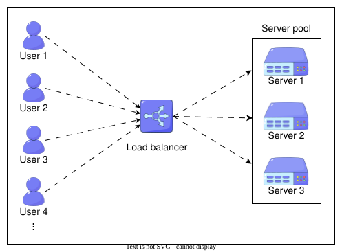

# Introduction_to_Load_Balancers

Source: https://www.educative.io/courses/grokking-the-system-design-interview/introduction-to-load-balancers

---

[Home](https://www.educative.io/)

[Courses](https://www.educative.io/search?tab=courses)

[Grokking Modern System Design Interview](https://www.educative.io/courses/grokking-the-system-design-interview)

# Introduction to Load Balancers

Define load balancers and their essential role in distributing high traffic across servers to prevent overload. Explore why LBs are crucial for achieving scalability, availability, and performance in modern distributed systems. Identify common placement strategies and key services, such as health checking and security.

We'll cover the following...

- [What is load balancing?](https://www.educative.io/courses/grokking-the-system-design-interview/introduction-to-load-balancers#What-is-load-balancing)
  - [Why do we need load balancers?](https://www.educative.io/courses/grokking-the-system-design-interview/introduction-to-load-balancers#Why-do-we-need-load-balancers)
- [Placing load balancers](https://www.educative.io/courses/grokking-the-system-design-interview/introduction-to-load-balancers#Placing-load-balancers)
- [Services offered by load balancers](https://www.educative.io/courses/grokking-the-system-design-interview/introduction-to-load-balancers#Services-offered-by-load-balancers)

## What is load balancing?[#](https://www.educative.io/courses/grokking-the-system-design-interview/introduction-to-load-balancers#What-is-load-balancing)

Typical data centers receive millions of requests per second. To handle this volume, thousands of servers work together to share the load. A **load balancer** (**LB**) distributes incoming client requests across a pool of available servers. Its primary job is to divide traffic fairly to prevent any single server from crashing due to overload.

**Note:** Here, it’s important to consider how incoming requests will be distributed across all available servers.

### Why do we need load balancers?[#](https://www.educative.io/courses/grokking-the-system-design-interview/introduction-to-load-balancers#Why-do-we-need-load-balancers)

The load balancer is the first point of contact inside a data center after the firewall. While low-traffic services may not require one, load balancers provide critical capabilities as traffic increases:

- **Scalability:** You can add servers to increase capacity seamlessly. Load balancers make upscaling or downscaling transparent to end users.
- **Availability:** If a server fails, the system remains online. The load balancer detects faults and reroutes traffic to healthy servers.
- **Performance:** Load balancers can forward requests to servers with the lowest load, improving response times and resource utilization.

Here’s an abstract depiction of how load balancers work:

Simplified working of a load balancer

Load balancers distribute requests using configured algorithms, such as:

- Round robin
- Weighted round robin
- Least response time
- Least connections

LBs ensure reliability by continuously monitoring server health and directing traffic only to servers that can respond efficiently. We will explore these algorithms in the [Advanced Details of Load Balancers](https://www.educative.io/courses/grokking-the-system-design-interview/advanced-details-of-load-balancers) lesson.

## Placing load balancers[#](https://www.educative.io/courses/grokking-the-system-design-interview/introduction-to-load-balancers#Placing-load-balancers)

Load balancers are commonly deployed between clients and backend servers, but they can also operate between internal service layers. In a typical three-tier architecture, load balancers are placed at the following points:

- Between end users and web servers (or the application gateway).
- Between web servers and application servers.
- Between application servers and database servers.

Possible usage of load balancers in a three-tier architecture

In reality, load balancers can be used between any two services with multiple instances.

## Services offered by load balancers[#](https://www.educative.io/courses/grokking-the-system-design-interview/introduction-to-load-balancers#Services-offered-by-load-balancers)

Beyond scalability and availability, load balancers offer several key services:

- **Health checking:** LBs use the heartbeat protocol to monitor the health and reliability of servers.
- **TLS termination****:** LBs handle TLS termination, reducing the processing burden on backend servers.
- **Predictive analytics:** LBs analyze traffic patterns to predict usage trends.
- **Reduced human intervention:** Automated failure handling reduces the need for manual system administration.
- **Service discovery:** LBs route requests to the appropriate hosting servers by querying the service registry.
- **Security:** LBs mitigate attacks like denial-of-service (DoS) at layers 3, 4, and 7 of the OSI model.

Overall, load balancers provide flexibility, reliability, redundancy, and efficiency to the System Design.

In the next lessons, we’ll look at how load balancers operate in complex systems and how to choose the right type for different use cases.

Test your knowledge!  
  
Say “Hi” to Ed (the AI persona) in the widget below to attempt some load balancing scenarios.

AI Powered

Saved

15 attempts left

Reset

Introduction to Load Balancers

Hi, I’m Ed. In this session, we will focus on some questions related to the load balancers. Do you want to be mentored or evaluated?”

You have 15 attempts to answer.

How the Domain Name System Works

Global and Local Load Balancing

Ask

[What is load balancing?](https://www.educative.io/courses/grokking-the-system-design-interview/introduction-to-load-balancers#What-is-load-balancing)

[Why do we need load balancers?](https://www.educative.io/courses/grokking-the-system-design-interview/introduction-to-load-balancers#Why-do-we-need-load-balancers)

[Placing load balancers](https://www.educative.io/courses/grokking-the-system-design-interview/introduction-to-load-balancers#Placing-load-balancers)

[Services offered by load balancers](https://www.educative.io/courses/grokking-the-system-design-interview/introduction-to-load-balancers#Services-offered-by-load-balancers)