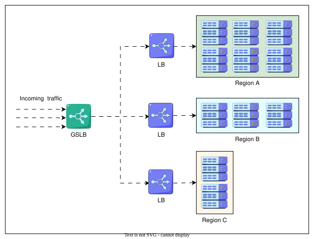
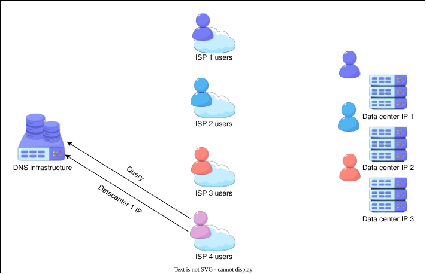
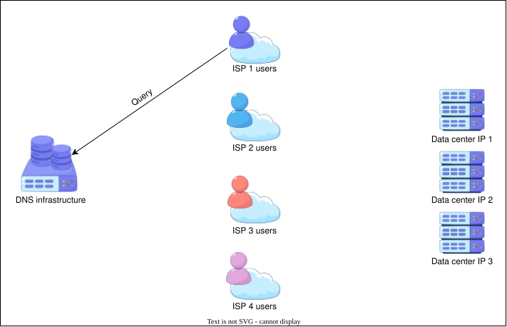
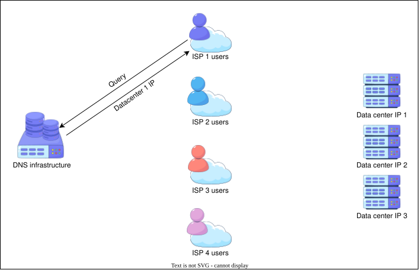
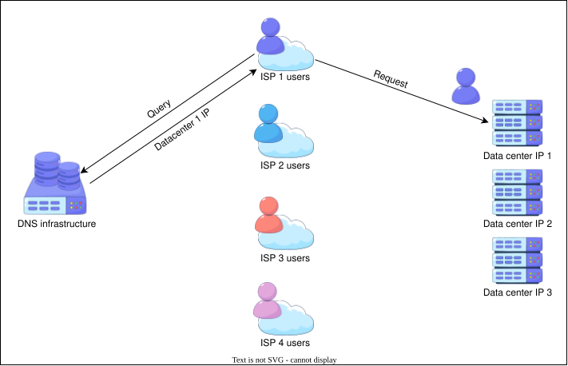
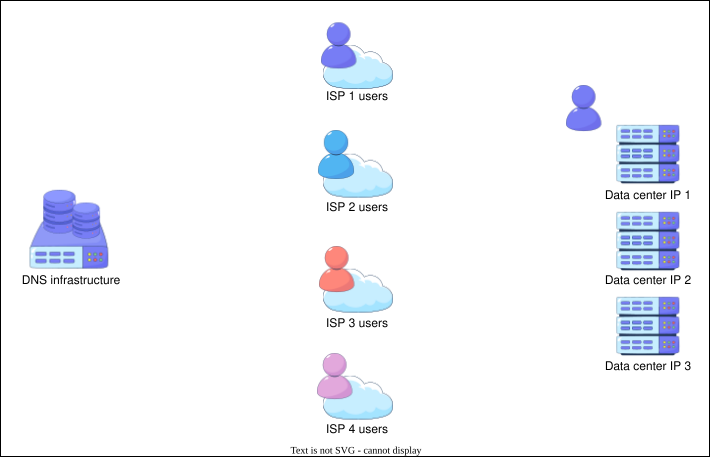

# Global_and_Local_Load_Balancing

Source: https://www.educative.io/courses/grokking-the-system-design-interview/global-and-local-load-balancing

---

[Home](https://www.educative.io/)

[Courses](https://www.educative.io/search?tab=courses)

[Grokking Modern System Design Interview](https://www.educative.io/courses/grokking-the-system-design-interview)

# Global and Local Load Balancing

Explore the critical differences between global server load balancing (GSLB) and local load balancing in distributed System Design. Analyze how DNS round-robin achieves GSLB, noting its limitations in failure recovery and traffic distribution. Understand the necessity of local load balancers for efficient resource utilization in data centers.

We'll cover the following...

- [Introduction](https://www.educative.io/courses/grokking-the-system-design-interview/global-and-local-load-balancing#Introduction)
- [Global server load balancing](https://www.educative.io/courses/grokking-the-system-design-interview/global-and-local-load-balancing#Global-server-load-balancing)
  - [Load balancing in DNS](https://www.educative.io/courses/grokking-the-system-design-interview/global-and-local-load-balancing#Load-balancing-in-DNS)
  - [The need for local load balancers](https://www.educative.io/courses/grokking-the-system-design-interview/global-and-local-load-balancing#The-need-for-local-load-balancers)
- [What is local load balancing?](https://www.educative.io/courses/grokking-the-system-design-interview/global-and-local-load-balancing#What-is-local-load-balancing)

## Introduction[#](https://www.educative.io/courses/grokking-the-system-design-interview/global-and-local-load-balancing#Introduction)

Load balancing operates at two distinct scales: global and local.

- **Global server load balancing (GSLB):** Distributes traffic across multiple geographic regions.
- **Local load balancing:** Distributes traffic within a specific data center to improve resource efficiency and server utilization.

The following sections detail these techniques.

## Global server load balancing[#](https://www.educative.io/courses/grokking-the-system-design-interview/global-and-local-load-balancing#Global-server-load-balancing)

GSLB intelligently forwards global traffic to the optimal data center. Decisions are based on user location, server capacity, and data center health. For example, if a data center experiences a power or network failure, GSLB reroutes traffic to an active location.

GSLB also enables automatic zonal failover. This service can be deployed on-premises or via load balancing as a service (LBaaS).

In a typical setup, GSLB forwards requests to specific data centers. The local load-balancing layer in each data center maintains a control-plane connection to the GSLB, reporting the health of the LBs and the server farm. GSLB uses this monitoring data to drive traffic decisions based on regional configurations.

Usage of global load balancing to send user requests to different regions

The Domain Name System (DNS) is a primary mechanism for performing GSLB.

### Load balancing in DNS[#](https://www.educative.io/courses/grokking-the-system-design-interview/global-and-local-load-balancing#Load-balancing-in-DNS)

DNS can return multiple IP addresses for a single query. As discussed in the [DNS lesson](https://www.educative.io/courses/grokking-the-system-design-interview/introduction-to-domain-name-system-dns), the system distributes load by reordering the list of IP addresses in its response (often visible via `nslookup`). This ensures different users receive different primary servers, effectively distributing requests across data centers. Specifically, DNS often uses a round-robin algorithm to rotate the IP order.

1 / 15

DNS responds with the IP address of data center 1 and does GSLB in round-robin fashion

1 / 15

The user from ISP 1 requests the DNS infrastructure for the IP address of a service

1 / 15

DNS responds with the IP address of data center 1

1 / 15

The user sends a request to data center 1

1 / 15

The user from ISP 1 gets served at data center 1

While DNS round robin forwards clients to data centers in a circular order, it has significant limitations:

- **Uneven load distribution:** ISPs with large user bases may cache a single IP address. This directs all their users to one server, creating imbalances.
- **Lack of failure detection:** The round-robin algorithm does not account for server crashes. It continues distributing the IP of a failed server until the cached entry’s Time-To-Live (TTL) expires, impacting availability.

Despite these limitations, round-robin is widely used. Providers often use short TTL values for cached entries to mitigate these issues and maintain effective load balancing.

> **Note:** DNS is not the only form of GSLB. Application delivery controllers (ADCs) and cloud-based load balancing ([discussed later](https://www.educative.io/courses/grokking-the-system-design-interview/advanced-details-of-load-balancers#Implementation-of-load-balancers)) offer more robust solutions.

AI Powered

Saved

1 attempt left

Reset

Explain anycast in global load balancing.

Anycast is a networking technique where the same IP address is assigned to multiple servers in different locations. Traffic is then routed to the nearest server based on the network's routing table, improving response times. With this in mind, explain the role of anycast in global load balancing and its advantages compared to traditional Global Server Load Balancing (GSLB) mechanisms.

This is your last attempt.

### The need for local load balancers[#](https://www.educative.io/courses/grokking-the-system-design-interview/global-and-local-load-balancing#The-need-for-local-load-balancers)

While DNS aids in global distribution, it is insufficient for granular control due to the following limitations:

- **Packet size:** The 512-byte limit of DNS packets prevents sending a comprehensive list of all server IP addresses.
- **Client behavior:** Clients may randomly select an IP address from the received set, potentially connecting to a busy data center.
- **Proximity:** DNS cannot easily determine the closest address for a client without complex geolocation or Anycast solutions.
- **Slow recovery:** Caching mechanisms and long TTL values delay recovery during failures.

To address these issues, a layer of local load balancing is required.

## What is local load balancing?[#](https://www.educative.io/courses/grokking-the-system-design-interview/global-and-local-load-balancing#What-is-local-load-balancing)

**Local load balancers** reside within a data center and act as a reverse proxy. They distribute incoming requests among a pool of available servers. Clients connect seamlessly to the LB using a virtual IP address (VIP), abstracting the backend infrastructure.

1.

Can DNS be considered a global server load balancer (GSLB)?

Show Answer

Did you find this helpful?

The next lesson explores advanced details of local load balancers.

Introduction to Load Balancers

Advanced Details of Load Balancers

Ask

[Introduction](https://www.educative.io/courses/grokking-the-system-design-interview/global-and-local-load-balancing#Introduction)

[Global server load balancing](https://www.educative.io/courses/grokking-the-system-design-interview/global-and-local-load-balancing#Global-server-load-balancing)

[Load balancing in DNS](https://www.educative.io/courses/grokking-the-system-design-interview/global-and-local-load-balancing#Load-balancing-in-DNS)

[The need for local load balancers](https://www.educative.io/courses/grokking-the-system-design-interview/global-and-local-load-balancing#The-need-for-local-load-balancers)

[What is local load balancing?](https://www.educative.io/courses/grokking-the-system-design-interview/global-and-local-load-balancing#What-is-local-load-balancing)